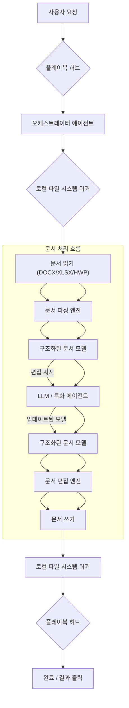

사무용 AI 에이전트 `Acryl`은 HWP, DOCX, XLSX, PPTX 등 로컬 Office 파일을 직접 편집하고 폴더 단위로 문서를 처리하는 혁신적인 기능을 선보였습니다. 이 기능은 기존 `playbook`의 `hub-worker` 자동화가 클라우드 기반 `API` 호출을 넘어 로컬 데스크탑 환경에서 구조화된 문서 편집 및 다중 파일 처리를 수행하도록 확장할 수 있는 중요한 단서를 제공합니다. 본 엔트리는 `Acryl` 사례를 통해 `playbook` 워커에 로컬 파일 시스템 상호작용 및 구조화된 문서 처리 역량을 통합하는 방안을 구체적으로 검토합니다.

## 로컬 파일 시스템 상호작용 워커 정의
`Acryl`의 핵심은 로컬 파일 시스템에 대한 직접적인 접근과 제어입니다. 이는 `playbook` 워커가 클라우드 환경의 제한된 `API` 호출을 넘어 사용자 로컬 환경에서 직접 작업을 수행하도록 확장하는 기반이 됩니다. 새로운 워커는 `virtual file system` 또는 `sandboxed environment`를 통해 안전하게 로컬 자원에 접근하며, `read`, `write`, `delete`, `list_directory`와 같은 기본 파일 시스템 작업을 수행하는 `tool`을 갖춰야 합니다. 보안을 위해 각 워커에 부여되는 `filesystem permissions`는 최소한의 원칙(principle of least privilege)을 따라야 하며, `user consent` 및 `audit log` 메커니즘이 필수적입니다.

```python
import os

class LocalFileSystemWorker:
    def __init__(self, sandbox_path):
        self.sandbox_root = os.path.abspath(sandbox_path) # Absolute path for security
        self.allowed_extensions = {".hwp", ".docx", ".xlsx", ".pptx"}
    
    def _validate_path(self, file_path):
        absolute_path = os.path.abspath(os.path.join(self.sandbox_root, file_path))
        if not absolute_path.startswith(self.sandbox_root):
            raise PermissionError(f"Access outside sandbox is denied for {file_path}.")
        if not any(absolute_path.lower().endswith(ext) for ext in self.allowed_extensions):
            raise ValueError(f"File type for {file_path} is not allowed.")
        return absolute_path

    def read_file(self, file_path):
        path = self._validate_path(file_path)
        with open(path, 'r', encoding='utf-8') as f:
            return f.read()

    def write_file(self, file_path, content):
        path = self._validate_path(file_path)
        with open(path, 'w', encoding='utf-8') as f:
            f.write(content)
        return True
```

## 구조화된 문서 처리 및 편집
`Acryl`이 `표`, `문단`, `셀`을 구분하여 편집하는 능력은 기존 `LLM`의 `raw text` 처리 한계를 넘어섭니다. `playbook` 워커는 `Microsoft Office` (DOCX, XLSX, PPTX) 및 `한글(HWP)` 파일의 내부 구조를 이해하고 조작할 수 있는 `parsing` 및 `editing engine`을 통합해야 합니다. 이를 위해 `Apache POI` (Java), `python-docx`, `openpyxl` (Python), 또는 `한글 OLE` 객체 제어를 위한 라이브러리/`COM` 인터페이스와 같은 도구를 활용하여 문서의 `structural elements`를 추상화하고 `AI agent`가 `semantic editing`을 수행하도록 설계합니다.



## 폴더 단위 태스크 오케스트레이션
`Acryl`의 `폴더째 맡기기` 기능은 `playbook` 워커가 단일 파일이 아닌, 연관된 여러 파일들을 `contextually` 처리할 수 있는 `multi-file processing` 역량을 요구합니다. 이는 `데이터 통합`, `보고서 자동 생성`, `대량 문서 검토`와 같은 복합적인 `workflow`에 필수적입니다. 워커는 특정 폴더 내의 파일 목록을 읽고, 각 파일의 내용을 분석하며, 필요에 따라 `cross-document reasoning`을 수행해야 합니다. `AI agent`는 `metadata` 추출, `content summarization`, `entity recognition` 등을 통해 폴더 내의 정보를 구조화하고, 이를 기반으로 `종합적인 분석` 또는 `새로운 문서 생성`을 지시할 수 있습니다. `Vector Database`를 활용하여 폴더 내 모든 문서의 `embedding`을 저장하고 `semantic search`를 수행하여 `context`를 효율적으로 관리할 수 있습니다.

## 트레이드오프
*   **로컬 파일 시스템 접근**:
    *   **장점**: `SaaS` 솔루션으로 접근 어려운 `로컬 데이터` 및 `특정 포맷` (`HWP`) 처리에 유리하며, `기존 데스크탑 워크플로우`와 연동성이 극대화됩니다.
    *   **단점**: `보안 취약점` 증가, `배포 및 관리 복잡성`, `확장성 제한`, `OS 종속성` 문제가 발생합니다.
*   **구조화된 문서 편집**:
    *   **장점**: `정밀하고 의미론적인 문서 수정`이 가능하여 `템플릿 문서 생성`, `정형 데이터 업데이트`, `보고서 자동화` 등에서 높은 정확도를 제공합니다.
    *   **단점**: `문서 포맷별 복잡한 파싱/편집 엔진` 개발 및 유지보수가 필요하며, `문서 구조 변경`에 취약합니다.
*   **폴더 단위 처리**:
    *   **장점**: `대량의 연관 문서`를 한 번에 처리하여 `정보 취합`, `비교 분석`, `종합 보고서 생성`과 같은 `복합적인 업무` 자동화에 매우 효과적입니다.
    *   **단점**: `처리 데이터 양` 증가에 따른 `리소스 사용량` 급증, `파일 간 의존성` 및 `데이터 일관성` 관리가 어려우며, `디버깅`이 복잡합니다.

## 실전 체크리스트
*   - [ ] 로컬 파일 시스템 접근을 위한 `sandboxing` 및 `권한 관리` 정책을 정의하고 구현했는가?
*   - [ ] 지원 문서 포맷(DOCX, XLSX, HWP 등)별 `파싱 및 편집 라이브러리/API` 통합 계획을 수립했는가?
*   - [ ] 워커가 로컬 파일 시스템에 대한 `읽기/쓰기/삭제` 요청을 `사용자 승인` (User Consent) 메커니즘과 연동시켰는가?
*   - [ ] `폴더 단위 처리` 시, `다중 파일 컨텍스트`를 효율적으로 관리하기 위한 `전략 (예: Vector DB, Semantic Chunking)`을 마련했는가?
*   - [ ] `AI 에이전트`가 구조화된 문서 모델을 이해하고 `의미론적 편집` 지시를 내릴 수 있도록 `프롬프트 엔지니어링` 또는 `스킬셋`을 개발했는가?
*   - [ ] 로컬 파일 작업으로 인한 `성능 병목`을 식별하고 최적화할 수 있는 `모니터링` 및 `로깅` 시스템을 구축했는가?
*   - [ ] `데이터 보안` 및 `개인 정보 보호`를 위해 로컬 파일 처리 워커의 `민감 데이터 접근`을 통제하고 `암호화`를 고려했는가?