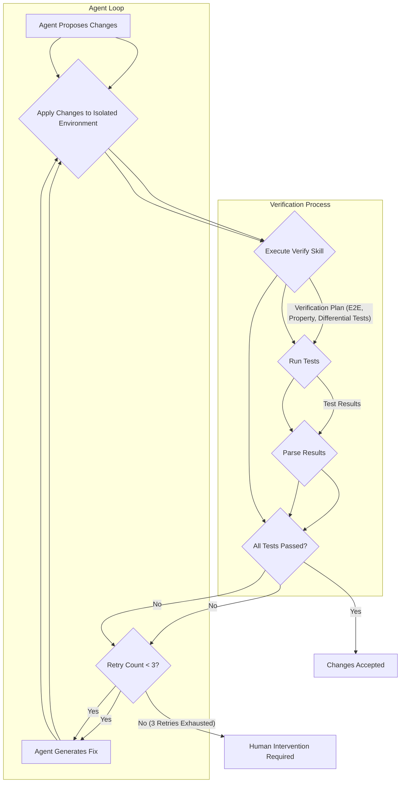

## 에이전트 기반 검증 루프: Claude Code 팀 접근 방식 구현

LLM 기반 에이전트가 코드 생성 및 수정 작업의 90% 이상을 담당하는 시대를 맞이하며, 인간의 직접적인 개입 없이도 시스템의 안정성과 신뢰성을 확보하는 검증 메커니즘은 필수적입니다. Claude Code 팀은 이러한 도전 과제에 대응하여 에이전트가 자체적으로 작업을 실행하고 결과를 검증하는 '에이전트 기반 검증 루프(Agent-Based Verification Loop)'를 구축했습니다.

이 접근 방식은 기존의 단위 테스트를 넘어 실제 사용자 흐름, 핵심 제약 조건, 그리고 기존 시스템과의 동작 비교에 중점을 둔 테스트 전략을 통해 LLM 생성 코드의 품질을 보장합니다.

### Claude Code 팀의 검증 철학

Claude Code 팀의 핵심 아이디어는 코드 변경에 대한 인간의 모든 검토를 제거하고, 대신 에이전트가 실행 결과를 통해 작업의 유효성을 스스로 입증하도록 하는 것입니다. 이를 위해 다음과 같은 세 가지 테스트 유형에 우선적으로 투자합니다.

1.  **E2E (End-to-End) 테스트**: 실제 사용자 시나리오를 시뮬레이션하여 시스템 전체의 통합된 동작을 검증합니다. 이는 단위 테스트만으로는 놓칠 수 있는 통합 문제를 식별하는 데 중요합니다.
2.  **속성 기반 (Property-Based) 테스트**: 코드의 특정 속성이나 불변식(invariants)이 다양한 입력에 대해 항상 유지되는지 확인합니다. 예를 들어, '정렬 함수는 항상 정렬된 리스트를 반환해야 한다'와 같은 속성을 검증합니다.
3.  **차등 (Differential) 테스트**: 변경된 시스템의 동작을 기존의 안정된 시스템의 동작과 비교하여, 의도하지 않은 회귀(regressions)나 기능 변경이 없는지 확인합니다. 이는 특히 LLM이 기존 코드를 리팩토링하거나 마이그레이션할 때 유용합니다.

검증의 중심은 에이전트가 `verify` 스킬을 사용하여 변경한 애플리케이션을 실제로 실행하고, 그 결과를 기반으로 스스로 평가하는 것입니다. 만약 검증에 실패하면, 에이전트는 이를 수정하기 위해 최대 세 차례의 시도를 할 수 있으며, 그 이후에도 문제가 해결되지 않으면 사람에게 작업이 할당됩니다.

### 에이전트 기반 검증 루프 설계

에이전트 기반 검증 루프는 LLM 에이전트가 생성한 출력(코드, 설정, 데이터 등)을 자동으로 평가하고, 필요한 경우 수정 단계를 반복하도록 설계됩니다. 핵심은 에이전트에게 `verify`라는 명확한 목적의 스킬을 부여하고, 이 스킬이 다양한 테스트 전략을 실행할 수 있도록 추상화하는 것입니다.

#### `verify` 스킬의 구현

`verify` 스킬은 내부적으로 테스트 러너(test runner)를 호출하고, 테스트 결과를 파싱하여 에이전트가 이해할 수 있는 형태로 변환합니다. 예를 들어, 코드를 생성한 에이전트는 `verify` 스킬을 사용하여 해당 코드를 빌드하고, 테스트 스위트를 실행하며, 예상되는 E2E 동작을 검증할 수 있습니다.

```python
import subprocess
import json
from typing import Dict, Any, List

class VerificationAgent:
    def __init__(self, llm_client, max_retries: int = 3):
        self.llm_client = llm_client
        self.max_retries = max_retries
        self.current_retry = 0
        self.codebase_path = "./project_codebase" # 예시 코드베이스 경로

    def _execute_tests(self, test_command: List[str]) -> Dict[str, Any]:
        """지정된 명령어를 실행하고 테스트 결과를 반환합니다."""
        try:
            result = subprocess.run(
                test_command,
                capture_output=True,
                text=True,
                check=False, # 명령어가 실패해도 예외 발생 안 함
                cwd=self.codebase_path
            )
            # 실제 테스트 프레임워크의 출력에 따라 파싱 로직 변경 필요
            if "FAIL" in result.stdout or "Error" in result.stderr:
                return {"status": "FAILED", "output": result.stdout + result.stderr}
            return {"status": "PASSED", "output": result.stdout}
        except Exception as e:
            return {"status": "ERROR", "output": str(e)}

    def verify(self, proposed_changes: Dict[str, str], verification_plan: List[Dict[str, Any]]) -> bool:
        """
        제안된 변경 사항을 적용하고, 검증 계획에 따라 테스트를 실행합니다.
        검증 성공 시 True, 실패 및 재시도 횟수 초과 시 False를 반환합니다.
        """
        self.current_retry = 0
        while self.current_retry <= self.max_retries:
            # print(f"Attempt {self.current_retry + 1}/{self.max_retries + 1} to verify changes...")

            # 1. 변경 사항 적용 (예: 파일 쓰기)
            # 실제 구현에서는 Git 작업 트리나 샌드박스 환경에서 이루어져야 합니다.
            for file_path, content in proposed_changes.items():
                full_path = f"{self.codebase_path}/{file_path}"
                # 안전한 샌드박스 환경 내에서만 실행해야 합니다.
                # with open(full_path, "w") as f:
                #     f.write(content)

            all_passed = True
            for step in verification_plan:
                test_type = step.get("type")
                command = step.get("command")

                # print(f"Running {test_type} test with command: `{str.join(' ', command)}`")
                test_result = self._execute_tests(command)

                if test_result["status"] == "FAILED" or test_result["status"] == "ERROR":
                    all_passed = False
                    # print(f"Verification FAILED for {test_type} test: {test_result['output']}")
                    # 에이전트에게 수정 지시 (LLM 호출)
                    feedback_prompt = (
                        f"The following verification step failed:\n"
                        f"Type: {test_type}\n"
                        f"Command: {str.join(' ', command)}\n"
                        f"Output: {test_result['output']}\n"
                        f"Analyze the proposed changes and generate new changes to fix this."
                    )
                    # new_proposed_changes = self.llm_client.generate_fix(proposed_changes, feedback_prompt)
                    # proposed_changes.update(new_proposed_changes) # 새로운 변경 사항으로 업데이트
                    break # 현재 스텝 실패 시 다음 스텝 진행 중단

            if all_passed:
                # print("All verification steps PASSED.")
                return True
            else:
                self.current_retry += 1
                if self.current_retry <= self.max_retries:
                    # print("Verification failed. Retrying...")
                    pass
                else:
                    # print(f"Verification failed after {self.max_retries + 1} attempts. Human intervention required.")
                    return False
        return False
```

#### 검증 루프 워크플로우



이 루프는 에이전트가 문제를 스스로 해결하고 학습하는 기회를 제공하며, 인간 개발자는 더 복잡하거나 예상치 못한 실패 시나리오에 집중할 수 있게 합니다.

### 2026년 LLM 에이전트 검증 트렌드 반영

2026년에는 LLM 기반 에이전트의 자율성이 더욱 강화됨에 따라, 검증 루프는 단순히 버그를 찾는 것을 넘어 **AI 시스템의 안전성, 신뢰성, 그리고 의도 정렬(intent alignment)**을 보장하는 핵심 요소가 될 것입니다.

*   **시프트 레프트(Shift-Left) 테스팅의 강화**: 에이전트가 코드를 생성하는 즉시, 혹은 계획 단계에서부터 검증을 시작하여 개발 초기 단계에서 오류를 발견하고 수정하는 문화가 확산됩니다.
*   **다차원적 검증**: 코드 품질, 성능, 보안 취약점, 리소스 사용량, 규정 준수 등 다양한 측면에서 에이전트가 자동으로 검증하는 능력이 중요해집니다.
*   **설명 가능성(Explainability) 및 디버깅**: 에이전트가 왜 특정 변경을 제안했는지, 어떤 테스트에서 실패했는지, 그리고 어떻게 수정했는지에 대한 명확한 설명을 제공하는 메커니즘이 중요해집니다. 이는 인간 개발자가 에이전트의 행동을 이해하고 신뢰하는 데 필수적입니다.
*   **적응형 검증 규칙**: 검증 규칙 자체가 에이전트에 의해 동적으로 생성되거나 수정될 수 있는 시스템이 등장하여, 변화하는 요구사항과 코드베이스에 민첩하게 대응합니다.

## 트레이드오프

에이전트 기반 검증 루프는 많은 이점을 제공하지만, 고려해야 할 트레이드오프도 존재합니다.

*   **초기 설정 복잡성**: 이 방식은 초기 설정에 상당한 시간과 노력이 필요합니다. `verify` 스킬을 구현하고, 다양한 테스트 유형을 통합하며, 격리된 실행 환경을 구축하는 과정이 복잡할 수 있습니다.
    *   **언제 좋은가**: 장기적으로 대규모 LLM 기반 개발 파이프라인을 구축하고 자동화하려는 경우, 초기 투자 대비 장기적인 효율성이 높습니다.
    *   **언제 나쁜가**: 소규모 프로젝트나 PoC(Proof of Concept) 단계에서는 검증 루프 자체의 구축 비용이 작업량 대비 과도할 수 있습니다.
*   **False Positive / False Negative 리스크**: 에이전트의 테스트 결과 파싱 능력이나 테스트 스위트의 완성도에 따라 잘못된 판단을 내릴 수 있습니다.
    *   **언제 좋은가**: 잘 정의된 테스트 스위트와 명확한 `verify` 스킬 로직을 갖춘 경우, 일관된 결과를 통해 인간의 실수 가능성을 줄입니다.
    *   **언제 나쁜가**: 테스트 커버리지가 불완전하거나, 에이전트의 테스트 결과 파싱 능력이 부족할 경우, 실제 문제가 없는데 실패하거나(False Positive) 문제가 있는데 성공(False Negative)할 수 있습니다. 이는 에이전트의 신뢰도를 저하시킵니다.
*   **디버깅 및 문제 해결**: 에이전트가 실패했을 때, 그 원인을 파악하고 수정하는 과정이 인간 개발자의 직접 디버깅보다 어려울 수 있습니다. 특히 에이전트의 '생각 과정'이 불투명할 때 더욱 그렇습니다.
    *   **언제 좋은가**: 에이전트가 명확한 피드백을 기반으로 반복적인 수정 작업을 수행할 수 있도록 설계된 경우, 개발자는 반복적인 디버깅에서 벗어날 수 있습니다.
    *   **언제 나쁜가**: 에이전트가 무한 루프에 빠지거나, 이해하기 어려운 방식으로 실패할 경우, 사람의 개입과 디버깅이 더 복잡해질 수 있습니다.
*   **샌드박스 환경 및 보안**: 에이전트가 코드를 실행하는 환경은 반드시 격리되어야 합니다. 이는 보안 위협을 줄이지만, 샌드박스 환경 자체의 구축 및 유지보수 비용이 발생합니다.
    *   **언제 좋은가**: 격리된 샌드박스 환경에서 코드를 실행하여 시스템에 대한 잠재적 위협을 방지하고, 안전하게 변경 사항을 테스트할 수 있습니다.
    *   **언제 나쁜가**: 샌드박스 환경을 구축하고 유지하는 데 상당한 오버헤드가 발생하며, 샌드박스 자체의 보안 취약점이 발생할 경우 심각한 위험을 초래할 수 있습니다. LLM이 악성 코드를 생성할 가능성도 항상 염두에 두어야 합니다.
*   **컨텍스트 윈도우 및 비용**: 검증 루프의 각 단계에서 LLM에 제공되는 컨텍스트의 양과 재시도 횟수는 비용에 직접적인 영향을 미칩니다.
    *   **언제 좋은가**: 에이전트가 필요한 코드와 테스트 관련 컨텍스트를 효율적으로 관리하여 LLM 호출 비용을 최적화할 수 있는 경우.
    *   **언제 나쁜가**: 검증 루프 과정에서 LLM에 너무 많은 컨텍스트를 지속적으로 제공해야 하거나, 잦은 재시도로 인해 불필요한 LLM 호출이 발생하면 비용이 급증할 수 있습니다.

## 실전 체크리스트

프로젝트에 에이전트 기반 검증 루프를 적용하기 위한 실전 체크리스트입니다.

*   [ ] **`verify` 스킬 API 정의 및 구현**: 에이전트가 호출할 수 있는 `verify` 함수/메서드의 명확한 인터페이스를 정의하고, 내부적으로 테스트 러너를 실행하는 로직을 구현했습니다.
*   [ ] **E2E, 속성 기반, 차등 테스트 통합**: 현재 프로젝트에 필요한 E2E, 속성 기반, 차등 테스트 시나리오를 식별하고, 이를 `verify` 스킬이 호출할 수 있는 스크립트나 모듈 형태로 통합했습니다.
*   [ ] **격리된 실행 환경 구축**: 에이전트가 생성한 코드를 안전하게 실행하고 테스트할 수 있는 샌드박스(컨테이너, 가상 머신, Git 작업 트리 등) 환경을 구축했습니다.
*   [ ] **재시도 및 인간 개입 로직 구현**: 검증 실패 시 에이전트가 자동으로 수정 시도를 할 횟수(예: 3회)를 정의하고, 이 횟수 초과 시 인간 개발자에게 알림을 보내고 작업을 할당하는 로직을 구현했습니다.
*   [ ] **LLM 피드백 루프 최적화**: 테스트 결과(실패 메시지, 스택 트레이스 등)를 에이전트 LLM에 다시 전달하여, 에이전트가 문제를 진단하고 수정 제안을 생성하는 프롬프트 엔지니어링 전략을 수립했습니다.
*   [ ] **검증 루프 성능 및 비용 모니터링**: 에이전트의 검증 루프 실행 시간, LLM 토큰 사용량, 재시도 횟수 등을 지속적으로 모니터링하고, 비효율적인 부분을 식별하여 최적화할 수 있는 대시보드 또는 알림 시스템을 구축했습니다.
*   [ ] **검증 규칙의 동적 관리 가능성**: 검증 규칙(테스트 스크립트, 단언(assertion) 로직)이 에이전트나 인간에 의해 쉽게 수정, 추가, 삭제될 수 있는 유연한 구조를 설계하여 시스템의 적응성을 높였습니다.