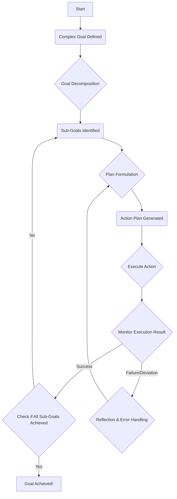

AI 에이전트가 실제 세계의 복잡한 문제를 해결하기 위해서는 단순한 단일 행동을 넘어, 다단계 추론(multi-stage reasoning)과 자율 행동 패턴(autonomous action patterns) 설계가 필수적입니다. 이는 단편적인 작업 처리 능력을 넘어, 고수준의 목표를 달성하기 위한 전략적 계획, 실행, 그리고 지속적인 적응을 가능하게 합니다.

## 다단계 추론의 필요성

현실 세계의 문제는 종종 모호하고, 불확실하며, 예측 불가능한 요소들을 포함합니다. 이러한 환경에서 에이전트가 효과적으로 작동하려면 다음의 능력이 요구됩니다.

*   **복합성 처리 (Complexity Handling)**: 단일 모델이나 프롬프트로는 해결하기 어려운, 여러 상호 의존적인 하위 문제(sub-problems)로 구성된 복합 목표를 처리해야 합니다.
*   **동적 환경 적응 (Dynamic Environment Adaptation)**: 환경의 변화에 따라 계획을 수정하고 새로운 정보에 기반하여 의사결정을 내리는 유연성이 필요합니다.
*   **견고성 및 자율성 (Robustness and Autonomy)**: 예상치 못한 오류나 실패에 직면했을 때 스스로 회복하거나 대안을 찾아 목표 달성을 이어갈 수 있는 자율성이 중요합니다.

다단계 추론은 이러한 요구사항을 충족시키기 위해 목표를 작은 단위의 하위 목표(sub-goals)로 분해하고, 각 단계에서 필요한 정보를 수집 및 분석하며, 최적의 행동을 결정하고 실행하는 순환적인 프로세스를 포함합니다.

### 핵심 설계 원칙

성공적인 다단계 추론 및 자율 행동 에이전트를 설계하기 위한 핵심 원칙은 다음과 같습니다.

1.  **목표 분해 (Goal Decomposition)**: 복잡한 최상위 목표(high-level goal)를 달성 가능한 중간 단계의 하위 목표로 명확하게 분해합니다. 각 하위 목표는 에이전트가 집중할 수 있는 구체적인 문제 정의를 제공합니다.
2.  **계획 및 전략 수립 (Planning and Strategy Formulation)**: 현재 상태와 하위 목표를 기반으로 일련의 행동(actions) 계획을 수립합니다. 이때 다양한 도구(tools)나 스킬(skills)을 활용하여 최적의 경로를 탐색합니다.
3.  **실행 및 모니터링 (Execution and Monitoring)**: 수립된 계획에 따라 행동을 실행하고, 실행 과정에서 발생하는 결과나 환경의 변화를 지속적으로 모니터링합니다.
4.  **반성 및 적응 (Reflection and Adaptation)**: 실행 결과가 예상과 다를 경우, 그 원인을 분석하고 다음 단계의 계획을 수정하거나 새로운 전략을 수립하여 적응합니다. 이는 자기 수정(self-correction) 메커니즘의 핵심입니다.
5.  **지식 축적 및 학습 (Knowledge Accumulation and Learning)**: 각 단계에서의 성공과 실패 경험을 통해 에이전트의 내부 지식 베이스(knowledge base)를 업데이트하고, 향후 유사한 상황에서 더 나은 의사결정을 내릴 수 있도록 학습합니다.

## Agent의 다단계 추론 흐름 (Mermaid Diagram)

아래 Mermaid 다이어그램은 복합 목표 달성을 위한 에이전트의 일반적인 다단계 추론 및 자율 행동 패턴을 시각화합니다.



## 코드 예제: 다단계 에이전트 프레임워크 (Python Pseudocode)

다음은 Python으로 구현된 간단한 다단계 에이전트 프레임워크의 의사 코드(pseudocode)입니다. 각 단계는 명확한 역할을 가지며, 반복적인 피드백 루프를 통해 목표를 달성합니다.

```python
class Agent:
    def __init__(self, name, knowledge_base):
        self.name = name
        self.knowledge_base = knowledge_base
        self.current_goal = None
        self.sub_goals = []
        self.plan = []
        self.tools = self._load_tools()

    def _load_tools(self):
        # 실제 도구 로드 로직 (e.g., API 호출, 데이터베이스 조회, 코드 실행 환경)
        return {"search_web": self._search_web, "execute_code": self._execute_code}

    def _search_web(self, query):
        print(f"Executing web search for: {query}")
        # 실제 웹 검색 API 호출 및 결과 반환
        return "Search result for {query}"

    def _execute_code(self, code):
        print(f"Executing code: {code}")
        # 실제 코드 실행 환경에서 코드 실행 및 결과 반환
        return "Code execution successful"

    def set_goal(self, goal_description):
        self.current_goal = {"description": goal_description, "status": "pending"}
        print(f"Agent '{self.name}' received new goal: {goal_description}")
        self._decompose_goal()

    def _decompose_goal(self):
        # LLM 호출을 통해 복합 목표를 하위 목표로 분해
        # Prompt: "Given the goal '{self.current_goal['description']}', break it down into a list of actionable sub-goals."
        # 예시: "Fetch market data, analyze trends, generate report"
        print(f"Decomposing goal: {self.current_goal['description']}")
        self.sub_goals = [{"description": "Fetch market data", "status": "pending"},
                          {"description": "Analyze trends", "status": "pending"},
                          {"description": "Generate report", "status": "pending"}]
        print(f"Sub-goals: {[sg['description'] for sg in self.sub_goals]}")
        self._plan_next_action()

    def _plan_next_action(self):
        # LLM 호출을 통해 현재 하위 목표를 위한 행동 계획 수립
        # Prompt: "Given sub-goals {self.sub_goals} and current knowledge {self.knowledge_base}, what is the next best action using available tools {list(self.tools.keys())}?"
        next_sub_goal = next((sg for sg in self.sub_goals if sg["status"] == "pending"), None)
        if not next_sub_goal:
            print("All sub-goals completed or no pending sub-goals.")
            return

        print(f"Planning for sub-goal: {next_sub_goal['description']}")
        # 예시: {"action": "search_web", "params": {"query": "current stock market data"}}
        # 실제로는 LLM이 JSON 형태로 반환할 것을 기대
        if next_sub_goal["description"] == "Fetch market data":
            self.plan = [{"tool": "search_web", "params": {"query": "latest market data for XYZ corp"}}]
        elif next_sub_goal["description"] == "Analyze trends":
            self.plan = [{"tool": "execute_code", "params": {"code": "analyze_data(market_data_result)"}}]
        elif next_sub_goal["description"] == "Generate report":
            self.plan = [{"tool": "execute_code", "params": {"code": "generate_report_from_analysis(analysis_result)"}}]
        else:
            self.plan = [] # Fallback or error

        self._execute_plan()

    def _execute_plan(self):
        if not self.plan:
            print("No plan to execute.")
            self._reflect()
            return

        for action_step in self.plan:
            tool_name = action_step["tool"]
            params = action_step["params"]
            if tool_name in self.tools:
                try:
                    result = self.tools[tool_name](**params)
                    self.knowledge_base.add(f"Action '{tool_name}' result: {result}")
                    print(f"Action '{tool_name}' successful. Result: {result[:50]}...")
                except Exception as e:
                    print(f"Error executing tool '{tool_name}': {e}")
                    self._handle_error(e)
                    return # 오류 발생 시 계획 중단 및 반성
            else:
                print(f"Unknown tool: {tool_name}")
                self._handle_error(f"Unknown tool: {tool_name}")
                return

        # 현재 하위 목표 완료 상태로 변경
        next_sub_goal = next((sg for sg in self.sub_goals if sg["status"] == "pending"), None)
        if next_sub_goal:
            next_sub_goal["status"] = "completed"
            print(f"Sub-goal '{next_sub_goal['description']}' completed.")
        self._reflect()

    def _handle_error(self, error):
        print(f"Agent encountered an error: {error}")
        # LLM 호출을 통해 오류 처리 및 새로운 전략 수립
        # Prompt: "An error '{error}' occurred while executing the plan for sub-goal '{next_sub_goal['description']}'. How should I recover or replan?"
        print("Attempting to replan due to error...")
        self._plan_next_action() # 간단하게 다시 계획을 시도

    def _reflect(self):
        # LLM 호출을 통해 실행 결과 및 현재 상태 평가
        # Prompt: "Reflect on the recent actions and current state. What are the next steps? Is the overall goal '{self.current_goal['description']}' progressing well?"
        print("Reflecting on current state and progress...")
        if all(sg["status"] == "completed" for sg in self.sub_goals):
            self.current_goal["status"] = "completed"
            print(f"Overall goal '{self.current_goal['description']}' achieved!")
            return

        self._plan_next_action() # 다음 하위 목표 계획 또는 전체 목표 재조정

# 사용 예시
# my_knowledge_base = [] # 실제로는 벡터 DB 또는 지식 그래프
# agent = Agent("MarketAnalyzer", my_knowledge_base)
# agent.set_goal("Understand current market trends and generate a summary report.")
```

2026년 트렌드를 반영한 에이전트 설계는 단순한 다단계 추론을 넘어, 다음과 같은 요소들을 통합합니다.

*   **전문 모델 통합 (Specialized Model Integration)**: 특정 도메인이나 작업에 최적화된 소형 전문 LLM 또는 ML 모델을 각 하위 단계에 활용하여 효율성과 정확도를 극대화합니다.
*   **지속적인 학습 및 피드백 루프 (Continuous Learning & Feedback Loops)**: 성공 및 실패 사례로부터 배우고, 이를 모델 가중치 업데이트나 행동 정책 개선에 반영하는 메커니즘을 내재화합니다.
*   **인간 개입 지점 (Human-in-the-Loop Checkpoints)**: 복잡하거나 위험도가 높은 의사결정 단계에서는 인간의 검토 및 승인을 요구하는 체크포인트를 두어 안전성과 신뢰성을 확보합니다. 이는 특히 초기 배포 단계나 중요한 비즈니스 프로세스에서 필수적입니다.

## 트레이드오프

복합 목표 달성을 위한 에이전트의 다단계 추론 및 자율 행동 패턴은 강력하지만, 고려해야 할 트레이드오프가 존재합니다.

*   **복잡성 vs. 유연성 (Complexity vs. Flexibility)**
    *   **언제 좋음**: 매우 복잡하고 동적인 환경에서 다양한 변수에 유연하게 대응해야 할 때. 예측 불가능한 상황에서 새로운 전략을 수립해야 할 경우 효과적입니다.
    *   **언제 나쁨**: 단순하고 반복적인 작업에는 과도한 오버헤드를 유발하여 비효율적입니다. 에이전트 시스템 자체의 설계, 디버깅, 유지보수 비용이 증가합니다.
*   **자원 소모 vs. 문제 해결 능력 (Resource Consumption vs. Problem Solving Capability)**
    *   **언제 좋음**: 고도의 지능과 창의적 문제 해결이 요구되는 고가치 작업에 적합합니다. 더 나은 결과와 깊이 있는 분석을 제공할 수 있습니다.
    *   **언제 나쁨**: 각 추론 단계에서 LLM 호출 및 도구 사용이 늘어나면서 연산 자원(GPU/CPU)과 비용 소모가 크게 증가합니다. 실시간 응답이 필수적인 저지연(low-latency) 시스템에는 부적합할 수 있습니다.
*   **실행 지연 vs. 견고성 (Latency vs. Robustness)**
    *   **언제 좋음**: 신중한 추론과 검증을 통해 오류 발생 가능성을 줄이고, 실패 시 복구 메커니즘을 내장하여 시스템의 견고성을 높일 수 있습니다. 중요한 의사결정이 포함된 작업에 유리합니다.
    *   **언제 나쁨**: 다단계 추론 과정에서 각 단계마다 시간이 소요되어 전체 작업 완료까지의 지연(latency)이 길어집니다. 빠른 의사결정이 필요한 미션 크리티컬한 실시간 시스템에는 적용하기 어렵습니다.
*   **예측 가능성 vs. 자율성 (Predictability vs. Autonomy)**
    *   **언제 좋음**: 에이전트가 예상치 못한 상황에서 스스로 판단하고 행동하여 목표를 달성하는 고도의 자율성을 제공합니다.
    *   **언제 나쁨**: 자율성이 높아질수록 에이전트의 행동이 인간의 통제를 벗어나거나, 의도치 않은 결과를 초래할 위험이 있습니다. 행동의 예측 가능성이 낮아져 감사(auditing) 및 규제 준수(compliance)에 어려움을 겪을 수 있습니다.

## 실전 체크리스트

프로젝트에 다단계 추론 및 자율 행동 에이전트 패턴을 적용하기 전에 다음 항목들을 검증해야 합니다.

*   [ ] **명확한 목표 및 하위 목표 정의**: 최상위 목표가 명확히 정의되었으며, 이를 달성하기 위한 모든 필수 하위 목표가 구체적이고 측정 가능하게 분해되었는가? (e.g., "Analyze market trends" -> "Collect 10 relevant news articles", "Extract sentiment scores from articles", "Identify 3 key trend shifts")
*   [ ] **각 추론 단계의 입력/출력 인터페이스 설계**: 각 추론 단계(분해, 계획, 실행, 반성)가 명확한 입력과 출력을 가지며, 다음 단계로의 정보 전달이 효율적이고 견고하게 설계되었는가?
*   [ ] **도구 활용 및 오류 처리 메커니즘**: 에이전트가 활용할 외부 도구(APIs, databases, code interpreters)가 안정적으로 통합되었으며, 도구 사용 중 발생하는 오류에 대한 회복(recovery) 및 재시도(retry) 로직이 충분히 구현되었는가?
*   [ ] **피드백 루프 및 자기 수정 기능**: 에이전트의 행동 결과가 목표 달성에 기여하는지 평가하고, 실패나 편차 발생 시 스스로 계획을 수정하거나 학습할 수 있는 피드백 루프가 설계되었는가?
*   [ ] **성능 및 비용 모니터링 시스템**: 각 추론 단계의 Latency, LLM 토큰 사용량, API 호출 횟수 등 핵심 성능 지표(KPIs)와 비용을 실시간으로 모니터링하고 분석할 수 있는 시스템이 구축되었는가?
*   [ ] **인간 개입 및 승인 워크플로우**: 위험도가 높거나 민감한 작업에 대해 에이전트의 최종 행동 이전에 인간의 검토 및 승인을 받을 수 있는 절차(Human-in-the-Loop)가 마련되었는가?
*   [ ] **지식 베이스(Knowledge Base) 업데이트 전략**: 에이전트가 새로운 정보나 학습된 패턴을 장기 기억(long-term memory)에 효과적으로 통합하고, 이를 다음 추론에 활용할 수 있는 메커니즘이 존재하는가? (e.g., RAG, Knowledge Graph)
