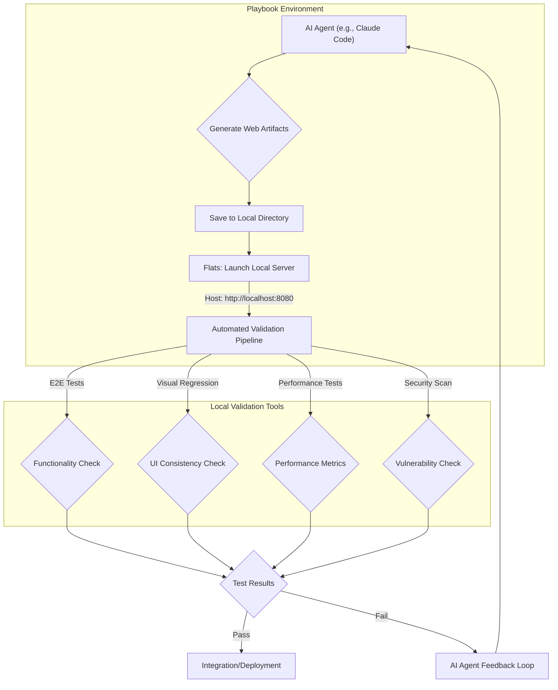

AI 에이전트의 발전은 코드, 웹사이트, 애플리케이션 등 다양한 소프트웨어 아티팩트 생성을 자동화하는 단계에 이르렀습니다. Claude Code, Codex, ChatGPT Sites와 같은 도구들이 이러한 능력을 선보이고 있지만, 생성된 결과물을 신뢰성 있게 검증하고 프로덕션 환경에 통합하는 과정은 여전히 중요한 과제로 남아있습니다. 특히 외부 서비스에 의존하지 않고 에이전트 출력물을 로컬 환경에서 직접 실행 및 검증하는 능력은 개발 워크플로우의 안정성과 효율성을 극대화하는 핵심 요소입니다.

## AI 생성 웹 아티팩트의 로컬 호스팅 필요성

AI 에이전트가 생성한 웹사이트나 앱은 잠재적으로 불안정하거나 예상치 못한 동작을 포함할 수 있습니다. 이러한 아티팩트를 클라우드 환경에 즉시 배포하기 전에 개발자의 로컬 환경에서 충분히 테스트하고 검증하는 과정은 필수적입니다. 로컬 호스팅은 개발자가 직접 코드를 수정하고 디버깅하는 것과 유사한 수준의 제어권을 제공하며, 보안 및 성능 측면에서도 유리합니다. 외부 서비스의 제약 없이 반복적인 테스트와 수정이 가능해 에이전트의 생성 품질을 빠르게 개선할 수 있습니다.

Flats 프로젝트는 이러한 요구사항을 해결하기 위한 오픈소스 솔루션으로 등장했습니다. AI 에이전트가 생성한 웹사이트나 애플리케이션을 사용자의 로컬 컴퓨터에서 쉽게 호스팅하고 실행할 수 있도록 지원하며, 이를 통해 개발자는 AI 생성 결과물의 동작을 즉각적으로 확인하고 피드백 루프를 단축할 수 있습니다.

## Flats 기반 로컬 호스팅 및 검증 파이프라인 통합

Flats를 활용한 검증 파이프라인 통합은 AI 에이전트가 생성한 아티팩트를 `playbook` 환경 내에서 안정적으로 평가하고 배포하는 기반을 마련합니다. 다음은 Flats를 활용한 워크플로우 예시입니다.

### 1. AI 에이전트 아티팩트 생성 및 전달

`playbook` 내 Claude Code 하네스는 웹사이트/앱의 소스 코드를 생성합니다. 이 코드는 일반적으로 HTML, CSS, JavaScript 파일 형태로 구성되며, 특정 디렉토리에 저장됩니다.

### 2. Flats를 이용한 로컬 서버 구동

Flats는 생성된 아티팩트 디렉토리를 지정하여 로컬 웹 서버를 쉽게 구동할 수 있습니다. 예를 들어, `claude-artifacts/my-web-app` 디렉토리에 아티팩트가 있다면, 다음과 같은 간단한 CLI 명령어로 서버를 시작할 수 있습니다.

```bash
# Flats 설치 (예시)
npm install -g flats-cli

# AI 에이전트가 생성한 아티팩트 디렉토리로 이동
cd claude-artifacts/my-web-app

# Flats를 사용하여 로컬 서버 시작
flats serve .
```

이 명령어는 `my-web-app` 디렉토리에 있는 정적 파일을 호스팅하며, 기본적으로 `http://localhost:8080`과 같은 주소로 접근할 수 있게 합니다.

### 3. 자동화된 검증 및 테스트

로컬 서버가 구동되면, 자동화된 테스트 스위트를 통해 에이전트가 생성한 웹사이트의 기능적, 시각적, 성능적 측면을 검증할 수 있습니다. 이는 기존의 CI/CD 파이프라인에 통합되어 에이전트 실행 후 자동으로 트리거될 수 있습니다.

*   **E2E 테스트 (End-to-End Testing)**: Playwright, Cypress와 같은 도구를 사용하여 사용자의 상호작용 흐름을 시뮬레이션하고 웹 애플리케이션의 핵심 기능을 검증합니다.
*   **시각적 회귀 테스트 (Visual Regression Testing)**: Percy, Chromatic 등을 활용하여 AI가 생성한 UI가 예상과 일치하는지, 기존 UI에 의도치 않은 변경이 없는지 픽셀 단위로 비교합니다.
*   **성능 테스트 (Performance Testing)**: Lighthouse, WebPageTest 등을 통해 페이지 로딩 속도, 렌더링 성능, 사용자 경험 지표(Core Web Vitals)를 측정합니다.
*   **보안 스캐닝 (Security Scanning)**: OWASP ZAP, Snyk과 같은 도구를 사용하여 생성된 코드에 잠재적인 보안 취약점이 있는지 스캔합니다.

다음은 Python과 Playwright를 사용한 간단한 E2E 테스트 예시입니다.

```python
# test_my_app.py
from playwright.sync_api import sync_playwright
import pytest
import subprocess
import time

@pytest.fixture(scope="module")
def flats_server():
    # Flats 서버를 백그라운드에서 실행
    process = subprocess.Popen(
        ["flats", "serve", "./claude-artifacts/my-web-app"],
        stdout=subprocess.PIPE,
        stderr=subprocess.PIPE
    )
    time.sleep(3) # 서버가 완전히 시작될 때까지 대기
    yield "http://localhost:8080"
    process.terminate() # 테스트 후 서버 종료

def test_homepage_title(flats_server):
    with sync_playwright() as p:
        browser = p.chromium.launch()
        page = browser.new_page()
        page.goto(flats_server)
        assert "Welcome to My AI App" in page.title()
        browser.close()

def test_button_exists(flats_server):
    with sync_playwright() as p:
        browser = p.chromium.launch()
        page = browser.new_page()
        page.goto(flats_server)
        button = page.locator("button:has-text('Click Me')")
        assert button.is_visible()
        browser.close()
```

이 테스트는 `pytest` 프레임워크와 `Playwright`를 활용하여 Flats로 호스팅된 로컬 웹 애플리케이션의 특정 요소가 올바르게 렌더링되는지 확인합니다. 이러한 테스트 스위트를 `playbook`의 `claude-code-harness` 내에 통합하여 AI 에이전트가 코드를 생성할 때마다 자동으로 실행되도록 구성할 수 있습니다.

### 4. 검증 파이프라인 시각화

Mermaid 다이어그램을 통해 전체 워크플로우를 시각화하면 이해도를 높일 수 있습니다.



이 다이어그램은 AI 에이전트가 아티팩트를 생성하고, Flats를 통해 로컬에서 호스팅되며, 다양한 자동화된 테스트를 거쳐 최종적으로 통합되거나 피드백 루프를 통해 에이전트에게 개선점을 전달하는 과정을 보여줍니다.

## 2026년 트렌드 반영

2026년에는 AI 에이전트의 자율성과 생성 품질이 더욱 향상될 것입니다. 이에 따라 AI 생성 아티팩트의 신뢰성과 보안에 대한 요구사항도 증대됩니다. 로컬 호스팅 및 검증 파이프라인은 이러한 트렌드에 대응하기 위한 핵심 전략입니다.

*   **Agentic Quality Assurance**: AI 에이전트가 스스로 생성물의 품질을 평가하고 개선하는 메타-에이전트(meta-agent) 시스템이 중요해집니다. 로컬 검증 환경은 이러한 자율 품질 보증 메커니즘을 위한 샌드박스를 제공합니다.
*   **Supply Chain Security for AI Artifacts**: AI가 생성한 코드도 소프트웨어 공급망의 일부로 간주됩니다. 로컬에서 철저한 보안 스캔을 수행하여 잠재적 취약점이나 악성 코드 주입을 사전에 차단하는 것이 중요합니다.
*   **Enhanced Developer Experience (DX)**: 개발자는 AI가 생성한 결과물을 마치 자신이 작성한 코드처럼 쉽게 검토, 디버그, 수정할 수 있어야 합니다. Flats와 같은 도구는 이러한 DX를 향상시키며, 에이전트와의 협업을 더욱 효율적으로 만듭니다.

## 트레이드오프

### 1. 초기 설정 복잡성 vs. 장기적 안정성
*   **When Good**: 에이전트가 생성하는 아티팩트의 종류가 다양하거나, 프로덕션 배포 전에 엄격한 품질 검증이 필요한 경우 유리합니다. 초기 설정에 드는 시간과 비용을 상회하는 장기적인 안정성과 신뢰성을 확보할 수 있습니다.
*   **When Bad**: 단순한 프로토타이핑이나 일회성 웹 페이지 생성과 같이 빠른 결과물 확인이 중요한 경우에는 과도한 오버헤드가 될 수 있습니다. 에이전트의 출력이 매우 단순하고 예측 가능한 경우에도 비효율적일 수 있습니다.

### 2. 로컬 리소스 소모 vs. 클라우드 비용 절감
*   **When Good**: 빈번한 테스트 및 검증이 필요하고, 클라우드 기반 CI/CD 환경의 사용 비용이 부담스러운 경우 효과적입니다. 로컬 머신의 유휴 리소스를 활용하여 비용 효율적인 검증 환경을 구축할 수 있습니다.
*   **When Bad**: 로컬 개발 환경의 사양이 낮거나, 여러 에이전트의 출력을 대규모로 병렬 처리해야 하는 경우 로컬 리소스의 한계에 부딪힐 수 있습니다. 대규모 분산 테스트 환경이 필요한 경우에는 클라우드 기반 솔루션이 더 적합합니다.

### 3. 검증 범위의 유연성 vs. 환경 일관성 문제
*   **When Good**: 로컬 환경에서 다양한 테스트 도구와 프레임워크를 자유롭게 통합하여 에이전트 출력에 대한 심층적인 검증(예: 특정 브라우저 버전 테스트)이 가능합니다.
*   **When Bad**: 개발자마다 로컬 환경이 다를 수 있어 `Works on my machine` 문제가 발생할 가능성이 있습니다. 모든 로컬 환경에서 동일한 테스트 결과가 나오도록 환경 일관성을 유지하기 위한 추가적인 노력이 필요합니다.

## 실전 체크리스트

AI 에이전트 생성 웹사이트/앱의 로컬 호스팅 및 검증 파이프라인을 통합할 때 다음 사항들을 점검해야 합니다.

- [ ] **Flats 통합 확인**: AI 에이전트가 생성한 아티팩트를 Flats를 통해 로컬에서 성공적으로 호스팅하고 접근할 수 있는지 확인합니다.
- [ ] **자동화된 E2E 테스트 구성**: Playwright 또는 Cypress와 같은 도구를 사용하여 핵심 사용자 흐름에 대한 E2E 테스트 스위트를 구축하고, Flats 로컬 서버에 대해 실행되도록 구성합니다.
- [ ] **시각적 회귀 테스트 도입**: AI 생성 UI의 시각적 일관성을 보장하기 위해 퍼시(Percy) 또는 크로매틱(Chromatic) 등의 시각적 회귀 테스트를 파이프라인에 통합합니다.
- [ ] **성능 지표 측정 자동화**: Lighthouse 또는 WebPageTest API를 사용하여 로컬에서 호스팅된 웹사이트의 Core Web Vitals 및 기타 성능 지표를 자동으로 측정하고 기준치를 설정합니다.
- [ ] **보안 취약점 스캐닝 연동**: AI가 생성한 코드에 잠재적인 보안 취약점이 있는지 자동으로 스캔하는 도구(예: OWASP ZAP)를 파이프라인에 통합합니다.
- [ ] **테스트 결과 보고 및 피드백 루프**: 모든 테스트 결과를 종합하여 `playbook` 내에서 쉽게 확인할 수 있는 형태로 보고하고, 실패 시 AI 에이전트에게 자동화된 피드백을 제공하는 메커니즘을 마련합니다.
- [ ] **환경 일관성 확보**: Docker 컨테이너 또는 가상 환경을 사용하여 모든 개발자 및 CI 환경에서 동일한 로컬 호스팅 및 테스트 환경이 재현되도록 설정합니다.