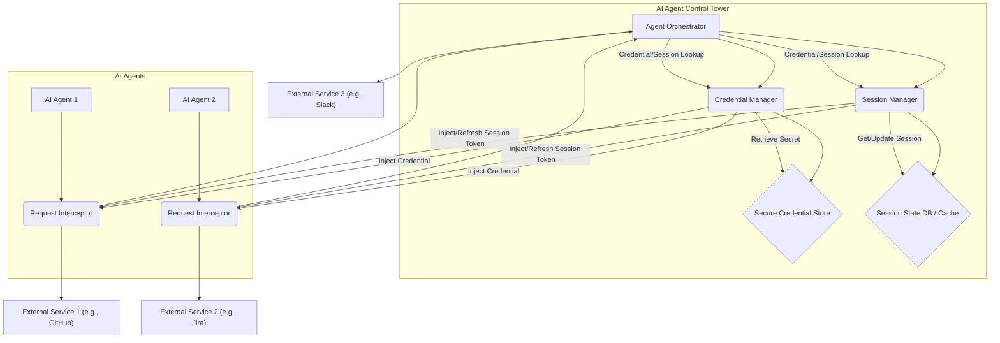

## AI 에이전트 관제탑: 크레덴셜 및 세션 관리 통합

다수의 AI 에이전트가 다양한 외부 서비스와 상호작용하는 복잡한 AI 워크플로우에서, 크레덴셜(Credential) 관리와 세션(Session) 유지는 핵심적인 과제입니다. 로그인 만료, API 키 재발급, 계정 전환 등 수동 개입은 에이전트 오케스트레이션의 효율성과 안정성을 저해하며 보안 위험을 야기합니다. AI 에이전트 관제탑(Control Tower)에 이 기능을 통합하는 것은 에이전트 시스템의 자율성과 신뢰성을 극대화하는 필수 전략입니다.

### 핵심 기능: 자율 에이전트 운영을 위한 기반

AI 에이전트 관제탑은 다수의 AI 에이전트를 모니터링, 스케줄링, 조정하는 중앙 집중식 시스템입니다. 여기에 크레덴셜 및 세션 관리 기능을 통합함으로써 에이전트는 외부 리소스에 안전하게 접근하고, 지속적인 세션을 자동으로 유지할 수 있습니다.

*   **크레덴셜 관리**: API 키, 비밀번호, OAuth 토큰 등 민감한 인증 정보를 중앙에서 안전하게 저장하고 관리합니다. 하드코딩이나 분산 저장으로 인한 보안 위험을 제거하며, 역할 기반 접근 제어(RBAC)를 통해 최소 권한을 보장합니다.
*   **세션 관리**: 에이전트가 외부 서비스와 상호작용하는 세션의 라이프사이클을 추적하고, 만료 시 자동으로 갱신합니다. 장시간 실행되는 작업의 중단을 방지하고 에이전트의 작업 연속성을 보장합니다.

이 통합은 `moneyballscore`나 `blog-autopilot` 워커와 같이 장기간 데이터를 수집하거나 콘텐츠를 생성하는 에이전트 시스템에서 '허브-워커 복리 자동화'의 핵심 기반이 됩니다. 수동 개입 없이 끊김 없는 워크플로우를 구현하여 운영 효율성을 극대화합니다.

### 아키텍처 및 구현 패턴

관제탑 내 크레덴셜/세션 관리 기능은 다음 구성 요소를 포함합니다.
1.  **크레덴셜 저장소**: HashiCorp Vault, AWS Secrets Manager 등 보안 솔루션으로 크레덴셜을 암호화하여 저장합니다.
2.  **세션 관리 모듈**: 세션 상태, 만료 시간, 갱신 로직을 관리합니다. 토큰 캐싱 및 자동 리프레시 메커니즘을 포함합니다.
3.  **접근 제어 정책**: 에이전트별 크레덴셜/세션 접근 권한을 정의하는 정책 엔진입니다.
4.  **인터셉터/프록시**: 에이전트의 외부 호출을 가로채 크레덴셜을 주입하거나 세션을 갱신합니다.

#### Mermaid 다이어그램: 관제탑의 크레덴셜/세션 흐름



이 다이어그램은 에이전트의 외부 서비스 접근 시 관제탑의 크레덴셜/세션 관리 모듈이 어떻게 인증 정보를 확보하고 요청에 주입하는지를 보여줍니다.

#### 코드 예제: 크레덴셜 및 세션 주입 (개념적 Python)

AI 에이전트가 외부 API를 호출하기 전에 관제탑 클라이언트를 통해 크레덴셜과 세션을 가져와 사용하는 개념적인 Python 코드입니다.

```python
class ControlTowerClient:
    def get_credential(self, agent_id: str, service_name: str) -> str:
        # 보안 채널을 통해 크레덴셜 저장소에서 가져옴 (캐싱 및 갱신 로직 포함)
        pass # Placeholder for actual implementation

    def get_session_token(self, agent_id: str, service_name: str) -> str:
        # 세션 만료 확인, 필요시 자동 갱신 로직 포함
        pass # Placeholder for actual implementation

# AI Agent Service Wrapper
class AgentServiceWrapper:
    def __init__(self, agent_id: str, service_name: str, control_tower: ControlTowerClient):
        self.agent_id = agent_id
        self.service_name = service_name;
        self.control_tower = control_tower

    def make_api_call(self, endpoint: str, data: dict = None):
        auth_token = self.control_tower.get_credential(self.agent_id, self.service_name)
        session_token = self.control_tower.get_session_token(self.agent_id, self.service_name)

        headers = {
            "Authorization": f"Bearer {auth_token}",
            "X-Session-Token": session_token,
            "Content-Type": "application/json"
        }
        # 실제 외부 API 호출 로직 (requests.post 등)
        print(f"[{self.agent_id}] Calling {self.service_name}/{endpoint} with tokens...")
        # return requests.post(f"https://api.{self.service_name.lower()}.com/{endpoint}", headers=headers, json=data)
        return {"status": "success", "agent": self.agent_id, "service": self.service_name}
```

이 코드는 `ControlTowerClient`를 통해 에이전트가 크레덴셜과 세션 토큰을 안전하게 요청하고, `AgentServiceWrapper`가 이를 사용하여 외부 API를 호출하는 개념을 보여줍니다. `get_session_token` 메소드는 캐시된 세션의 만료를 확인하고, 만료 시 자동으로 갱신을 요청하는 로직을 포함합니다.

### 2026년 최신 트렌드 반영

2026년 AI 에이전트 관제탑의 크레덴셜/세션 관리는 더욱 고도화될 전망입니다.
*   **Zero-Trust Security**: '절대 신뢰하지 않고 항상 검증한다'는 원칙 적용, 최소 권한 원칙 준수.
*   **분산 식별자(DIDs) 및 Verifiable Credentials(VCs)**: 블록체인 기반 신원 시스템으로 에이전트 신원 증명 및 크레덴셜 관리의 투명성/안전성 강화.
*   **행동 기반 인증**: 에이전트 행동 패턴 분석을 통한 비정상 접근 탐지, 자동 크레덴셜 비활성화/세션 종료.
*   **에이전트별 세분화된 세션 정책**: 역할, 서비스, 작업 중요도에 따른 세션 타임아웃, 갱신 주기 동적 조절.

## 트레이드오프

AI 에이전트 관제탑에 크레덴셜/세션 관리 기능을 통합하는 것은 다음과 같은 트레이드오프를 수반합니다.

*   **초기 복잡성 vs. 장기적 효율성**:
    *   **언제 좋음**: 다수의 에이전트가 복잡한 외부 서비스와 상호작용하며 수동 개입이 잦을 때, 장기적인 운영 효율성 및 비용 절감 효과를 극대화합니다.
    *   **언제 나쁨**: 소규모 에이전트 운영이나 단순한 외부 연동 환경에서는 과도한 초기 투자로 이득이 미미할 수 있습니다.
*   **중앙 집중화된 보안 vs. 단일 실패 지점**:
    *   **언제 좋음**: 크레덴셜 중앙 관리 및 일관된 접근 제어로 전반적인 보안 수준 향상, 감사 용이.
    *   **언제 나쁨**: 관제탑 공격/오작동 시 모든 에이전트 외부 접근 마비 가능성. 고가용성 및 재해 복구 전략 필수.
*   **유연성 제한 vs. 정책 일관성**:
    *   **언제 좋음**: 시스템 전체에 일관된 보안/세션 정책 적용으로 안정성/예측 가능성 증대.
    *   **언제 나쁨**: 에이전트의 특수하거나 유동적인 크레덴셜 요구 사항에 중앙 정책이 유연성을 저해할 수 있음.

## 실전 체크리스트

AI 에이전트 관제탑에 크레덴셜/세션 관리 기능을 도입할 때 다음 항목들을 검증합니다.

*   [ ] **크레덴셜 저장소 보안 검증**: 모든 크레덴셜이 안전하게 암호화되어 관리되고, 최소 권한 원칙을 준수하는지 확인.
*   [ ] **접근 제어 정책 구현 확인**: 각 에이전트가 필요한 외부 서비스 크레덴셜에만 접근하도록 RBAC/ABAC 정책이 명확하게 정의/적용되었는지 검증.
*   [ ] **세션 라이프사이클 관리 자동화 테스트**: 세션 토큰의 발급, 갱신, 폐기가 자동으로 이루어지며, 만료 임박 시 자동 갱신 로직이 견고하게 작동하는지 테스트.
*   [ ] **감사 및 로깅 시스템 구축**: 크레덴셜 접근 및 세션 갱신 활동에 대한 모든 이벤트가 기록되고, 비정상 패턴을 탐지할 수 있는 모니터링 시스템 구축 여부 확인.
*   [ ] **고가용성 및 재해 복구 전략 수립**: 관제탑의 크레덴셜/세션 관리 모듈이 단일 실패 지점이 되지 않도록 다중화 및 백업/복구 전략이 수립되었는지 점검.
*   [ ] **성능 부하 테스트 수행**: 다수의 에이전트가 동시에 크레덴셜/세션을 요청할 때 시스템이 안정적으로 응답하는지, 성능 저하가 없는지 부하 테스트 수행.
*   [ ] **크레덴셜/토큰 순환 정책 자동화**: 보안 강화를 위해 크레덴셜 및 세션 토큰이 주기적으로 자동으로 순환(rotation)되도록 정책 수립 및 메커니즘 구현 여부 확인.