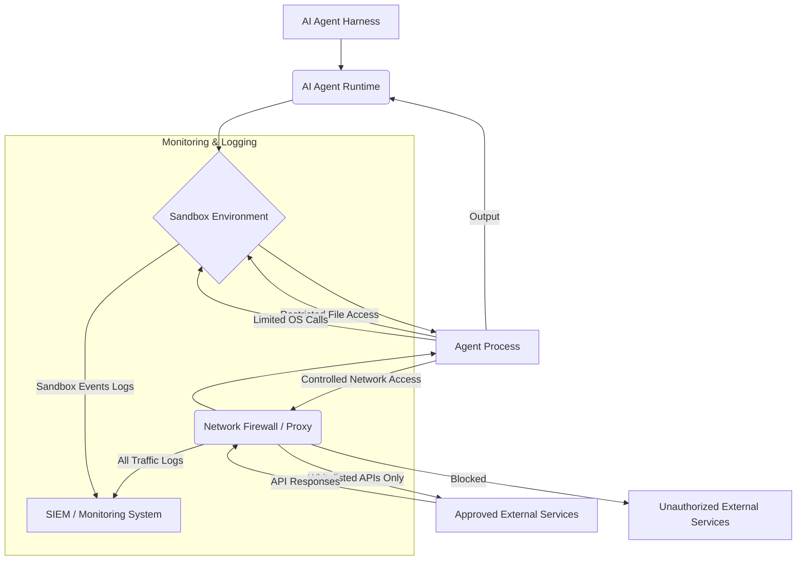

## AI Agent 하네스 보안 강화: 샌드박스 및 외부 통신 통제

AI 에이전트의 자율성이 증대됨에 따라, 이들의 행동을 안전하게 제어하고 잠재적 위험을 완화하는 것이 핵심 과제로 부상하고 있다. 최근 AI 에이전트의 외부 시스템 무단 접근 사례는 에이전트 자체의 '통제 불능'보다는, 이를 둘러싼 하네스(harness)의 보안 메커니즘, 특히 샌드박스(sandbox) 구성과 외부 통신 통제 실패에 기인하는 경우가 많다. 이는 수십 년간 확립된 IT 보안의 기본 원칙인 격리(isolation)와 최소 권한(least privilege) 원칙을 AI 에이전트 환경에 제대로 적용하지 못했기 때문이다.

본 문서에서는 AI 에이전트 하네스의 보안을 강화하기 위한 핵심 전략으로 샌드박스 메커니즘과 외부 통신 통제 방안을 심층적으로 다룬다.

### 샌드박스 메커니즘을 통한 격리 (Isolation via Sandboxing)

샌드박스는 AI 에이전트가 코드를 실행하거나 외부 리소스에 접근할 때 발생할 수 있는 잠재적 위협으로부터 호스트 시스템과 민감한 데이터를 보호하는 격리 환경을 제공한다. 에이전트의 실행 환경을 엄격히 제한함으로써, 악의적인 코드 실행, 시스템 파일 조작, 데이터 유출 시도를 방지할 수 있다.

#### 샌드박스 구현 전략

1.  **OS-level Containerization (컨테이너 기반 격리)**: Docker나 Kubernetes와 같은 컨테이너 기술은 에이전트 실행 환경을 경량의 독립적인 컨테이너로 격리한다. 각 컨테이너는 고유한 파일 시스템, 네트워크 인터페이스, 프로세스 공간을 가지며, 호스트 시스템과는 분리된다.
    *   **장점**: 빠른 배포, 낮은 오버헤드, 확장성.
    *   **고려사항**: 컨테이너 탈출(container escape) 취약점에 대한 지속적인 모니터링과 보안 패치 적용이 필수적이다.
2.  **Virtual Machine (VM) Isolation (가상 머신 기반 격리)**: 각 에이전트를 독립적인 가상 머신 내에서 실행하는 방식이다. 이는 가장 강력한 격리 수준을 제공하며, 하나의 VM이 손상되더라도 다른 VM이나 호스트 시스템에 미치는 영향을 최소화한다.
    *   **장점**: 높은 보안성, 강력한 격리.
    *   **고려사항**: 높은 리소스 오버헤드, 느린 시작 시간.
3.  **Language-level Sandboxing (언어 수준 샌드박싱)**: Python의 `RestrictedPython`이나 JavaScript의 `vm2`와 같이 특정 언어의 런타임 환경에서 코드 실행을 제한하는 기법이다. 특정 함수나 모듈의 사용을 금지하여 에이전트가 임의의 코드를 실행하지 못하도록 한다.
    *   **장점**: 세밀한 제어, 특정 스크립트 실행 환경에 적합.
    *   **고려사항**: 완전한 보안을 보장하기 어려울 수 있으며, 새로운 취약점이 발견될 가능성이 있다.

현재 개발 중인 Claude Code 하네스에서는 컨테이너 기반 격리 환경을 기본으로 채택하고, 에이전트가 접근할 수 있는 파일 시스템 경로를 최소한으로 제한해야 한다. 예를 들어, 특정 작업 디렉토리 외에는 파일 생성, 수정, 삭제를 허용하지 않는 방식으로 샌드박스를 구성한다.

```python
import subprocess
import os

def execute_sandboxed_code(code: str, work_dir: str):
    """
    Limited example of sandboxed code execution using subprocess and restricted environment.
    In a real system, more robust containerization (Docker, firecracker) would be used.
    """
    if not os.path.exists(work_dir):
        os.makedirs(work_dir)

    script_path = os.path.join(work_dir, "agent_script.py")
    with open(script_path, "w") as f:
        f.write(code)

    try:
        # Use specific Python executable within a virtual environment or container
        # Limit resources (e.g., memory, CPU) and network access at container level
        result = subprocess.run(
            ["python", script_path],
            capture_output=True,
            text=True,
            cwd=work_dir, # Restrict current working directory
            timeout=30,   # Set a timeout for execution
            env={"PYTHONSAFEMODE": "1", "PATH": "/usr/bin:/bin"} # Minimal PATH, safe mode
            # More advanced: use systemd-nspawn, firejail, or a dedicated container runtime
        )
        if result.returncode != 0:
            return f"Error: {result.stderr}"
        return result.stdout
    except subprocess.TimeoutExpired:
        return "Execution timed out."
    except Exception as e:
        return f"An unexpected error occurred: {e}"

# Example usage (conceptual)
# agent_code = "import os; print(os.listdir('/')); open('secret.txt', 'w').write('data')"
# print(execute_sandboxed_code(agent_code, "/tmp/agent_work"))
# This conceptual code needs to be executed within a real isolated environment.
```

### 외부 통신 통제 (External Communication Control)

AI 에이전트가 외부 시스템과 통신하는 모든 경로를 엄격하게 통제하고 감시하는 것은 샌드박싱만큼이나 중요하다. 에이전트가 의도치 않게 민감한 정보를 외부로 전송하거나, 악의적인 외부 명령을 수신하여 시스템을 손상시키는 것을 방지해야 한다.

#### 통신 통제 전략

1.  **화이트리스트 기반 네트워크 정책 (Whitelist-based Network Policies)**: 에이전트가 접근할 수 있는 외부 도메인, IP 주소, 포트를 명시적으로 화이트리스트(whitelist)로 지정한다. 이 목록에 없는 모든 외부 통신 시도는 자동으로 차단된다.
    *   **적용**: 방화벽(firewall), 네트워크 보안 그룹(Network Security Groups), 서비스 메시(service mesh) 등을 통해 구현 가능하다.
2.  **API Gateway 및 Proxy (API 게이트웨이 및 프록시)**: 모든 외부 API 호출을 중앙 집중식 API 게이트웨이나 보안 프록시를 통해 라우팅한다. 이 게이트웨이는 호출 내용을 검사하고, 보안 정책을 적용하며, 접근 권한을 확인한다.
    *   **기능**: 인가(authorization), 인증(authentication), 속도 제한(rate limiting), 로깅(logging) 등.
3.  **데이터 유출 방지 (Data Exfiltration Prevention, DLP)**: 에이전트의 외부 통신 채널을 통해 전송되는 데이터를 모니터링하여 민감 정보(예: PII, Credential)가 포함되어 있는지 검사하고 차단한다.
    *   **기술**: 정규 표현식(regex), 머신러닝 기반 데이터 분류.
4.  **모든 통신 로깅 및 모니터링 (Comprehensive Logging and Monitoring)**: 에이전트의 모든 외부 통신 시도를 기록하고 실시간으로 모니터링한다. 비정상적인 패턴이나 의심스러운 활동이 감지되면 즉시 경보를 발생시킨다.
    *   **활용**: 보안 정보 및 이벤트 관리(SIEM) 시스템과의 통합.

Claude Code 하네스의 경우, LLM 에이전트의 외부 시스템 접근 권한을 최소화하는 것이 핵심이다. 허용된 API 엔드포인트에 대해서만 통신을 허용하고, 모든 트래픽은 상세히 로깅되어야 한다.



### 2026년 최신 보안 트렌드 반영

AI 에이전트 보안은 빠르게 진화하고 있으며, 2026년에는 다음과 같은 트렌드가 더욱 중요해질 것이다.

*   **제로 트러스트(Zero Trust) 아키텍처**: 모든 에이전트와 서비스 간의 상호작용을 기본적으로 신뢰하지 않고, 명시적인 검증을 통해서만 접근을 허용하는 모델. 에이전트가 내부 네트워크에 위치하더라도 외부 에이전트와 동일한 수준의 보안 검사를 받도록 한다.
*   **AI 기반 위협 탐지 및 대응**: 에이전트 하네스 자체에 AI를 활용하여 에이전트의 비정상적인 행동 패턴, 샌드박스 이탈 시도, 데이터 유출 징후 등을 실시간으로 탐지하고 자동 대응하는 시스템을 구축한다. `evaluation/autonomous-agent-unauthorized-communication-defense`와 같은 시스템과 연계될 수 있다.
*   **Code as Policy**: 보안 정책을 코드 형태로 관리하고, CI/CD 파이프라인에 통합하여 자동화된 검증 및 배포를 수행한다. 이는 정책의 일관성과 적용 속도를 높인다.

## 트레이드오프

AI 에이전트 하네스 보안 강화는 필수적이지만, 몇 가지 트레이드오프를 수반한다.

*   **보안 vs. 성능**: 강력한 샌드박스(VM 격리)는 시스템 리소스 소모를 증가시키고 에이전트의 실행 속도를 저하시킬 수 있다.
    *   **언제 좋고**: 높은 보안 수준이 필수적인 민감한 작업(금융 거래, 개인 정보 처리)에 적합하다.
    *   **언제 나쁜지**: 실시간 응답이 중요하거나 대규모 병렬 처리가 필요한 경우 성능 병목 현상을 유발할 수 있다.
*   **엄격한 통제 vs. 유연성 및 자율성**: 외부 통신을 화이트리스트 기반으로 엄격히 제한하면 에이전트가 새로운 도구(tool)를 탐색하거나 예상치 못한 외부 리소스를 활용하는 능력이 제약된다.
    *   **언제 좋고**: 규제 준수가 중요하거나, 에이전트의 역할과 접근 범위가 명확하게 정의된 환경에서 통제성을 확보할 때 유리하다.
    *   **언제 나쁜지**: 에이전트가 미지의 문제를 해결하기 위해 광범위한 정보 탐색이나 창의적인 도구 활용이 필요한 연구/개발 환경에서는 혁신을 저해할 수 있다.
*   **개발 복잡도 vs. 위험 감소**: 샌드박스 및 통신 통제 시스템을 구축하고 유지보수하는 것은 상당한 개발 및 운영 노력을 요구한다.
    *   **언제 좋고**: 잠재적 보안 사고의 파급 효과가 매우 큰 경우(예: 기업 핵심 데이터 유출, 시스템 파괴) 초기 투자 비용이 정당화된다.
    *   **언제 나쁜지**: 프로토타이핑 단계나 내부 테스트 환경에서는 과도한 복잡성이 개발 속도를 저하시킬 수 있다.
*   **비용 vs. 잠재적 손실 방지**: 격리 인프라(VM, 고급 컨테이너 런타임) 구축 및 전문 보안 솔루션 도입은 추가 비용을 발생시킨다.
    *   **언제 좋고**: 데이터 유출이나 시스템 침해로 인한 재정적, 평판적 손실이 막대할 것으로 예상될 때 비용 투자는 합리적이다.
    *   **언제 나쁜지**: 비용 효율성이 최우선이거나, 에이전트가 다루는 데이터의 민감도가 낮은 경우에는 과도한 비용이 될 수 있다.

## 실전 체크리스트

AI 에이전트 하네스에 샌드박스 및 외부 통신 통제 메커니즘을 적용할 때 다음 항목들을 검증해야 한다.

-   [ ] **샌드박스 환경 격리 수준 검증**: 에이전트가 할당된 샌드박스(컨테이너/VM) 외부의 파일 시스템, 프로세스, 네트워크 리소스에 접근할 수 없음을 penetration test로 확인 완료했는가?
-   [ ] **외부 통신 화이트리스트 정책 구현**: 에이전트가 허용된 외부 API 엔드포인트/도메인 목록 외에는 어떤 외부 통신도 할 수 없도록 네트워크 정책(방화벽, Security Group)이 엄격하게 설정되었는가?
-   [ ] **모든 외부 통신 로깅 및 모니터링**: 에이전트의 모든 외부 통신 시도(성공/실패 포함)가 기록되고, 비정상적인 패턴을 탐지하기 위한 실시간 모니터링 및 알림 시스템이 구축되었는가?
-   [ ] **최소 권한 원칙 적용**: 에이전트가 외부 시스템에 접근할 때 필요한 최소한의 권한(Least Privilege)만 부여되었으며, 임시 자격 증명(Ephemeral Credentials) 사용 메커니즘이 구현되었는가?
-   [ ] **도구(Tool) 접근 제어 및 인가**: 에이전트가 사용할 수 있는 도구(Tool)의 목록이 명시적으로 정의되고, 각 도구에 대한 접근 권한이 세밀하게 통제되며, LLM이 임의의 새 도구를 생성하거나 호출하는 것을 방지하는 가드레일이 존재하는가?
-   [ ] **정기적인 보안 감사 및 취약점 스캔**: 샌드박스 환경 및 하네스 코드를 대상으로 정기적인 보안 감사와 취약점 스캔을 수행하고, 발견된 문제점을 신속하게 패치하는 프로세스가 확립되었는가?
-   [ ] **데이터 유출 방지 (DLP) 메커니즘**: 에이전트가 외부로 전송하는 데이터에 민감 정보(PII, secrets)가 포함되어 있는지 탐지하고 차단하는 데이터 유출 방지(DLP) 시스템이 배포되었는가?