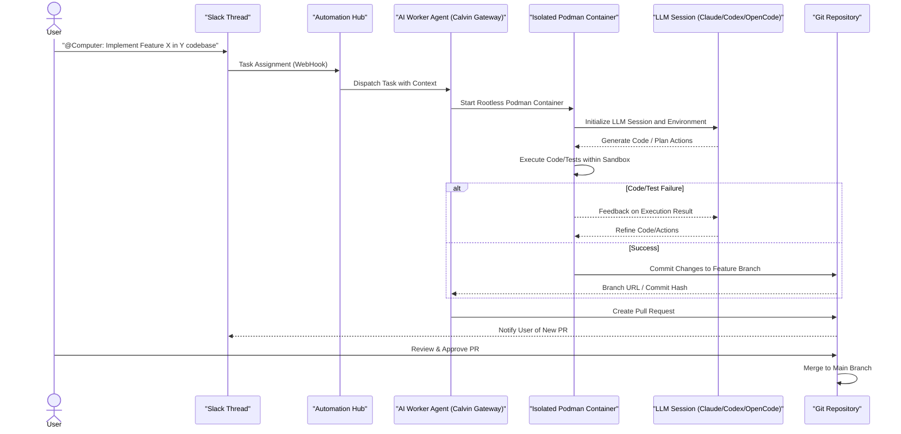

AI 워커 에이전트(AI worker agent)는 복잡한 태스크를 자율적으로 수행하며, 특히 코드 생성과 같은 민감한 작업에 투입될 때 강력한 격리 환경과 자동화된 워크플로가 필수적이다. 최근 OpenComputer와 같은 솔루션은 이러한 요구사항을 충족하며, Devin의 오픈소스 대안으로 주목받고 있다. 본 엔트리는 에이전트의 안정성과 보안을 확보하는 격리 메커니즘과 효율적인 코드 생성 자동화 워크플로 구축 방안을 다룬다.

## AI 워커 에이전트 격리 환경의 필요성

AI 에이전트가 코드를 생성하고 실행하는 과정에서 잠재적인 위험이 발생할 수 있다. 예를 들어, 악성 코드 생성, 무한 루프 실행, 민감한 데이터 유출 등의 문제가 발생할 가능성이 있다. 이를 방지하기 위해 에이전트의 실행 환경을 다른 시스템 리소스와 명확하게 분리하는 격리(isolation) 기술이 중요하다. 격리 환경은 다음과 같은 이점을 제공한다.

### 보안 강화
에이전트가 실행되는 컨테이너(container)나 가상 머신(VM)은 외부 시스템으로부터 완전히 분리되어, 잠재적인 위협이 호스트 시스템으로 전파되는 것을 막는다. 특히, OpenComputer의 rootless Podman과 같은 기술은 루트(root) 권한 없이 컨테이너를 실행하여 보안 침해 시 피해 범위를 최소화한다.

### 안정성 및 재현성 확보
각 에이전트 세션이 독립적인 환경에서 실행되므로, 한 에이전트의 실패가 다른 에이전트나 시스템 전체에 영향을 미치지 않는다. 또한, 동일한 컨테이너 이미지를 사용하여 실행 환경을 표준화함으로써, 코드 생성 및 테스트 과정의 재현성(reproducibility)을 높일 수 있다.

### 자원 관리 효율화
격리된 환경은 CPU, 메모리, 네트워크 등의 자원 할당을 세밀하게 제어할 수 있게 한다. 이는 에이전트가 과도한 자원을 소비하여 시스템 성능을 저하시키는 것을 방지하고, 다수의 에이전트를 동시에 효율적으로 운영할 수 있게 한다.

## 자동화된 코드 생성 워크플로

OpenComputer는 Slack 스레드에서 작업을 지시하면 에이전트가 코딩하고, 그 결과를 Pull Request(PR)로 생성하는 워크플로를 제공한다. 이러한 자동화된 접근 방식은 개발 팀의 생산성을 혁신적으로 향상시킨다.

### 작업 지시 및 컨텍스트 전달
Slack과 같은 협업 도구를 통해 자연어 또는 구조화된 메시지로 에이전트에 작업을 할당한다. 이 과정에서 필요한 코드베이스 컨텍스트, 요구사항, 제약 조건 등이 에이전트에 전달된다.

### 격리된 환경에서의 코드 생성 및 테스트
에이전트는 할당된 작업을 바탕으로 Claude Code, Codex, OpenCode와 같은 LLM 세션을 시작하며, 각 세션은 rootless Podman으로 격리된 컨테이너 내에서 코드를 생성하고 자체적으로 테스트를 수행한다. 이 과정에서 필요한 외부 도구 설치, 의존성 관리 등도 격리 환경 내에서 이루어진다.

### Pull Request 자동 생성 및 피드백 루프
코드 생성 및 테스트가 완료되면, 에이전트는 변경 사항을 포함하는 Pull Request를 자동으로 생성한다. 개발 팀은 이 PR을 검토하고, 필요한 경우 추가적인 피드백을 제공하여 에이전트의 작업을 개선할 수 있다. 이 피드백 루프는 에이전트의 학습 및 개선에 중요한 역할을 한다.

## '허브-워커 복리 자동화' 시스템에 적용 방안

이러한 OpenComputer의 접근 방식은 기존 '허브-워커 복리 자동화' 시스템에 효과적으로 통합될 수 있다. 워커(worker) 에이전트의 실행 환경 안정성과 자동화 수준을 높이는 데 초점을 맞춘다.

### 워커 실행 환경 표준화 및 격리
현재 워커 에이전트가 다양한 환경에서 실행될 수 있다면, rootless Podman과 같은 기술을 활용하여 모든 워커를 표준화된 컨테이너 환경에서 실행하도록 전환한다. 이를 통해 환경 설정의 복잡성을 줄이고, 잠재적인 환경 의존성 문제를 해결할 수 있다. 각 워커는 독립적인 컨테이너에서 동작하며, 필요한 경우 개별적인 리소스 제한을 적용한다.

### 자동화된 PR 워크플로 통합
허브(hub)가 워커에 작업을 할당하고, 워커가 해당 작업을 완료한 후 코드 변경 사항을 자동으로 PR로 생성하는 시스템을 구축한다. 이는 수동 작업을 줄이고, 코드 변경의 추적 가능성과 투명성을 높인다. Slack 통합을 통해 실시간 진행 상황 모니터링 및 개입이 가능하도록 설계한다.

### 워크플로 시각화: AI 워커 코드 생성 프로세스



## 코드 예시: 격리된 환경에서 에이전트 실행 (가상)

아래는 `rootless Podman`을 사용하여 AI 에이전트의 코드 생성 및 테스트 환경을 격리하고 실행하는 과정을 개념적으로 보여주는 스크립트이다. 실제 에이전트 로직은 `agent_script.py` 내부에 구현된다.

```bash
#!/bin/bash

# Define agent execution environment details
AGENT_IMAGE="my-ai-agent:latest"
CONTAINER_NAME="ai-code-worker-${RANDOM}"
CODE_REPO_URL="git@github.com:my-org/my-project.git"
TASK_DESCRIPTION="Implement new user authentication flow"

# 1. Pull the agent image (if not already present)
podman pull $AGENT_IMAGE

# 2. Create a temporary volume for the agent's work directory
# This ensures isolation and easy cleanup
WORK_VOLUME="${CONTAINER_NAME}-data"
podman volume create $WORK_VOLUME

# 3. Run the agent in a rootless Podman container
#    - `--rm`: Automatically remove the container after exit
#    - `--network=none`: Isolate network access (if not needed, or specify specific networks)
#    - `-v ${WORK_VOLUME}:/app/work`: Mount the work volume
#    - `-e TASK="${TASK_DESCRIPTION}"`: Pass task as environment variable
#    - `--security-opt label=disable`: Disable SELinux labeling for rootless Podman if encountering issues
#    - `--memory="2g" --cpus="1.0"`: Limit resources to prevent runaway execution

podman run \
    --rm \
    --network=none \
    -v $WORK_VOLUME:/app/work \
    -e "TASK=${TASK_DESCRIPTION}" \
    --security-opt label=disable \
    --memory="2g" \
    --cpus="1.0" \
    --name $CONTAINER_NAME \
    $AGENT_IMAGE bash -c \
    "git clone ${CODE_REPO_URL} /app/work/project && \
     cd /app/work/project && \
     python3 /app/agent_script.py && \
     git add . && \
     git commit -m \"feat: AI agent implemented new auth flow\" || true && \
     git push origin feature/${CONTAINER_NAME}"

# 4. Clean up the temporary volume
podman volume rm $WORK_VOLUME

echo "AI Worker Agent task completed in container: ${CONTAINER_NAME}"
```

## 트레이드오프

### 1. 컨테이너 기반 격리 (Container-based Isolation)
*   **장점**: 뛰어난 보안성(sandboxing), 환경 일관성, 자원 효율성. 특히 `rootless Podman`은 호스트 시스템에 대한 공격 표면을 줄여 보안 수준을 한 단계 높인다.
*   **단점**: 초기 설정 및 관리 복잡성 증가, 일부 IO 집약적 작업에서 성능 오버헤드 발생 가능성. 컨테이너 이미지 관리에 대한 추가적인 노력이 필요하다.
*   **언제 좋은가**: 보안이 최우선이고, 다양한 에이전트 작업을 안정적으로 병렬 처리해야 하는 경우에 유리하다.
*   **언제 나쁜가**: 개발 초기 단계에서 빠른 프로토타이핑이 필요하거나, 극도로 낮은 지연 시간을 요구하는 작업에는 불필요한 복잡성을 야기할 수 있다.

### 2. 자동화된 Pull Request 생성 (Automated Pull Request Generation)
*   **장점**: 개발 워크플로의 자동화 수준을 극대화하여 인간 개발자의 반복적인 작업을 줄이고, 코드 변경의 이력(history)을 체계적으로 관리할 수 있게 한다. 에이전트의 작업 결과를 신속하게 통합하고 피드백 루프를 단축한다.
*   **단점**: 에이전트가 생성한 코드의 품질 보증(QA)을 위한 추가적인 검토 및 검증 프로세스가 필수적이다. 잘못된 PR은 코드베이스의 품질을 저하시킬 수 있으며, 과도한 PR 생성은 팀의 리뷰 부담을 가중시킨다.
*   **언제 좋은가**: 반복적이고 정형화된 코드 생성 작업(예: 보일러플레이트, 마이그레이션 스크립트, 간단한 버그 수정)에 매우 효과적이다.
*   **언제 나쁜가**: 높은 창의성, 복잡한 설계 판단, 또는 미묘한 비즈니스 로직 이해가 필요한 작업에는 인간의 개입 없이 전적으로 의존하기 어렵다.

### 3. Rootless Podman 도입 (Adoption of Rootless Podman)
*   **장점**: 향상된 보안 모델(루트 권한 없이 컨테이너 실행)로 컨테이너 탈출 공격(container escape attack)의 위험을 크게 감소시킨다. 기존 Docker 환경과의 호환성이 높아 마이그레이션이 용이하다.
*   **단점**: 시스템 설정 및 권한 관리에 대한 이해가 필요하며, 특정 환경에서는 일부 제약(예: 포트 바인딩 제한, 네트워크 구성 복잡성)이 발생할 수 있다. 디버깅이 더 어려울 수 있다.
*   **언제 좋은가**: 다수의 AI 에이전트 워커를 공용 클러스터에서 운영하거나, 개발자의 로컬 환경에서 컨테이너 기반 개발을 안전하게 지원해야 할 때 이상적이다.
*   **언제 나쁜가**: 단일 목적의 전용 서버에서 에이전트를 운영하거나, 컨테이너 환경 관리에 대한 전문성이 부족한 소규모 팀에서는 초기 도입 비용이 높을 수 있다.

## 실전 체크리스트

AI 워커 에이전트 격리 환경 및 자동화된 코드 생성 워크플로를 프로젝트에 적용할 때 다음 항목들을 검증한다.

- [ ] **워커 에이전트 이미지 보안 강화**: 각 워커 에이전트의 컨테이너 이미지가 최소한의 권한(least privilege) 원칙에 따라 빌드되었는지, 불필요한 소프트웨어와 라이브러리가 제거되었는지 확인한다.
- [ ] **자원 할당 및 제한 정책 수립**: 각 에이전트 컨테이너에 CPU, 메모리, 스토리지에 대한 명확한 할당량 및 제한(limits)이 설정되어 있는지 검토하고, 과도한 자원 소비로 인한 서비스 중단을 방지한다.
- [ ] **네트워크 격리 및 접근 제어**: 에이전트 컨테이너가 필요한 외부 리소스(Git 리포지토리, LLM API 등)에만 접근할 수 있도록 네트워크 정책(network policies)이 엄격하게 구성되었는지 확인한다.
- [ ] **자동화된 PR 검증 파이프라인 구축**: 에이전트가 생성한 PR에 대해 정적 코드 분석(static code analysis), 단위/통합 테스트(unit/integration tests), 코드 스타일 검사(linting) 등을 포함하는 CI/CD 파이프라인이 자동 실행되는지 검증한다.
- [ ] **보안 감시 및 로깅 시스템 연동**: 에이전트 컨테이너의 실행 로그, 보안 이벤트, 자원 사용량 등이 중앙 집중식 로깅 및 모니터링 시스템으로 수집되고, 비정상적인 활동에 대한 알림(alert)이 설정되었는지 확인한다.
- [ ] **비상 대책 및 롤백 전략 명확화**: 에이전트의 잘못된 코드 생성 또는 배포로 인해 문제가 발생했을 때, 신속하게 이전 상태로 롤백할 수 있는 절차와 도구가 준비되어 있는지 점검한다.
- [ ] **시크릿(Secret) 및 인증 정보 관리**: 에이전트가 사용하는 API 키, 토큰 등 민감한 정보가 안전하게 관리되고, 컨테이너 환경 내에 직접 하드코딩되지 않고 동적으로 주입되는지 확인한다.
