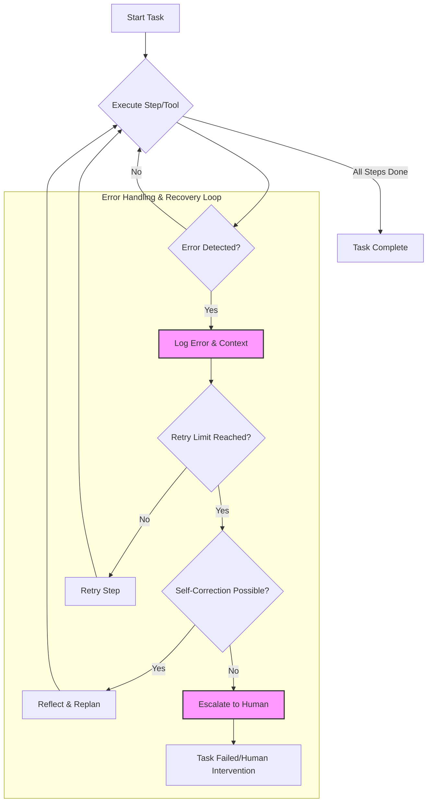

자율 에이전트(Autonomous Agent) 시스템은 복잡한 환경에서 독립적으로 목표를 달성하기 위해 설계됩니다. 그러나 외부 도구(Tool) 사용 실패, LLM(Large Language Model) 환각(Hallucination), 예상치 못한 환경 변화 등 다양한 요인으로 인해 오류(Error)가 발생할 수 있습니다. 이러한 오류를 효과적으로 처리하고 시스템을 복구하는 능력은 에이전트의 신뢰성(Reliability)과 안정성(Stability)을 결정하는 핵심 요소입니다. 2026년 에이전트 기반 시스템이 더욱 고도화됨에 따라, 견고한 오류 처리 및 복구 전략은 단순한 예외 처리(Exception Handling)를 넘어 시스템의 생존성과 지속적인 학습에 필수적입니다.

## 자율 에이전트 오류의 본질

자율 에이전트에서 발생하는 오류는 기존 소프트웨어 시스템의 오류와는 다른 특성을 가집니다. 이는 단순히 코드 버그나 인프라 문제뿐만 아니라, LLM의 비결정성(Non-determinism), 외부 API의 응답 불확실성, 에이전트의 추론(Reasoning) 실패 등 복합적인 원인에서 기인합니다. 특히, 목표(Goal) 지향적인 에이전트의 특성상 하나의 오류가 전체 작업 흐름(Workflow)을 중단시키거나 잘못된 방향으로 이끌 수 있어 전파성(Propagation)이 높습니다.

### 주요 오류 유형

*   **Tool Execution Errors**: 외부 API 호출 실패, 환경 구성 오류, Tool 입력/출력 불일치.
*   **LLM Hallucinations & Misinterpretations**: LLM이 사실과 다른 정보를 생성하거나, Tool 사용 지시를 잘못 이해하는 경우.
*   **Planning & Reasoning Failures**: 에이전트가 주어진 목표를 달성하기 위한 적절한 계획을 수립하지 못하거나, 현재 상태를 잘못 판단하는 경우.
*   **Context Window Overflow**: 너무 많은 정보가 Context Window에 담겨 중요한 정보가 유실되거나 처리되지 않는 경우.
*   **Resource Exhaustion**: 메모리, CPU, 토큰 예산(Token Budget) 등의 자원 고갈.

## 견고한 오류 처리 및 복구 전략

### 1. 예방(Prevention) 및 감지(Detection) 강화

오류 발생 후 복구하는 것보다 사전에 방지하거나 조기에 감지하는 것이 중요합니다.

*   **Pre-flight Checks & Input Validation**: Tool 실행 전 필수 매개변수 유효성 검사, 환경 상태 확인.
*   **Guardrails & Constraints**: LLM 출력에 대한 형식, 내용, 안전성(Safety) 가드레일 적용. 예를 들어, `JSON` 형식 강제, 특정 키워드 필터링.
*   **Comprehensive Monitoring & Observability**: 에이전트의 내부 상태, Tool 호출 결과, LLM 응답, 자원 사용량 등을 실시간으로 모니터링하고 로그(Log)를 통해 가시성(Observability)을 확보합니다. (예: LLM Agent Observability with SpanLens Trace Monitoring)
*   **Anomaly Detection**: 에이전트의 예상치 못한 행동이나 비정상적인 자원 사용 패턴을 감지하여 잠재적 오류를 식별합니다.

### 2. 자동 복구 메커니즘(Automated Recovery Mechanisms)

대부분의 예측 가능한 오류는 에이전트 스스로 복구할 수 있도록 설계해야 합니다.

*   **Retry with Exponential Backoff**: 일시적인 네트워크 오류나 API 과부하 등에 대해 지수 백오프(Exponential Backoff)를 사용하여 재시도합니다.

```python
import time
import random

def call_external_tool(tool_name: str, params: dict, max_retries: int = 3) -> dict:
    for i in range(max_retries):
        try:
            print(f"Attempt {i+1} to call {tool_name} with {params}")
            # Simulate tool call success/failure
            if random.random() < 0.7: # 70% success rate
                return {"status": "success", "data": f"Result from {tool_name}"}
            else:
                raise ConnectionError(f"Failed to connect to {tool_name}")
        except ConnectionError as e:
            print(f"Error calling {tool_name}: {e}")
            if i < max_retries - 1:
                sleep_time = 2 ** i + random.uniform(0, 1) # Exponential backoff with jitter
                print(f"Retrying {tool_name} in {sleep_time:.2f} seconds...")
                time.sleep(sleep_time)
            else:
                print(f"Max retries reached for {tool_name}.")
                return {"status": "failed", "error": str(e)}

    return {"status": "failed", "error": "Unknown error"}

# Example usage
result = call_external_tool("data_api", {"query": "user_data"})
print(result)
```

*   **Self-Correction / Reflection Loops**: 에이전트가 자신의 행동이나 Tool 출력에 오류가 있음을 감지하면, 이를 분석하고 새로운 계획을 수립하여 다시 시도합니다. 이는 LLM의 추론 능력을 활용하여 문제의 근본 원인을 파악하고 해결책을 모색하는 과정입니다. (예: LLM Agent Self-Correction Error Recovery)

*   **State Checkpointing & Rollback**: 에이전트의 작업 흐름 중 중요한 단계마다 현재 상태(State)를 저장합니다. 오류 발생 시, 이전의 안정적인 Checkpoint로 되돌아가 작업을 재개합니다. 이는 장기 실행 작업(Long-running tasks)에 특히 유용합니다.

*   **Fallback Strategies**: 주요 Tool이나 LLM이 실패할 경우, 미리 정의된 대체 Tool, 더 간단한 LLM 모델, 혹은 기본(Default) 동작을 수행하도록 설계합니다. (예: AI Agent Service High Availability Fallback Retry Strategies)

### 3. Human-in-the-Loop (HITL) Intervention

자동 복구 메커니즘으로 해결할 수 없는 복잡하거나 치명적인 오류는 인간의 개입을 요청합니다.

*   **Escalation & Notification**: 특정 유형 또는 심각도(Severity)의 오류 발생 시, 운영자에게 알림을 보내고 자세한 로그와 Context를 제공하여 문제 해결을 돕습니다.
*   **Interactive Debugging**: 인간 운영자가 에이전트의 실행 경로를 확인하고, 특정 단계에서 직접 개입하여 다음 행동을 지시하거나 데이터를 수정할 수 있는 인터페이스를 제공합니다.
*   **Learning from Failures**: 인간이 해결한 오류 사례를 분석하여 에이전트의 오류 처리 로직이나 학습 데이터(Training Data)를 개선하는 데 활용합니다.

### 4. Robust Tool Integration

에이전트가 사용하는 외부 Tool의 신뢰성은 시스템 전체의 안정성에 직결됩니다.

*   **Tool Adapters & Wrappers**: Tool 호출 시 발생할 수 있는 다양한 예외를 표준화된 방식으로 처리하는 어댑터 계층을 구현합니다. 이는 Tool의 비일관적인 응답을 에이전트가 이해할 수 있는 형식으로 변환하는 역할도 합니다.
*   **Idempotency**: Tool 호출이 여러 번 반복되어도 동일한 결과를 보장하도록 설계하여 재시도로 인한 부작용을 최소화합니다.

## 에이전트 오류 처리 흐름 (Mermaid Diagram)



## 트레이드오프 (Trade-offs)

### 1. 공격적인 재시도(Aggressive Retries)
*   **언제 좋은가**: 일시적인 네트워크 불안정, API 레이트 리밋(Rate Limit) 등 예측 가능한 Transient Error에 효과적입니다. 시스템의 탄력성(Resilience)을 높여줍니다.
*   **언제 나쁜가**: 근본적인 오류(예: 잘못된 Tool 입력 스키마, 영구적인 API 인증 실패)에 대해서는 자원(토큰, 컴퓨팅 파워)을 낭비하고 작업 완료 시간을 지연시킬 뿐입니다. 무한 루프에 빠질 위험도 있습니다.

### 2. Human-in-the-Loop (HITL) 개입
*   **언제 좋은가**: 복잡하고 예측 불가능한 오류, 비즈니스에 치명적인 영향을 줄 수 있는 Critical Task에서 높은 신뢰성과 정확성을 보장합니다. 에이전트 학습 데이터(Training Data)를 개선하는 데 기여합니다.
*   **언제 나쁜가**: 오류 발생 빈도가 높을 경우 인간 운영자의 병목 현상(Bottleneck)이 되며, 실시간 자동화의 이점을 상쇄시킵니다. 인건비 상승 및 시스템 확장성(Scalability) 저하의 원인이 될 수 있습니다.

### 3. 심층적인 Self-Correction/Reflection
*   **언제 좋은가**: LLM의 추론 능력을 활용하여 복합적인 오류의 원인을 분석하고, 새로운 접근 방식을 탐색하여 문제 해결 가능성을 높입니다. 예상치 못한 상황에 대한 적응력(Adaptability)을 제공합니다.
*   **언제 나쁜가**: Self-Correction 과정 자체가 추가적인 LLM 호출을 유발하여 토큰 사용량과 Latency를 증가시킵니다. 잘못된 Reflection은 에이전트가 오류 루프(Error Loop)에 갇히게 하거나, 비효율적인 해결책을 반복하게 할 수 있습니다.

### 4. 상태 Checkpointing 및 Rollback
*   **언제 좋은가**: 장기 실행 작업이나 여러 단계를 거치는 복잡한 Workflow에서 데이터 일관성(Data Consistency)을 보장하고, 오류 발생 시 전체 작업을 처음부터 다시 시작할 필요 없이 이전 안정 상태에서 재개할 수 있게 합니다.
*   **언제 나쁜가**: Checkpoint 저장 및 복원 로직 구현에 복잡성이 추가되며, 저장 주기가 너무 짧으면 저장 오버헤드가 커져 전체 시스템 성능에 영향을 줄 수 있습니다. Rollback 시점 이후의 모든 작업이 무효화될 수 있습니다.

### 5. Tool Adapters & Wrappers 사용
*   **언제 좋은가**: 다양한 외부 Tool의 인터페이스를 표준화하고, Tool별 특이한 오류 패턴을 일관성 있게 처리할 수 있도록 캡슐화(Encapsulation)하여 에이전트 로직의 복잡성을 줄입니다. Tool의 교체나 업데이트에 유연하게 대응할 수 있습니다.
*   **언제 나쁜가**: 모든 Tool에 대해 Adapter를 구현하는 초기 개발 비용이 발생하며, Adapter 계층이 너무 비대해지면 성능 저하를 야기할 수 있습니다. Adapter 자체의 오류는 디버깅을 어렵게 만들 수 있습니다.

## 실전 체크리스트

자율 에이전트의 오류 처리 및 복구 방법을 프로젝트에 적용할 때 다음 항목들을 검증합니다:

- [ ] **오류 유형 정의 및 우선순위 설정**: 시스템에서 발생 가능한 주요 오류 유형을 정의하고, 각 오류의 비즈니스 영향도에 따라 심각도와 우선순위를 명확히 설정했는지 확인합니다.
- [ ] **종합적인 모니터링 및 로깅 구현**: 에이전트의 모든 Tool 호출, LLM 상호작용, 내부 상태 변경 및 예외 발생을 추적할 수 있는 상세 로깅 및 실시간 모니터링 시스템이 구축되었는지 확인합니다.
- [ ] **탄력적인 재시도 정책 설계**: 각 Tool 및 외부 API 호출에 대해, 오류 유형별로 적절한 재시도 횟수, 지수 백오프, 지터(Jitter) 등의 재시도 정책이 명확히 정의되고 구현되었는지 검증합니다.
- [ ] **Self-Correction/Reflection 메커니즘 통합**: LLM의 추론 능력을 활용하여 Tool 실패나 비정상적인 응답에 대해 에이전트 스스로 문제 해결을 시도하는 Self-Correction 루프가 설계 및 테스트되었는지 확인합니다.
- [ ] **Human-in-the-Loop (HITL) 워크플로우 명확화**: 자동 복구가 불가능한 치명적인 오류에 대해 인간 운영자에게 알림을 보내고, 문제 해결을 위한 정보와 개입 인터페이스를 제공하는 Human Escalation 워크플로우가 정의되었는지 확인합니다.
- [ ] **상태 Checkpointing 및 Rollback 전략 수립**: 장기 실행 작업에서 오류 발생 시 데이터 손실을 방지하고 복원력을 높이기 위한 Checkpoint 저장 시점, 빈도 및 Rollback 메커니즘이 설계되었는지 검증합니다.
- [ ] **오류 처리 로직 테스트 및 검증**: 다양한 오류 시나리오(예: 네트워크 단절, API 응답 지연, LLM 환각, 잘못된 Tool 스키마)에 대해 오류 처리 및 복구 로직이 예상대로 동작하는지 End-to-End 테스트를 정기적으로 수행하는지 확인합니다.