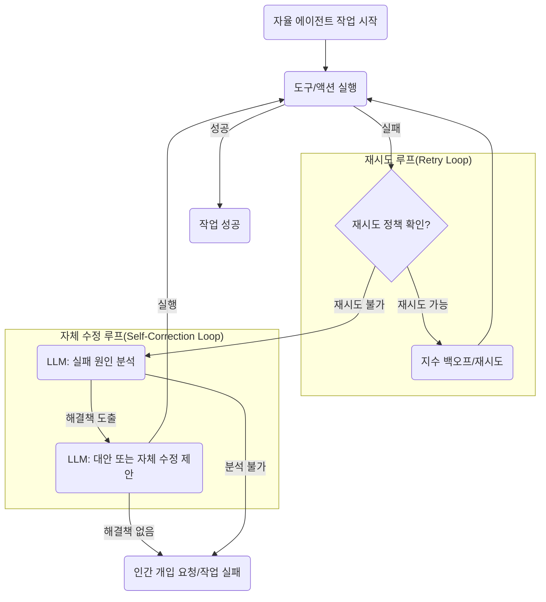

자율 에이전트(Autonomous Agents)는 복잡한 태스크를 인간의 직접적인 개입 없이 수행하며, 그 과정에서 다양한 실패 상황에 직면할 수 있습니다. 시스템 오류, 외부 API 호출 실패, 예측 불가능한 환경 변화, 또는 LLM(Large Language Model)의 추론 오류 등이 그 예입니다. 이러한 실패를 효과적으로 감지하고 복구하며 재시도하는 로직을 설계하는 것은 에이전트의 신뢰성(Reliability)과 안정성(Stability)을 확보하여 실무 적용 가능성을 확대하는 핵심 요소입니다.

## 자율 에이전트 실패의 특성

전통적인 소프트웨어 시스템의 실패와 달리, 자율 에이전트의 실패는 다음과 같은 복합적인 특성을 가집니다.

*   **불확실성(Uncertainty)**: LLM의 비결정적(Non-deterministic) 특성으로 인해 동일한 입력에 대해서도 다른 실패 양상을 보일 수 있습니다.
*   **다계층성(Multi-layered)**: 도구 사용(Tool Use) 계층, 계획(Planning) 계층, 추론(Reasoning) 계층 등 여러 계층에서 실패가 발생할 수 있습니다.
*   **장기적인 영향(Long-term Impact)**: 초기 단계의 사소한 실패가 누적되어 전체 태스크의 방향을 완전히 틀거나 치명적인 결과를 초래할 수 있습니다.

## 실패 복구 및 재시도 로직 설계 원칙

강력한 실패 복구 로직을 설계하기 위한 주요 원칙은 다음과 같습니다.

1.  **가시성(Visibility)**: 실패 발생 시, 실패 지점, 원인, 그리고 에이전트의 내부 상태를 명확히 파악할 수 있어야 합니다. 정교한 로깅(Logging)과 모니터링(Monitoring)이 필수적입니다.
2.  **점진적 복구(Gradual Recovery)**: 작은 실패에는 가벼운 재시도 로직을 적용하고, 해결되지 않을 경우 점진적으로 더 복잡한 자체 수정 또는 인간 개입 단계를 거치도록 설계합니다.
3.  **컨텍스트 인지(Context-Awareness)**: 실패 시 단순히 재시도하는 것을 넘어, 현재까지의 작업 컨텍스트와 실패 원인을 종합적으로 고려하여 가장 적절한 복구 전략을 선택해야 합니다.
4.  **안전성(Safety)**: 복구 및 재시도 로직이 오히려 더 큰 문제를 야기하지 않도록 안전 장치(Guardrails)를 마련해야 합니다. 무한 루프, 자원 고갈, 비정상적인 상태 전이 등을 방지해야 합니다.

## 핵심 실패 복구 및 재시도 전략

### 1. 지수 백오프와 지터(Exponential Backoff with Jitter)

가장 기본적인 재시도 전략입니다. 실패 시 재시도 간격을 점진적으로 늘려 백엔드 시스템에 과부하를 주지 않고 일시적인 오류에서 회복할 시간을 줍니다. `Jitter`를 추가하여 여러 에이전트가 동시에 재시도하여 또 다른 병목 현상을 일으키는 것을 방지합니다.

```python
import time
import random

def retry_with_backoff(func, max_retries=5, initial_delay=1, jitter_factor=0.1):
    for i in range(max_retries):
        try:
            return func()
        except Exception as e:
            print(f"Action failed (attempt {i + 1}/{max_retries}): {e}")
            if i == max_retries - 1:
                raise
            delay = initial_delay * (2 ** i) # Exponential backoff
            delay = delay * (1 + random.uniform(-jitter_factor, jitter_factor)) # Add jitter
            time.sleep(delay)

def agent_action():
    # Simulate an action that might fail
    if random.random() < 0.6: # 60% chance of failure
        raise ValueError("Simulated external API error")
    return "Action completed successfully"

# Usage example
try:
    result = retry_with_backoff(agent_action)
    print(result)
except Exception as e:
    print(f"Task ultimately failed: {e}")
```

### 2. 컨텍스트 기반 자체 수정(Contextual Self-Correction)

LLM의 추론 능력을 활용하여 실패 원인을 분석하고 스스로 해결책을 찾아 다시 시도하는 방식입니다. 에이전트가 현재까지의 `Task Context`, `Error Log`, `Previous Actions`를 `Prompt`로 받아 실패 원인을 진단하고 다음 액션을 계획하도록 합니다. 이는 특히 LLM 자체의 추론 오류나 잘못된 도구 사용에서 효과적입니다.

### 3. 회로 차단기 패턴(Circuit Breaker Pattern)

특정 도구나 서비스에 반복적인 실패가 발생할 경우, 해당 도구로의 요청을 일시적으로 중단(Open)하여 시스템 자원을 보호하고 실패한 도구에 회복할 시간을 줍니다. 일정 시간 후 다시 시도(Half-Open)하여 정상화 여부를 확인합니다.

### 4. 인간 개입(Human-in-the-Loop) 및 에스컬레이션

에이전트 스스로 해결할 수 없는 치명적인 실패나 반복되는 실패에 대해서는 인간 운영자에게 알림을 보내고, 필요한 정보를 제공하여 개입을 요청합니다. 이 과정에서 에이전트는 `Diagnostic Information`을 잘 정리하여 제공해야 합니다.

## 실패 복구 흐름도



## 트레이드오프

### 1. 단순 재시도 vs. 컨텍스트 인지 복구
*   **언제 좋은가 (When Good)**: 단순 재시도는 일시적인 네트워크 문제, 리소스 부족 등 `Transient Failures`에 빠르고 비용 효율적으로 대응할 수 있습니다. 구현이 간단합니다.
*   **언제 나쁜가 (When Bad)**: 근본적인 `Logic Error`나 `Semantic Error`에는 효과가 없으며, 무의미한 재시도로 `Computational Cost`만 증가시키고 `Response Time`을 지연시킬 수 있습니다.

### 2. 적극적 자체 수정 vs. 빠른 인간 개입
*   **언제 좋은가 (When Good)**: 적극적인 자체 수정은 에이전트의 `Autonomy`를 극대화하고, 인간 운영자의 `Cognitive Load`를 줄여 `Scalability`를 높입니다. 특히 `Well-defined Failure Modes`에 유용합니다.
*   **언제 나쁜가 (When Bad)**: 자체 수정 로직이 복잡해질수록 `Development Cost`가 증가하고, 잘못된 자체 수정이 더 큰 `Unintended Consequences`를 초래할 위험이 있습니다. `Critical Systems`에서는 예측 불가능한 `Failure`에 대해 빠른 `Human Intervention`이 더 안전할 수 있습니다.

### 3. 엄격한 오류 검증 vs. 유연한 복구 시도
*   **언제 좋은가 (When Good)**: 엄격한 오류 검증은 `High-stakes Applications` (예: 금융 거래, 의료)에서 `Data Integrity`와 `Safety`를 보장하는 데 필수적입니다. `False Positives`를 줄입니다.
*   **언제 나쁜가 (When Bad)**: 과도하게 엄격한 검증은 `Overhead`를 증가시키고, 에이전트의 `Robustness`를 저해하여 사소한 오류에도 작업을 중단시킬 수 있습니다. `Exploratory Tasks`에서는 `Graceful Degradation`과 `Flexible Recovery`가 더 적합할 수 있습니다.

### 4. 동기식 재시도 vs. 비동기식 재시도/복구
*   **언제 좋은가 (When Good)**: 동기식 재시도는 `Simple Workflows`에서 구현이 용이하고 `Immediate Feedback`을 제공합니다. `Blocking Operations`에 적합합니다.
*   **언제 나쁜가 (When Bad)**: `Long-running Tasks`나 `High-throughput Systems`에서는 동기식 재시도가 `Resource Hogging`을 유발하고 `Overall Performance`를 저해합니다. `Non-blocking Operations`이나 `Distributed Systems`에서는 `Asynchronous Retries`가 필수적입니다.

## 실전 체크리스트

프로젝트에 자율 에이전트의 실패 복구 및 재시도 로직을 적용할 때 다음 항목들을 검증해야 합니다.

- [ ] **오류 분류 및 정책 정의**: 예상되는 실패 유형(일시적, 영구적, 논리적)을 정의하고, 각 유형에 대한 재시도 횟수, 간격, 복구 전략(자체 수정, 폴백, 인간 개입)을 명확히 문서화했는가?
- [ ] **컨텍스트 로깅 및 모니터링**: 에이전트의 각 단계별 `Intermediate States`, `Tool Outputs`, `LLM Prompts` 및 `Responses`, `Error Logs`가 충분히 상세하게 기록되며, `Anomaly Detection` 시스템과 연동되어 있는가?
- [ ] **재시도 메커니즘 구현**: `Exponential Backoff with Jitter`가 외부 서비스 호출 및 내부 컴포넌트 간 통신에 적용되었으며, `Deadlock` 또는 `Resource Starvation` 위험이 없는가?
- [ ] **자체 수정 가이드라인**: LLM 기반 자체 수정 로직이 실패 컨텍스트를 정확히 이해하고 `Hallucination` 없이 실행 가능한 대안을 제시하도록 `Prompt Engineering` 및 `Guardrails`가 구현되었는가?
- [ ] **회로 차단기 패턴 적용**: 반복적으로 실패하는 외부 도구 또는 서비스에 대한 `Circuit Breaker`가 구현되어 시스템 과부하를 방지하고 `Fault Isolation`을 제공하는가?
- [ ] **인간 개입 워크플로우**: 에이전트가 `Automated Recovery`에 실패했을 때, `Diagnostic Information`과 함께 `Alert`가 지정된 운영자에게 전송되고 `Human Override` 메커니즘이 원활하게 작동하는가?
- [ ] **종합 테스트 및 시뮬레이션**: 다양한 실패 시나리오(네트워크 지연, API 오류, LLM 추론 오류 등)를 모킹(Mocking) 및 시뮬레이션하여 설계된 복구 로직이 예상대로 작동하며 `Edge Cases`를 처리하는지 검증했는가?
- [ ] **비용 및 성능 영향 분석**: 복구 및 재시도 로직이 `Computational Overhead` 및 `Latency`에 미치는 영향을 측정하고, 허용 가능한 범위 내에서 최적화되었는가?