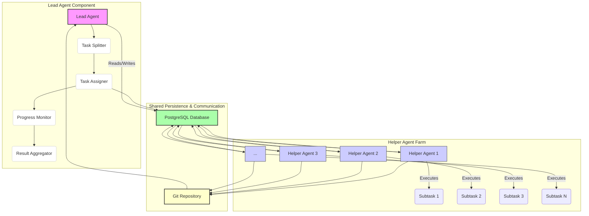

Claude Fable 5.2는 복잡한 작업을 대규모로 처리하기 위한 다중 에이전트 협업의 새로운 지평을 열었습니다. Anthropic 연구진이 페르마의 마지막 정리(Fermat's Last Theorem)를 Lean 언어로 형식화하는 데 성공한 실험은 단일 리드 에이전트(Lead Agent)와 수백 개의 헬퍼 에이전트(Helper Agents)가 효과적으로 협력할 수 있음을 입증했습니다. 이는 에이전트 하네스(Agent Harness) 내에서 복잡한 자동화 워크플로우를 지원하는 핵심 패턴으로 자리매김할 것입니다.

## 리드-헬퍼 에이전트 아키텍처

이 협업 모델의 핵심은 명확한 역할 분담에 있습니다. 리드 에이전트는 전체 프로젝트의 기획자이자 조율자 역할을 수행하며, 복잡한 문제를 세부 작업으로 분해하고, 헬퍼 에이전트들에게 작업을 할당하며, 진행 상황을 모니터링하고 최종 결과물을 통합합니다. 반면, 헬퍼 에이전트들은 할당된 특정 서브태스크(Subtask)를 실행하고, 그 결과를 리드 에이전트에게 보고하는 데 집중합니다. 페르마의 마지막 정리 실험에서 리드 에이전트는 초기 10분 이내에 `Announce`, `Assign`, `Notes`, `Subtasks`, `Landed`와 같은 다섯 가지 테이블을 정의하여 협업의 구조를 확립했습니다. 가장 어려웠던 정리인 랭글랜즈-터넬 정리(Langlands–Tunnell Theorem)는 약 750개의 헬퍼 에이전트가 최대 10단계에 걸쳐 2,418개의 작업으로 쪼개어 처리되었습니다.

### 상태 관리 및 통신 패턴

다중 에이전트 시스템에서 효율적인 상태 관리와 통신은 필수적입니다. Claude Fable 5.2 실험에서는 별도의 복잡한 협업 도구 없이 Git 브랜치와 공유 PostgreSQL 데이터베이스를 활용했습니다.

*   **Git 브랜치**: 각 헬퍼 에이전트는 독립적인 작업 공간으로 Git 브랜치를 활용합니다. 이는 동시에 여러 작업이 병렬로 진행될 때 코드 변경사항의 충돌을 최소화하고, 각 에이전트의 작업 이력을 명확하게 추적할 수 있도록 합니다. 리드 에이전트는 이 브랜치들을 통합(Merge)하거나 변경 사항을 검토합니다.
*   **PostgreSQL**: 공유 PostgreSQL 데이터베이스는 에이전트 간의 중앙 집중식 통신 허브이자 상태 저장소 역할을 합니다. 리드 에이전트가 정의한 테이블들은 다음과 같은 목적으로 사용될 수 있습니다:
    *   `Announce`: 새로운 작업이나 중요한 공지사항을 게시합니다.
    *   `Assign`: 헬퍼 에이전트에게 특정 작업을 할당합니다.
    *   `Notes`: 작업 진행 중 발생한 중요한 기록이나 발견 사항을 공유합니다.
    *   `Subtasks`: 현재 활성화된 서브태스크 목록과 그 상태를 관리합니다.
    *   `Landed`: 완료되어 통합된 작업 또는 증명 부분을 기록합니다.

이러한 패턴은 에이전트별 상태를 효율적으로 관리하고, 대규모 에이전트 팀의 안전하고 안정적인 운영을 가능하게 합니다. 2026년 현재, 이러한 '워크플로우를 위한 데이터베이스(Database-as-a-Workflow)' 접근 방식은 복잡한 Agentic 워크로드의 지속적인 통합 및 배포 파이프라인(CI/CD Pipeline)을 구축하는 데 중요한 트렌드로 부상하고 있습니다.

## 다중 에이전트 협업 시스템 아키텍처



## 코드 예시: 간단한 태스크 분배 및 상태 관리 (Python Pseudocode)

이 예시는 Lead Agent와 Helper Agents가 가상의 Git 및 Postgres 인터페이스를 통해 어떻게 협력하는지 보여줍니다. 실제 시스템에서는 더 복잡한 로깅, 에러 처리, 동시성 제어가 필요합니다.

```python
import time
import uuid

# Mock Git & PostgreSQL Interfaces
class MockGit:
    def __init__(self):
        self.branches = {}

    def checkout(self, branch_name):
        print(f