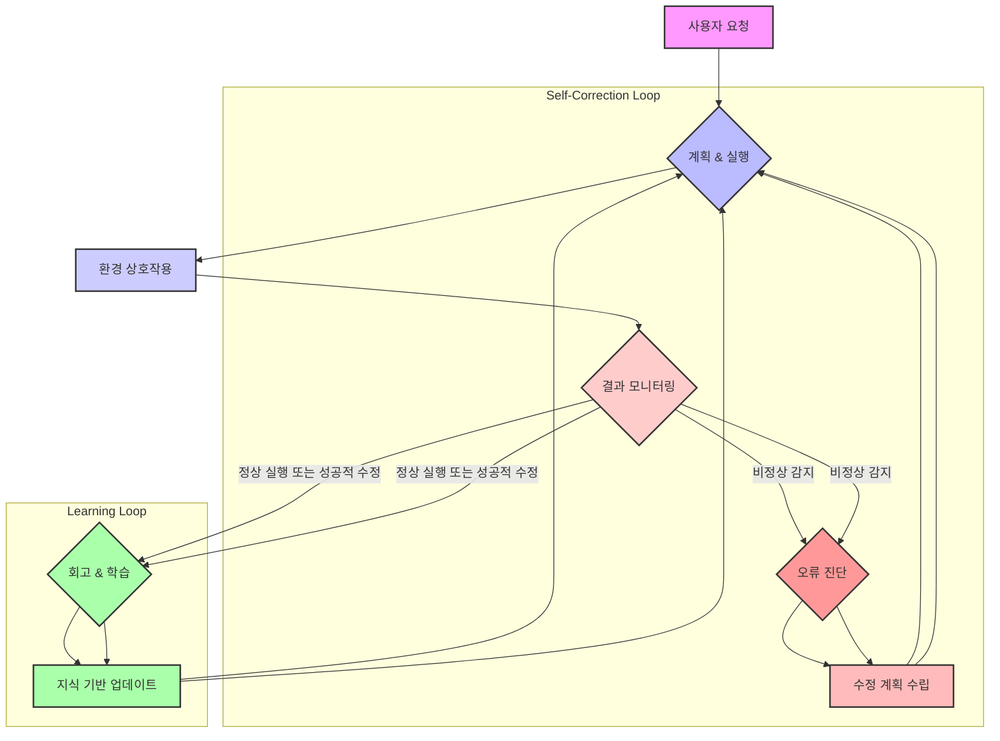

자기 수정 및 학습 루프는 복합 AI 에이전트가 예측 불가능한 환경에서 안정성과 적응성을 확보하기 위한 핵심 기술입니다. 에이전트가 오류를 감지하고, 원인을 진단하며, 경험을 통해 지식을 축적하는 능력은 실제 적용을 위한 필수적인 요소입니다. 이 접근 방식은 에이전트의 실제 성능과 신뢰성 간의 '갭(gap)'을 해소하며, 자율적으로 복잡한 작업을 수행하고 실패를 최소화하며 최적의 결과를 도출하도록 돕습니다.

## 자기 수정 루프의 핵심 원칙

자기 수정 루프(Self-Correction Loop)는 에이전트가 예상치 못한 상황이나 오류에 직면했을 때, 이를 인지하고 원래의 목표를 향해 경로를 재설정하는 메커니즘입니다. 주요 구성 요소는 다음과 같습니다.

### 1. 감지 (Detection)
에이전트의 행동이 목표에서 벗어나거나, 예기치 않은 결과를 초래하는 상황을 식별하는 단계입니다. 이는 실행 결과 모니터링, 환경 변화 감지, 예측 모델과의 불일치 확인 등 다양한 방식으로 이루어질 수 있습니다. 특히 멀티모달 에이전트(Multimodal Agent)의 경우 시각, 음성, 텍스트 등 여러 입력 소스에서 오는 불일치를 통합적으로 감지하는 능력이 중요해집니다.

### 2. 진단 (Diagnosis)
감지된 오류나 편차의 근본 원인을 파악하는 단계입니다. 에이전트의 내부 상태, 과거 실행 로그, 사용된 도구의 출력, 외부 환경 요인 등을 분석하여 문제의 핵심을 찾아냅니다. 예를 들어, 잘못된 도구 선택, 컨텍스트 부족, 추론 오류, 오래된 지식 베이스 등이 원인이 될 수 있습니다.

### 3. 계획 (Planning & Remediation)
진단된 문제에 기반하여 수정 계획을 수립하고, 이를 실행 가능한 행동으로 변환하는 단계입니다. 이는 재시도, 다른 도구 사용, 추가 정보 검색, 프롬프트 재구성, 내부 지식 업데이트 등 다양한 수정 전략을 포함할 수 있습니다. 2026년 트렌드에서는 이 단계에서 에이전트가 자신의 과거 "실패 기록"을 참조하여 최적의 수정 전략을 선택하는, 더욱 고도화된 메타 학습(Meta-learning) 능력이 요구됩니다.

### 4. 실행 (Execution)
수정 계획을 실제 행동으로 옮기는 단계입니다. 실행 후에는 다시 감지 단계로 돌아가 수정의 성공 여부를 확인하는 반복적인 프로세스를 거칩니다.

## 지속 학습 루프의 설계

자기 수정 루프가 주로 당면한 문제 해결에 초점을 맞춘다면, 지속 학습 루프(Continuous Learning Loop)는 에이전트의 장기적인 성능 향상과 적응력 강화를 목표로 합니다. 이는 에이전트가 경험을 통해 지식 기반(Knowledge Base)을 확장하고 추론 능력을 개선하는 과정입니다.

### 1. 회고 (Retrospection)
에이전트의 모든 실행, 특히 성공적인 수정과 실패 경험을 정기적으로 검토하는 단계입니다. 이 과정에서 에이전트는 무엇이 잘 작동했고, 무엇이 실패했으며, 그 이유는 무엇인지에 대해 자기 반성(Self-Reflection)을 수행합니다. LLM 기반 에이전트에서는 이 회고 과정이 복잡한 추론과 자연어 분석을 통해 이루어집니다.

### 2. 지식 추출 및 일반화 (Knowledge Extraction & Generalization)
회고를 통해 얻은 통찰력에서 일반화 가능한 지식, 규칙, 패턴을 추출하는 단계입니다. 예를 들어, 특정 유형의 문제에 대해 어떤 도구가 효과적이었는지, 어떤 프롬프트 전략이 더 나은 결과를 낳았는지 등을 학습하여 에이전트의 장기 기억(Long-Term Memory) 또는 지식 그래프(Knowledge Graph)를 업데이트합니다.

### 3. 정책 업데이트 (Policy Update)
추출된 지식을 바탕으로 에이전트의 행동 정책(Policy), 의사 결정 로직, 도구 사용 전략 등을 업데이트합니다. 이는 새로운 상황에 대한 더 나은 초기 계획을 수립하거나, 오류 발생 가능성을 줄이는 데 기여합니다. 이 과정은 모델 파인튜닝(Fine-tuning) 또는 적응형 프롬프트 엔지니어링(Adaptive Prompt Engineering)을 통해 구현될 수 있습니다.

## 자기 수정 및 학습 루프 아키텍처 예시

다음 Mermaid 다이어그램은 자기 수정 및 학습 루프가 통합된 에이전트의 일반적인 아키텍처를 보여줍니다.



## 코드 예시: 간단한 Python 에이전트 (Pseudocode)

다음은 가상의 `Agent`가 특정 목표를 달성하려 시도하고, 실패 시 자기 수정 및 학습 과정을 거치는 간단한 Python 코드 예시입니다. (실제 복잡한 LLM 호출 및 환경 상호작용은 추상화되어 있습니다.)

```python
import time

class KnowledgeBase:
    def __init__(self):
        self.rules = {} # error_type: fix_suggestion
        self.past_experiences = [] # Stores {'task_id', 'error', 'fix', 'success_status'}

    def add_or_update_rule(self, error_type, fix_suggestion):
        self.rules[error_type] = fix_suggestion
        # print(f"KB: Rule for {error_type} updated.")

    def get_suggestion(self, error_type):
        return self.rules.get(error_type, "retry_generic")

    def record_experience(self, task_id, error, fix_applied, success):
        self.past_experiences.append({'task_id': task_id, 'error': error, 'fix': fix_applied, 'success_status': success, 'timestamp': time.time()})
        # print(f"KB: Experience recorded for task {task_id}.")

class Agent:
    def __init__(self, name, kb):
        self.name = name
        self.knowledge_base = kb
        self.max_attempts = 3

    def run_task(self, task_description):
        task_id = hash(task_description)
        current_plan = {"description": task_description, "attempt_num": 0, "last_error": None, "last_fix": None}

        print(f"\n[{self.name}] Starting task: '{task_description}'")

        while current_plan["attempt_num"] < self.max_attempts:
            current_plan["attempt_num"] += 1
            print(f"[{self.name}] Attempt {current_plan['attempt_num']}. Plan: {current_plan['description']}")

            try:
                result = self._execute_plan(current_plan) # Simulate execution
                if result["status"] == "success":
                    print(f"[{self.name}] Task SUCCESS: {result['output']}")
                    if current_plan["last_error"]:
                        # Learning: If a correction led to success, reinforce the rule
                        self.knowledge_base.add_or_update_rule(current_plan["last_error"], current_plan["last_fix"])
                    self.knowledge_base.record_experience(task_id, current_plan["last_error"], current_plan["last_fix"], True)
                    return result["output"]
                else:
                    raise Exception(result["error"])

            except Exception as e:
                error_type = self._diagnose_error(str(e))
                print(f"[{self.name}] Error: {e}. Diagnosed as: {error_type}")
                current_plan["last_error"] = error_type

                if current_plan["attempt_num"] < self.max_attempts:
                    self._self_correct(current_plan)
                else:
                    print(f"[{self.name}] Task FAILED after {self.max_attempts} attempts.")
                    self.knowledge_base.record_experience(task_id, error_type, current_plan["last_fix"], False)
                    return None
        return None

    def _execute_plan(self, plan):
        # Simulate interaction with external environment/tools
        desc = plan["description"].lower()
        time.sleep(0.1) # Simulate some work

        if "fail_web_search" in desc:
            return {"status": "error", "error": "web_search_timeout"}
        if "fail_api_call" in desc and plan["attempt_num"] == 1:
            return {"status": "error", "error": "api_permission_denied"}
        if "generic_problem" in desc and plan["attempt_num"] < 3: # Always fails on first two attempts
            return {"status": "error", "error": "generic_runtime_error"}

        return {"status": "success", "output": f"Info for '{plan['description']}'"}

    def _diagnose_error(self, error_message):
        if "web_search_timeout" in error_message: return "web_search_timeout"
        if "api_permission_denied" in error_message: return "api_permission_denied"
        return "generic_runtime_error"

    def _self_correct(self, plan):
        fix_suggestion = self.knowledge_base.get_suggestion(plan["last_error"])
        plan["last_fix"] = fix_suggestion
        print(f"[{self.name}] Self-correcting with: '{fix_suggestion}'")

        # Apply the fix by modifying the plan/description
        if fix_suggestion == "retry_generic":
            plan["description"] = f"{plan['description']} (retrying)"
        elif fix_suggestion == "use_alternative_search":
            plan["description"] = f"{plan['description']} (alternative search)"
        elif fix_suggestion == "re_authenticate_api":
            plan["description"] = f"{plan['description']} (re-authenticated)"
        # More complex agents would use LLM to modify the actual prompt/tool parameters

# --- Simulation ---
kb_instance = KnowledgeBase()
main_agent = Agent("PrimaryAgent", kb_instance)

# Initial rules
kb_instance.add_or_update_rule("web_search_timeout", "use_alternative_search")
kb_instance.add_or_update_rule("api_permission_denied", "re_authenticate_api")

main_agent.run_task("perform a successful data query")
main_agent.run_task("research fail_web_search topic") # Should self-correct
main_agent.run_task("make an initial fail_api_call") # Should self-correct
main_agent.run_task("handle a generic_problem") # Should take 3 attempts
```

## 트레이드오프

복합 AI 에이전트의 자기 수정 및 학습 루프를 설계할 때 고려해야 할 주요 트레이드오프는 다음과 같습니다.

*   **안정성 및 신뢰성 vs. 오버헤드 (Stability & Reliability vs. Overhead)**
    *   **언제 좋은가**: 높은 수준의 안정성과 신뢰성이 필수적인 미션 크리티컬 시스템(Mission-critical systems)에서 매우 유리합니다. 오류 발생 시 사람의 개입 없이도 시스템이 스스로 복구하고 지속 작동해야 하는 경우에 적합합니다.
    *   **언제 나쁜가**: 모든 에이전트 행동에 대한 엄격한 모니터링, 진단, 수정 및 학습 프로세스는 상당한 컴퓨팅 자원(Computational resources)과 시간 지연(Latency)을 유발할 수 있습니다. 실시간 응답이 최우선이거나, 오류 비용이 낮은 시나리오에서는 과도한 설계가 될 수 있습니다.

*   **적응성 및 유연성 vs. 예측 가능성 및 제어 (Adaptability & Flexibility vs. Predictability & Control)**
    *   **언제 좋은가**: 급변하는 환경이나 예상치 못한 새로운 문제에 직면할 가능성이 높은 도메인에서 에이전트의 유연한 대응을 가능하게 합니다. 새로운 지식이나 상황에 빠르게 적응하여 장기적인 성능을 유지할 수 있습니다.
    *   **언제 나쁜가**: 학습 루프가 에이전트의 행동을 지속적으로 변경함에 따라, 특정 행동의 결과나 시스템 전체의 상태를 예측하기 어려워질 수 있습니다. 이는 규제 준수(Regulatory compliance)나 안전(Safety)이 중요한 시스템에서 심각한 문제를 야기할 수 있으며, 디버깅(Debugging) 및 검증(Verification)을 복잡하게 만듭니다.

*   **설계 복잡성 vs. 유지보수 용이성 (Design Complexity vs. Maintainability)**
    *   **언제 좋은가**: 장기적으로 에이전트가 더 복잡하고 자율적인 문제 해결 능력을 갖추도록 설계할 때 필수적입니다. 초기 투자로 더 강력한 자율 시스템을 구축할 수 있습니다.
    *   **언제 나쁜가**: 자기 수정 및 학습 메커니즘은 필연적으로 에이전트 아키텍처를 복잡하게 만듭니다. 이는 개발 초기 단계의 비용 증가뿐만 아니라, 시스템의 오류 원인을 추적하고 수정하는 유지보수(Maintenance) 측면에서 어려움을 초래할 수 있습니다. 명확한 가드레일(Guardrails)과 옵저버빌리티(Observability) 없이 설계되면 통제 불능 상태에 빠질 위험이 있습니다.

## 실전 체크리스트

복합 AI 에이전트의 자기 수정 및 학습 루프를 프로젝트에 적용하기 위한 실전 체크리스트는 다음과 같습니다.

*   [ ] **오류 감지 메커니즘 정의**: 에이전트가 어떤 유형의 오류(예: API 타임아웃, 잘못된 도구 사용, 목표 달성 실패, 비논리적 출력)를 어떻게 감지할 것인지 명확히 정의하고, 각 오류 유형에 대한 임계값 및 트리거를 설정했는가?
*   [ ] **근본 원인 진단 체계 수립**: 감지된 오류에 대해 에이전트가 내부 상태, 실행 로그, 외부 피드백 등을 활용하여 근본 원인을 자동으로 진단하는 체계(예: LLM 기반 추론, 규칙 기반 시스템)를 구축했는가?
*   [ ] **수정 전략 레퍼토리 구축**: 각 진단된 원인에 대해 에이전트가 적용할 수 있는 최소 3개 이상의 구체적인 수정 전략(예: 재시도, 프롬프트 재구성, 대체 도구 사용, 사람 개입 요청)을 마련하고 우선순위를 부여했는가?
*   [ ] **장기 기억 및 지식 기반 업데이트 로직 구현**: 에이전트의 성공적인 수정 경험과 실패 경험으로부터 새로운 지식, 규칙, 패턴을 추출하여 장기 기억 또는 지식 그래프를 업데이트하는 자동화된 학습 루프를 구현했는가?
*   [ ] **실험 및 검증 환경 설계**: 자기 수정 및 학습 루프의 효과를 측정하기 위한 A/B 테스트 환경 또는 시뮬레이션 환경을 구축하고, 메트릭(예: 오류 감소율, 성공률 증가, 사람 개입 감소)을 정의하여 주기적으로 검증하고 있는가?
*   [ ] **안전 가드레일 및 롤백 전략**: 에이전트의 자기 수정 또는 학습이 예상치 못한 부작용(예: 무한 루프, 비용 과소비, 부적절한 행동)을 일으킬 경우를 대비하여, 안전 가드레일, 비용 제한, 자동 롤백 또는 사람 개입(Human-in-the-loop) 트리거를 설계했는가?
*   [ ] **옵저버빌리티 및 디버깅 도구 확보**: 에이전트의 내부 의사 결정 과정, 수정 시도, 학습 업데이트 내역을 시각적으로 추적하고 디버깅할 수 있는 도구(예: 실행 로그, 대화 기록, 지식 그래프 시각화)를 마련했는가?