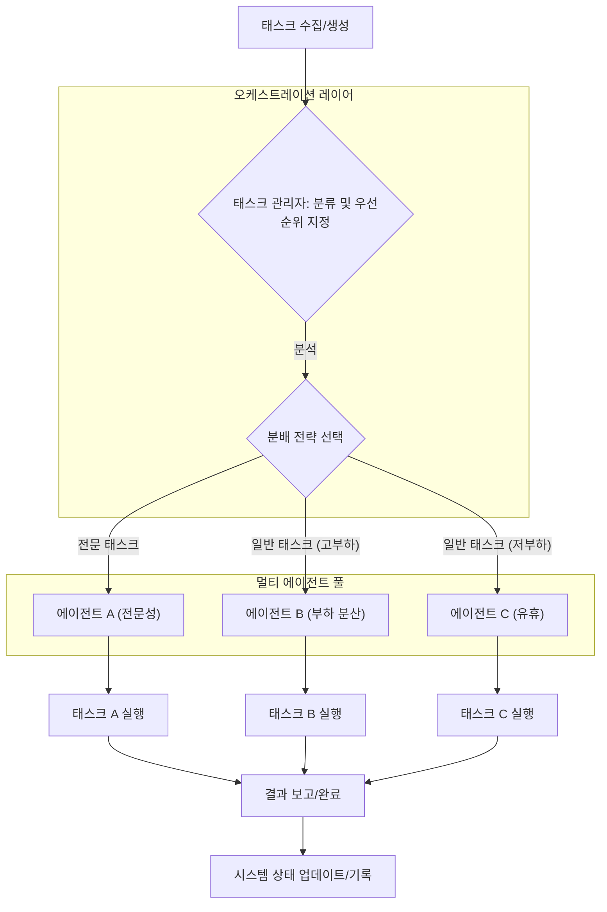

멀티 에이전트 시스템의 복잡성이 증대함에 따라, 태스크를 효율적으로 분배하고 관리하는 전략은 시스템의 성능과 안정성을 결정하는 핵심 요소가 됩니다. 단일 에이전트로는 처리하기 어려운 복합적인 문제를 여러 에이전트가 협력하여 해결할 때, 각 에이전트의 강점을 최대한 활용하고 병목 현상을 최소화하는 태스크 분배 방식이 필수적입니다.

## 태스크 분배 핵심 전략

멀티 에이전트 시스템의 태스크 분배는 크게 중앙 집중식(Centralized)과 분산식(Decentralized)으로 나눌 수 있습니다. 2026년 트렌드는 대규모 언어 모델(LLM) 기반의 에이전트 증가와 함께, 에이전트의 전문성을 고려한 동적(Dynamic)이고 유연한 분배 메커니즘을 강조합니다.

### 1. 중앙 집중식 오케스트레이션 (Centralized Orchestration)
중앙의 태스크 관리자(Task Manager)가 모든 태스크와 에이전트의 상태를 파악하고, 최적의 에이전트에게 태스크를 할당합니다. 단순하고 예측 가능한 환경에 적합하며, 전체 시스템의 가시성(visibility)이 높습니다.

### 2. 분산식 협업 프로토콜 (Decentralized Collaboration Protocols)
에이전트들이 직접 태스크를 공지하고, 상호 협상(negotiation)이나 입찰(bidding)을 통해 자율적으로 태스크를 수락하는 방식입니다. 대표적인 예로는 콘트랙트 넷 프로토콜(Contract Net Protocol)이 있습니다. 시스템의 확장성(scalability)과 견고성(robustness)이 뛰어나지만, 오버헤드가 발생할 수 있습니다.

### 3. 전문성 기반 할당 (Specialization-Based Assignment)
각 에이전트가 특정 도메인 지식이나 도구 사용 능력(tool-use capability)에 특화되어 태스크의 요구사항에 따라 가장 적합한 전문 에이전트에게 할당하는 방식입니다. LLM 에이전트의 경우, 특정 유형의 프롬프트(prompt) 처리나 특정 API 호출에 능숙한 에이전트를 활용할 수 있습니다.

### 4. 동적 로드 밸런싱 (Dynamic Load Balancing)
실시간으로 에이전트의 부하(load) 상태를 모니터링하여, 현재 가장 여유 있는(idle) 에이전트에게 태스크를 분배하는 방식입니다. 시스템의 처리량(throughput)을 최대화하는 데 기여합니다.

## 태스크 분배 흐름 예시

아래 Mermaid 다이어그램은 중앙 집중식 태스크 관리자가 태스크를 수신하고, 분류 및 전략에 따라 에이전트에게 분배하는 일반적인 흐름을 보여줍니다.



## 코드 예시: 중앙 태스크 디스패처

다음 Python 코드는 에이전트의 역량(capabilities)을 기반으로 태스크를 할당하는 간단한 중앙 집중식 디스패처(Central Dispatcher)를 보여줍니다. 에이전트가 태스크를 처리하는 동안 `is_busy` 상태로 표시되어 중복 할당을 방지합니다.

```python
from typing import Dict, Any, List
import time

class Agent:
    def __init__(self, agent_id: str, capabilities: List[str]):
        self.agent_id = agent_id
        self.capabilities = capabilities
        self.is_busy = False # 에이전트의 현재 작업 상태

    def process_task(self, task: Dict[str, Any]):
        self.is_busy = True
        print(f"Agent '{self.agent_id}' starting task: {task['id']}")
        time.sleep(task.get('duration', 0.5)) # 작업 시뮬레이션
        print(f"Agent '{self.agent_id}' completed task: {task['id']}")
        self.is_busy = False
        return f"Task {task['id']} done by {self.agent_id}"

class CentralTaskDispatcher:
    def __init__(self, agents: List[Agent]):
        self.agents = {agent.agent_id: agent for agent in agents}
        self.pending_tasks: List[Dict[str, Any]] = []

    def add_task(self, task_id: str, task_type: str, requirements: List[str], duration: float = 0.5):
        self.pending_tasks.append({'id': task_id, 'type': task_type, 'requirements': requirements, 'duration': duration})
        print(f"Task '{task_id}' added. Requirements: {requirements}")

    def distribute_tasks(self):
        processed_results: List[str] = []
        unassigned_tasks = []

        for task in self.pending_tasks:
            assigned = False
            for agent_id, agent in self.agents.items():
                # 유휴 상태이며, 태스크 요구사항을 모두 충족하는 에이전트 할당
                if not agent.is_busy and all(req in agent.capabilities for req in task['requirements']):
                    processed_results.append(agent.process_task(task))
                    assigned = True
                    break
            if not assigned:
                unassigned_tasks.append(task) # 할당 실패 시 다시 대기열에 추가
                print(f"No suitable agent for task '{task['id']}', re-queueing.")
        
        self.pending_tasks = unassigned_tasks
        return processed_results

# --- 예시 사용 --- 
if __name__ == "__main__":
    dev_agent = Agent("DevAgent", ["coding", "bugfix"])
    test_agent = Agent("TestAgent", ["testing", "review"])
    infra_agent = Agent("InfraAgent", ["deployment", "monitoring"])

    dispatcher = CentralTaskDispatcher([dev_agent, test_agent, infra_agent])

    dispatcher.add_task("T001", "feat-implement", ["coding"], duration=1.0)
    dispatcher.add_task("T002", "code-review", ["review"], duration=0.8)
    dispatcher.add_task("T003", "deploy-service", ["deployment"], duration=1.5)
    dispatcher.add_task("T004", "bug-fix", ["bugfix"], duration=0.7)
    dispatcher.add_task("T005", "test-new-feature", ["testing"], duration=1.2)
    dispatcher.add_task("T006", "unknown-task", ["research"], duration=2.0) # 'research' 역량 에이전트 없음

    print("\n--- 첫 번째 분배 주기 ---")
    results = dispatcher.distribute_tasks()
    for res in results:
        print(f"Result: {res}")

    print("\n--- 두 번째 분배 주기 ---")
    # 첫 번째 주기에서 처리되지 못한 태스크를 다시 시도
    results = dispatcher.distribute_tasks()
    for res in results:
        print(f"Result: {res}")

    print("\n--- 최종 미할당 태스크 ---")
    for task in dispatcher.pending_tasks:
        print(f"Unassigned: {task['id']} (Req: {task['requirements']})")
```

## 트레이드오프

태스크 분배 전략 선택 시 다음 트레이드오프를 고려해야 합니다.

*   **중앙 집중식 vs. 분산식**: 중앙 집중식은 `단순한 시스템, 예측 가능한 워크로드`에 좋지만 `단일 장애점 및 병목`이 될 수 있습니다. 분산식은 `복잡하고 동적인 대규모 시스템`에 적합하지만 `구현 복잡성 및 통신 오버헤드`가 발생합니다.
*   **전문성 기반 vs. 일반 에이전트 풀**: 전문성 기반은 `고도로 특화된 태스크의 효율성`을 높이지만 `태스크 종류가 적거나 특정 전문 에이전트가 유휴 상태일 때 비효율적`입니다. 일반 풀은 `유연성`이 높지만 `최적의 성능을 보장하기 어려울` 수 있습니다.
*   **정적 할당 vs. 동적 로드 밸런싱**: 정적 할당은 `안정적인 워크로드`에 적합하며 `구현이 간단`하지만 `급변하는 시스템 부하에 취약`합니다. 동적 로드 밸런싱은 `변동성 큰 부하 환경`에서 `시스템 처리량을 최적화`하지만 `모니터링 및 제어 복잡성`이 증가합니다.

## 실전 체크리스트

멀티 에이전트 태스크 분배 전략을 구현할 때 다음 사항을 검토해야 합니다.

- [ ]  **태스크 분류 및 우선순위 체계 정의**: 들어오는 태스크를 어떤 기준으로 분류하고(예: 중요도, 복잡성, 요구 역량), 우선순위를 어떻게 할당할지 명확히 정의되었는가?
- [ ]  **에이전트 역량 및 상태 관리**: 각 에이전트가 수행할 수 있는 역량(capabilities)이 명확히 정의되었고, 현재 작업 중인지(is_busy), 유휴 상태인지(idle) 등의 상태를 실시간으로 추적하는 메커니즘이 있는가?
- [ ]  **태스크 할당 로직 구현**: 에이전트의 역량, 현재 부하, 태스크의 우선순위 등을 고려하여 최적의 에이전트에게 태스크를 할당하는 로직이 구현되었는가?
- [ ]  **실패 처리 및 재시도 메커니즘**: 에이전트가 태스크를 실패하거나 응답하지 않을 경우, 태스크를 재할당하거나 다른 에이전트에게 전달하는 견고한(robust) 실패 처리 및 재시도 로직이 설계되었는가?
- [ ]  **모니터링 및 로깅 시스템 구축**: 태스크의 생성, 할당, 실행, 완료(또는 실패) 과정을 추적하고, 에이전트의 부하 상태를 모니터링할 수 있는 시스템이 구축되었는가?
- [ ]  **확장성 고려**: 새로운 에이전트가 추가되거나 태스크 부하가 증가할 때, 시스템이 유연하게 확장(scale)될 수 있도록 설계되었는가?
- [ ]  **커뮤니케이션 오버헤드 최소화**: 에이전트 간 또는 에이전트와 디스패처 간 통신이 과도하여 시스템 성능에 영향을 주지 않도록 효율적인 통신 프로토콜을 사용하는가?