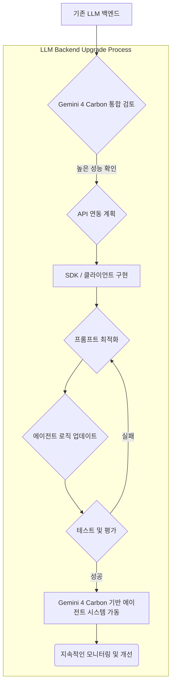

Gemini 4 Carbon은 Artificial Analysis Intelligence Index v5에서 1위를 기록하며 복잡한 추론, 지식 통합, 과학 및 코딩 에이전트 작업에서 강력한 성능을 입증했다. 이러한 성능은 LLM 백엔드를 사용하는 에이전트 시스템의 지능 및 효율성을 혁신할 잠재력을 가진다. 기존 LLM 백엔드를 Gemini 4 Carbon으로 업그레이드하는 것은 에이전트의 문제 해결 능력, 코드 생성 및 디버깅 능력, 그리고 전반적인 자율성을 크게 향상시킬 수 있다.

## 핵심 역량 및 에이전트 시스템 적용

Gemini 4 Carbon의 강점은 특히 다음과 같은 에이전트 시스템 영역에서 중요한 가치를 제공한다.

### 복잡한 추론 및 다단계 문제 해결

Gemini 4 Carbon은 복잡한 논리적 흐름을 이해하고 여러 단계를 거쳐 해결해야 하는 문제에서 뛰어난 성능을 보인다. 이는 장기 계획(long-term planning), 전략적 의사 결정(strategic decision-making), 그리고 여러 도구 호출(tool calls)이 필요한 복합적인 에이전트 워크플로우에 직접적으로 기여한다. 에이전트는 더 적은 개입으로 더 복잡한 목표를 달성할 수 있게 되며, 이는 전체 시스템의 자율성을 높인다.

### 고급 코딩 및 디버깅 에이전트 성능

Antigravity CLI와 같은 환경에서 Gemini 4 Carbon은 코딩 에이전트로서 높은 점수를 기록했다. 이는 코드 생성, 코드 리뷰, 버그 진단 및 수정, 그리고 레거시 코드베이스 리팩토링과 같은 작업에서 에이전트의 효율성을 극대화한다. 개발 워크플로우에 통합될 경우, 개발 생산성을 향상시키고 소프트웨어 품질을 높일 수 있다.

## 아키텍처 및 통합 전략

Gemini 4 Carbon으로 백엔드를 업그레이드하는 과정은 API 연동과 기존 프롬프트 및 에이전트 로직의 최적화를 포함한다.

### API 연동 및 SDK 활용

Google Cloud에서 제공하는 Gemini API를 통해 시스템에 통합할 수 있다. Python, Node.js 등 다양한 언어의 SDK를 활용하여 기존 LLM 호출 로직을 Gemini 4 Carbon으로 전환한다. 이때, 인증(Authentication), 속도 제한(Rate Limiting) 관리, 그리고 오류 처리(Error Handling)가 중요하다.

```python
import google.generativeai as genai

# Configure API key (consider environment variables or secure key management)
genai.configure(api_key="YOUR_GEMINI_API_KEY")

def get_gemini_response(prompt_text, model_name="gemini-4-carbon"):
    model = genai.GenerativeModel(model_name)
    try:
        response = model.generate_content(prompt_text)
        return response.text
    except Exception as e:
        print(f"Error generating content: (e)")
        return None

# Example usage for a coding agent task
code_generation_prompt = (
    "Generate a Python function that calculates the nth Fibonacci number efficiently. "
    "Include docstrings and type hints." 
)

generated_code = get_gemini_response(code_generation_prompt)
if generated_code:
    print("--- Generated Code ---")
    print(generated_code)

code_refactoring_prompt = (
    "Refactor the following Python code for better readability and performance. "
    "Identify potential bugs or inefficiencies.\n\n" + generated_code
)

refactored_code = get_gemini_response(code_refactoring_prompt)
if refactored_code:
    print("--- Refactored Code ---")
    print(refactored_code)
```

### 프롬프트 엔지니어링 및 에이전트 로직 최적화

Gemini 4 Carbon의 강화된 추론 능력은 더 간결하고 명확한 프롬프트를 통해 더 나은 결과를 얻을 수 있음을 의미한다. Chain of Thought (CoT), Tree of Thoughts (ToT)와 같은 고급 추론 프롬프트 기법을 적용하여 모델의 잠재력을 최대한 활용한다. 에이전트의 도구 사용(Tool Use) 패턴과 자체 수정(Self-Correction) 로직 또한 Gemini 4 Carbon의 지능에 맞춰 재정비하여 전반적인 성능을 향상시킨다.

## 에이전트 시스템 업그레이드 흐름

Mermaid 다이어그램은 LLM 백엔드 업그레이드 프로세스를 시각화한다.



2026년 현재, LLM 에이전트의 발전은 단순히 하나의 작업을 수행하는 것을 넘어, 복잡한 환경에서 자율적으로 학습하고 적응하는 방향으로 나아가고 있다. Gemini 4 Carbon과 같은 고성능 모델의 도입은 이러한 트렌드를 가속화하며, 에이전트가 현실 세계의 문제에 더 효과적으로 대응할 수 있도록 한다.

## 트레이드오프

*   **장점: 성능 향상 vs. 단점: 비용 및 복잡성 증가**
    *   **언제 좋은가**: 에이전트의 추론 정확도, 코드 생성 품질, 다단계 작업 처리 능력이 critical path에 있고, 기존 모델의 한계로 인해 비즈니스 가치 창출에 제약이 있을 때. 복잡한 문제 해결을 위한 인간의 개입 비용을 절감하고자 할 때 효과적이다.
    *   **언제 나쁜가**: 단순 반복 작업이나 저비용 모델로 충분한 작업에 적용할 경우, 불필요한 비용 상승과 함께 과도한 엔지니어링 복잡성을 초래할 수 있다.

*   **장점: 최신 지능 모델 활용 vs. 단점: 종속성 및 마이그레이션 비용**
    *   **언제 좋은가**: 최신 AI 연구 동향을 반영한 최고 수준의 지능을 에이전트에 빠르게 도입하여 경쟁 우위를 확보하고자 할 때. 특히 rapidly evolving (빠르게 발전하는) AI 분야에서 새로운 기능을 빠르게 활용해야 할 경우 유용하다.
    *   **언제 나쁜가**: 특정 모델에 대한 종속성(vendor lock-in)이 심화될 수 있으며, 마이그레이션 과정에서 기존 시스템과의 호환성 문제, 프롬프트 재조정, 그리고 테스트 비용이 발생할 수 있다.

*   **장점: 에이전트 자율성 증대 vs. 단점: 제어 및 가드레일 필요성 증가**
    *   **언제 좋은가**: 에이전트가 더 많은 자율성을 가지고 복잡한 작업을 스스로 계획하고 실행하기를 기대할 때. 휴먼-인-더-루프(human-in-the-loop) 개입을 줄여 운영 효율성을 높이고자 할 때.
    *   **언제 나쁜가**: 에이전트의 자율성이 높아질수록 예상치 못한 동작(unintended behaviors)이나 할루시네이션(hallucination), 혹은 비용 초과(cost overrun)의 위험이 커진다. 강력한 모니터링, 가드레일, 그리고 안전 메커니즘이 필수적으로 뒷받침되지 않으면 시스템 안정성에 문제가 발생할 수 있다.

## 실전 체크리스트

Gemini 4 Carbon 모델로 LLM 백엔드 업그레이드를 진행할 때 다음 항목들을 검증한다.

- [ ] **성능 벤치마킹 계획**: 기존 모델 대비 Gemini 4 Carbon의 핵심 성능 지표(추론 정확도, 코딩 성공률, 응답 시간)를 측정하기 위한 구체적인 벤치마킹 시나리오를 정의했는가?
- [ ] **API 연동 안정성**: Gemini 4 Carbon API 호출 시 발생할 수 있는 네트워크 지연, 속도 제한 초과, API 오류에 대한 Robust error handling (강건한 오류 처리) 로직이 구현되었는가?
- [ ] **프롬프트 최적화 검증**: Gemini 4 Carbon의 특성을 최대한 활용하는 새로운 프롬프트 템플릿 및 전략(예: CoT, ToT)이 개발되었으며, 이를 통해 기존 대비 유의미한 성능 향상을 검증했는가?
- [ ] **비용 관리 전략**: Gemini 4 Carbon 사용에 따른 예상 비용 모델을 수립하고, 토큰 사용량 모니터링, 캐싱, 동적 모델 라우팅 등 비용 최적화 방안을 마련했는가?
- [ ] **에이전트 로직 호환성**: 기존 에이전트의 도구 사용(tool use), 계획(planning), 기억(memory) 모듈이 Gemini 4 Carbon의 응답 형식 및 추론 능력과 원활하게 통합되도록 수정되었는가?
- [ ] **보안 및 규정 준수**: 민감한 데이터 처리 시 Gemini 4 Carbon API를 통한 데이터 유출 위험을 평가하고, 관련 데이터 보안 및 개인정보 보호 규정(예: GDPR, CCPA)을 준수하는가?
- [ ] **모니터링 및 로깅**: Gemini 4 Carbon 기반 에이전트의 실시간 성능, 비용, 오류율, 그리고 이상 행동 감지를 위한 모니터링 시스템과 상세 로깅(logging) 체계가 구축되었는가?