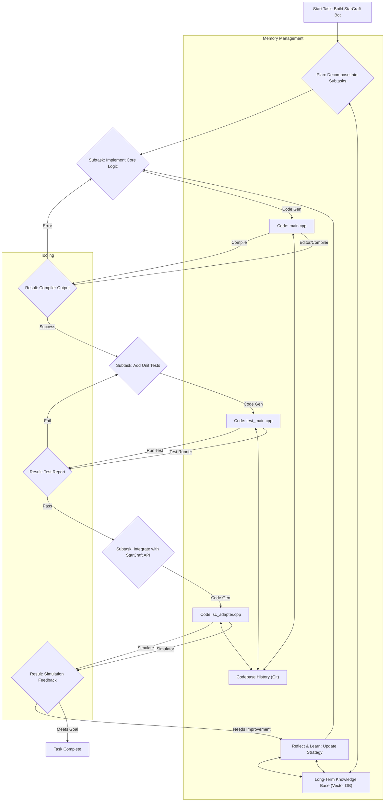

Gemini 4 Argon의 StarCraft 플레이 사례는 장기 추론(Long-Term Reasoning) 및 에이전트 코딩(Agent Coding) 능력의 잠재력을 명확히 보여주었습니다. 특히, 복잡한 환경에서 1시간 동안 C++ Protoss 봇을 개발하고 연습 경기 데이터를 반영하여 개선하는 과정은 LLM이 단순한 코드 생성자를 넘어선 자율적인 문제 해결 주체가 될 수 있음을 시사합니다. 이러한 Gemini Agent의 역량을 극대화하기 위해 기존 Claude Code 하네스(harness)를 최적화하는 harness-engineering 전략은 필수적입니다. 이 엔트리에서는 장기적인 관점을 playbook 내 복리 자동화 워커 디스패치 로직에 통합하는 방안을 포함하여, 프롬프트 전략, 기억 관리, 도구 활용 방식을 개선하는 데 초점을 맞춥니다.

## 장기 추론 및 에이전트 코딩 최적화
LLM이 장기적인 목표를 달성하고 복잡한 코드를 진화시키는 능력은 단순한 단일 프롬프트 응답을 넘어섭니다. 이는 다단계 계획 수립, 중간 결과 평가, 그리고 지속적인 학습 및 적응을 요구합니다. Gemini 4 Argon 사례는 이 과정에서 필요한 핵심 요소들을 조명합니다.

### 프롬프트 전략 개선: Structured Planning & Reflection
장기 추론을 위해 프롬프트는 에이전트가 복잡한 태스크를 분해하고, 각 단계를 계획하며, 실행 후 자체 평가를 수행하도록 유도해야 합니다.
1.  **Chain-of-Thought (CoT) 및 Tree-of-Thought (ToT) 확장**: 단순히 순차적인 추론을 넘어, 여러 가능한 경로를 탐색하고 최적의 경로를 선택하는 Tree-of-Thought 프롬프트 기법을 적용합니다. 각 노드에서 에이전트는 하위 태스크를 정의하고, 필요한 정보나 도구를 식별합니다.
2.  **자기 성찰(Self-Reflection) 루프 강화**: 에이전트가 코드 변경 또는 전략 실행 후 예상치 못한 결과가 발생했을 때, 그 원인을 진단하고 다음 행동을 수정할 수 있도록 명시적인 성찰 단계를 프롬프트에 포함합니다. `Practice match feedback`과 같이 외부 시스템으로부터의 피드백을 구조화된 형태로 받아들이고 분석하는 과정을 설계합니다.
3.  **장기 목표 유지 프롬프트**: 매 턴마다 전체 목표를 상기시키고, 현재 단계가 전체 목표에 어떻게 기여하는지 명확히 하도록 유도합니다. 이는 에이전트가 미시적인 태스크에 매몰되어 전역 목표를 잃는 것을 방지합니다.

### 기억 관리(Memory Management) 및 Context Persistence
장기 태스크 수행을 위해서는 과거의 결정, 코드 변경 이력, 그리고 학습된 지식을 지속적으로 활용할 수 있는 효과적인 기억 시스템이 필요합니다.
1.  **영구 메모리(Persistent Memory) 시스템**: 코드베이스, 디자인 문서, 과거 에이전트 실행 로그 등을 저장하는 벡터 데이터베이스(Vector Database)를 구축합니다. 에이전트의 현재 작업과 관련된 정보를 동적으로 검색(RAG: Retrieval Augmented Generation)하여 컨텍스트 창(Context Window)에 주입합니다.
2.  **컨텍스트 압축(Context Compaction) 및 요약**: 모든 과거 컨텍스트를 유지하는 것은 토큰 비용 및 성능 측면에서 비효율적입니다. 중요도가 낮은 정보를 압축하거나, 주기적으로 핵심 요약본을 생성하여 컨텍스트 크기를 관리합니다. 예를 들어, N번의 코드 변경 후 핵심 변경사항만 요약하여 장기 메모리에 저장합니다.
3.  **지식 그래프(Knowledge Graph) 통합**: 코드 구조, 함수 종속성, 클래스 계층 등 코드베이스의 정적 정보를 지식 그래프 형태로 관리하여 에이전트가 코드 변경의 영향 범위를 더 잘 이해하고 계획할 수 있도록 돕습니다.

### 도구 활용(Tool Utilization) 및 상호작용
Gemini Agent가 C++ 봇을 만든 것처럼, 실제 환경에서 코딩 능력을 발휘하려면 다양한 도구와의 유연한 상호작용이 필수적입니다.
1.  **통합 개발 환경(IDE) 유사 도구 인터페이스**: 코드 편집, 컴파일, 테스트 실행, 디버깅 등 개발 워크플로우를 에이전트가 직접 제어할 수 있는 도구 세트를 제공합니다. `ls`, `cat`, `grep`, `diff`, `make`, `g++`, `pytest` 등의 명령어를 래핑하여 에이전트가 안전하게 호출할 수 있도록 합니다.
2.  **동적 도구 선택(Dynamic Tool Selection)**: 현재 태스크와 컨텍스트에 따라 가장 적절한 도구를 에이전트가 자율적으로 선택하도록 유도하는 프롬프트 및 도구 정의를 설계합니다. 예를 들어, `compile error` 발생 시 `read source code`, `debug with compiler flags`, `test with specific input` 등의 도구를 고려합니다.
3.  **피드백 루프**: 도구 실행 결과(컴파일 에러, 테스트 실패, 런타임 로그)를 에이전트가 이해하고 분석하기 쉬운 구조화된 형식으로 제공하여, 즉각적인 코드 수정 및 재시도를 가능하게 합니다.

## 트레이드오프

*   **높은 초기 구현 복잡성 vs. 장기적인 자율성 및 효율 증대**:
    *   **Good**: 복잡한 harness-engineering 패턴을 도입하면 초기 설정 및 개발에 많은 시간과 리소스가 필요하지만, 일단 구축되면 에이전트가 더 복잡하고 지속적인 태스크를 인간의 개입 없이도 효율적으로 수행할 수 있게 됩니다. 이는 장기적으로 개발 및 운영 비용을 절감하고 생산성을 극대화합니다.
    *   **Bad**: 단기적이거나 단순 반복적인 태스크에 과도한 하네스 복잡성을 적용하는 것은 오버엔지니어링(Over-engineering)이 될 수 있으며, 불필요한 비용과 유지보수 부담을 초래합니다.

*   **토큰 비용 증가 vs. 추론 깊이 및 정확도 향상**:
    *   **Good**: 장기 기억 관리, 상세한 자기 성찰 프롬프트, 도구 실행 결과 분석 등은 LLM에 더 많은 컨텍스트를 제공하여 추론의 깊이와 태스크 정확도를 크게 향상시킵니다. 중요한 비즈니스 로직이나 민감한 코드 변경에 있어 오류를 줄일 수 있습니다.
    *   **Bad**: 컨텍스트 창을 넓게 사용하거나 여러 번의 추론 단계를 거치는 것은 토큰 사용량을 급증시켜 LLM API 호출 비용을 크게 증가시킬 수 있습니다. 특히 비용에 민감한 환경이나 대규모 배치(Batch) 처리 시에는 신중한 최적화가 요구됩니다.

*   **실행 지연 시간(Latency) 증가 vs. 태스크 견고성 및 적응력 개선**:
    *   **Good**: 여러 단계의 계획, 실행, 검증, 성찰 루프는 에이전트의 응답 시간을 길게 만들 수 있지만, 예측 불가능한 상황에 대한 견고성(Robustness)과 새로운 정보에 대한 적응력(Adaptability)을 높여줍니다. 이는 특히 실시간 상호작용이 덜 중요한 백그라운드 장기 실행 태스크에 적합합니다.
    *   **Bad**: 사용자 인터랙션이 중요한 실시간 시스템(Real-time System)이나 빠른 응답이 필수적인 애플리케이션에서는 이러한 지연 시간이 사용자 경험을 저해할 수 있습니다. 짧은 지연 시간이 중요한 경우, 추론 단계의 간소화나 병렬 처리(Parallel Processing) 도입을 고려해야 합니다.

*   **표준화된 도구 인터페이스 vs. 유연성 제약**:
    *   **Good**: 에이전트가 활용할 수 있는 도구 인터페이스를 표준화하면 에이전트 개발 및 유지보수가 용이해지고, 새로운 도구 추가 시 일관성을 유지할 수 있습니다. 이는 에이전트 간의 협업(Collaboration)에도 긍정적입니다.
    *   **Bad**: 너무 엄격한 도구 표준화는 에이전트가 특정 태스크에 필요한 비정형적이거나 최신 도구를 유연하게 활용하는 데 제약이 될 수 있습니다. 에이전트의 창의적인 문제 해결 능력을 저해할 가능성도 있습니다.

## 실전 체크리스트

프로젝트에 Gemini Agent의 장기 추론 및 코딩 능력 활용을 위한 harness-engineering 최적화를 적용할 때 다음 항목들을 검증해야 합니다:

- [ ] **프롬프트 체인(Prompt Chain) 다단계 검증**: 에이전트의 계획, 실행, 성찰 각 단계별 프롬프트가 의도된 추론 경로를 따라가는지, 예상치 못한 루프(Loop)나 탈선이 없는지 워크플로우 테스트를 통해 검증했습니다.
- [ ] **기억 관리 시스템 통합 및 성능 측정**: 벡터 데이터베이스(Vector DB) 또는 지식 그래프(Knowledge Graph)가 에이전트의 코드 변경 이력 및 도메인 지식을 효과적으로 저장하고 검색하는지 확인하고, 검색 지연 시간과 관련성(Relevance) 지표를 측정했습니다.
- [ ] **도구 사용 로깅 및 에러 핸들링**: 에이전트가 호출하는 모든 외부 도구(컴파일러, 테스트 러너 등)의 실행 로그를 기록하고, 에러 발생 시 에이전트가 적절하게 진단 및 복구 시도를 하는지 시나리오 테스트를 완료했습니다.
- [ ] **장기 태스크 진행 상태 모니터링**: 에이전트가 장기 코딩 태스크를 수행할 때, 현재 진행 단계, 코드 변경 사항, 남은 하위 태스크 등을 인간이 명확하게 이해할 수 있도록 모니터링 대시보드(Dashboard)를 구축했습니다.
- [ ] **복리 자동화 워커 디스패치 로직 통합**: playbook의 `복리 자동화 워커 디스패치` 로직이 에이전트의 장기 목표와 현재 컨텍스트를 고려하여 다음 워커를 배정하도록 수정되었으며, 실제 운영 환경에서 의도대로 동작함을 확인했습니다.
- [ ] **토큰 비용 최적화 전략 적용**: 컨텍스트 압축, 캐싱(Caching), 프롬프트 요약 등의 기법을 적용하여 장기 태스크 수행 중 발생하는 토큰 비용이 허용 가능한 범위 내에 있는지 주기적으로 측정하고 최적화했습니다.
- [ ] **실행 지연 시간 기준 설정 및 준수**: 에이전트의 장기 추론 및 코딩 태스크에 대한 예상 완료 시간 및 중간 단계 지연 시간 기준(SLA)을 설정하고, 실제 실행 시간이 이를 준수하는지 모니터링하고 있습니다.