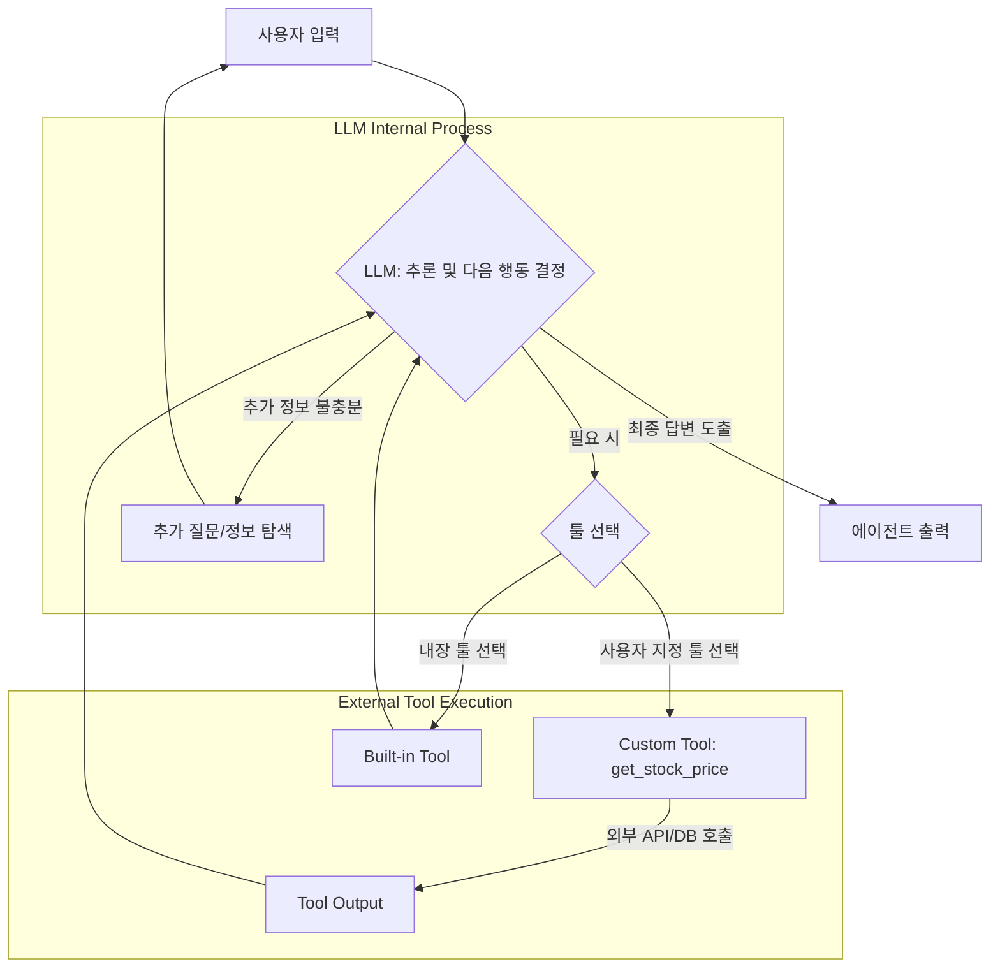

LangChain 에이전트 개발에서 사용자 지정 툴(Custom Tools)의 통합은 정형화되지 않은(unstructured) 실제 세계의 복잡한 문제를 해결하는 데 필수적인 요소입니다. 대규모 언어 모델(LLM) 기반의 자율 에이전트(Autonomous Agents)는 그 자체로 강력한 추론 능력을 가지지만, 특정 도메인 지식이나 외부 시스템과의 상호작용은 툴(Tool) 없이는 불가능합니다. 이 엔트리는 LangChain 에이전트에 사용자 지정 툴을 효과적으로 설계하고 통합하는 개발 패턴을 제시합니다.

## 사용자 지정 툴의 필요성
LangChain은 기본적으로 다양한 내장 툴(Built-in Tools)을 제공하지만, 현실의 비즈니스 로직이나 고유한 데이터 소스에 접근하기 위해서는 이러한 툴만으로는 한계가 있습니다. 예를 들어, 기업 내부의 특정 API를 호출하거나, 사내 데이터베이스를 조회하거나, 비표준 형식의 문서를 처리하는 등의 작업은 사용자 정의된 툴을 통해서만 수행할 수 있습니다. 2026년 기준, 에이전트 기반 시스템은 더욱 정교하고 특화된 기능 요구사항을 수용하며, 이는 곧 유연한 툴 확장성으로 직결됩니다.

## LangChain에서 사용자 지정 툴 설계
LangChain에서 사용자 지정 툴을 생성하는 방법은 크게 두 가지가 있습니다: `@tool` 데코레이터를 사용하는 간단한 함수 기반 툴과, `BaseTool` 클래스를 상속받는 객체 지향 툴입니다. 후자는 더 복잡한 로직, 비동기 작업, 그리고 입력 유효성 검사(input validation)에 유리합니다.

### 함수 기반 툴 (Function-based Tools)
간단한 유틸리티 함수를 툴로 활용할 때 유용합니다. 함수의 docstring은 LLM이 툴의 목적과 사용법을 이해하는 데 중요한 역할을 합니다.

```python
from langchain.agents import AgentExecutor, create_react_agent
from langchain_core.prompts import ChatPromptTemplate
from langchain_core.tools import tool
from langchain_openai import ChatOpenAI
import datetime

# 사용자 지정 툴 정의 1: 현재 시간 반환
@tool
def get_current_time(timezone: str) -> str:
    """현재 시간을 지정된 시간대(timezone, 예: 'Asia/Seoul', 'America/New_York')로 반환합니다."""
    from pytz import timezone as pytz_timezone, utc
    from datetime import datetime
    tz = pytz_timezone(timezone)
    now = datetime.now(utc).astimezone(tz)
    return now.strftime("%Y-%m-%d %H:%M:%S %Z%z")

# 사용자 지정 툴 정의 2: 간단한 계산기
@tool
def calculator(expression: str) -> str:
    """수학적 표현식(expression)을 계산하여 결과를 반환합니다. 단, 파이썬 eval 함수를 사용하므로 악의적인 코드는 실행하지 마세요."""
    try:
        return str(eval(expression))
    except Exception as e:
        return f"Calculation error: {e}"

# 툴 리스트
tools = [get_current_time, calculator]

# LLM 초기화 (실제 사용 시 API 키 설정 필요)
llm = ChatOpenAI(model="gpt-4o-mini", temperature=0.0)

# 프롬프트 정의
prompt = ChatPromptTemplate.from_messages([
    ("system", "당신은 유용한 AI 비서입니다. 제공된 툴을 활용하여 질문에 답변하세요."),
    ("human", "{input}"),
    ("placeholder", "{agent_scratchpad}")
])

# ReAct 에이전트 생성
agent = create_react_agent(llm, tools, prompt)

# 에이전트 실행기 생성
agent_executor = AgentExecutor(agent=agent, tools=tools, verbose=True)

# 에이전트 실행 예시
print("\n--- Agent Query 1 ---")
result1 = agent_executor.invoke({"input": "현재 서울 시간은 몇 시인가요?"})
print(f"Result: {result1['output']}")

print("\n--- Agent Query 2 ---")
result2 = agent_executor.invoke({"input": "256 * 128을 계산해주세요."})
print(f"Result: {result2['output']}")
```

### 객체 지향 툴 (Object-Oriented Tools)
더 복잡하거나 상태를 가지는 툴, 또는 비동기적인 동작이 필요한 경우 `BaseTool`을 상속받아 구현할 수 있습니다. Pydantic을 활용하여 입력 스키마(input schema)를 정의하고 유효성 검사를 수행하는 것이 강력하게 권장됩니다.

```python
from langchain_core.tools import BaseTool
from pydantic import BaseModel, Field
import requests

# Pydantic을 이용한 툴 입력 스키마 정의
class StockPriceInput(BaseModel):
    symbol: str = Field(description="주식 심볼 (예: AAPL, GOOG)")

class GetStockPriceTool(BaseTool):
    name: str = "get_stock_price"
    description: str = "주식 심볼을 입력받아 현재 주가를 조회합니다. (실제 서비스에서는 유효한 API 키가 필요합니다.)"
    args_schema: type[BaseModel] = StockPriceInput

    def _run(self, symbol: str) -> str:
        # 실제 API 호출 로직 (여기는 더미 데이터)
        try:
            # 실제 API 호출 예시 (API 키 필요)
            # api_key = "YOUR_ALPHA_VANTAGE_API_KEY"
            # url = f"https://www.alphavantage.co/query?function=GLOBAL_QUOTE&symbol={symbol}&apikey={api_key}"
            # response = requests.get(url).json()
            # if "Global Quote" in response and "05. price" in response["Global Quote"]:
            #     return f"The current price of {symbol} is {response['Global Quote']['05. price']}"
            # else:
            #     return f"Could not retrieve stock price for {symbol}."
            
            # 더미 데이터 반환
            dummy_prices = {"AAPL": "$170.50", "GOOG": "$180.25", "MSFT": "$440.10"}
            return dummy_prices.get(symbol.upper(), f"Unknown symbol: {symbol}")
        except Exception as e:
            return f"Error fetching stock price: {e}"

    async def _arun(self, symbol: str) -> str:
        # 비동기 로직 구현 (필요한 경우)
        raise NotImplementedError("비동기 주가 조회는 구현되지 않았습니다.")

# 툴 리스트에 추가
tools.append(GetStockPriceTool())

# 에이전트 실행 예시
print("\n--- Agent Query 3 ---")
result3 = agent_executor.invoke({"input": "AAPL 주가는 얼마인가요?"})
print(f"Result: {result3['output']}")
```

### 에이전트의 툴 사용 흐름
Mermaid 다이어그램을 통해 LangChain 에이전트가 사용자 지정 툴을 활용하는 일반적인 흐름을 시각화할 수 있습니다.



이 다이어그램은 LLM이 사용자 입력을 받아 추론하고, 필요한 경우 적절한 툴(사용자 지정 또는 내장)을 선택하여 실행하며, 그 결과를 바탕으로 최종 답변을 도출하는 과정을 보여줍니다.

## 트레이드오프

*   **생산성 대 복잡성 (Productivity vs. Complexity)**
    *   **언제 좋은가**: 빠르게 특정 기능을 통합해야 할 때 `@tool` 데코레이터 기반의 함수 툴이 높은 생산성을 제공합니다. 간단한 유틸리티성 작업에 적합합니다.
    *   **언제 나쁜가**: 툴의 입력 유효성 검사가 복잡하거나, 비동기 처리가 필요하거나, 툴 자체에 내부 상태(state)가 필요한 경우, 함수 툴은 유지보수 및 확장성 측면에서 한계를 가집니다. 이때는 `BaseTool` 상속 방식이 더 적합하지만 초기 구현 복잡성이 증가합니다.

*   **유연성 대 제어 (Flexibility vs. Control)**
    *   **언제 좋은가**: `BaseTool`을 상속받는 방식은 툴의 동작 방식을 완벽하게 제어할 수 있으며, Pydantic을 통한 강력한 입력 스키마 정의로 에이전트의 오작동(malfunction) 가능성을 줄일 수 있습니다. 복잡한 비즈니스 로직에 맞춰 툴을 정교하게 조정할 수 있습니다.
    *   **언제 나쁜가**: 간단한 툴조차도 클래스 구조를 갖게 되어 초기 개발 시간이 늘어나고 코드가 장황해질 수 있습니다. 오버엔지니어링(over-engineering)의 위험이 있습니다.

*   **보안 대 편의성 (Security vs. Convenience)**
    *   **언제 좋은가**: 사용자 지정 툴은 내부 시스템(internal systems)이나 민감한 데이터에 접근할 수 있으므로, 툴 내부에서 엄격한 인증(authentication) 및 권한 부여(authorization) 로직을 구현하여 보안을 강화할 수 있습니다. 이는 특히 엔터프라이즈 환경에서 중요합니다.
    *   **언제 나쁜가**: 각 툴마다 보안 로직을 추가하는 것은 개발 복잡성을 높이고, 일관된 보안 정책을 유지하기 어려울 수 있습니다. 툴 레벨에서 너무 많은 보안을 구현하기보다, 에이전트 계층의 `control tower`나 `gateway`를 통한 중앙 집중식 보안(centralized security) 관리가 필요할 수도 있습니다.

*   **실시간 처리 대 비용 (Real-time Processing vs. Cost)**
    *   **언제 좋은가**: 비동기(async) 툴(`_arun` 메서드)을 구현하면 여러 툴 호출을 병렬(parallel)로 처리하여 에이전트의 응답 시간을 단축하고 사용자 경험을 향상시킬 수 있습니다. 특히 외부 API 호출이 많은 경우 효과적입니다.
    *   **언제 나쁜가**: 비동기 툴의 구현 및 디버깅은 더 복잡하며, 불필요한 비동기 처리는 오히려 오버헤드(overhead)를 발생시켜 개발 및 운영 비용을 증가시킬 수 있습니다. 모든 툴에 비동기 기능을 적용할 필요는 없습니다.

## 실전 체크리스트

*   [ ] **툴 목적 및 스코프 명확화**: 각 사용자 지정 툴이 해결해야 할 구체적인 문제와 제공할 기능의 범위를 명확히 정의했는가?
*   [ ] **입력 스키마 유효성 검사**: `Pydantic` `BaseModel`을 사용하여 툴의 모든 입력 파라미터(input parameters)에 대한 유효성 검사 규칙을 정의하고 구현했는가? (특히 `BaseTool` 상속 시)
*   [ ] **예외 처리 및 에러 메시지**: 툴 실행 중 발생할 수 있는 모든 예외(exceptions)를 적절히 처리하고, LLM이 이해하기 쉬운 상세한 에러 메시지를 반환하도록 구현했는가?
*   [ ] **권한 및 보안 모델**: 툴이 접근하는 외부 시스템이나 데이터에 대한 인증 및 권한 부여 로직이 적절히 구현되었으며, `least privilege principle`을 따르는가?
*   [ ] **병렬/비동기 처리 고려**: 툴 호출이 `I/O-bound` 작업이거나 에이전트의 응답 시간이 중요한 경우, `_arun` 메서드를 통해 비동기 처리(asynchronous processing)를 고려했는가?
*   [ ] **툴 Docstring 및 설명의 명확성**: LLM이 툴의 사용법과 목적을 정확히 이해할 수 있도록 `docstring`과 `description`이 충분히 상세하고 명확하게 작성되었는가?
*   [ ] **로깅 및 모니터링**: 툴의 호출 횟수, 성공/실패 여부, 실행 시간 등 주요 지표를 로깅하고 모니터링할 수 있는 메커니즘을 마련했는가?