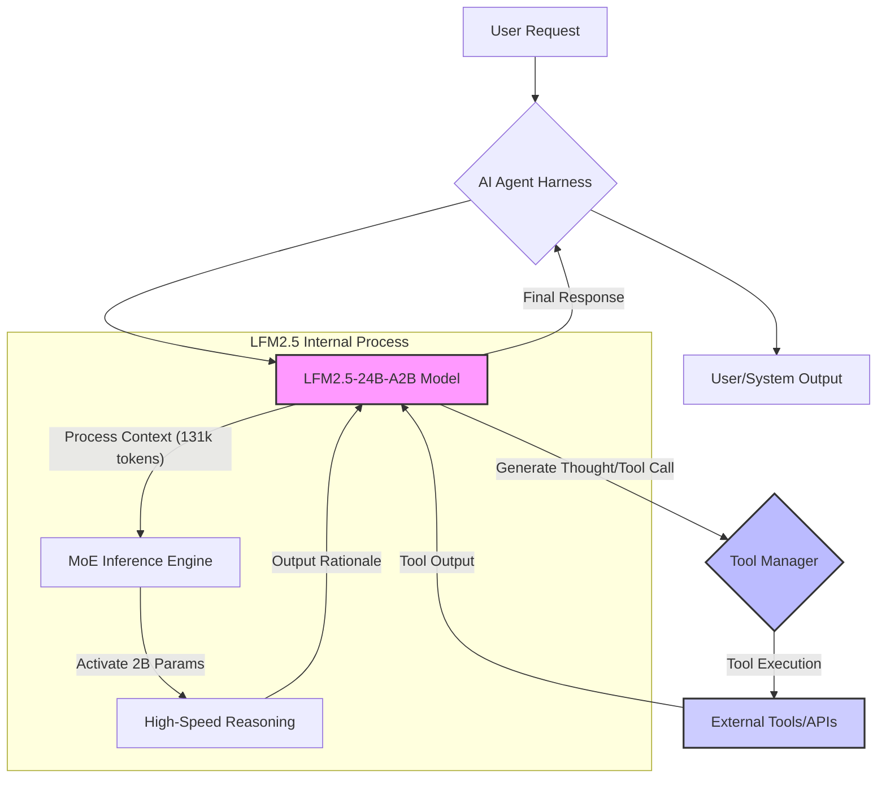

LFM2.5-24B-A2B는 Liquid AI가 로컬 AI 에이전트의 고속 추론과 복합적인 작업 수행 능력을 극대화하기 위해 설계한 혁신적인 공개 가중치 모델입니다. 특히 기기 내에서 도구를 빠르게 호출하고 여러 단계의 작업을 효율적으로 처리하도록 최적화되어, 기존 클라우드 기반 LLM의 한계를 뛰어넘는 새로운 활용 가능성을 제시합니다. 이 모델은 AI 에이전트의 온디바이스(on-device) 실행을 통해 지연 시간을 줄이고, 데이터 프라이버시를 강화하며, 클라우드 API 사용에 따른 비용을 절감하는 이점을 제공합니다. 2026년 현재, 로컬 AI 모델의 성능 향상과 활용 범위 확대는 주요 기술 트렌드 중 하나로 자리 잡고 있습니다. LFM2.5-24B-A2B의 도입 검토는 이러한 트렌드에 발맞춰 AI 에이전트 시스템의 효율성과 독립성을 한층 강화하는 중요한 단계입니다.

## 모델 아키텍처 및 핵심 기능

### MoE(Mixture-of-Experts) 구조의 효율성
LFM2.5-24B-A2B의 핵심은 MoE(Mixture-of-Experts) 아키텍처에 있습니다. 전체 240억 개에 달하는 파라미터 중 토큰당 약 20억 개만이 활성화되는 이 구조는 모델의 추론 속도를 비약적으로 향상시키면서도, 유사한 규모의 밀집 모델(dense model) 대비 높은 성능을 유지합니다. 이는 특히 실시간으로 도구를 호출하고 복잡한 의사결정을 내려야 하는 에이전트 환경에서 큰 장점으로 작용합니다. 활성화되는 파라미터 수가 적어 연산 자원 효율성도 높아, 로컬 환경에서의 구동 가능성을 높입니다.

### 고속 도구 호출 및 다단계 작업 처리 능력
이 모델은 AI 에이전트가 외부 도구를 빠르고 정확하게 호출하고, 이를 활용하여 복잡한 다단계 작업을 순차적으로 수행하는 데 특화되어 있습니다. 기존 LLM은 도구 호출 시의 지연 시간이나 여러 단계의 추론 과정에서 발생하는 오류로 인해 에이전트의 자율성이 저하되는 경우가 있었으나, LFM2.5-24B-A2B는 이러한 문제점을 개선하여 에이전트의 신뢰성과 효율성을 높입니다. 최종 답변 생성 전에 사고 과정을 명시적으로 생성하는 능력은 에이전트의 의사결정 과정을 투명하게 만들고, 디버깅 및 최적화를 용이하게 합니다.

### 131,072 토큰 컨텍스트 윈도우의 이점
이전 모델보다 4배 확대된 131,072 토큰의 방대한 컨텍스트 윈도우는 LFM2.5-24B-A2B의 또 다른 강점입니다. 이는 에이전트가 매우 긴 문서나 대화 기록, 복잡한 코드베이스 등을 한 번에 처리하고 종합적인 이해를 바탕으로 작업을 수행할 수 있도록 합니다. 장기적인 상호작용이 필요한 에이전트나 대규모 프로젝트 관리와 같이 광범위한 컨텍스트를 요구하는 시나리오에서 특히 유용하며, 컨텍스트 스위칭으로 인한 성능 저하를 최소화합니다.

## 기존 AI 에이전트 하네스 통합 및 검증

LFM2.5-24B-A2B 모델의 도입은 기존 AI 에이전트 시스템의 성능 향상 및 비용 효율성 최적화에 중요한 기여를 할 수 있습니다. 이식 계획에 따라, 모델 가중치를 다운로드하고 현재 운영 중인 AI 에이전트 하네스에 통합하여 기존 Claude API 기반 에이전트와 비교 테스트를 진행합니다.

### 통합 절차 및 테스트 시나리오
1.  **모델 가중치 다운로드**: Liquid AI에서 제공하는 LFM2.5-24B-A2B 모델의 공개 가중치를 확보하고, 로컬 추론 환경을 위한 준비를 진행합니다.
2.  **하네스 통합**: 기존 AI 에이전트 하네스에 LFM2.5 모델을 추론 엔진으로 연결합니다. 이 과정에서 모델 로딩, 입력/출력 인터페이스 정의, 도구 호출 메커니즘 연동 등을 구현합니다.
3.  **성능 및 비용 효율성 비교**: 특정 작업(예: 코드 분석 및 수정, 문서 요약, 복합 질의 응답)에 대해 LFM2.5 기반 에이전트와 Claude API 기반 에이전트의 성능(정확도, 응답 시간) 및 비용(API 사용료, 로컬 자원 소모)을 면밀히 비교합니다.
4.  **핵심 기능 검증**: 특히 LFM2.5의 강점인 '빠른 도구 호출'과 '여러 단계의 작업 수행' 성능을 집중 검증합니다. 예를 들어, 순차적으로 여러 API를 호출하여 데이터를 검색하고, 그 결과를 바탕으로 의사결정을 내리며, 최종 결과를 도출하는 복잡한 에이전트 워크플로우를 설계하여 테스트합니다.

다음은 LFM2.5 기반 로컬 에이전트가 도구를 사용하는 간략한 Python 예시 코드입니다.

```python
import lfm2_5_client
import external_tool_manager

class LocalAIAgent:
    def __init__(self, model_path="./lfm2_5_weights"): # LFM2.5 모델 경로
        self.model = lfm2_5_client.load_model(model_path)
        self.tool_manager = external_tool_manager.ToolManager()

    def execute_task(self, task_description: str) -> str:
        # 1. LFM2.5 모델에 초기 요청
        thought_process = self.model.generate_thought(task_description)
        print(f"Agent Thought: {thought_process}")

        # 2. 모델의 사고 과정에 따라 도구 호출 판단
        if "call_tool" in thought_process:
            tool_name, tool_args = self.parse_tool_call(thought_process)
            print(f"Calling tool: {tool_name} with args {tool_args}")
            tool_output = self.tool_manager.execute(tool_name, tool_args)
            print(f"Tool Output: {tool_output}")

            # 3. 도구 실행 결과를 다시 모델에 전달하여 다음 단계 추론
            final_response = self.model.generate_response(thought_process, tool_output)
            return final_response
        else:
            # 도구 호출 없이 직접 답변
            return self.model.generate_response(thought_process)

    def parse_tool_call(self, thought_process: str):
        # 사고 과정에서 도구 호출 정보 추출 로직 (예: JSON 파싱)
        # 실제 구현에서는 모델의 structured output 기능을 활용
        return "search_database", {"query": "latest stock prices"}

# 예제 실행
agent = LocalAIAgent()
result = agent.execute_task("Find the latest stock price for Apple and summarize market sentiment.")
print(f"Final Result: {result}")
```

### Mermaid 다이어그램: LFM2.5-24B-A2B 통합 워크플로우


## 트레이드오프

LFM2.5-24B-A2B와 같은 로컬 AI 에이전트 모델 도입에는 명확한 장단점이 존재하며, 프로젝트의 특성에 따라 신중한 평가가 필요합니다.

*   **비용 효율성**: 클라우드 API 호출 비용 절감 측면에서 우수합니다. 그러나 모델 유지보수, 하드웨어 투자, 전력 소모 등 초기 투자 및 지속적인 운영 비용이 발생할 수 있습니다. 짧고 반복적인 작업에는 유리하지만, 모델 업데이트나 특수 하드웨어 요구 사항이 발생하면 장기적인 비용 이점이 상쇄될 수 있습니다.
*   **데이터 프라이버시 및 보안**: 민감한 데이터를 외부로 전송할 필요가 없어 데이터 유출 위험이 낮고, 엄격한 규제 환경에서 유리합니다. 하지만 로컬 환경 자체의 보안 취약점 관리 및 모델 가중치 접근 제어에 대한 추가적인 노력이 필요합니다. 온프레미스(on-premise) 환경 또는 에지(edge) 디바이스에 적합합니다.
*   **낮은 지연 시간**: 로컬에서 추론이 이루어지므로 클라우드 통신에 따른 지연 시간을 없애고 거의 실시간에 가까운 응답을 제공합니다. 이는 사용자 경험이 중요한 애플리케이션이나 고주파(high-frequency) 에이전트 작업에 매우 유용합니다. 반면, 로컬 하드웨어 성능에 직접적인 영향을 받으므로, 충분한 GPU 자원 확보가 필수적입니다.
*   **특화된 에이전트 성능**: 특정 에이전트 작업(도구 호출, 다단계 처리)에 최적화되어 높은 성능을 보입니다. 하지만 일반적인 질문이나 광범위한 지식 기반의 추론에서는 범용 클라우드 LLM 대비 답변의 깊이나 범위가 제한될 수 있습니다. 특정 목적의 에이전트 개발에는 강력하나, 광범위한 도메인 지식이 필요한 경우에는 보완이 필요합니다.
*   **자원 관리 및 확장성**: 로컬 리소스에 의존하므로, 사용량 증가에 따른 확장성(scaling) 계획이 클라우드 서비스보다 복잡할 수 있습니다. 단일 기기 또는 소규모 클러스터에서는 예측 가능한 성능을 제공하지만, 대규모 동시 요청 처리가 필요한 경우 분산 추론 및 로드 밸런싱 아키텍처 구축이 필수적입니다.

## 실전 체크리스트

LFM2.5-24B-A2B 모델을 실제 프로젝트에 적용하기 전, 다음 항목들을 검증하여 성공적인 도입을 위한 기반을 마련해야 합니다.

- [ ] **하드웨어 및 환경 준비**: LFM2.5-24B-A2B 모델 구동에 필요한 최소 GPU 메모리(VRAM) 및 컴퓨팅 자원을 확보하고, 로컬 추론 환경(예: CUDA 드라이버, PyTorch/TensorFlow)을 성공적으로 구축했는가?
- [ ] **성능 벤치마킹**: 특정 도구 호출 및 다단계 작업 시나리오에서 LFM2.5 모델의 추론 지연 시간(latency)과 처리량(throughput)이 기존 Claude API 대비 목표 성능 지표를 충족하는지 정량적으로 측정했는가?
- [ ] **비용 분석**: LFM2.5 로컬 운영 시의 하드웨어 감가상각, 전력 소모, 유지보수 비용과 Claude API 사용 비용을 종합적으로 비교하여 장기적인 TCO(총 소유 비용) 이점을 확인했는가?
- [ ] **도구 통합 신뢰성**: LFM2.5 에이전트가 다양한 외부 도구를 안정적으로 호출하고, 도구 실행 실패 시 적절한 오류 처리 및 복구 메커니즘이 작동하는지 검증했는가?
- [ ] **컨텍스트 처리 능력**: 131,072 토큰 컨텍스트 윈도우를 활용하여 장문이나 복잡한 데이터 구조를 입력했을 때, 모델이 핵심 정보를 정확하게 이해하고 유의미한 추론을 수행하는지 확인했는가?
- [ ] **보안 및 규정 준수**: 로컬 환경에서 모델 가중치 및 민감 데이터에 대한 접근 제어, 데이터 암호화 등 보안 정책을 수립하고, 필요한 경우 데이터 거버넌스 규정(예: GDPR, CCPA)을 준수하는지 점검했는가?
- [ ] **지속적인 관리 및 업데이트**: 모델 성능 모니터링, 버전 관리, 정기적인 가중치 업데이트 또는 미세 조정(fine-tuning) 계획을 수립하여 장기적인 운영 전략을 마련했는가?