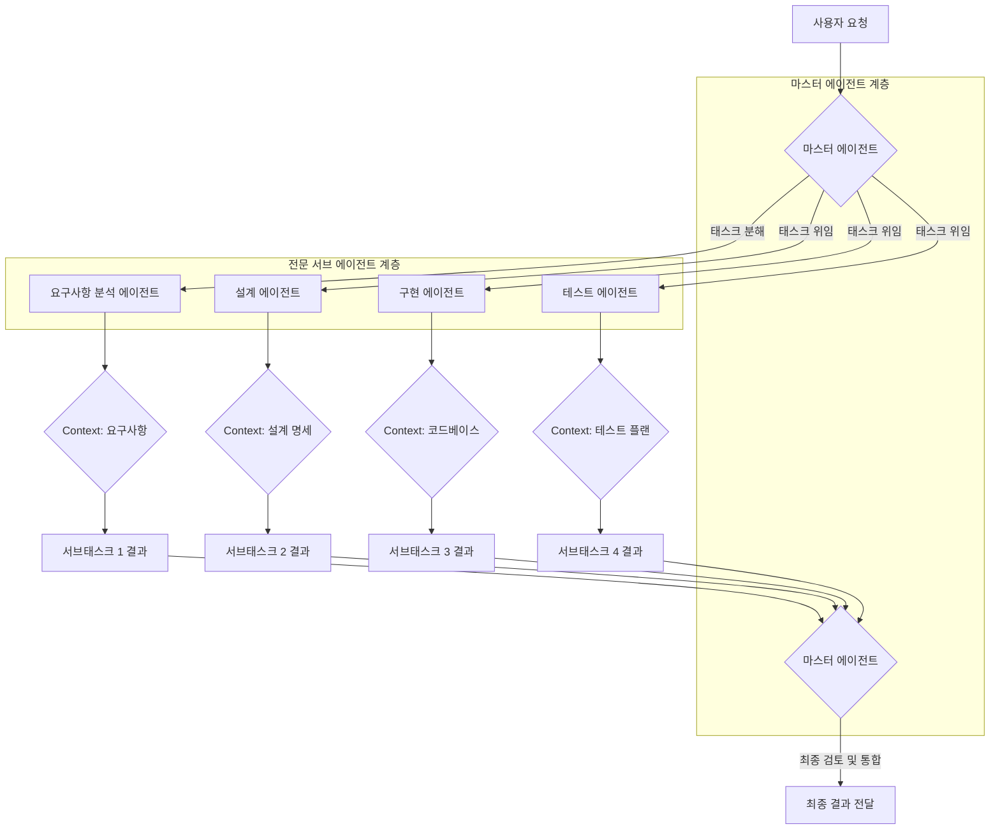

복잡한 문제를 해결하기 위한 대규모 언어 모델(LLM)의 잠재력은 엄청나지만, 단일 프롬프트로는 다단계 추론(multi-step reasoning)이나 복잡한 의사결정(complex decision-making)을 수행하는 데 한계가 있습니다. 이러한 난제를 극복하기 위해 LLM 에이전트 체인(Agent Chain) 디자인 패턴이 필수적입니다. 에이전트 체인은 LLM, 외부 도구(Tool), 메모리(Memory) 등을 유기적으로 연결하여 복잡한 태스크를 작은 단계로 분해하고, 각 단계를 순차적 또는 병렬적으로 실행하며, 필요에 따라 자기 수정(self-correction)하거나 외부 정보를 탐색하도록 설계된 아키텍처 패턴입니다. 견고하고 효율적인 LLM 에이전트 시스템을 구축하기 위해서는 이러한 설계 패턴에 대한 깊은 이해가 필수적입니다.

## 핵심 개념: LLM 에이전트 체인의 구성 요소
LLM 에이전트 체인은 기본적으로 다음 핵심 구성 요소들로 이루어집니다.
*   **LLM (Large Language Model)**: 각 단계에서 추론을 수행하거나 행동을 결정하는 두뇌 역할.
*   **도구 (Tools)**: 외부 API 호출, 데이터베이스 조회, 코드 실행 등 LLM의 능력을 확장하는 수단.
*   **메모리 (Memory)**: 대화 기록, 이전 실행 결과, 장기 기억(Long-term Memory) 등 에이전트가 정보를 유지하고 활용할 수 있도록 돕습니다.
*   **오케스트레이터 (Orchestrator)**: 체인의 흐름을 제어하고, 다음 스텝을 결정하며, 각 구성 요소 간의 상호작용을 관리합니다.
*   **관찰 (Observation)**: 도구 실행 결과나 LLM의 응답을 통해 얻은 정보로, 다음 행동 결정의 근거가 됩니다.

## LLM 에이전트 체인 디자인 패턴

### 1. 순차 체인 (Sequential Chain)
가장 기본적인 패턴으로, 일련의 작업을 정해진 순서대로 실행합니다. 각 단계의 출력은 다음 단계의 입력이 됩니다. 간단한 워크플로우에 적합하며 구현이 용이하지만, 복잡한 로직이나 조건부 분기에는 유연성이 떨어집니다.

**적용 사례**: 사용자 질의 -> 정보 검색 -> 답변 요약

### 2. 병렬 체인 (Parallel Chain)
독립적으로 실행될 수 있는 여러 서브태스크(Sub-task)를 동시에 처리하는 패턴입니다. 전체 작업 시간을 단축하고, 각 서브태스크의 독립성을 보장합니다. 최종 결과를 얻기 위해 병렬 실행된 결과들을 통합하는 단계가 필요합니다.

**적용 사례**: 사용자 요청 분석 -> 데이터베이스 조회 및 웹 검색 동시 실행 -> 결과 통합 및 요약

### 3. 계층적 체인 (Hierarchical Chain)
복잡한 문제를 상위 레벨의 마스터 에이전트(Master Agent)가 하위 레벨의 전문 서브 에이전트(Sub-agent)들에게 위임하여 해결하는 패턴입니다. 마스터 에이전트는 전체 목표를 관리하고, 서브 에이전트들은 특정 도메인 지식이나 도구를 활용하여 구체적인 작업을 수행합니다. 문제 분해(Task Decomposition) 능력과 확장성이 뛰어납니다.

**적용 사례**: 소프트웨어 개발 프로젝트 관리 -> 요구사항 분석, 설계, 코딩, 테스트 등 각 단계별 전문 에이전트에게 위임.

### 4. 반성 및 자기 수정 체인 (Reflection & Self-Correction Chain)
에이전트가 자신의 이전 행동이나 생성된 출력을 평가하고, 오류나 개선점을 식별하여 다음 반복(Iteration)에서 이를 수정하도록 하는 패턴입니다. 피드백 루프(Feedback Loop)를 통해 에이전트의 성능과 정확성을 지속적으로 향상시킬 수 있습니다. 특히 코드 생성, 보고서 작성 등 높은 정확도를 요구하는 작업에 유용합니다.

**적용 사례**: LLM이 생성한 코드 -> 코드 실행 및 테스트 -> 테스트 결과 분석 -> LLM에 피드백 -> 코드 수정 및 재시도.

### 5. 사고의 나무/그래프 (Tree of Thoughts / Graph of Thoughts)
단일 추론 경로 대신 여러 가지 가능한 사고 경로를 탐색하고, 각 경로의 유망성을 평가하여 최적의 경로를 선택하는 고급 추론 패턴입니다. 백트래킹(backtracking)이나 가지치기(pruning) 메커니즘을 포함하여 비효율적인 경로를 제거합니다. 복잡한 의사결정, 창의적 문제 해결, 최적화 문제에 특히 강력합니다.

**적용 사례**: 주어진 제약 조건 내에서 복잡한 최적화 문제 해결, 여러 가설을 동시에 탐색하고 검증하는 과학 연구 보조.

## Mermaid Diagram: 계층적 에이전트 체인 예시


## 코드 예제: 간단한 순차 체인 구현 (Python 유사 코드)
```python
import json

class LLMAgent:
    def __init__(self, name, llm_model, tools=None):
        self.name = name
        self.llm = llm_model # Placeholder for actual LLM API client
        self.tools = {tool.name: tool for tool in tools} if tools else {}

    def run(self, prompt, context=None):
        full_prompt = f"Agent: {self.name}. Task: {prompt}. Context: {context if context else 'None'}. Use available tools if necessary."
        # Simulate LLM call and tool use
        print(f"[{self.name}] Processing: {prompt}")
        if "search" in prompt.lower() and "web_search" in self.tools:
            print(f"[{self.name}] Using web_search tool for: {prompt}")
            search_query = prompt.replace("search for", "").strip()
            result = self.tools["web_search"].execute(search_query)
            return f"Search result for '{search_query}': {result}"
        # Fallback LLM response
        return f"LLM output for '{prompt}' from {self.name}."

class WebSearchTool:
    def __init__(self):
        self.name = "web_search"

    def execute(self, query):
        # Simulate web search API call
        print(f"[Tool: WebSearch] Searching for: {query}")
        return f"Data found for {query}."

class SummaryTool:
    def __init__(self):
        self.name = "summary_tool"

    def execute(self, text_to_summarize):
        # Simulate summarization API call or LLM call
        print(f"[Tool: Summary] Summarizing text.")
        return f"Summarized: {text_to_summarize[:50]}..."

# Initialize tools
web_search = WebSearchTool()
summary_tool = SummaryTool()

# Initialize agents
data_fetcher_agent = LLMAgent("DataFetcher", "gpt-4", tools=[web_search])
analyst_agent = LLMAgent("Analyst", "claude-3-opus", tools=[summary_tool])
reporter_agent = LLMAgent("Reporter", "gemini-1.5-pro")

# Sequential Chain Execution
def execute_sequential_chain(initial_query):
    print("\n--- Starting Sequential Chain ---")

    # Step 1: Data Fetching
    fetch_result = data_fetcher_agent.run(f"search for '{initial_query}' data")
    print(f"[Chain] Data Fetcher Output: {fetch_result}")

    # Step 2: Analysis and Summarization
    analysis_prompt = f"Analyze and summarize the following data: {fetch_result}"
    analysis_result = analyst_agent.run(analysis_prompt, context=fetch_result)
    print(f"[Chain] Analyst Output: {analysis_result}")

    # Step 3: Reporting
    final_report_prompt = f"Generate a report based on the summarized analysis: {analysis_result}"
    final_report = reporter_agent.run(final_report_prompt, context=analysis_result)
    print(f"[Chain] Reporter Output: {final_report}")

    print("--- Sequential Chain Finished ---")
    return final_report

# Example usage
# execute_sequential_chain("2026 AI market trends")
```
_참고: 위 코드는 LLM 에이전트 체인의 개념을 설명하기 위한 의사 코드(pseudo-code)로, 실제 프로덕션 환경에서는 LangChain, LlamaIndex와 같은 프레임워크나 자체 오케스트레이션 로직이 필요합니다._

## 2026년 최신 트렌드 반영: 적응형 에이전트 체인과 안전성
2026년에는 LLM 에이전트 체인 디자인에서 다음 트렌드들이 더욱 중요해지고 있습니다.
*   **동적 체인 라우팅 (Dynamic Chain Routing)**: 사전 정의된 정적 체인 대신, 실시간으로 태스크의 복잡성, 가용 도구, 현재 컨텍스트에 따라 가장 적합한 체인 패턴(순차, 병렬, 계층 등)을 동적으로 선택하고 조합하는 접근 방식이 주목받고 있습니다. 이는 `llm-agent-dynamic-tool-selection-optimization` 및 `llm-prompt-routing-dynamic-optimization`과 연관됩니다.
*   **강화된 안전성 및 가드레일 (Enhanced Safety & Guardrails)**: 에이전트 체인의 복잡성이 증가함에 따라, 의도치 않은 행동(unintended behavior)이나 비용 초과(cost overrun)를 방지하기 위한 `ai-agent-control-accountability-guardrails` 및 `ai-agent-safety-constraint-control-design-patterns`와 같은 강력한 가드레일 설계가 필수적입니다. 각 체인 단계에서 출력 검증(output validation), 권한 제어(access control), 비용 모니터링(cost monitoring) 메커니즘이 통합됩니다.
*   **지속적인 학습 및 적응 (Continuous Learning & Adaptation)**: 에이전트 체인의 실행 로그와 성공/실패 사례를 분석하여 패턴 자체를 개선하고, 새로운 도구를 동적으로 학습하여 체인의 성능을 최적화하는 `agent-self-correction-retrospection-loop-implementation` 및 `agent-rationale-storage-decision-learning-system` 등의 방식이 연구되고 있습니다.

## 트레이드오프
*   **복잡성 vs. 견고성 (Complexity vs. Robustness)**
    *   **언제 좋고**: 다단계의 복잡한 추론이나 다양한 외부 도구 연동이 필요한 경우, 체인 디자인은 시스템의 견고성과 문제 해결 능력을 크게 향상시킵니다. 에러 발생 시 특정 단계에서 복구하거나 재시도하는 로직 구현이 용이합니다.
    *   **언제 나쁜지**: 간단하고 예측 가능한 단일 태스크의 경우, 체인 도입은 불필요한 복잡성을 증가시키고 개발 및 디버깅 오버헤드를 초래할 수 있습니다. 각 단계 간의 의존성 관리도 어려워질 수 있습니다.

*   **비용 vs. 정확도 (Cost vs. Accuracy)**
    *   **언제 좋고**: 여러 단계를 거치며 LLM 호출 및 도구 사용이 많아지므로 초기 비용은 증가할 수 있지만, 이는 결과물의 정확도와 신뢰도를 높여 장기적으로는 비즈니스 가치 증대 및 인력 개입 비용 감소로 이어질 수 있습니다.
    *   **언제 나쁜지**: 매 단계마다 LLM 호출이 발생하여 토큰 사용량이 급증할 수 있으며, 이는 특히 비용에 민감한 애플리케이션이나 대량 처리 환경에서 치명적인 단점이 될 수 있습니다. 신중한 프롬프트 최적화가 필요합니다.

*   **지연 시간 vs. 병렬 처리 (Latency vs. Parallelism)**
    *   **언제 좋고**: 순차적 체인은 각 단계의 결과가 다음 단계에 영향을 미칠 때 논리적인 흐름을 보장합니다. 병렬 체인은 독립적인 서브태스크를 동시에 처리하여 전체 지연 시간을 효과적으로 줄일 수 있습니다.
    *   **언제 나쁜지**: 순차적 체인의 경우 각 단계의 지연 시간이 누적되어 전체 작업 완료 시간이 길어질 수 있습니다. 병렬 체인이라도 결과 병합(merge) 단계에서 병목 현상이 발생하거나, 서브태스크 간의 의존성이 잘못 정의되면 예상치 못한 오류를 초래할 수 있습니다.

*   **유연성 vs. 예측 가능성 (Flexibility vs. Predictability)**
    *   **언제 좋고**: 동적 라우팅을 포함한 고급 체인 패턴은 다양한 시나리오에 유연하게 대응하고 새로운 태스크에 빠르게 적응할 수 있게 합니다. 이는 변화하는 요구사항에 대한 시스템의 회복탄력성(resilience)을 높입니다.
    *   **언제 나쁜지**: 유연성이 높아질수록 체인의 동작을 예측하고 디버깅하기가 어려워질 수 있습니다. 예상치 못한 경로로 실행되거나 무한 루프에 빠질 위험이 있으며, 이는 시스템의 안정성과 신뢰성에 영향을 미칠 수 있습니다.

## 실전 체크리스트
*   [ ] 태스크 분해 및 에이전트 역할 정의: 해결하려는 복잡한 문제를 명확하게 식별하고, 각 단계별로 필요한 에이전트의 역할(LLM, 도구, 메모리 포함)을 구체적으로 정의했는가?
*   [ ] 체인 패턴 선택 및 정당성 확보: 문제의 특성(순차적, 병렬적, 계층적, 반복적)에 가장 적합한 체인 디자인 패턴을 선택하고, 그 선택의 기술적/비즈니스적 정당성을 확보했는가? (예: `agents/llm-agent-chain-design-complex-multi-stage-tasks` 참조)
*   [ ] 입력/출력 스키마 및 인터페이스 정의: 각 체인 스텝 간의 데이터 흐름과 LLM, 도구의 입력/출력 스키마를 명확하게 정의하고, 에이전트 간의 인터페이스를 표준화했는가?
*   [ ] 에러 핸들링 및 재시도 로직 구현: 각 체인 단계에서 발생할 수 있는 잠재적 오류(LLM 응답 실패, 도구 오류, 타임아웃 등)를 식별하고, 적절한 에러 핸들링, 재시도(retry), 폴백(fallback) 로직을 구현했는가? (예: `agents/autonomous-agent-error-recovery-resilient-design` 참조)
*   [ ] 비용 및 지연 시간 모니터링 및 최적화: LLM 토큰 사용량, 도구 호출 비용, 각 체인 스텝의 지연 시간을 실시간으로 모니터링하고, 병목 현상 제거 및 비용 효율성 최적화 방안을 마련했는가? (예: `harness-engineering/llm-cost-optimization-design-patterns` 참조)
*   [ ] 자기 수정 및 반성 메커니즘 통합: 중요한 의사결정이나 최종 결과물 생성 단계에서 에이전트 스스로 결과를 검토하고 개선할 수 있는 반성(reflection) 또는 자기 수정(self-correction) 메커니즘을 통합했는가? (예: `agents/agent-self-correction-retrospection-loop-implementation` 참조)
*   [ ] 가드레일 및 안전성 검증: LLM의 유해하거나 의도치 않은 행동을 방지하기 위한 가드레일(guardrails)을 구현하고, `ai-agent-safety-constraint-control-design-patterns` 문서를 참고하여 체인 전체의 안전성을 체계적으로 검증했는가?