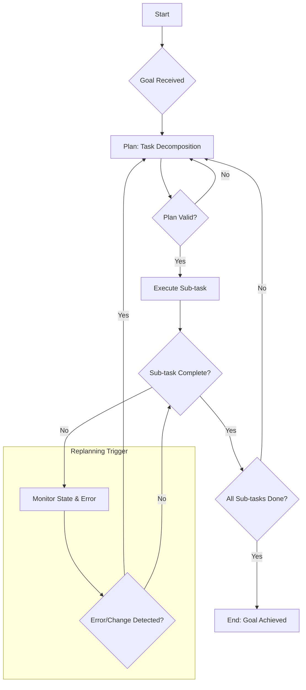

LLM 기반 자율 에이전트(Autonomous Agents)가 복잡한 목표를 효과적으로 달성하기 위해서는 작업 분해(Task Decomposition)와 동적 재계획(Dynamic Replanning) 능력이 필수적입니다. 단일 프롬프트로 해결하기 어려운 다단계 문제나 불확실성이 높은 환경에서 에이전트의 신뢰성과 효율성을 극대화하는 핵심 패턴입니다.

## 작업 분해(Task Decomposition)
작업 분해는 주어진 상위 수준 목표(high-level goal)를 더 작고 관리 가능한 하위 작업(sub-tasks)으로 나누는 과정입니다. 이는 LLM이 각 하위 작업을 개별적으로 추론하고 실행할 수 있게 하여, 전체 문제의 복잡성을 줄이고 에이전트의 '사고' 과정을 구조화합니다.

### 상향식(Bottom-Up) vs. 하향식(Top-Down) 분해
*   **하향식 분해 (Top-Down Decomposition)**: 전체 목표에서 시작하여 점진적으로 세부 단계를 정의합니다. 일반적으로 계획(Planning) 단계에서 LLM이 큰 그림을 그리고, 이를 더 작은 논리적 단위로 나눕니다.
    *   예: "웹 애플리케이션 개발" -> "프런트엔드 개발", "백엔드 개발", "데이터베이스 설계" -> 각 파트를 또 세분화
*   **상향식 분해 (Bottom-Up Synthesis)**: 사용 가능한 도구(Tools)나 기본 동작(Primitive Actions)을 기반으로, 어떤 하위 작업들을 조합해야 목표에 도달할 수 있을지 역추적합니다. 특정 도구 세트에 제약이 있거나, 탐색적 문제 해결에 유용합니다.
    *   예: "파일 읽기", "API 호출", "코드 생성"과 같은 기능들을 조합하여 특정 데이터 처리 로직 구현

## 동적 재계획(Dynamic Replanning)
자율 에이전트가 예측 불가능한 실세계 환경과 상호작용할 때, 초기 계획은 종종 예상치 못한 오류, 환경 변화 또는 새로운 정보로 인해 무효화될 수 있습니다. 동적 재계획은 이러한 상황에 대응하여 현재 상태를 평가하고, 필요에 따라 기존 계획을 수정하거나 완전히 새로운 계획을 생성하는 메커니즘입니다.

### 재계획 트리거 (Replanning Triggers)
재계획은 다음과 같은 상황에서 트리거될 수 있습니다.
*   **하위 작업 실패 (Sub-task Failure)**: 특정 하위 작업이 예상대로 완료되지 않거나 오류를 반환했을 때.
*   **환경 변화 (Environmental Change)**: 에이전트가 인식하는 외부 환경이 초기 계획과 달라졌을 때 (예: 파일 삭제, 외부 API 변경).
*   **새로운 정보 (New Information)**: 작업 수행 중 목표 달성에 유리하거나 필수적인 새로운 정보가 발견되었을 때.
*   **시간 초과 (Timeout)**: 특정 작업이 설정된 시간 내에 완료되지 않았을 때.
*   **피드백 루프 (Feedback Loop)**: 인간 사용자 또는 다른 에이전트로부터의 피드백.

### 재계획 메커니즘
LLM은 현재까지의 실행 기록, 현재 환경 상태, 실패 원인 등을 종합적으로 고려하여 새로운 추론을 수행하고, 새로운 작업 분해 및 실행 순서를 제안합니다. 이는 단순한 재시도(retry)를 넘어, 문제의 근본 원인을 파악하고 더 효과적인 해결 전략을 모색하는 과정입니다.

## 패턴 구현: Plan-Execute-Monitor-Replan (PEMR) Loop

이 패턴은 에이전트가 계획을 세우고, 실행하고, 모니터링하며, 필요 시 재계획하는 순환 구조를 따릅니다.



**코드 예시 (Python-like Pseudocode)**:
다음은 LLM 기반 에이전트가 작업 분해 및 재계획을 수행하는 기본적인 워크플로우를 보여줍니다.

```python
class LLMAgent:
    def __init__(self, llm_client, tools):
        self.llm = llm_client
        self.tools = tools
        self.current_goal = None
        self.current_plan = []
        self.history = []

    def plan(self, goal, context=""):
        prompt = f"""
        Given the ultimate goal: "{goal}"
        And the current context: "{context}"

        Break down this goal into a sequential list of atomic, executable sub-tasks.
        Consider available tools: {list(self.tools.keys())}
        Each sub-task should be a clear action.
        Output format: A numbered list of sub-tasks.
        """
        response = self.llm.generate(prompt)
        # Parse response into self.current_plan list
        self.current_plan = self.parse_plan(response.text)
        print(f"New Plan: {self.current_plan}")
        return self.current_plan

    def execute_sub_task(self, sub_task):
        tool_name, args = self.extract_tool_call(sub_task)
        if tool_name in self.tools:
            try:
                result = self.tools[tool_name](**args)
                self.history.append({"task": sub_task, "status": "success", "result": result})
                return "success", result
            except Exception as e:
                self.history.append({"task": sub_task, "status": "failure", "error": str(e)})
                return "failure", str(e)
        else:
            self.history.append({"task": sub_task, "status": "failure", "error": "Tool not found"})
            return "failure", "Tool not found"

    def replan(self, goal, failed_task, error_info):
        context = f"""
        Original Goal: "{goal}"
        Execution History: {self.history}
        Failed Task: "{failed_task}"
        Error Information: "{error_info}"
        
        The previous plan failed at "{failed_task}".
        Based on the history and error, devise a new strategy.
        Break down the remaining work, or propose a completely new plan to achieve the goal.
        Output format: A numbered list of sub-tasks.
        """
        return self.plan(goal, context)

    def run(self, goal):
        self.current_goal = goal
        self.plan(self.current_goal)

        while self.current_plan:
            next_task = self.current_plan.pop(0)
            status, result = self.execute_sub_task(next_task)
            
            if status == "failure":
                print(f"Task failed: {next_task}, Error: {result}")
                self.replan(self.current_goal, next_task, result)
                # After replanning, current_plan will be updated.
                # The loop will naturally pick up the new plan.
                if not self.current_plan: # If replanning yielded no new tasks, stop.
                    print("Replanning failed to generate new tasks. Stopping.")
                    break
            else:
                print(f"Task succeeded: {next_task}, Result: {result}")
        
        print("Goal achieved or stopped due to unresolvable issues.")

    def parse_plan(self, text):
        # Implement robust parsing from LLM output (e.g., regex for numbered lists)
        return [f"step {i}" for i in range(1, 4)] # Placeholder

    def extract_tool_call(self, sub_task):
        # Implement parsing to extract tool_name and arguments from sub_task string
        # Example: "CallTool(search_web, query='latest LLM trends')"
        return "dummy_tool", {"query": sub_task} # Placeholder
```
이 예제에서 `plan` 메서드는 LLM을 호출하여 목표를 하위 작업으로 분해하고, `execute_sub_task`는 실제 작업을 수행합니다. 실패 시 `replan` 메서드가 호출되어 LLM에 실패 컨텍스트를 제공하고 새로운 계획을 요청합니다.

## 트레이드오프

*   **세분화 깊이 (Granularity of Decomposition)**
    *   **장점**: 작은 작업은 LLM의 추론 오류를 줄이고, 실패 지점 디버깅을 용이하게 합니다. 재사용 가능한 모듈형 작업으로 구성될 수 있습니다.
    *   **단점**: 과도한 세분화는 계획의 길이를 늘려 LLM 호출 횟수와 비용을 증가시키고, 컨텍스트 관리를 복잡하게 만듭니다.
    *   **언제 좋고/언제 나쁜지**: 복잡하고 불확실성이 높은 초기 탐색 단계나 장기 실행 작업에 좋습니다. 간단하고 예측 가능한 단일 작업에는 불필요합니다.

*   **재계획 빈도 (Frequency of Replanning)**
    *   **장점**: 환경 변화나 오류에 대한 에이전트의 반응성을 높여 신뢰성을 향상시킵니다. 예상치 못한 상황에서 막히지 않고 유연하게 대응합니다.
    *   **단점**: 잦은 재계획은 LLM 호출로 인한 추가적인 지연과 비용을 발생시키고, 계획 불안정성(Plan Instability)을 초래할 수 있습니다.
    *   **언제 좋고/언제 나쁜지**: 동적인 실시간 환경, 외부 API 의존도가 높은 작업, 장기 실행 프로젝트에 좋습니다. 정적이고 확정적인 내부 연산에는 오버헤드입니다.

*   **컨텍스트 관리 (Context Management for Planning)**
    *   **장점**: 충분한 컨텍스트(실행 기록, 환경 상태)는 LLM이 더 정확하고 상황에 맞는 계획/재계획을 세우는 데 도움을 줍니다.
    *   **단점**: 너무 많은 컨텍스트는 LLM의 컨텍스트 윈도우 한계를 초과하거나, 불필요한 정보로 인해 LLM의 성능을 저하시키고 비용을 증대시킵니다.
    *   **언제 좋고/언제 나쁜지**: 장기적인 목표를 가진 에이전트, 과거의 실패를 학습해야 하는 경우에 좋습니다. 단기적이고 독립적인 작업에는 핵심 정보만 선별하여 제공하는 것이 좋습니다.

*   **도구 통합 복잡성 (Tool Integration Complexity)**
    *   **장점**: 풍부하고 다양한 도구(Tools)는 에이전트의 능력과 문제 해결 범위를 확장합니다. LLM은 특정 도구의 기능을 활용하여 더 정교한 계획을 세울 수 있습니다.
    *   **단점**: 새로운 도구를 통합하고 관리하는 데 추가적인 개발 노력이 필요하며, LLM이 도구를 올바르게 선택하고 사용하는 방법을 학습하는 데 어려움이 있을 수 있습니다.
    *   **언제 좋고/언제 나쁜지**: 다양한 외부 시스템과 연동해야 하는 실제 비즈니스 로직 자동화에 필수적입니다. 단일 기능만 필요한 경우 간단한 도구만으로 충분합니다.

## 실전 체크리스트

LLM 기반 자율 에이전트의 작업 분해 및 재계획 패턴을 프로젝트에 적용할 때 다음 항목들을 검증하세요.

*   [ ] **하위 작업 명확성 및 원자성 검증**: LLM이 분해한 하위 작업들이 충분히 작고 명확하며, 단일 목표를 갖는지 확인합니다. 모호하거나 너무 큰 작업은 재분해하도록 유도합니다.
*   [ ] **재계획 트리거 로직 설계**: 오류 유형, 환경 변화 감지, 시간 초과 등 재계획을 유발하는 조건을 구체적으로 정의하고 시스템에 구현했는지 확인합니다.
*   [ ] **에이전트 상태 및 기록 관리**: 에이전트가 현재 진행 상황, 이전 실행 결과, 실패 원인 등 재계획에 필요한 모든 관련 컨텍스트를 효과적으로 저장하고 검색하는 메커니즘을 갖추었는지 검증합니다.
*   [ ] **재계획 루프의 발산 방지**: 무한 재계획 루프(infinite replanning loop)에 빠지지 않도록, 재계획 횟수 제한, 실패 원인 학습, 또는 휴먼 인 더 루프(human-in-the-loop) 개입 트리거를 구현했는지 확인합니다.
*   [ ] **도구 사용의 견고성**: 에이전트가 사용하는 도구(Tools)의 오류 처리(error handling)가 견고하며, 도구 실패 시 LLM이 의미 있는 정보를 받고 재계획에 활용할 수 있는지 테스트합니다.
*   [ ] **비용 및 성능 최적화**: 계획 및 재계획 과정에서 발생하는 LLM 호출 횟수와 토큰 사용량을 모니터링하고, 과도한 비용 발생 없이 적절한 응답 시간(latency)을 유지하는지 측정합니다.
*   [ ] **복잡한 시나리오 테스트 케이스**: 에이전트가 여러 번의 재계획을 거쳐야만 해결할 수 있는, 예측 불가능한 복잡한 시나리오를 포함하는 테스트 케이스를 충분히 마련했는지 확인합니다.