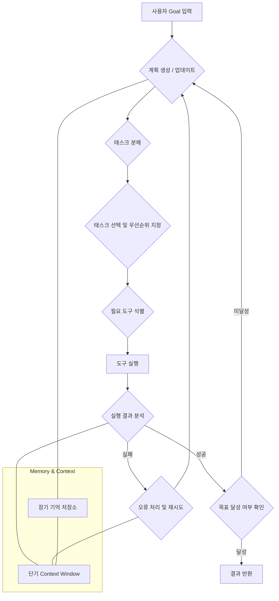

실용적인 LLM 에이전트는 단순히 지시를 따르는 것을 넘어 복잡한 문제를 해결하고 자율적으로 목표를 달성해야 합니다. 이를 위해서는 체계적인 Task Planning (태스크 플래닝)과 Execution Patterns (실행 패턴)이 필수적입니다. 복잡한 목표를 달성하기 위해 에이전트는 문제를 하위 태스크로 분해하고, 각 태스크를 실행하며, 그 결과를 평가하여 다음 단계를 계획하는 순환적인 프로세스를 거칩니다.

## 태스크 플래닝: 복잡성 분해
에이전트가 복잡한 목표를 해결하기 위한 첫 단계는 태스크를 효과적으로 계획하는 것입니다. 이는 일반적으로 목표를 더 작고 관리 가능한 하위 태스크로 분해하는 Task Decomposition (태스크 분해) 과정과, 이들을 어떤 순서로 처리할지 결정하는 Sequencing (순서화)으로 구성됩니다.

### 계층적 플래닝 및 반복적 정제
*   **Hierarchical Planning (계층적 플래닝)**: 큰 목표를 점진적으로 세분화하여 실행 가능한 작은 단위로 만듭니다. 예를 들어, "웹사이트 개발"이라는 목표는 "프론트엔드 개발", "백엔드 개발", "데이터베이스 구축"으로 나뉘고, 다시 "프론트엔드 개발"은 "UI 컴포넌트 구현", "API 연동" 등으로 세분화될 수 있습니다.
*   **Iterative Refinement (반복적 정제)**: 초기 계획은 대략적일 수 있으며, 실행 과정에서 발생하는 정보나 예상치 못한 문제에 따라 계획을 동적으로 수정하고 정제하는 것이 중요합니다. Self-reflection (자기 성찰) 메커니즘을 통해 에이전트 스스로 계획의 효율성과 정확성을 평가하고 개선합니다.

### 주요 플래닝 패턴
*   **Chain of Thought (CoT)**: LLM이 추론 과정을 단계별로 명시적으로 보여주게 하여 복잡한 문제 해결 능력을 향상시킵니다.
*   **Tree of Thought (ToT)**: CoT의 확장으로, 여러 가능한 추론 경로를 탐색하고 유망한 경로를 선택하여 더 심층적인 계획을 세웁니다.
*   **ReAct (Reasoning and Acting)**: LLM이 Reason (추론)과 Act (행동, 즉 도구 사용)를 번갈아 가며 수행하도록 지시하여 동적인 문제 해결 능력을 제공합니다. 이는 특히 외부 도구 사용이 필수적인 에이전트에서 강력한 패턴입니다.
*   **Auto-GPT Style**: 초기 목표를 기반으로 스스로 태스크 목록을 생성하고, 실행하고, 평가하며, 다음 태스크를 동적으로 결정하는 자율적인 루프입니다. 이 방식은 높은 자율성을 제공하지만, 통제 및 비용 측면에서 Guardrails (안전 장치)가 필수적입니다.

```python
class LLMAgent:
    def __init__(self, llm_model, tools):
        self.llm = llm_model
        self.tools = tools
        self.memory = []

    def plan(self, objective, current_state):
        prompt = f"""Given the objective: "{objective}" and current state: "{current_state}",
        break down the objective into a list of atomic tasks. Provide justification for each task.
        Also, suggest which tool to use for each task. Output in JSON format.
        Example: {{
            "plan": [
                {{"task": "Identify user query intent", "tool": "None", "reason": "Understand goal"}},
                {{"task": "Search relevant documents", "tool": "search_tool", "reason": "Gather info"}}
            ]
        }}
        """
        response = self.llm.invoke(prompt)
        # Parse JSON response and return plan
        return json.loads(response.content) # Assuming JSON output

    def execute_task(self, task_description, tool_name, context):
        if tool_name == "None":
            return self.llm.invoke(f"Process task: {task_description} with context: {context}").content
        else:
            tool = self.tools.get(tool_name)
            if tool:
                return tool.run(task_description, context) # Assuming tool.run method
            else:
                raise ValueError(f"Tool '{tool_name}' not found.")

    def run(self, objective):
        current_state = "Initial state."
        while True:
            plan_response = self.plan(objective, current_state)
            plan = plan_response.get("plan", [])

            if not plan:
                print("No more tasks planned. Exiting.")
                break

            for task_item in plan:
                task = task_item["task"]
                tool = task_item["tool"]
                print(f"Executing: {task} using {tool}")
                try:
                    result = self.execute_task(task, tool, current_state)
                    self.memory.append(f"Task: {task}, Result: {result}")
                    current_state = f"Previous state: {current_state}\nLatest result: {result}"
                except Exception as e:
                    print(f"Error executing task '{task}': {e}. Reflecting...")
                    # Self-correction/reflection logic here
                    current_state = f"Previous state: {current_state}\nError: {e}"
                    break # Re-plan on error
            
            # Check for objective completion or re-plan
            if self.llm.invoke(f"Is the objective '{objective}' achieved given the state: {current_state}?").content.lower() == "yes":
                print("Objective achieved!")
                break

# Example Tool (conceptual)
class SearchTool:
    def run(self, query, context):
        print(f"Searching for '{query}' with context '{context}'")
        return "Search results for: " + query

# Usage (conceptual)
# llm_model = YourLLMInterface()
# agent_tools = {"search_tool": SearchTool()}
# agent = LLMAgent(llm_model, agent_tools)
# agent.run("Research LLM agent frameworks and summarize their pros and cons.")
```

## 태스크 실행: 견고함과 적응성
계획된 태스크는 실제로 시스템에서 실행되어야 합니다. 이 과정에서 에이전트는 외부 도구와 상호작용하고, 실행 결과를 모니터링하며, 오류를 처리하고, 필요시 계획을 조정해야 합니다.

### 핵심 실행 전략
*   **Tool Use Integration (도구 사용 통합)**: 에이전트는 API 호출, 코드 실행, 데이터베이스 쿼리 등 다양한 외부 Tools (도구)를 활용하여 실제 환경과 상호작용합니다. 도구의 명확한 Schema Definition (스키마 정의)과 Error Handling (오류 처리) 전략이 중요합니다.
*   **State Management (상태 관리)**: 장기 실행 태스크의 경우 에이전트의 현재 State (상태)와 진행 상황을 지속적으로 추적하고 저장해야 합니다. 이를 통해 에이전트는 중단된 지점부터 작업을 재개하거나, 여러 태스크 간에 컨텍스트를 공유할 수 있습니다.
*   **Execution Monitoring (실행 모니터링)**: 각 태스크의 실행 결과를 실시간으로 모니터링하고, 성공/실패 여부, 소요 시간, 자원 사용량 등을 기록해야 합니다. 이를 통해 Malfunctions (오작동)이나 Cost Overruns (비용 초과)를 조기에 감지하고 대응할 수 있습니다. 2026년에는 Observability (관측 가능성)가 더욱 강조되어, 에이전트의 내부 추론 과정까지 시각화하는 도구가 발전하고 있습니다.

### 에이전트 실행 루프 다이어그램


### 실용적인 고려사항: 2026 트렌드
*   **Adaptive Planning (적응형 플래닝)**: 실시간으로 변화하는 환경에 맞춰 계획을 동적으로 조정하는 능력. 예를 들어, Multimodal Input (다중 모달 입력)을 통해 시각적 정보를 얻어 계획에 반영하는 방식입니다.
*   **Robust Error Recovery (견고한 오류 복구)**: 단순한 재시도를 넘어, 오류의 근본 원인을 분석하고 계획 자체를 수정하는 Self-correction (자기 수정) 메커니즘이 중요합니다.
*   **Human-in-the-Loop (인간 개입)**: 중요한 의사결정 지점이나 불확실성이 높은 상황에서 인간의 승인이나 피드백을 받아 에이전트의 안정성과 신뢰성을 높이는 패턴이 보편화되고 있습니다. Human Checkpoints (인간 체크포인트)는 비용과 안전성을 동시에 관리하는 핵심 전략입니다.
*   **Cost Efficiency (비용 효율성)**: 불필요한 LLM 호출이나 도구 사용을 최소화하기 위한 Context Compaction (컨텍스트 압축), Caching (캐싱), Model Routing (모델 라우팅) 등의 기법이 더욱 정교해지고 있습니다.

## 트레이드오프
*   **복잡성과 견고함**: 이 패턴은 고도로 복잡하고 예측 불가능한 Real-world tasks (실세계 태스크)에서 에이전트가 자율적으로 문제를 해결해야 할 때 강력합니다. 다양한 오류 상황에 대한 Robustness (견고함)를 제공합니다. 그러나 간단하고 반복적인 태스크에는 과도한 Overhead (오버헤드)를 발생시킵니다. 개발 및 디버깅의 복잡도가 크게 증가하며, 초기 구현 비용이 높습니다.
*   **유연성과 통제**: 빠르게 변화하는 요구사항이나 새로운 도구에 유연하게 적응해야 하는 시스템에서 빛을 발합니다. 에이전트가 Emergent Behavior (창발적 행동)를 통해 예상치 못한 해결책을 찾을 수 있습니다. 하지만 예측 가능한 Deterministic (결정론적) 결과가 필수적인 Critical systems (핵심 시스템)에서는 에이전트의 자율성이 Unintended Consequences (의도치 않은 결과)를 초래할 위험이 있습니다. Fine-grained control (세밀한 통제)이 어렵습니다.
*   **자원 소비와 성능**: 장기적인 관점에서 반복적인 수작업을 자동화하여 Operational Efficiency (운영 효율성)를 극대화할 수 있습니다. 고품질의 결과를 안정적으로 도출해야 할 때 성능이 중요합니다. 그러나 LLM 호출, 도구 실행, Memory Management (메모리 관리) 등에 상당한 Computational Resources (계산 자원)를 소모합니다. Low-latency (저지연) 요구사항이 있는 애플리케이션에서는 복잡한 플래닝이 병목이 될 수 있습니다.

## 실전 체크리스트
*   - [ ] 목표를 가장 작은 Atomic Task (원자적 태스크)로 분해하는 Decomposition Logic (분해 로직)이 명확하게 정의되었는가?
*   - [ ] 각 Tool (도구)의 Input/Output Schema (입/출력 스키마)와 예상 Error Conditions (오류 조건)이 문서화되고 Type-safe (타입 안전)하게 관리되는가?
*   - [ ] 에이전트의 Current State (현재 상태), Progress (진행 상황), Context History (컨텍스트 히스토리)를 저장하고 로드할 수 있는 Persistent Memory (영속 메모리) 시스템이 구현되었는가?
*   - [ ] 각 Planning Step (플래닝 단계)과 Execution Step (실행 단계)에 대한 Detailed Logs (상세 로그)와 Metrics (지표)를 수집하여 Observability Platform (관측 가능성 플랫폼)에 연동되었는가?
*   - [ ] LLM Token Usage (LLM 토큰 사용량) 및 Tool API Call (도구 API 호출) 비용을 모니터링하고, 특정 임계값을 초과할 경우 경고 또는 Halt Mechanism (정지 메커니즘)이 작동하는가?
*   - [ ] Critical Actions (중요한 작업) 또는 Sensitive Data (민감한 데이터) 처리 전에 Human Approval (인간 승인)을 요청하는 Checkpoint System (체크포인트 시스템)이 설계되었는가?
*   - [ ] 일반적인 Tool Execution Errors (도구 실행 오류)에 대해 Exponential Backoff (지수 백오프)를 포함한 Retry Logic (재시도 로직) 및 Fallback Strategy (폴백 전략)가 구현되었는가?