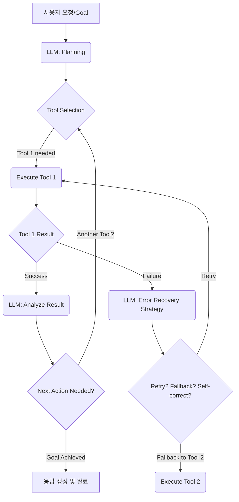

### Introduction: LLM Agent Tool Use Efficiency

LLM 에이전트의 툴 사용(Tool Use)은 단순한 기능 호출을 넘어, 복잡한 문제를 해결하고 외부 환경과 상호작용하는 핵심 역량입니다. 그러나 비효율적인 툴 사용은 불필요한 비용 증가, 지연 시간(latency) 상승, 그리고 신뢰성 저하로 이어집니다. 실용적인 에이전트 시스템을 구축하기 위해서는 툴 사용의 효율성과 안정성을 높이는 정교한 설계가 필수적입니다. 이 엔트리에서는 LLM 에이전트가 툴을 더욱 지능적이고 안정적으로 활용하도록 돕는 주요 설계 패턴과 전략을 소개합니다.

### 핵심 설계 패턴

#### 1. Contextual Tool Selection (상황 인지형 툴 선택)
에이전트가 주어진 목표와 현재의 맥락(context)에 가장 적합한 툴을 동적으로 선택하는 능력은 효율성의 핵심입니다. 단순히 모든 툴 목록을 제공하는 것을 넘어, RAG(Retrieval Augmented Generation) 기법을 활용하여 관련성이 높은 툴만 선별적으로 프롬프트에 포함시키거나, 툴의 메타데이터(설명, 사용 예시)를 활용해 유사도 기반으로 툴을 추천할 수 있습니다. 이는 LLM의 컨텍스트 윈도우(context window)를 절약하고 불필요한 추론 비용을 줄입니다.

```python
import json

class ToolRegistry:
    def __init__(self):
        self.tools = {}

    def register_tool(self, name, description, func):
        self.tools[name] = {"description": description, "func": func}

    def get_tool_description(self, name):
        return self.tools[name]["description"] if name in self.tools else None

    def execute_tool(self, name, *args, **kwargs):
        if name in self.tools:
            return self.tools[name]["func"](*args, **kwargs)
        raise ValueError(f"Tool '{name}' not found.")

def search_web(query: str):
    """Searches the web for the given query and returns relevant results."""
    print(f"Searching web for: {query}")
    return f"Results for '{query}': ... (simulated web search)"

def get_current_weather(location: str):
    """Fetches the current weather for a specified location."""
    print(f"Fetching weather for: {location}")
    return f"Weather in {location}: 25C, Sunny (simulated weather API)"

# 툴 등록 예시
tool_registry = ToolRegistry()
tool_registry.register_tool("web_search", "웹 검색을 수행하여 정보를 찾습니다.", search_web)
tool_registry.register_tool("weather_api", "현재 날씨 정보를 조회합니다.", get_current_weather)

# LLM 프롬프트 생성 (예시)
def generate_prompt_with_tools(task_description: str, available_tools: dict):
    tool_descriptions = "\n".join([f"- {name}: {info['description']}" for name, info in available_tools.items()])
    prompt = f"""You are an AI assistant capable of using tools.
Here are the tools available to you:
{tool_descriptions}

Your task: {task_description}

Please respond by planning your action using the available tools, then call the tool.
Use the following format for tool calls:
{{
  "tool_name": "...",
  "parameters": {{...}}
}}
"""
    return prompt

# 사용 예시
task = "서울의 현재 날씨를 알려주고, LLM 에이전트 툴 사용 효율화에 대한 최신 정보를 찾아줘."
prompt = generate_prompt_with_tools(task, tool_registry.tools)
print(prompt)

# LLM 응답 시뮬레이션 (JSON 출력 가정)
llm_response_weather = json.dumps({"tool_name": "weather_api", "parameters": {"location": "Seoul"}})
llm_response_search = json.dumps({"tool_name": "web_search", "parameters": {"query": "LLM agent tool use efficiency latest"}})

# 에이전트의 툴 실행 로직 (간략화)
def agent_execute(llm_output_json: str):
    tool_call = json.loads(llm_output_json)
    tool_name = tool_call["tool_name"]
    parameters = tool_call["parameters"]
    result = tool_registry.execute_tool(tool_name, **parameters)
    print(f"Tool {tool_name} executed. Result: {result}")
    return result

agent_execute(llm_response_weather)
agent_execute(llm_response_search)
```

#### 2. Robust Tool Error Recovery (강력한 툴 오류 복구)
툴 사용 중 발생하는 오류는 에이전트의 작업 흐름을 중단시키고 신뢰성을 저해합니다. 효과적인 오류 복구 전략에는 다음이 포함됩니다:
*   **재시도 메커니즘 (Retry Mechanisms)**: 일시적인 네트워크 문제나 API 제한에 대해 지수 백오프(exponential backoff)를 포함한 재시도를 적용합니다.
*   **오류 유형별 처리**: 특정 오류 코드(예: 404 Not Found, 429 Rate Limit)에 따라 다른 전략을 적용합니다. 예를 들어, 404의 경우 대체 검색 툴을 사용하거나 사용자에게 문의합니다.
*   **자가 수정(Self-correction)**: LLM이 오류 메시지를 분석하고, 프롬프트나 툴 인자를 수정하여 다시 시도하도록 지시합니다. 이는 추론 비용이 들지만, 복잡한 시나리오에서 효과적입니다.
*   **폴백(Fallback) 툴**: 주력 툴이 실패했을 때 유사한 기능을 수행하는 보조 툴을 미리 정의하여 활용합니다.

#### 3. Tool Orchestration and Chaining (툴 오케스트레이션 및 체이닝)
단일 툴 호출로는 해결하기 어려운 복잡한 작업을 위해 여러 툴을 순차적(sequential) 또는 병렬적(parallel)으로 연결하여 사용하는 패턴입니다.
*   **Sequential Chaining**: 한 툴의 출력이 다음 툴의 입력으로 사용되는 방식입니다. (예: 검색 결과 요약 -> 요약된 정보를 기반으로 문서 생성).
*   **Parallel Execution**: 서로 독립적인 여러 툴을 동시에 실행하여 시간을 절약합니다. (예: 웹 검색과 내부 데이터베이스 조회를 동시에 수행).
*   **Conditional Execution**: 이전 툴의 결과에 따라 다음에 호출할 툴을 동적으로 결정합니다. (예: 검색 결과가 충분하면 요약 툴, 아니면 추가 검색 툴).

아래 Mermaid 다이어그램은 LLM 에이전트의 툴 오케스트레이션 흐름을 시각화합니다.



#### 4. Tool Abstraction Layer (툴 추상화 계층)
다양한 외부 툴(API, 데이터베이스, 스크립트 등)을 에이전트 시스템에 통합할 때, 일관된 인터페이스를 제공하는 추상화 계층은 개발 복잡도를 줄이고 유연성을 높입니다. 각 툴의 고유한 호출 방식이나 데이터 형식을 캡슐화하여, 에이전트가 모든 툴을 균일한 방식으로 사용하도록 돕습니다. 이는 툴의 추가, 제거, 교체를 용이하게 만듭니다.

#### 5. Tool State Management (툴 상태 관리)
장기 실행(long-running) 작업에서 툴의 이전 호출 결과나 중간 상태를 저장하고 활용하는 것은 중복 작업을 방지하고 효율성을 높입니다. 캐싱(caching)을 통해 동일한 툴 호출에 대한 결과를 재사용하거나, 세션(session) 단위로 툴의 실행 상태를 관리하여 에이전트가 중단된 지점부터 작업을 재개할 수 있도록 합니다. 이는 특히 비용이 많이 드는 API 호출이나 시간이 오래 걸리는 연산에 유용합니다.

### 2026년 최신 트렌드 반영

2026년 LLM 에이전트의 툴 사용 효율화는 멀티모달(Multimodal) 툴의 통합, 온디바이스(On-device) 에이전트에서의 경량화된 툴킷, 그리고 LLM의 지능적 추론과 툴 실행을 유기적으로 결합하는 "Agentic RAG"의 진화에 초점을 맞춥니다. 특히, LLM이 단순히 툴을 선택하는 것을 넘어, 툴 자체를 동적으로 생성하거나 기존 툴을 조합하여 새로운 기능을 만드는 **Tool Creation & Composition** 능력에 대한 연구가 활발합니다. 또한, 블록체인 기반의 분산형 툴 레지스트리(Decentralized Tool Registry)를 통해 툴의 신뢰성과 투명성을 확보하려는 시도도 주목할 만합니다.

### ## 트레이드오프

*   **Contextual Tool Selection**:
    *   **장점**: LLM의 컨텍스트 윈도우 및 추론 비용 절감, 관련성 높은 툴 사용으로 성능 향상.
    *   **단점**: 툴 선택 로직(RAG 쿼리, 유사도 계산 등) 개발 및 유지보수 비용 발생, 잘못된 선택 시 중요한 툴 누락 가능성.
    *   **언제 좋은가**: 툴의 개수가 많고, LLM 추론 비용이 중요하며, 특정 시나리오에 필요한 툴이 명확할 때.
    *   **언제 나쁜가**: 툴셋이 매우 작고, 모든 툴이 항상 관련될 수 있는 단순한 시나리오에서는 불필요한 복잡성을 추가.
*   **Robust Tool Error Recovery**:
    *   **장점**: 에이전트의 안정성 및 신뢰성 향상, 사용자 경험 개선, 장기 실행 작업의 성공률 증가.
    *   **단점**: 재시도 로직, 오류 핸들링, 폴백 툴 구현에 추가적인 개발 노력 필요, 자가 수정 시 LLM 추론 비용 증가.
    *   **언제 좋은가**: 외부 API 의존도가 높고, 네트워크 불안정성이 존재하며, 작업 실패의 비용이 클 때.
    *   **언제 나쁜가**: 모든 툴 호출이 항상 성공할 것으로 가정할 수 있는 통제된 내부 환경에서는 과도한 설계가 될 수 있음.
*   **Tool Orchestration and Chaining**:
    *   **장점**: 복잡한 작업 해결 능력 향상, 모듈식 접근으로 개발 용이, LLM의 추론 부하 분산 가능.
    *   **단점**: 워크플로우 설계 복잡도 증가, 각 단계 간의 데이터 변환 및 동기화 문제, 중간 오류 발생 시 전체 워크플로우 실패 위험.
    *   **언제 좋은가**: 단일 툴로 해결 불가능한 다단계 작업이 많고, 각 툴이 명확한 입력과 출력을 가질 때.
    *   **언제 나쁜가**: 모든 작업이 단일 툴 호출로 간단히 해결될 수 있거나, 각 툴 간의 의존성이 매우 복잡하여 체이닝 로직을 만들기 어려울 때.
*   **Tool Abstraction Layer**:
    *   **장점**: 툴 인터페이스의 일관성 유지, 새로운 툴 통합 용이, 코드 재사용성 증대, 유지보수 용이.
    *   **단점**: 초기 설계 및 구현 비용 발생, 불필요한 추상화는 성능 오버헤드를 유발할 수 있음.
    *   **언제 좋은가**: 통합해야 할 툴의 종류가 다양하고 많으며, 시스템의 확장성이 중요할 때.
    *   **언제 나쁜가**: 매우 적은 수의 고정된 툴만 사용하며, 툴의 변화 가능성이 거의 없을 때.
*   **Tool State Management**:
    *   **장점**: 중복 툴 호출 방지, 비용 절감, 장기 실행 작업의 효율성 및 재개 가능성 향상.
    *   **단점**: 상태 저장 및 관리 메커니즘 구현의 복잡성, 캐싱 무효화(cache invalidation) 문제, 상태 불일치(state inconsistency) 위험.
    *   **언제 좋은가**: 동일 툴 호출이 반복될 가능성이 높거나, 비용/시간 소모적인 툴 사용이 잦을 때, 에이전트 세션이 장기간 유지될 때.
    *   **언제 나쁜가**: 툴 호출이 항상 고유하며, 결과가 빠르게 변화하고, 상태 저장이 불필요하게 복잡성을 더할 때.

### ## 실전 체크리스트

프로젝트에 LLM 에이전트 툴 사용 효율화 디자인을 적용할 때 다음 항목들을 검증합니다.

- [ ] **툴 메타데이터 표준화**: 모든 툴에 대해 명확하고 구조화된 설명(description), 입력 스키마(input schema), 출력 스키마(output schema)가 정의되어 있는가?
- [ ] **동적 툴 선택 전략 구현**: LLM의 컨텍스트 윈도우 내에서 가장 관련성 높은 툴만을 동적으로 프롬프트에 포함시키는 메커니즘(예: RAG 기반 툴 리트리버)이 구현되어 있는가?
- [ ] **오류 복구 메커니즘 테스트**: 일반적인 툴 호출 실패 시 (네트워크 오류, API 제한, 잘못된 인자 등) 에이전트가 재시도, 폴백, 또는 자가 수정 로직을 통해 성공적으로 복구하는지 테스트했는가?
- [ ] **툴 호출 비용 모니터링**: 각 툴 호출의 비용(API 토큰, 외부 서비스 비용)과 지연 시간(latency)을 실시간으로 모니터링하고, 비효율적인 호출을 식별하는 대시보드가 마련되어 있는가?
- [ ] **툴 오케스트레이션 정의**: 복잡한 작업에 대해 여러 툴을 순차적/병렬적으로 조합하는 워크플로우가 명확히 설계되고 구현되어 있으며, 이를 시각화할 수 있는가?
- [ ] **툴 추상화 계층 검토**: 새로운 툴을 추가하거나 기존 툴을 교체할 때 에이전트 코드의 수정 없이 (또는 최소한의 수정으로) 통합 가능한 추상화 계층이 존재하는가?
- [ ] **지속적인 툴 성능 평가**: 툴 사용의 성공률, 오류율, 평균 실행 시간 등 핵심 지표를 정기적으로 평가하고 개선 계획을 수립하고 있는가?