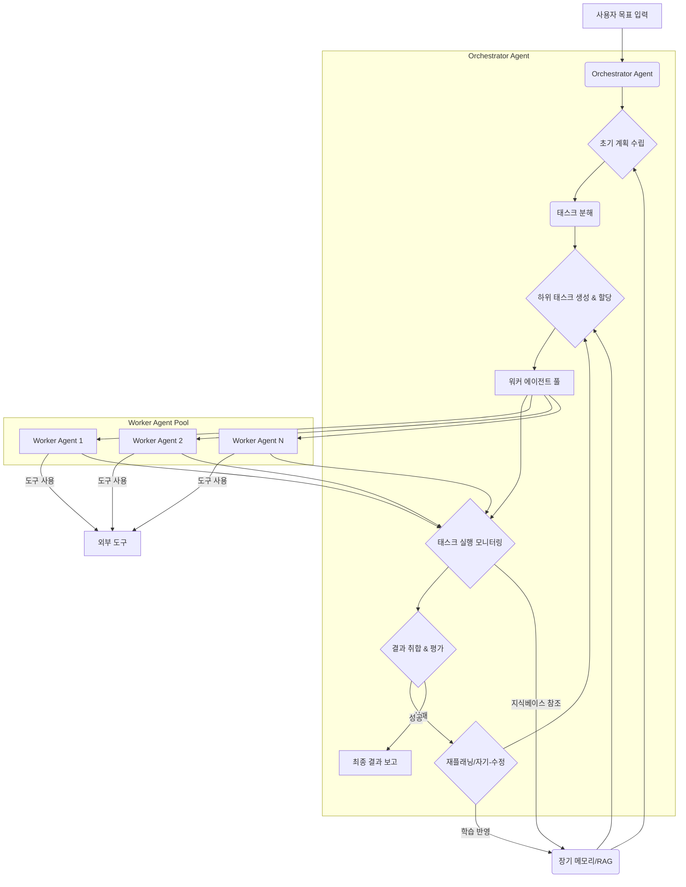

복잡한 멀티스텝 태스크는 LLM 에이전트에게 중대한 도전 과제를 제시하며, 종종 실패, 환각(hallucinations) 또는 비효율적인 실행으로 이어진다. 안정적인 워크플로우를 설계하려면 전체 목표를 관리 가능한 하위 태스크로 분해하고, 실행을 오케스트레이션하며, 자기-수정 및 상태 지속성 메커니즘을 통합해야 한다. 이 엔트리는 복잡한 프로세스를 안정적으로 처리할 수 있는 LLM 에이전트 워크플로우를 엔지니어링하기 위한 구조화된 접근 방식을 설명한다.

## 핵심 설계 원칙

### 1. 계층적 태스크 분해 (Hierarchical Task Decomposition)
복잡한 목표를 직접 LLM에 부여하는 대신, 이를 작은 단위의 하위 태스크로 나누는 것이 중요하다. 각 하위 태스크는 에이전트가 직접 해결할 수 있는 명확한 입력과 출력을 가져야 한다.
-   **메인 에이전트 (Orchestrator Agent)**: 전체 목표를 이해하고, 하위 태스크를 생성, 할당, 모니터링한다.
-   **워커 에이전트 (Worker Agent)**: 할당된 개별 하위 태스크를 실행하며, 필요한 도구를 사용하고 결과를 메인 에이전트에 보고한다.

### 2. 동적 플래닝 및 재플래닝 (Dynamic Planning and Replanning)
에이전트는 초기 계획을 수립하지만, 실행 과정에서 발생하는 예외 상황이나 새로운 정보에 따라 계획을 동적으로 수정할 수 있어야 한다. 이는 예측 불가능한 환경에서 에이전트의 견고성을 높인다.
-   **사전 계획 (Pre-computation Planning)**: 초기 단계에서 전체적인 흐름을 설계한다.
-   **실행 중 계획 (Execution-time Planning)**: 각 스텝 완료 후, 다음 스텝의 유효성을 검토하고 필요시 계획을 수정한다.

### 3. 상태 관리 및 컨텍스트 지속성 (State Management & Context Persistence)
멀티스텝 태스크는 이전 스텝의 결과나 중간 상태가 다음 스텝에 영향을 미친다. 에이전트는 이러한 상태를 효율적으로 관리하고, 관련 컨텍스트를 유지하며 장기 메모리(long-term memory)에 저장하여 참조할 수 있어야 한다.
-   **단기 컨텍스트 (Short-term Context)**: 현재 태스크에 직접 필요한 정보.
-   **장기 컨텍스트 (Long-term Context)**: 과거의 경험, 지식 베이스, 학습된 패턴. RAG(Retrieval Augmented Generation) 패턴을 활용하여 관련 정보를 검색하고 현재 컨텍스트에 주입한다.

### 4. 도구 오케스트레이션 및 활용 (Tool Orchestration & Utilization)
LLM 에이전트의 강력함은 외부 도구(APIs, 코드 실행 환경, 데이터베이스 등)를 효과적으로 사용하는 데서 온다. 복잡한 태스크에서는 여러 도구를 조합하여 순차적 또는 병렬적으로 사용하는 오케스트레이션 전략이 필수적이다.
-   **도구 선택 (Tool Selection)**: 태스크에 가장 적합한 도구를 동적으로 선택하는 능력.
-   **도구 사용 (Tool Use)**: 도구의 입력 형식을 정확히 맞추고, 출력 결과 해석.
-   **에러 처리 (Error Handling)**: 도구 사용 중 발생하는 에러를 감지하고 복구 메커니즘을 작동시킨다.

### 5. 자율적 자기-수정 및 회고 (Autonomous Self-Correction & Retrospection)
실패는 에이전트 학습의 중요한 기회이다. 에이전트는 자신의 행동과 결과를 평가하고, 실패의 원인을 분석하여 미래 행동을 개선할 수 있는 회고(retrospection) 메커니즘을 내장해야 한다. 이는 2026년 LLM 에이전트의 핵심 트렌드 중 하나로, 모듈화된 설계, 동적 도구 선택, 강력한 에러 처리, 적응형 플래닝, 정교한 메모리 관리가 통합되어 더욱 견고한 시스템을 가능하게 한다.
-   **피드백 루프 (Feedback Loop)**: 실행 결과에 대한 명시적 또는 암묵적 피드백을 수집한다.
-   **회고 (Retrospection)**: 실패 케이스를 분석하여 개선점을 도출하고, 이를 플래닝 또는 도구 사용 전략에 반영한다.

## 워크플로우 다이어그램



## 코드 예제: 멀티스텝 태스크 실행 (Python)

이 예제는 간단한 `Orchestrator`가 `Worker`에게 태스크를 위임하고, 워커가 특정 `Tool`을 사용하여 작업을 수행하는 개념을 보여준다. 실제 구현에서는 LLM 호출, 상태 관리, 에러 처리 로직이 훨씬 복잡하게 엮여야 한다.

```python
import abc
from typing import List, Dict, Any, Optional

# 가상 LLM 인터페이스
class MockLLM:
    def __init__(self, name: str):
        self.name = name

    def generate(self, prompt: str, tools: Optional[List[str]] = None) -> Dict[str, Any]:
        print(f"[{self.name}] LLM Prompt: {prompt[:50]}...")
        if "divide by zero" in prompt:
            return {"action": "error", "message": "Division by zero detected."}
        if tools and "search" in tools and "latest stock price" in prompt:
            return {"action": "call_tool", "tool_name": "WebSearchTool", "tool_args": {"query": "AAPL stock price"}}
        if tools and "calculator" in tools and "calculate 10+5" in prompt:
            return {"action": "call_tool", "tool_name": "CalculatorTool", "tool_args": {"expression": "10+5"}}
        return {"response": f"Mock response for '{prompt[:30]}...'", "status": "completed"}

# 도구 인터페이스
class Tool(abc.ABC):
    @abc.abstractmethod
    def name(self) -> str:
        pass

    @abc.abstractmethod
    def description(self) -> str:
        pass

    @abc.abstractmethod
    def run(self, **kwargs) -> Any:
        pass

class WebSearchTool(Tool):
    def name(self) -> str:
        return "WebSearchTool"
    def description(self) -> str:
        return "Perform a web search for information."
    def run(self, query: str) -> str:
        print(f"[Tool] Searching web for: {query}")
        if "AAPL stock price" in query:
            return "AAPL stock price is $175.25 as of 2026-07-20."
        return f"Search result for '{query}'"

class CalculatorTool(Tool):
    def name(self) -> str:
        return "CalculatorTool"
    def description(self) -> str:
        return "Perform arithmetic calculations."
    def run(self, expression: str) -> float:
        print(f"[Tool] Calculating: {expression}")
        try:
            return eval(expression)
        except Exception as e:
            return f"Error: {str(e)}"

# 에이전트 클래스
class Agent:
    def __init__(self, name: str, llm: MockLLM, available_tools: List[Tool]):
        self.name = name
        self.llm = llm
        self.tools = {tool.name(): tool for tool in available_tools}
        self.memory = [] # 간략화된 메모리

    def act(self, task_description: str, context: List[str]) -> Dict[str, Any]:
        full_context = "\n".join(self.memory + context)
        tool_names = list(self.tools.keys())
        prompt = f"Context: {full_context}\nTask: {task_description}\nAvailable Tools: {tool_names}\nThink step-by-step and then provide an action or a final response."
        
        llm_output = self.llm.generate(prompt, tools=tool_names)
        
        if llm_output.get("action") == "call_tool":
            tool_name = llm_output["tool_name"]
            tool_args = llm_output["tool_args"]
            print(f"[{self.name}] Calling tool: {tool_name} with args {tool_args}")
            if tool_name in self.tools:
                tool_result = self.tools[tool_name].run(**tool_args)
                self.memory.append(f"Tool {tool_name} result: {tool_result}")
                # 재귀적으로 다시 act를 호출하거나, 결과를 Orchestrator에게 반환
                return {"status": "tool_executed", "result": tool_result}
            else:
                return {"status": "error", "message": f"Tool {tool_name} not found."}
        elif llm_output.get("status") == "error":
            return llm_output
        else:
            self.memory.append(f"LLM Response: {llm_output.get('response')}")
            return {"status": "completed", "final_response": llm_output.get("response")}

# 오케스트레이터 클래스
class Orchestrator:
    def __init__(self, name: str, llm: MockLLM, worker_agents: List[Agent]):
        self.name = name
        self.llm = llm
        self.workers = {agent.name: agent for agent in worker_agents}
        self.global_state = {"history": []}

    def run_task(self, goal: str) -> Dict[str, Any]:
        print(f"\n[{self.name}] Starting task: {goal}")
        self.global_state["goal"] = goal
        
        # 1. 초기 계획 수립 (LLM 또는 predefined)
        plan_prompt = f"Formulate a step-by-step plan to achieve the goal: {goal}. Consider available worker agents: {list(self.workers.keys())} and tools."
        initial_plan_output = self.llm.generate(plan_prompt)
        initial_plan = initial_plan_output.get("response", "Decompose into subtasks.")
        print(f"[{self.name}] Initial Plan: {initial_plan}")
        
        # 간략화된 태스크 분해 및 실행
        sub_tasks = [
            "Find the latest stock price for AAPL.",
            "Calculate 10+5.",
            "Report the findings."
        ] # 실제로는 LLM이 분해

        results = []
        for i, task in enumerate(sub_tasks):
            print(f"\n[{self.name}] Orchestrating sub-task {i+1}: {task}")
            current_context = [f"Global state: {self.global_state['history'][-1]}" if self.global_state["history"] else ""]
            
            # 워커 에이전트에게 태스크 위임 (여기서는 간단히 첫 번째 워커 사용)
            worker_response = self.workers["AlphaWorker"].act(task, current_context)
            
            if worker_response.get("status") == "tool_executed":
                results.append(f"Task '{task}' executed tool. Result: {worker_response['result']}")
                self.global_state["history"].append(f"Sub-task {i+1} result: {worker_response['result']}")
            elif worker_response.get("status") == "completed":
                results.append(f"Task '{task}' completed. Response: {worker_response['final_response']}")
                self.global_state["history"].append(f"Sub-task {i+1} response: {worker_response['final_response']}")
            elif worker_response.get("status") == "error":
                print(f"[{self.name}] Error in sub-task '{task}': {worker_response['message']}")
                # 여기서 자기-수정, 재플래닝 로직 구현
                self_correction_prompt = f"Sub-task '{task}' failed with error: {worker_response['message']}. Suggest a correction or alternative approach given the goal: {goal} and current state: {self.global_state['history'][-1] if self.global_state['history'] else ''}"
                correction_suggestion = self.llm.generate(self_correction_prompt)
                print(f"[{self.name}] Correction suggested: {correction_suggestion.get('response')}")
                # 실제 구현에서는 수정된 계획을 재실행
                return {"status": "failed", "reason": f"Sub-task failed: {task}", "error_details": worker_response['message']}

        final_report_prompt = f"Based on the following sub-task results: {results}, provide a comprehensive final report for the goal: {goal}"
        final_report = self.llm.generate(final_report_prompt)
        self.global_state["history"].append(f"Final Report: {final_report.get('response')}")
        
        return {"status": "success", "final_report": final_report.get("response"), "details": results}

# 초기화 및 실행
if __name__ == "__main__":
    llm_orchestrator = MockLLM("OrchestratorLLM")
    llm_worker = MockLLM("WorkerLLM")

    web_search_tool = WebSearchTool()
    calculator_tool = CalculatorTool()

    worker_alpha = Agent("AlphaWorker", llm_worker, [web_search_tool, calculator_tool])
    
    orchestrator = Orchestrator("MainOrchestrator", llm_orchestrator, [worker_alpha])

    # 예제 1: 성공적인 멀티스텝 태스크
    result_success = orchestrator.run_task("Investigate current market status of Apple and perform a simple calculation.")
    print("\n--- Final Success Result ---")
    print(result_success)

    # 예제 2: 실패 상황 (에러 감지 및 자기-수정 시도)
    # result_failure = orchestrator.run_task("Calculate a division by zero to test error handling.")
    # print("\n--- Final Failure Result ---")
    # print(result_failure)
```

## 트레이드오프

1.  **복잡성 증가 vs. 안정성 확보**:
    *   **언제 좋은가**: 태스크가 본질적으로 복잡하고 실패 비용이 높은 프로덕션 환경에서 좋다. 명확한 단계, 상태 관리, 자기-수정 메커니즘은 전체 시스템의 안정성과 예측 가능성을 크게 향상시킨다.
    *   **언제 나쁜가**: 단순하고 단발적인 태스크에는 과도한 오버헤드가 발생한다. 개발 및 디버깅 주기가 길어져 빠른 프로토타이핑에는 비효율적이다.

2.  **자율성 증대 vs. 제어력 상실 위험**:
    *   **언제 좋은가**: 반복적이고 예측 가능한 패턴의 작업을 자동화하여 운영 효율성을 극대화할 수 있다. 사람의 개입 없이도 문제 해결 및 목표 달성이 가능하다.
    *   **언제 나쁜가**: 에이전트의 잘못된 결정이나 제어 불능 상태(runaway agent)는 예상치 못한 비용 발생, 잘못된 데이터 처리, 심각한 시스템 오류로 이어질 수 있다. 중요한 비즈니스 로직에는 강력한 Guardrail과 Human-in-the-Loop 검증이 필요하다.

3.  **리소스 소모 증가 vs. 태스크 완료율 향상**:
    *   **언제 좋은가**: 고품질의 결과물이나 높은 성공률이 중요한 경우, 태스크 분해, 다단계 추론, 회고 과정에 더 많은 LLM 호출과 컴퓨팅 리소스를 할당하는 것이 정당화된다.
    *   **언제 나쁜가**: 비용 효율성이 최우선이거나, 실시간 응답이 필수적인 환경에서는 과도한 LLM 호출과 복잡한 워크플로우가 성능 저하와 비용 상승으로 이어진다.

4.  **확장성 vs. 초기 설계 난이도**:
    *   **언제 좋은가**: 다양한 유형의 복잡한 태스크를 포괄하고, 새로운 도구나 워커 에이전트를 쉽게 추가할 수 있는 시스템을 구축할 때 유리하다. 모듈화된 설계는 장기적인 유지보수와 기능 확장에 기여한다.
    *   **언제 나쁜가**: 초기 설계 단계에서 모든 잠재적 시나리오와 확장성을 고려해야 하므로, 초기 구현에 많은 시간과 전문성이 요구된다. 유연한 아키텍처를 구축하는 데 상당한 노력이 필요하다.

## 실전 체크리스트

-   [ ] **태스크 분해 명확성**: 최상위 목표가 최소 3단계 이상의 하위 태스크로 명확하게 분해되었는가? 각 하위 태스크는 단일 LLM 호출 또는 단일 도구 사용으로 해결 가능한 수준으로 정의되었는가?
-   [ ] **상태 및 컨텍스트 전달 메커니즘**: 각 워커 에이전트가 이전 단계의 결과 또는 필요한 컨텍스트를 안정적으로 수신하고 다음 단계로 전달하는 메커니즘이 구현되었는가? (예: `global_state`, `memory` 객체)
-   [ ] **동적 플래닝 및 재플래닝 로직**: 초기 계획 실패 시 에이전트가 실패 원인을 분석하고, 새로운 실행 계획을 수립하거나 기존 계획을 수정하는 재플래닝 로직이 포함되어 있는가? (예: Mermaid 다이어그램의 `I{재플래닝/자기-수정}` 노드 구현 여부)
-   [ ] **도구 사용 및 에러 처리 견고성**: 에이전트가 외부 도구를 호출할 때, 입력 값 유효성 검사, API 호출 실패 시 재시도, 비정상 응답 처리 등 에러 복구 전략이 명확하게 정의되고 테스트되었는가?
-   [ ] **자기-수정 및 회고 루프 구현**: 태스크 실패 시 해당 실패 케이스를 분석하고, 향후 유사한 상황에서 더 나은 결정을 내릴 수 있도록 학습하는 피드백 루프(예: `self.memory`를 활용한 학습)가 존재하며 작동하는가?
-   [ ] **가드레일 및 비용 관리**: 무한 루프 또는 과도한 LLM 호출을 방지하기 위한 토큰/시간 제한, 특정 행동 금지 가드레일(예: `ai-agent-control-accountability-guardrails` 연결 문서 참조)이 설정되어 있으며 모니터링되고 있는가?
-   [ ] **Human-in-the-Loop (HITL) 개입 지점**: 에이전트가 스스로 해결하지 못하는 복잡한 결정이나 중요도가 높은 단계에서 사람이 개입하여 검토하고 승인할 수 있는 명확한 HITL 인터페이스가 설계되었는가?