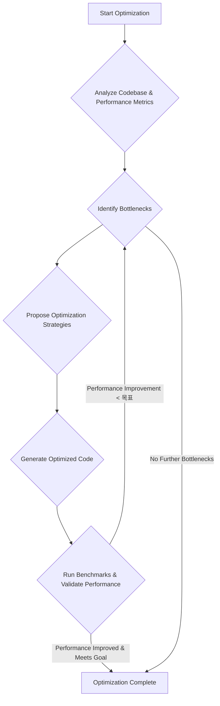

LLM 기반 애플리케이션의 성능은 추론 속도와 비용에 크게 좌우됩니다. 특히 대규모 LLM 추론 워크로드에서 최적화는 필수적입니다. 전통적인 코드 최적화는 시간과 전문 지식이 많이 소요되는 작업이었으나, 코딩 에이전트(Coding Agents)는 이러한 과정을 자동화하고 가속화하는 새로운 가능성을 제시합니다. AWS FPGA에서 LLM 추론을 33배 최적화한 사례는 에이전트가 단순한 코드 생성자를 넘어 복잡한 성능 엔지니어링 문제를 해결할 수 있음을 입증합니다. 본 문서는 LLM 에이전트가 자체 코드 또는 워커 코드의 성능 병목을 식별하고 점진적으로 개선하는 워크플로를 탐색합니다.

## Agent-Driven Optimization Workflow
코딩 에이전트 기반 LLM 코드 최적화는 다음의 단계로 구성될 수 있습니다.

### 1. 코드 및 성능 데이터 분석 (Code and Performance Data Analysis)
에이전트는 먼저 최적화 대상 LLM 추론 코드 베이스와 관련 성능 메트릭(예: latency, throughput, memory usage)을 분석합니다. 'Claude Code Harness'와 같은 환경에서는 에이전트가 코드 저장소에 접근하여 파일 구조, 함수 호출, 데이터 흐름 등을 파악합니다. 프로파일링 도구의 출력이나 벤치마크 결과를 해석하여 초기 성능 병목 지점을 추정합니다.

### 2. 병목 식별 및 최적화 목표 설정 (Bottleneck Identification and Optimization Goal Setting)
분석된 데이터를 바탕으로 에이전트는 코드의 특정 섹션이나 알고리즘에서 발생하는 성능 병목을 식별합니다. 예를 들어, 과도한 메모리 접근, 순차적인 연산으로 인한 병렬성 부족, 비효율적인 데이터 파이프라인 등이 될 수 있습니다. 이후 에이전트는 특정 성능 목표(예: 추론 속도 10% 향상, 메모리 사용량 20% 감소)를 설정하고, 이를 달성하기 위한 구체적인 최적화 전략을 수립합니다.



### 3. 최적화 기법 적용 및 코드 생성 (Applying Optimization Techniques & Code Generation)
에이전트는 식별된 병목을 해결하기 위해 메모리 접근 패턴 최적화, 연산 병렬화, 데이터 파이프라인 재구성 등 다양한 기법을 적용하여 코드를 생성합니다.

*   **메모리 접근 최적화 (Memory Access Optimization)**: 캐시 효율성을 높이거나, 데이터 구조를 변경하여 locality를 개선합니다.
*   **병렬화 (Parallelization)**: 멀티코어 CPU 또는 GPU를 활용하도록 코드를 재구성하여 동시 처리량을 높입니다. `multiprocessing` 또는 `asyncio` 모듈, 또는 GPU 가속 라이브러리(CUDA, OpenCL) 사용을 제안할 수 있습니다.
*   **파이프라인 구성 (Pipelining)**: 독립적인 연산을 연속적으로 실행하여 전체 처리 시간을 단축합니다.
*   **추측 디코딩 (Speculative Decoding)**: LLM 추론에서 일부 토큰을 미리 추측하고 검증하는 방식으로 속도를 높입니다.

**프롬프트 엔지니어링 전략**: 에이전트에게 구체적인 최적화 지시를 내리기 위한 프롬프트는 매우 중요합니다.
예를 들어:
`"Optimize the `inference_engine.py` module for improved token generation speed. Focus on reducing memory access latency in the `attention_layer` function and enhancing parallel computation within the `forward_pass`."`
`"Analyze the `data_loader.py` for potential pipelining opportunities. Specifically, explore overlapping data loading with model inference stages to minimize idle time."`

### 4. 성능 검증 및 반복 (Performance Validation and Iteration)
생성된 최적화 코드는 실제 환경 또는 시뮬레이션 환경에서 벤치마크 테스트를 거쳐 성능 향상 여부를 검증합니다. 이 과정에서 에이전트는 새로운 성능 데이터를 수집하고, 목표 달성 여부를 평가합니다. 만약 목표에 미달하거나 새로운 병목이 발견되면, 에이전트는 다시 첫 단계로 돌아가 분석-식별-생성-검증 과정을 반복합니다. 이 반복적인 개선 주기는 점진적인 성능 향상을 이끌어냅니다.

**코드 예제**: Python에서 간단한 LLM 토큰 생성 시뮬레이션 및 최적화 프롬프트 예시.

```python
# original_inference.py
import time
import numpy as np

def compute_attention(query, key, value):
    # Simulate heavy computation/memory access
    time.sleep(0.001) # Simulate latency
    scores = np.dot(query, key.T)
    return np.dot(scores, value)

def llm_inference_step(input_embedding, num_heads=8):
    outputs = []
    for _ in range(num_heads):
        # Simulate processing for each attention head
        query = input_embedding + np.random.rand(*input_embedding.shape) * 0.1
        key = input_embedding + np.random.rand(*input_embedding.shape) * 0.1
        value = input_embedding + np.random.rand(*input_embedding.shape) * 0.1
        outputs.append(compute_attention(query, key, value))
    return np.mean(outputs, axis=0)

def generate_tokens_original(text_input, vocab_size=50000, max_tokens=100):
    embedding = np.random.rand(1, 768) # Simulate input embedding
    generated_tokens = []
    for _ in range(max_tokens):
        start_time = time.perf_counter()
        output_embedding = llm_inference_step(embedding)
        logits = np.dot(output_embedding, np.random.rand(768, vocab_size))
        next_token_id = np.argmax(logits)
        generated_tokens.append(next_token_id)
        embedding = np.random.rand(1, 768) # Update embedding for next token
        end_time = time.perf_counter()
        # print(f"Token generation took: {end_time - start_time:.4f}s")
    return generated_tokens

if __name__ == "__main__":
    print("Starting original token generation...")
    start_total = time.perf_counter()
    tokens = generate_tokens_original("Hello, world!")
    end_total = time.perf_counter()
    print(f"Total time for 100 tokens (original): {end_total - start_total:.4f}s")
    # Expected output: ~0.8s - 1.0s (100 tokens * 0.008s/token)
```

위 `original_inference.py` 코드에서 `compute_attention` 함수 내의 `time.sleep`은 실제로는 복잡한 행렬 연산과 메모리 접근으로 인한 지연을 시뮬레이션합니다. 에이전트는 이러한 부분을 식별하고 최적화를 제안할 수 있습니다.

**Agent Prompt for Optimization:**

```bash
# Agent Command Example (Conceptual)
agent.optimize(
    target_file="original_inference.py",
    objective="reduce total token generation time by 30%",
    focus_areas=["memory_access_patterns_in_compute_attention", "parallelization_of_llm_inference_step"],
    instructions="Refactor `compute_attention` to use `numpy.einsum` or a more optimized matrix multiplication, considering potential library integrations like `torch.matmul` if context supports. Implement multi-threading or multi-processing for `llm_inference_step` across attention heads if suitable, while avoiding GIL bottlenecks. Provide a `optimized_inference.py` output."
)
```

이러한 프롬프트는 에이전트에게 단순히 "빨리 만들어라"가 아닌, 구체적인 최적화 방향과 제약 조건을 제시하여 더 효과적인 결과를 유도합니다.

## 트레이드오프

코딩 에이전트를 활용한 LLM 코드 최적화는 강력한 이점을 제공하지만, 몇 가지 트레이드오프를 수반합니다.

*   **비용 vs. 성능 향상 (Cost vs. Performance Gain)**
    *   **언제 좋나**: 복잡한 병목 분석과 다양한 최적화 시도를 통해 상당한 성능 향상을 기대할 수 있을 때 유리합니다. 특히 수동 최적화에 드는 인건비가 높거나, 최적화 기법에 대한 전문성이 부족할 때 에이전트의 높은 탐색 비용(토큰 비용, 컴퓨팅 비용)을 상회하는 가치를 제공합니다.
    *   **언제 나쁜가**: 미미한 성능 향상만 필요하거나, 최적화 대상 코드가 간단하여 수동으로 쉽게 개선할 수 있을 때는 에이전트의 토큰 비용이 비효율적일 수 있습니다. '긱뉴스' 사례처럼 1만 달러의 토큰 비용은 상당한 투자입니다.

*   **자동화된 탐색 속도 vs. 인간의 직관 (Automated Exploration Speed vs. Human Intuition)**
    *   **언제 좋나**: 광범위한 코드 변경이나 다양한 최적화 파라미터 조합을 빠르게 탐색하고 실험할 필요가 있을 때 에이전트의 자동화된 탐색 능력이 빛을 발합니다. 인간 개발자가 단기간에 수행하기 어려운 수백만 줄의 코드 생성 및 분석이 가능합니다.
    *   **언제 나쁜가**: 매우 특수하거나 고도로 추상적인 최적화 문제는 에이전트가 초기 탐색에 어려움을 겪을 수 있습니다. 인간 전문가의 깊은 도메인 지식이나 창의적인 '돌파구' 아이디어가 더 빠르고 효과적인 해결책을 제시할 수 있습니다.

*   **일관된 개선 vs. 예측 불가능한 결과 (Consistent Improvement vs. Unpredictable Outcomes)**
    *   **언제 좋나**: 점진적인 개선을 통해 꾸준히 성능을 끌어올릴 때 효과적입니다. 에이전트는 특정 최적화 패턴을 반복적으로 적용하고 학습하여 지속적인 개선을 제공할 수 있습니다.
    *   **언제 나쁜가**: 에이전트가 예상치 못한 버그를 생성하거나, 잘못된 최적화 방향으로 진행하여 성능을 저하시킬 위험이 있습니다. 이 경우 디버깅 및 재조정 과정에서 추가적인 시간과 비용이 발생할 수 있습니다.

*   **명시적 지시의 중요성 vs. 자율성 (Importance of Explicit Directives vs. Autonomy)**
    *   **언제 좋나**: 에이전트에게 명확한 목표와 구체적인 최적화 기법(예: 메모리 접근 최적화, 병렬화)을 지시하는 프롬프트 엔지니어링 전략이 잘 수립되어 있을 때, 에이전트는 매우 효율적으로 작동합니다.
    *   **언제 나쁜가**: 너무 추상적이거나 모호한 지시는 에이전트의 자율성을 제한하거나, 비효율적인 탐색으로 이어질 수 있습니다. 인간의 개입 없이 완전한 자율성을 부여할 경우, 에이전트가 비용을 통제하지 못하고 의도하지 않은 방향으로 진행될 수 있습니다.

## 실전 체크리스트

LLM 코드 최적화 워크플로에 코딩 에이전트를 도입할 때 다음 사항을 검토해야 합니다.

- [ ] **초기 성능 측정 및 벤치마크 기준선 확립**: 에이전트 도입 전 현재 코드의 핵심 성능 메트릭(Latency, Throughput, Memory Usage 등)을 정확히 측정하고 문서화했는가?
- [ ] **에이전트의 코드 베이스 접근 권한 및 환경 설정**: 에이전트가 최적화 대상 코드 저장소에 안전하게 접근하고, 필요한 개발 도구(컴파일러, 런타임, 프로파일러)를 사용할 수 있도록 환경이 구성되었는가?
- [ ] **구체적인 최적화 목표 설정 및 프롬프트 정의**: 에이전트에게 "빨라져라"가 아닌 "X% Latency 감소, Y% Throughput 증가"와 같이 측정 가능한 목표를 제시하고, 메모리, 병렬화, 파이프라인 등 어떤 영역을 개선할지 구체적인 프롬프트 전략을 수립했는가?
- [ ] **성능 검증 및 자동화된 테스트 파이프라인 구축**: 에이전트가 생성한 최적화 코드를 자동으로 벤치마크하고, 성능 향상 여부를 검증할 수 있는 CI/CD 파이프라인이 준비되었는가?
- [ ] **비용 모니터링 및 제어 메커니즘 마련**: 에이전트의 토큰 사용량 및 컴퓨팅 자원 사용량을 실시간으로 모니터링하고, 과도한 비용 발생 시 작업을 중단하거나 경고를 발생시키는 제어 장치를 구현했는가?
- [ ] **인간 감독 및 개입 지점 정의**: 에이전트의 최적화 과정에서 인간 전문가가 언제 개입하고, 어떤 결정을 내릴지 명확한 워크플로와 체크포인트를 설정했는가?
- [ ] **생성 코드의 안전성 및 품질 검증 절차**: 에이전트가 변경한 코드가 기존 기능에 영향을 주지 않고, 보안 취약점이나 새로운 버그를 유발하지 않는지 검증하는 절차(예: 단위 테스트, 통합 테스트, 보안 감사)가 포함되었는가?