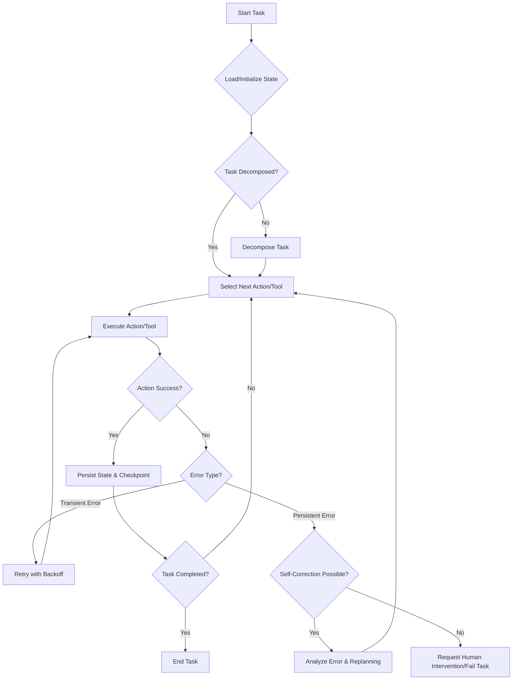

복잡하고 장기 실행되는 AI 에이전트 시스템의 안정적인 운영을 위해서는 효율적인 상태 관리와 견고한 오류 복구 메커니즘이 필수적이다. 특히 2026년 현재, 에이전트의 자율성이 증대됨에 따라 예상치 못한 상황에 대한 복원력(resilience)은 핵심 기술 역량으로 부상하고 있다. 본 문서는 장기 실행 에이전트가 직면하는 상태 관리 및 오류 복구의 본질적인 문제를 분석하고, 이에 대한 실용적인 접근 방식과 구현 전략을 제시한다.

## 장기 실행 에이전트의 도전 과제
장기 실행 에이전트는 단일 세션으로 끝나지 않고 여러 단계와 작업을 거쳐 목표를 달성한다. 이 과정에서 다음과 같은 도전 과제에 직면한다.

*   **상태 휘발성 (State Volatility)**: 에이전트의 내부 작업 상태, 외부 도구 상호작용 상태, 환경 변화 등이 휘발성 메모리에만 의존할 경우, 시스템 장애 시 모든 진행 상황이 손실된다.
*   **오류 발생 가능성 (Error Proneness)**: LLM의 환각(hallucination), 외부 API 호출 실패, 네트워크 오류, 자원 고갈 등 다양한 원인으로 작업이 중단될 수 있다.
*   **진행 상황 추적의 복잡성 (Complexity in Progress Tracking)**: 작업이 길어질수록 어떤 단계까지 완료되었고, 어떤 상태에서 오류가 발생했는지 추적하기 어려워진다.

## 상태 관리 전략 (State Management Strategies)
장기 실행 에이전트의 안정성을 확보하기 위한 핵심은 현재 상태를 안정적으로 저장하고 복원할 수 있도록 하는 것이다.

### 지속성 메모리 (Persistent Memory)
에이전트의 핵심 작업 데이터, 결정 과정, 외부 도구 사용 기록 등을 영구적으로 저장한다. 이는 에이전트가 중단된 지점부터 다시 시작할 수 있게 하는 기반이 된다.

*   **구조화된 데이터베이스 (Structured Databases)**: `PostgreSQL`, `MongoDB` 등은 에이전트의 계획, 작업 항목, 결과, 사용한 도구 및 파라미터 등을 구조화하여 저장하기에 적합하다. 특히 트랜잭션 기능을 활용하여 일관된 상태를 유지할 수 있다.
*   **벡터 데이터베이스 (Vector Databases)**: 에이전트의 대화 이력, 관찰 결과, 자체 반성(self-reflection) 내용 등 LLM의 추론에 필요한 비정형 데이터를 임베딩 형태로 저장하고 검색하는 데 사용된다.
*   **파일 시스템 (File System)**: 간단한 JSON/YAML 파일이나 로그 파일 형태로 상태를 저장할 수도 있다. 이는 빠르게 구현할 수 있지만, 동시성 제어 및 검색 효율성 측면에서 한계가 있다.

### 체크포인트 및 스냅샷 (Checkpoints & Snapshots)
장기 실행 작업의 특정 중요한 지점에서 에이전트의 전체 또는 부분 상태를 저장하는 기법이다. 이는 재시작 시 롤백 지점을 제공하여 작업 손실을 최소화한다.

*   **주기적 체크포인트 (Periodic Checkpoints)**: 일정 시간 간격 또는 특정 작업 완료 후 자동으로 상태를 저장한다.
*   **의미론적 체크포인트 (Semantic Checkpoints)**: 중요한 의사 결정이나 외부 시스템에 영구적인 변경을 가하기 전에 상태를 저장하여 멱등성(idempotency)을 강화한다.

### 멱등성 (Idempotency)
동일한 작업을 여러 번 수행하더라도 시스템 상태가 동일하게 유지되도록 설계하는 원칙이다. 이는 재시도 메커니즘과 결합될 때 오류 복구의 안정성을 극대화한다.

*   **멱등성 키 (Idempotency Key)**: 각 작업에 고유한 키를 부여하여, 동일한 키로 요청이 들어올 경우 이전에 성공한 결과를 반환하거나 중복 실행을 방지한다.
*   **상태 변경의 원자성 (Atomic State Changes)**: 여러 단계로 구성된 작업을 단일 트랜잭션으로 처리하거나, 최소한의 단위로 쪼개어 부분적인 성공/실패가 전체 시스템에 불일치를 야기하지 않도록 한다.

## 오류 복구 메커니즘 (Error Recovery Mechanisms)
오류는 피할 수 없는 현실이며, 이를 어떻게 처리하느냐가 에이전트 시스템의 신뢰도를 결정한다.

### 재시도 로직과 지수 백오프 (Retry Logic with Exponential Backoff)
일시적인 오류(네트워크 문제, API Rate Limit 등)에 대해 작업을 자동으로 다시 시도하는 가장 기본적인 복구 전략이다.

*   **지수 백오프 (Exponential Backoff)**: 재시도 간격을 점진적으로 늘려 외부 시스템에 과부하를 주지 않으면서 성공 가능성을 높인다. 예: 1초, 2초, 4초, 8초...
*   **최대 재시도 횟수 (Max Retries)**: 무한 루프에 빠지는 것을 방지하기 위해 최대 재시도 횟수를 설정한다. 이를 초과하면 다른 복구 메커니즘으로 전환한다.
*   **회로 차단기 (Circuit Breaker)**: 특정 서비스나 도구가 지속적으로 실패할 경우, 일시적으로 해당 서비스 호출을 중단하여 시스템 전체의 안정성을 확보한다.

### 자체 수정 및 반성 루프 (Self-Correction & Reflection Loops)
LLM 기반 에이전트의 강점을 활용하여 오류의 원인을 스스로 분석하고 해결책을 모색하는 고급 복구 기법이다.

*   **오류 분석 및 재계획 (Error Analysis & Replanning)**: 오류 메시지, 현재 상태, 작업 목표 등을 컨텍스트로 LLM에 제공하여 오류의 근본 원인을 파악하고, 새로운 실행 계획을 생성하도록 한다.
*   **도구 재선택 (Tool Re-selection)**: 특정 도구의 실패가 반복될 경우, 동일한 목표를 달성할 수 있는 다른 도구를 탐색하고 활용한다.
*   **컨텍스트 정제 (Context Refinement)**: 과도한 컨텍스트나 잘못된 정보가 오류를 유발했다면, 컨텍스트를 압축하거나 필터링하여 재시도한다.

### 인간 개입 (Human-in-the-Loop)
자동 복구가 불가능하거나 높은 위험이 따르는 경우, 인간 전문가의 개입을 요청하여 문제를 해결한다. 이는 완전 자율 시스템의 한계를 보완한다.

*   **경고 및 알림 (Alerts & Notifications)**: 특정 임계치 이상의 오류 발생 또는 복구 불가능 상황 시 슬랙, 이메일, 대시보드 등으로 관리자에게 즉시 알린다.
*   **수동 승인 (Manual Approval)**: 시스템에 큰 영향을 미칠 수 있는 작업(예: 프로덕션 데이터 수정)은 최종 실행 전 인간의 승인을 거치도록 한다.
*   **디버깅 인터페이스 (Debugging Interface)**: 에이전트의 상태, 실행 로그, LLM 추론 과정 등을 시각적으로 보여주는 인터페이스를 제공하여 인간이 효율적으로 문제 진단 및 수동 조치를 취할 수 있도록 한다.

### 관찰 가능성 및 모니터링 (Observability & Monitoring)
에이전트의 모든 활동, 상태 변경, 오류 발생을 기록하고 시각화하여 시스템의 건전성을 파악하고 문제 발생 시 신속하게 대응할 수 있도록 한다.

*   **구조화된 로깅 (Structured Logging)**: 에이전트의 각 단계, 도구 호출, LLM 프롬프트/응답, 상태 변경 등을 체계적인 형식(JSON 등)으로 기록한다.
*   **분산 트레이싱 (Distributed Tracing)**: 에이전트가 여러 서비스나 도구를 호출할 때, 각 호출의 흐름과 지연 시간을 추적하여 병목 현상이나 오류 지점을 식별한다.
*   **메트릭 및 대시보드 (Metrics & Dashboards)**: 에이전트의 성공률, 오류율, 평균 작업 시간, 재시도 횟수 등을 메트릭으로 수집하고 대시보드를 통해 실시간으로 모니터링한다.

## 실행 흐름 예시 (Execution Flow Example)
다음 Mermaid 다이어그램은 장기 실행 에이전트의 상태 관리 및 오류 복구 메커니즘이 통합된 일반적인 작업 흐름을 보여준다.



## 구현 예시 (Implementation Example)
Python을 사용하여 에이전트의 상태를 저장하고 간단한 재시도 로직을 포함하는 pseudo-code 예시이다.

```python
import json
import time
import os
from typing import Dict, Any, Optional

# 상태를 저장할 파일 경로 (2026년 트렌드에 맞춰 클라우드 DB 연동도 고려)
STATE_FILE = 