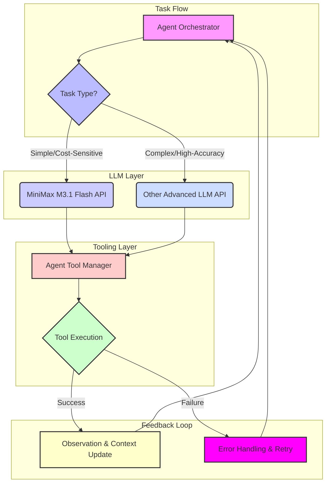

자율형 AI 에이전트의 수요가 급증하면서, 에이전트의 성능과 운영 비용은 핵심적인 고려 사항이 되었습니다. 기존 대규모 언어 모델(LLM)은 뛰어난 추론 능력을 제공하지만, 높은 지연 시간(latency)과 비용 문제로 인해 실시간 및 대규모 에이전트 워크로드에 적용하기에는 한계가 있었습니다. MiniMax M3.1 Flash는 이러한 도전 과제를 해결하기 위해 설계된 모델로, 에이전트 작업, 코딩, 컴퓨터 사용 및 사이버보안 역량을 강화하면서도 탁월한 속도와 비용 효율성을 제공합니다.

## MiniMax M3.1 Flash의 핵심 역량

MiniMax M3.1 Flash는 다음과 같은 주요 특성을 통해 AI 에이전트의 혁신을 주도합니다:

*   **향상된 에이전트 작업 능력**: 복잡한 의사 결정 체인과 다단계 작업을 효율적으로 처리하도록 최적화되어 있습니다.
*   **코딩 및 컴퓨터 사용 역량 강화**: 코드 생성, 디버깅, 시스템 명령어 실행 등 개발자 에이전트 및 자동화 에이전트의 핵심 기능을 크게 향상시킵니다.
*   **사이버보안 전문성**: 보안 분석, 위협 탐지, 취약점 평가 등 보안 관련 태스크에서 에이전트의 성능을 높입니다.
*   **3배 빠른 온라인 추론 속도**: 기존 모델 대비 약 3배 빠른 추론 속도를 제공하여 에이전트의 응답 시간을 획기적으로 단축시킵니다.
*   **70% 낮은 운영 비용**: 에이전트 작업의 전체 사용 비용을 이전 모델보다 70% 절감하여 대규모 배포의 경제성을 확보합니다.

이러한 장점들은 M3.1 Flash를 AI 에이전트 하네스(harness)에 통합할 경우, 더욱 빠르고 경제적인 자율 시스템 구축을 가능하게 합니다.

## AI 에이전트 하네스 통합 전략

MiniMax M3.1 Flash를 기존 AI 에이전트 하네스에 성공적으로 통합하기 위한 전략은 다음과 같습니다:

### 1. 동적 모델 라우팅 구현

모든 태스크에 동일한 LLM을 사용하는 대신, 태스크의 복잡도와 중요도에 따라 모델을 동적으로 라우팅하는 전략을 채택합니다. M3.1 Flash는 비용에 민감하거나 빠른 응답이 필요한 반복적인 작업, 경량 코딩 태스크에 최적화된 선택입니다. 반면, 고도의 창의성이나 심층적인 복합 추론이 요구되는 작업에는 더 강력한 모델을 활용할 수 있습니다.

### 2. 프롬프트 엔지니어링 최적화

M3.1 Flash의 특성과 강점에 맞춰 프롬프트를 재설계합니다. 효율적인 토큰 사용과 명확한 지시를 통해 모델의 추론 능력을 극대화하고, 불필요한 토큰 소비를 줄여 비용 절감 효과를 더욱 강화합니다.

### 3. 캐싱 및 응답 재사용

자주 발생하는 질의나 반복적인 패턴에 대한 M3.1 Flash의 응답을 캐싱하여, 동일한 요청에 대해 실제 추론 없이 빠르게 결과를 반환하도록 합니다. 이는 API 호출 횟수를 줄여 비용을 절감하고, 에이전트의 전체 응답 속도를 개선하는 데 기여합니다.

## 코드 예시: MiniMax M3.1 Flash를 활용한 에이전트 툴 사용 (Python)

아래 코드는 AI 에이전트가 MiniMax M3.1 Flash를 사용하여 특정 툴을 호출하고 응답을 처리하는 개념적인 예시입니다. 여기서는 가상의 `MiniMaxClient`와 `AgentTool`을 사용합니다.

```python
import os
import json
from typing import Dict, Any

class MiniMaxClient:
    def __init__(self, api_key: str):
        self.api_key = api_key
        # 실제 MiniMax API 클라이언트 초기화 로직

    def inference(self, model: str, prompt: str, tools: list = None) -> Dict[str, Any]:
        print(f"Calling MiniMax {model} with prompt: {prompt[:50]}...")
        # 가상의 API 응답. 실제 구현에서는 네트워크 요청 및 응답 파싱 포함
        if "get_current_weather" in prompt and model == "m3.1-flash":
            return {
                "tool_calls": [
                    {
                        "tool_name": "get_current_weather",
                        "arguments": {"location": "Seoul"}
                    }
                ]
            }
        elif "execute_code" in prompt and model == "m3.1-flash":
            return {
                "tool_calls": [
                    {
                        "tool_name": "execute_code",
                        "arguments": {"code": "print('Hello MiniMax!')"}
                    }
                ]
            }
        elif "summarize_document" in prompt and model == "m3.1-flash":
            return {
                "text": "Document summarized efficiently by M3.1 Flash."
            }
        else:
            return {"text": f"MiniMax {model} response to: {prompt}"}

class AgentTool:
    def get_current_weather(self, location: str) -> str:
        print(f"Tool: Getting weather for {location}")
        return f"The weather in {location} is sunny with 25°C."

    def execute_code(self, code: str) -> str:
        print(f"Tool: Executing code: {code}")
        try:
            exec_globals = {}
            exec(code, exec_globals)
            return "Code executed successfully."
        except Exception as e:
            return f"Code execution failed: {e}"
            
    def summarize_document(self, document_content: str) -> str:
        print("Tool: Summarizing document")
        # 실제 요약 로직
        return f"Summary of {document_content[:20]}..."

class AIAgent:
    def __init__(self, minimax_client: MiniMaxClient, tools: AgentTool):
        self.client = minimax_client
        self.tools = tools
        self.model = "m3.1-flash" # 기본 모델 설정

    def run_task(self, task_description: str) -> str:
        prompt = f"Given the task: '{task_description}', what action should I take? Consider using tools if necessary."
        
        # M3.1 Flash로 초기 추론 시도
        response = self.client.inference(self.model, prompt)
        
        if "tool_calls" in response and response["tool_calls"]:
            tool_call = response["tool_calls"][0]
            tool_name = tool_call["tool_name"]
            tool_args = tool_call["arguments"]
            
            if hasattr(self.tools, tool_name):
                tool_function = getattr(self.tools, tool_name)
                tool_result = tool_function(**tool_args)
                
                # 툴 실행 결과를 다시 LLM에 전달하여 다음 행동 결정 (CoT)
                follow_up_prompt = f"I called the tool '{tool_name}' with arguments {tool_args}. The result was: '{tool_result}'. What should I do next?"
                final_response = self.client.inference(self.model, follow_up_prompt)
                return f"Task completed. Final thought: {final_response.get('text', 'No final text.')}"
            else:
                return f"Error: Tool '{tool_name}' not found."
        else:
            return response.get("text", "No response text.")

# Example Usage
api_key = os.getenv("MINIMAX_API_KEY", "YOUR_MINIMAX_API_KEY")
minimax_client = MiniMaxClient(api_key)
agent_tools = AgentTool()
agent = AIAgent(minimax_client, agent_tools)

print(agent.run_task("What is the weather in Seoul?"))
print("---")
print(agent.run_task("Execute a simple 'Hello MiniMax!' python script."))
print("---")
print(agent.run_task("Please summarize a long technical document for me."))
```

## M3.1 Flash 통합 아키텍처

MiniMax M3.1 Flash를 AI 에이전트 하네스에 통합하는 개념적 아키텍처 다이어그램입니다.



## 트레이드오프

MiniMax M3.1 Flash 모델을 AI 에이전트 시스템에 도입할 때 고려해야 할 트레이드오프는 다음과 같습니다:

*   **성능 최적화 vs. 결과 일관성**: M3.1 Flash의 높은 추론 속도는 빠른 반복과 신속한 응답이 필요한 태스크에 매우 유리합니다. 하지만 고도로 복잡하거나 미묘한 추론이 요구되는 상황에서는, 더 크고 강력한 모델 대비 결과의 깊이나 일관성이 다소 떨어질 수 있습니다. (언제 좋고/언제 나쁜지: 빠른 자동화, 단순 질의응답에 좋고, 고도의 창의적 글쓰기나 복잡한 과학 연구에 나쁩니다.)
*   **비용 절감 vs. 모델 특화 기능**: M3.1 Flash는 범용적인 에이전트 작업, 특히 코딩 및 컴퓨터 사용 역량에서 비용 효율적인 대안을 제공합니다. 그러나 특정 도메인(예: 법률, 의학)에 고도로 전문화되어 미세 조정된(fine-tuned) 모델이 필요한 경우, M3.1 Flash의 범용성이 제한적일 수 있습니다. (언제 좋고/언제 나쁜지: 일반적인 개발 워크플로우 자동화 및 고객 지원 에이전트에 좋고, 특정 산업의 심층 전문 지식 요구에 나쁩니다.)
*   **신규 모델 도입 vs. 기존 시스템 안정성**: MiniMax M3.1 Flash와 같은 신규 모델 통합은 상당한 성능 및 비용 개선을 가져올 수 있습니다. 하지만 이는 기존 에이전트 워크플로우와의 호환성 검토, API 통합, 그리고 새로운 모델의 잠재적 동작 변화에 대한 광범위한 테스트 및 검증이 필요하므로, 단기적인 안정성 위험을 수반할 수 있습니다. (언제 좋고/언제 나쁜지: 장기적인 효율성과 확장성에 좋고, 단기적인 서비스 중단이나 예기치 않은 버그 발생 위험이 있는 초기 도입 단계에 나쁩니다.)
*   **벤더 종속성(Vendor Lock-in) vs. 최첨단 기술 활용**: MiniMax M3.1 Flash를 도입함으로써 MiniMax 생태계에 대한 종속성이 증가할 수 있습니다. 이는 향후 다른 최신 모델로의 전환 유연성을 제한할 수 있지만, 동시에 특정 벤더의 최첨단 기술과 지속적인 개선 혜택을 누릴 수 있습니다. (언제 좋고/언제 나쁜지: MiniMax의 기술 로드맵을 신뢰하고 장기적인 파트너십을 고려할 때 좋고, 다양한 모델을 유연하게 교체해야 하는 멀티-클라우드/멀티-LLM 전략에는 나쁩니다.)

## 실전 체크리스트

MiniMax M3.1 Flash를 AI 에이전트 프로젝트에 도입하기 위한 실전 체크리스트입니다:

- [ ] MiniMax M3.1 Flash API 키 발급 및 에이전트 하네스 내 인증 구성이 완료되었는지 확인합니다.
- [ ] 기존 에이전트 툴 정의(tool definitions)가 M3.1 Flash의 함수 호출(function calling) 또는 툴 사용(tool use) 포맷과 호환되는지 검토 및 필요시 수정합니다.
- [ ] M3.1 Flash 도입 후 핵심 에이전트 워크플로우의 온라인 추론 속도를 벤치마킹하고, 기존 모델 대비 3배 이상의 성능 개선이 실증되었는지 측정합니다.
- [ ] M3.1 Flash 사용에 따른 총 운영 비용(total operational cost)을 모니터링하고, 이전 모델 대비 70% 비용 절감 목표가 달성되었는지 검증합니다.
- [ ] 복잡한 코딩 태스크, 컴퓨터 사용, 사이버보안 관련 태스크에서 M3.1 Flash의 정확도와 안정성을 평가하기 위한 테스트 케이스를 실행합니다.
- [ ] 다중 모델 라우팅 전략(예: 단순 질의는 M3.1 Flash, 복합 추론은 상위 모델)을 수립하고, 각 모델의 역할과 전환 기준이 명확하게 정의되었는지 확인합니다.
- [ ] 에이전트 워크플로우 내에서 M3.1 Flash가 반환하는 잠재적 오류에 대한 적절한 오류 처리 및 재시도(retry) 로직이 구현되었는지 검증합니다.