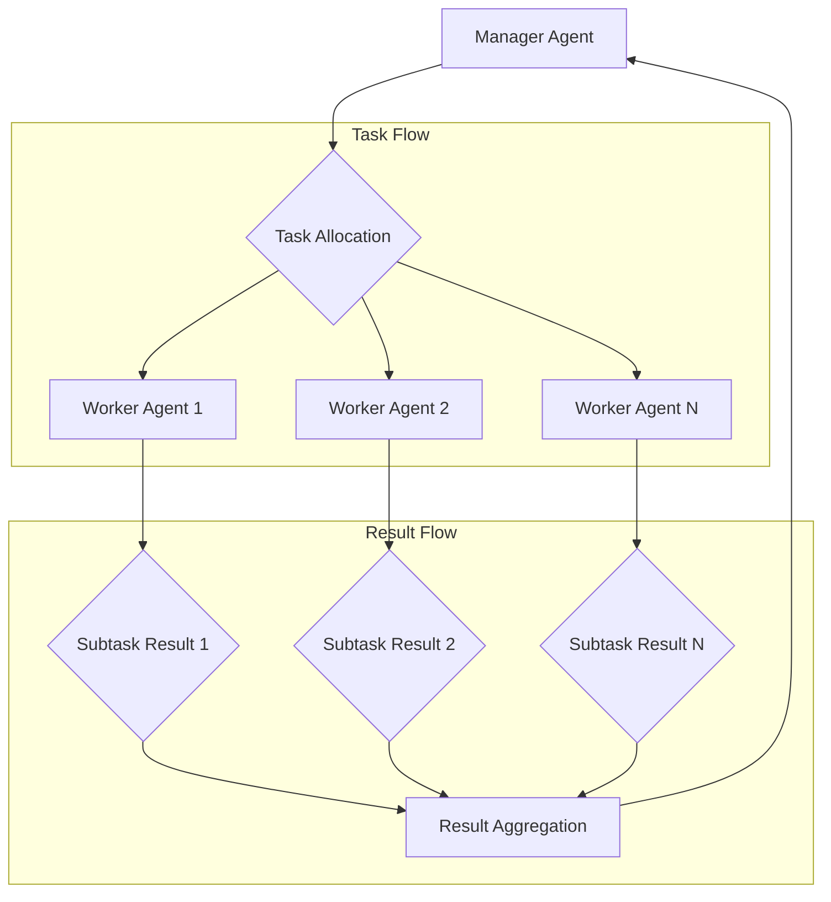

멀티 에이전트 시스템(Multi-Agent Systems, MAS)은 복잡한 문제를 해결하기 위해 여러 개의 독립적인 지능형 에이전트가 상호작용하는 분산형 시스템입니다. 특히 복잡한 비즈니스 프로세스를 자동화하거나, 동적인 환경에 적응해야 하는 시나리오에서 MAS의 효율적인 설계는 필수적입니다. 에이전트 간의 효과적인 협업(collaboration)과 조정(coordination)은 시스템 전체의 성능과 신뢰성을 좌우하는 핵심 요소입니다.

## 멀티 에이전트 협업 및 조정의 중요성
개별 에이전트의 능력만으로는 해결하기 어려운 대규모 문제에 직면했을 때, 여러 에이전트가 각자의 전문성을 활용하여 협력하는 것이 중요합니다. 하지만 단순한 협업만으로는 충분하지 않습니다. 각 에이전트의 행동이 다른 에이전트에게 미치는 영향을 관리하고, 자원 경합을 피하며, 전체 시스템 목표에 부합하도록 행동을 동기화하는 조정 메커니즘이 필요합니다. 2026년 현재, LLM 기반 에이전트의 등장으로 에이전트의 인지 능력은 비약적으로 발전했지만, 이들 에이전트의 대규모 협업 및 조정은 여전히 중요한 연구 및 개발 영역입니다.

### 핵심 디자인 패턴
멀티 에이전트 시스템의 협업 및 조정을 위한 여러 디자인 패턴이 존재합니다. 이 패턴들은 에이전트 간의 상호작용 방식을 구조화하여 시스템의 복잡성을 관리하고 효율성을 높이는 데 기여합니다.

#### 1. Blackboard 패턴
Blackboard 패턴은 모든 에이전트가 접근할 수 있는 공유된 작업 공간(Blackboard)을 제공합니다. 에이전트들은 이 Blackboard에 부분적인 문제 해결책을 게시하고, 다른 에이전트들이 게시된 정보를 활용하여 자신의 작업을 진행합니다. 이는 복잡하고 예측 불가능한 문제에 대해 유연한 협업을 가능하게 합니다. 일반적으로 `Knowledge Sources` (문제 해결 지식 보유 에이전트), `Blackboard Data Structure` (공유 메모리), `Control Component` (Blackboard 상태 변화 모니터링 및 KS 활성화)로 구성됩니다.

#### 2. Manager-Worker 패턴 (계층적 조정)
중앙 관리자(Manager) 에이전트가 전체 작업을 더 작은 서브태스크로 분할하여 워커(Worker) 에이전트들에게 할당하고, 워커 에이전트들의 진행 상황을 모니터링하며 결과를 통합합니다. 이 패턴은 작업 흐름이 명확하고 중앙 집중식 제어가 필요한 시스템에 적합합니다. 관리자는 자원 할당, 스케줄링, 충돌 해결 등의 역할을 수행하며, 워커는 할당된 태스크를 독립적으로 수행합니다.



#### 3. Contract Net Protocol (분산형 태스크 할당)
에이전트들이 분산된 방식으로 태스크를 협상하고 할당하는 프로토콜입니다. 태스크를 가진 에이전트(Manager)가 태스크를 브로드캐스트하면, 다른 에이전트(Bidder)들이 자신의 능력과 자원을 바탕으로 입찰(bid)합니다. Manager는 가장 적합한 입찰을 선택하여 태스크를 할당합니다. 이는 동적이고 예측 불가능한 환경에서 자원 활용 효율을 높이는 데 효과적입니다.

#### 4. Swarm Intelligence (Emergent Coordination)
개별 에이전트가 매우 간단한 규칙을 따르지만, 이들 에이전트의 상호작용을 통해 전역적으로 복잡하고 지능적인 행동이 나타나는 패턴입니다. 개미 군집 최적화(Ant Colony Optimization), 벌떼 최적화(Particle Swarm Optimization) 등이 대표적이며, 특히 로봇 공학, 물류, 네트워크 라우팅 등에서 활용됩니다. 중앙 집중식 제어 없이 높은 복원력과 확장성을 제공합니다.

### 구현 예시: Manager-Worker 패턴 (Python)
아래 Python 코드는 간단한 Manager-Worker 패턴을 구현합니다. Manager가 워커들에게 `Task`를 할당하고, 워커는 이를 처리한 후 결과를 반환합니다.

```python
import queue
import threading
import time

class Task:
    def __init__(self, task_id, data):
        self.task_id = task_id
        self.data = data

    def __repr__(self):
        return f"Task({self.task_id}, data='{self.data}')"

class WorkerAgent(threading.Thread):
    def __init__(self, worker_id, task_queue, result_queue):
        super().__init__()
        self.worker_id = worker_id
        self.task_queue = task_queue
        self.result_queue = result_queue
        self.running = True

    def run(self):
        print(f"Worker {self.worker_id} started.")
        while self.running:
            try:
                task = self.task_queue.get(timeout=1)
                print(f"Worker {self.worker_id} processing {task}")
                # Simulate work
                time.sleep(0.5)
                result = f"Processed {task.data} by {self.worker_id}"
                self.result_queue.put((task.task_id, result))
                self.task_queue.task_done()
            except queue.Empty:
                continue
        print(f"Worker {self.worker_id} stopped.")

    def stop(self):
        self.running = False

class ManagerAgent:
    def __init__(self, num_workers=3):
        self.task_queue = queue.Queue()
        self.result_queue = queue.Queue()
        self.workers = []
        for i in range(num_workers):
            worker = WorkerAgent(f"W{i+1}", self.task_queue, self.result_queue)
            self.workers.append(worker)

    def start_system(self):
        for worker in self.workers:
            worker.start()
        print("All workers started.")

    def assign_task(self, task):
        print(f"Manager assigning {task}")
        self.task_queue.put(task)

    def collect_results(self):
        results = {}
        while not self.result_queue.empty():
            task_id, result = self.result_queue.get()
            results[task_id] = result
        return results

    def stop_system(self):
        print("Stopping all workers...")
        for worker in self.workers:
            worker.stop()
        for worker in self.workers:
            worker.join()
        print("All workers stopped and joined.")

if __name__ == "__main__":
    manager = ManagerAgent(num_workers=3)
    manager.start_system()

    tasks_to_assign = [
        Task(1, "data_A"),
        Task(2, "data_B"),
        Task(3, "data_C"),
        Task(4, "data_D"),
        Task(5, "data_E"),
    ]

    for t in tasks_to_assign:
        manager.assign_task(t)

    # Wait for all tasks to be processed
    manager.task_queue.join()

    final_results = manager.collect_results()
    print("--- Final Results ---")
    for task_id, res in final_results.items():
        print(f"Task {task_id}: {res}")

    manager.stop_system()
```

### 2026년 트렌드 반영
최근 멀티 에이전트 시스템 디자인에서는 대규모 언어 모델(LLM)의 활용이 두드러집니다. LLM은 에이전트의 추론, 계획, 커뮤니케이션 능력을 크게 향상시키며, 이는 더욱 정교하고 유연한 협업 및 조정 메커니즘을 가능하게 합니다. 특히 다음과 같은 방향으로 발전하고 있습니다:

*   **동적 태스크 재계획 (Dynamic Task Re-planning)**: LLM 기반 에이전트가 환경 변화나 예상치 못한 상황에 따라 실시간으로 태스크 계획을 수정하고 재조정하는 능력.
*   **인간-에이전트 협업 (Human-Agent Collaboration)**: 에이전트 시스템이 인간 사용자와 자연어로 소통하며 공동의 목표를 달성하는 하이브리드 워크플로우 디자인. 특히 LLM은 에이전트의 의사결정 과정을 인간에게 설명하는 데 유용합니다.
*   **자율적 갈등 해결 (Autonomous Conflict Resolution)**: 에이전트 간의 자원 경합이나 목표 불일치 발생 시, LLM 기반의 협상 또는 중재 메커니즘을 통해 자율적으로 해결하는 방안.
*   **메타-조정 계층 (Meta-Coordination Layer)**: 에이전트 그룹의 행동을 모니터링하고, 필요에 따라 하위 그룹의 조정 전략을 변경하거나 새로운 협업 패턴을 도입하는 상위 수준의 조정 에이전트.

## 트레이드오프
각 협업 및 조정 패턴은 고유한 장단점을 가지므로, 시스템의 요구사항에 따라 신중하게 선택해야 합니다.

*   **Blackboard 패턴**: 유연성과 적응성이 높습니다. 언제 좋냐면, 문제가 정의되지 않았거나 예측하기 어려운 동적 환경에서 에이전트들이 비동기적으로 정보를 공유하며 탐색적으로 해결책을 찾아갈 때 효과적입니다. 언제 나쁘냐면, Blackboard 자체가 병목 지점이 될 수 있고, 데이터 일관성 및 동시성 제어가 복잡해지면 성능 저하가 발생할 수 있습니다.
*   **Manager-Worker 패턴**: 중앙 집중식 제어 덕분에 구현 및 관리가 비교적 간단하며, 작업 할당의 효율성을 높일 수 있습니다. 언제 좋냐면, 태스크 분해가 명확하고, 작업의 순서나 의존성이 중요한 안정적인 환경에 적합합니다. 언제 나쁘냐면, Manager 에이전트가 단일 장애점(Single Point of Failure)이 될 수 있고, 워커 수가 많아지면 Manager에게 병목 현상이 발생하여 확장성 문제가 생길 수 있습니다.
*   **Contract Net Protocol**: 분산된 태스크 할당으로 시스템의 유연성과 확장성이 뛰어납니다. 언제 좋냐면, 에이전트들의 능력과 가용 자원이 동적으로 변하는 환경에서 최적의 태스크 분배를 달성해야 할 때 유리합니다. 언제 나쁘냐면, 태스크 브로드캐스팅 및 입찰 과정에서 통신 오버헤드가 발생할 수 있고, 입찰 전략 설계가 복잡하여 시스템 전체의 효율성을 예측하기 어려울 수 있습니다.
*   **Swarm Intelligence**: 중앙 제어 없이도 강력한 복원력과 높은 확장성을 제공합니다. 언제 좋냐면, 개별 에이전트의 역할이 단순하고, 전체 시스템의 복잡한 행동이 개별 에이전트의 상호작용에서 자연스럽게 나타나도록 할 때 유용합니다 (예: 경로 최적화, 군집 로봇). 언제 나쁘냐면, 특정 전역 목표를 명확하게 제어하거나 예측하기 어렵고, emergent behavior의 디버깅 및 분석이 매우 까다로울 수 있습니다.

## 실전 체크리스트
멀티 에이전트 시스템의 협업 및 조정 메커니즘을 설계하고 구현할 때 다음 체크리스트를 활용하여 시스템의 효율성과 견고성을 확보할 수 있습니다.

-   [ ] **에이전트 역할 및 책임 명확화**: 각 에이전트의 전문 분야와 책임 영역을 구체적으로 정의했는가? (`Manager`, `Worker`, `Mediator` 등)
-   [ ] **표준화된 통신 프로토콜 설계**: 에이전트 간 메시지 형식(예: JSON, ACL)과 전송 방식(예: 메시지 큐, REST API)을 표준화하여 정의했는가?
-   [ ] **충돌 해결 전략 구현**: 자원 경합, 태스크 중복, 또는 의견 불일치가 발생했을 때 이를 해결하기 위한 명확한 메커니즘(예: 우선순위, 투표, 협상)을 마련했는가?
-   [ ] **관찰 가능성(Observability) 및 디버깅 용이성 확보**: 에이전트의 내부 상태, 메시지 교환, 의사결정 과정을 추적하고 시각화할 수 있는 로깅 및 모니터링 시스템을 구축했는가?
-   [ ] **확장성 및 성능 평가**: 시스템이 에이전트 수 또는 태스크 부하 증가에 따라 어떻게 확장되는지, 그리고 목표 성능 지표(예: 처리량, 지연 시간)를 충족하는지 테스트했는가?
-   [ ] **인간 개입 지점 설계**: 에이전트의 자율적 결정이 중요한 실패를 야기할 수 있는 경우, 인간이 개입하여 의사결정을 검토하거나 재정의할 수 있는 안전 장치(Human-in-the-Loop)를 마련했는가?
-   [ ] **태스크 완료율 및 효율성 측정**: 에이전트 시스템이 할당된 태스크를 성공적으로 완료하는 비율과, 그 과정에서 소모된 자원(예: 시간, 컴퓨팅 비용)의 효율성을 측정하는 지표를 정의했는가?