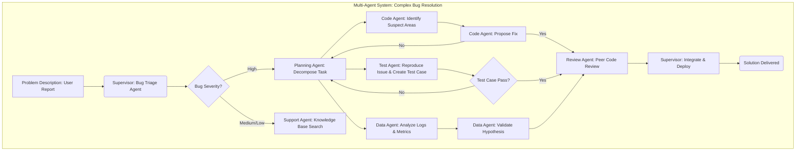

복잡한 문제 해결은 단일 에이전트(Single Agent)의 역량을 넘어서는 경우가 많습니다. 2026년 실무 환경에서는 고도로 전문화된 지능형 에이전트들의 협업을 통해 이러한 복잡성을 효과적으로 관리하고 해결하는 능력이 필수적입니다. 이 엔트리에서는 복잡한 문제를 해결하기 위한 멀티 에이전트 협업 시스템의 설계 원칙과 핵심 패턴을 다룹니다.

## 멀티 에이전트 협업의 필요성
현대 소프트웨어 시스템은 방대한 데이터 처리, 실시간 의사 결정, 다양한 도구 통합 등 다층적인 요구사항을 가집니다. 단일 대규모 언어 모델(LLM) 기반 에이전트만으로는 처리하기 어려운 규모와 복잡도를 가집니다. 따라서, 각기 다른 전문성을 가진 에이전트들이 상호작용하며 협력하는 멀티 에이전트 시스템(Multi-Agent System, MAS)의 설계가 중요해지고 있습니다. 이는 각 에이전트가 특정 도메인 지식이나 태스크에 특화되어 전체 시스템의 효율성과 견고성을 높이는 방법론입니다.

## 핵심 개념
멀티 에이전트 협업 패턴을 설계하기 위한 핵심 개념들은 다음과 같습니다.

### 1. 에이전트 역할 및 전문화 (Agent Roles & Specialization)
각 에이전트는 명확하고 고유한 역할(Role)을 수행해야 합니다. 예를 들어, 기획 에이전트(Planning Agent)는 문제 분해 및 태스크 계획을, 코드 에이전트(Code Agent)는 실제 코드 구현을, 테스트 에이전트(Test Agent)는 검증을 담당할 수 있습니다. 이러한 전문화는 각 에이전트가 처리해야 할 컨텍스트(Context)를 줄여 효율성을 높이고, 특정 에이전트의 실패가 전체 시스템에 미치는 영향을 최소화합니다.

### 2. 통신 프로토콜 (Communication Protocols)
에이전트 간의 효과적인 정보 교환은 협업의 핵심입니다. 통신은 구조화된 메시지(Structured Messages) 형식으로 이루어지며, 비동기(Asynchronous) 또는 동기(Synchronous) 방식으로 구현될 수 있습니다. 메시지 큐(Message Queue)나 Pub/Sub 패턴을 활용하여 에이전트 간 결합도를 낮추고 유연성을 확보하는 것이 중요합니다.

### 3. 공유 상태 및 메모리 (Shared State & Memory)
에이전트들이 협업하면서 공유해야 하는 정보(예: 문제 정의, 현재 진행 상황, 중간 결과)를 관리하는 메커니즘이 필요합니다. 중앙화된 지식 베이스(Centralized Knowledge Base)인 블랙보드(Blackboard) 시스템, 또는 분산된 컨텍스트(Distributed Context) 관리 시스템을 통해 에이전트들이 필요한 정보를 접근하고 업데이트할 수 있도록 합니다. 이때, 데이터 일관성(Data Consistency)과 동시성 제어(Concurrency Control)가 중요합니다.

### 4. 오케스트레이션 및 조정 (Orchestration & Coordination)
에이전트들의 태스크 위임(Task Delegation), 실행 순서 제어, 충돌 해결(Conflict Resolution) 등을 담당하는 상위 레벨의 로직입니다. 이는 중앙 오케스트레이터(Central Orchestrator)가 될 수도 있고, 에이전트들이 자율적으로 조정(Self-Coordination)하는 방식으로 이루어질 수도 있습니다.

## 멀티 에이전트 협업 패턴

### 1. 계층적 협업 (Hierarchical Collaboration)
하나의 슈퍼바이저 에이전트(Supervisor Agent)가 상위 태스크를 하위 에이전트들에게 분해하고 위임하며, 하위 에이전트들의 결과를 취합하여 최종 결과를 도출하는 패턴입니다. 명확한 제어 흐름과 쉬운 디버깅이 장점이지만, 슈퍼바이저가 병목 현상(Bottleneck)이나 단일 실패 지점(Single Point of Failure)이 될 수 있습니다.

### 2. 피어 투 피어 협업 (Peer-to-Peer Collaboration)
에이전트들이 중앙 집중적인 제어 없이 서로 직접 상호작용하며 태스크를 분담하고 해결하는 패턴입니다. 높은 복원력(Resilience)과 확장성(Scalability)을 가지지만, 조정 메커니즘 설계가 복잡하고 예측 불가능한 행동으로 이어질 수 있습니다.

### 3. 블랙보드 아키텍처 (Blackboard Architecture)
모든 에이전트가 접근하고 수정할 수 있는 중앙 공유 메모리(Blackboard)를 통해 협업하는 패턴입니다. 에이전트들은 블랙보드에 있는 정보를 모니터링하고, 자신의 전문성에 따라 적절한 시점에 블랙보드를 업데이트합니다. 에이전트 간의 결합도가 낮아 유연하고 확장 가능하지만, 블랙보드 자체의 성능과 일관성 관리가 중요합니다.

아래 Mermaid 다이어그램은 복잡한 버그 해결을 위한 멀티 에이전트 시스템의 계층적 협업 흐름을 보여줍니다.



## 코드 예제: 간단한 계층적 태스크 위임 (Python)

이 예제는 슈퍼바이저 에이전트가 버그 리포트를 받아 기획, 코딩, 테스트 에이전트에게 순차적으로 태스크를 위임하는 과정을 보여줍니다.

```python
import abc
from typing import Dict, Any

class Agent(abc.ABC):
    def __init__(self, name: str):
        self.name = name

    @abc.abstractmethod
    def process_task(self, task: Dict[str, Any]) -> Dict[str, Any]:
        pass

class SupervisorAgent(Agent):
    def process_task(self, task: Dict[str, Any]) -> Dict[str, Any]:
        print(f"[{self.name}] Received task: {task['description']}")
        results = {}
        if "bug_report" in task:
            # Delegate to Planning Agent
            planning_task = {"type": "plan_fix", "bug_report": task["bug_report"]}
            plan = self.delegate(PlanningAgent("Planner"), planning_task)
            results["plan"] = plan

            if plan and "steps" in plan:
                code_task = {"type": "implement_fix", "plan": plan["steps"]}
                code_output = self.delegate(CodeAgent("Coder"), code_task)
                results["code"] = code_output

                if code_output and "code" in code_output:
                    test_task = {"type": "run_tests", "code": code_output["code"], "test_context": task.get("test_context", {})}
                    test_results = self.delegate(TestAgent("Tester"), test_task)
                    results["test_results"] = test_results
            return {"status": "completed", "final_results": results}
        return {"status": "failed", "reason": "Unsupported task"}

    def delegate(self, agent: Agent, sub_task: Dict[str, Any]) -> Dict[str, Any]:
        print(f"[{self.name}] Delegating to {agent.name} for task: {sub_task['type']}")
        return agent.process_task(sub_task)

class PlanningAgent(Agent):
    def process_task(self, task: Dict[str, Any]) -> Dict[str, Any]:
        if task["type"] == "plan_fix":
            print(f"[{self.name}] Planning fix for: {task['bug_report']}")
            # Simulate planning logic
            plan_steps = [
                "Analyze call stack",
                "Identify root cause in `foo.py`",
                "Propose change to `bar()` function",
                "Write unit test for `bar()`"
            ]
            return {"status": "planned", "steps": plan_steps, "estimated_time": "2 hours"}
        return {"status": "failed", "reason": "Invalid task type"}

class CodeAgent(Agent):
    def process_task(self, task: Dict[str, Any]) -> Dict[str, Any]:
        if task["type"] == "implement_fix":
            print(f"[{self.name}] Implementing fix based on plan: {task['plan']}")
            # Simulate code generation
            generated_code = """
def bar(x):
    # Fix: ensure x is always positive
    if x < 0:
        x = abs(x)
    return x * 2
"""
            return {"status": "code_generated", "code": generated_code}
        return {"status": "failed", "reason": "Invalid task type"}

class TestAgent(Agent):
    def process_task(self, task: Dict[str, Any]) -> Dict[str, Any]:
        if task["type"] == "run_tests":
            print(f"[{self.name}] Running tests for code: {task['code'][:50]}...")
            # Simulate test execution
            test_success = True # Assume success for simplicity
            return {"status": "tests_passed" if test_success else "tests_failed", "report": "All critical tests passed."}
        return {"status": "failed", "reason": "Invalid task type"}

# Example Usage
if __name__ == "__main__":
    supervisor = SupervisorAgent("MainSupervisor")
    complex_bug_task = {
        "description": "Critical bug: Negative values cause incorrect calculation in report generation.",
        "bug_report": "Error in report X when input is -5.",
        "test_context": {"environment": "staging", "data_subset": "small"}
    }
    final_outcome = supervisor.process_task(complex_bug_task)
    print("\nFinal Outcome:", final_outcome)
```

## 트레이드오프

멀티 에이전트 협업 패턴을 설계할 때는 다음과 같은 트레이드오프를 고려해야 합니다.

*   **복잡성 vs. 모듈성 (Complexity vs. Modularity)**
    *   **언제 좋은가**: 각 에이전트가 고도로 전문화된 태스크를 수행하고 명확한 책임 분리가 필요한 경우, 시스템의 모듈성을 높여 관리가 용이해집니다.
    *   **언제 나쁜가**: 단순한 문제나 태스크에는 에이전트 간의 통신 및 조정 오버헤드가 불필요한 복잡성을 추가할 수 있습니다.
*   **확장성 vs. 조정 오버헤드 (Scalability vs. Coordination Overhead)**
    *   **언제 좋은가**: 병렬 처리(Parallel Processing)가 가능하고 작업 부하를 분산하여 시스템 전체의 확장성을 확보할 때 유리합니다.
    *   **언제 나쁜가**: 에이전트 수가 증가할수록 통신 및 동기화(Synchronization) 비용이 기하급수적으로 늘어나 전체 시스템의 병목 현상이 발생할 수 있습니다.
*   **견고성 vs. 지연 시간 (Robustness vs. Latency)**
    *   **언제 좋은가**: 에이전트 실패 시 재시도(Retry), 대체 에이전트(Fallback Agent) 등의 메커니즘을 통해 시스템의 견고성(Robustness)과 내결함성(Fault Tolerance)을 높일 수 있습니다.
    *   **언제 나쁜가**: 추가적인 검증 및 오류 복구(Error Recovery) 단계가 전체 태스크 실행 시간을 증가시켜 실시간(Realtime) 또는 낮은 지연 시간(Low Latency)이 요구되는 환경에서는 불리할 수 있습니다.
*   **자율성 vs. 제어 (Autonomy vs. Control)**
    *   **언제 좋은가**: 에이전트가 독립적으로 판단하고 행동하여 예측 불가능한 상황에 유연하게 대처하고 적응력을 높일 수 있습니다.
    *   **언제 나쁜가**: 강력한 오케스트레이션이나 조정 로직 없이 과도한 자율성은 비최적의 결과나 에이전트 간의 충돌로 이어질 수 있습니다.

## 실전 체크리스트

멀티 에이전트 협업 시스템을 프로젝트에 적용할 때 다음 항목들을 확인하십시오.

- [ ] 각 에이전트의 역할과 책임(Role and Responsibility)이 명확하게 정의되었는가?
- [ ] 에이전트 간 통신 프로토콜(Communication Protocol)이 표준화되어 있고, 메시지 포맷(Message Format)이 구조화되었는가?
- [ ] 공유되는 상태(Shared State)나 지식 베이스(Knowledge Base)의 일관성 및 동시성 제어(Concurrency Control) 메커니즘이 설계되었는가?
- [ ] 복잡한 태스크를 하위 태스크로 분해(Task Decomposition)하고 에이전트에 위임(Delegation)하는 오케스트레이션(Orchestration) 로직이 명확한가?
- [ ] 에이전트 실패(Agent Failure) 시 재시도(Retry), 대체 에이전트(Fallback Agent) 활성화 등 오류 복구 전략(Error Recovery Strategy)이 마련되었는가?
- [ ] 시스템 전체의 성능 병목(Performance Bottleneck)을 식별하고 개선하기 위한 모니터링(Monitoring) 및 로깅(Logging) 체계가 구축되었는가?
- [ ] 새로운 에이전트(New Agent) 추가 또는 기존 에이전트(Existing Agent) 교체 시 유연하게 대응할 수 있도록 시스템이 확장성(Scalability)을 갖추었는가?