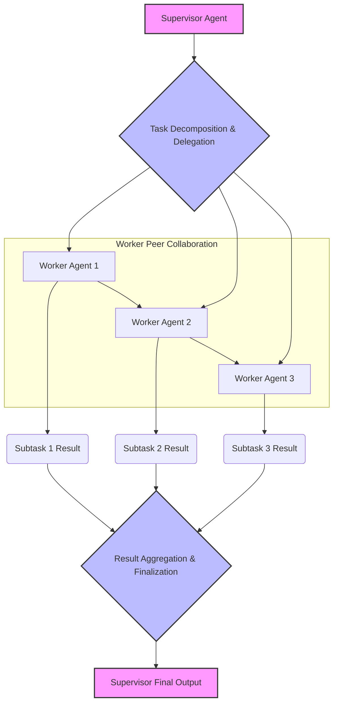

### 멀티 에이전트 시스템의 필요성 (Why Multi-Agent Systems?)
단일 Large Language Model (LLM)은 복잡한 태스크, 실시간 일관성 유지, 최신 정보 처리 등에서 한계를 보입니다. 이러한 제약을 극복하기 위해 멀티 에이전트 시스템이 필요합니다. 멀티 에이전트 시스템은 문제를 작은 서브 태스크로 분해(Decomposition)하고, 각 에이전트가 특정 분야에 전문화(Specialization)되어 병렬 처리(Parallel Processing)를 통해 전체 시스템의 내결함성(Fault Tolerance)을 높일 수 있습니다. 핵심 과제는 이러한 에이전트 간의 효율적인 협업(Collaboration) 및 조정(Coordination) 패턴을 설계하는 것입니다.

### 주요 협업 패턴 (Key Collaboration Patterns)

#### 1. 순차적 파이프라인 (Sequential Pipeline)
*   **설명**: 에이전트들이 정해진 순서대로 태스크를 처리하며 결과를 다음 에이전트에게 전달합니다. 각 에이전트는 이전 에이전트의 출력을 입력으로 받습니다.
*   **장점**: 구현이 단순하고, 각 에이전트의 책임이 명확하게 분리됩니다.
*   **단점**: 한 에이전트에서 병목 현상이 발생하거나 오류가 생기면 전체 파이프라인에 영향을 미칩니다.
*   **예시**: `Planner Agent` → `Executor Agent` → `Reviewer Agent`

#### 2. 병렬 처리 (Parallel Processing)
*   **설명**: 여러 에이전트가 동시에 독립적인 서브 태스크를 처리한 후, 통합 에이전트가 각 결과를 병합합니다.
*   **장점**: 태스크 처리 속도를 크게 향상시키고, 작업 부하를 분산할 수 있습니다.
*   **단점**: 각 에이전트의 결과를 효율적으로 병합하고 중복을 제거하는 로직이 복잡해질 수 있으며, 자원 관리가 필요합니다.
*   **예시**: `Research Agent 1` + `Research Agent 2` → `Synthesis Agent`

#### 3. 계층적 조정 (Hierarchical Coordination)
*   **설명**: 상위 에이전트 (`Supervisor Agent`)가 전체 목표를 관리하고, 이 목표를 더 작은 단위의 태스크로 분해하여 하위 에이전트들에게 위임합니다. 하위 에이전트들은 독립적으로 서브 태스크를 수행하고 결과를 상위 에이전트에게 보고합니다.
*   **장점**: 전체 시스템의 제어가 용이하며, 복잡한 태스크를 효율적으로 분해하고 관리할 수 있습니다.
*   **단점**: 상위 에이전트가 단일 장애점(Single Point of Failure)이 될 수 있고, 하위 에이전트의 자율성이 제한될 수 있습니다.
*   **예시**: `Project Manager Agent` → `Developer Agent` & `Tester Agent`

#### 4. 합의 기반 (Consensus-Based)
*   **설명**: 여러 에이전트가 동일한 문제에 대해 독립적으로 솔루션을 제안한 후, 투표, 토론 또는 특정 기준에 따라 최적의 합의된 솔루션을 도출합니다.
*   **장점**: 다양한 관점을 반영하여 결과의 견고성(Robustness)과 신뢰성을 높일 수 있습니다.
*   **단점**: 합의 과정 자체가 비효율적일 수 있고, 에이전트 간 의견 충돌을 해결하기 위한 복잡한 로직이 필요합니다.
*   **예시**: `Multiple Solver Agents` → `Consensus Agent`

### 2026년 트렌드: 적응형 및 동적 협업 (Adaptive and Dynamic Collaboration)
2026년 LLM 기반 멀티 에이전트 시스템은 더욱 지능적이고 유연한 협업을 목표로 합니다. 핵심 트렌드는 다음과 같습니다:
*   **동적 역할 할당 (Dynamic Role Assignment)**: 태스크의 특성이나 시스템 상태에 따라 에이전트의 역할을 실시간으로 변경하여 효율성을 극대화합니다.
*   **자기 수정 루프 (Self-Correction Loops)**: 에이전트 간의 지속적인 피드백 메커니즘을 통해 오류를 감지하고 스스로 학습하며 수정하는 능력을 강화합니다.
*   **온톨로지 및 지식 그래프 통합 (Ontology & Knowledge Graph Integration)**: 에이전트들이 공유된 온톨로지나 지식 그래프를 기반으로 더욱 정교하게 의사소통하고 추론하여, 문맥 이해도를 높입니다.
*   **도구 사용 최적화 (Optimized Tool Use)**: 에이전트가 외부 도구 (External Tools)를 효율적으로 식별하고, 언제 어떤 도구를 사용할지 동적으로 결정하는 능력을 향상시킵니다.

### 코드 예제: 간단한 순차적 에이전트 파이프라인 (Python)
```python
from typing import List

class LLMAgent:
    def __init__(self, name: str, role: str, model_client):
        self.name = name
        self.role = role
        self.model_client = model_client

    def act(self, task_input: str) -> str:
        prompt = f"You are {self.name}, a {self.role}. Process this task: '{task_input}'. Provide a concise output."
        # Simulate an LLM call. In a real system, this would be an actual LLM API call.
        response = self.model_client.generate(prompt)
        # print(f"[{self.name} ({self.role})] Input: '{task_input}' -> Output: '{response}'") # Suppress for brevity
        return response

class MockLLMClient:
    """A mock LLM client for demonstration purposes."""
    def generate(self, prompt: str) -> str:
        if "plan" in prompt.lower():
            return "Identified key components and outlined a step-by-step approach."
        elif "process" in prompt.lower() or "execute" in prompt.lower():
            return "Implemented the outlined steps, generating intermediate results."
        elif "review" in prompt.lower() or "validate" in prompt.lower():
            return "Validated the results and provided feedback for improvement."
        else:
            return "Processed the generic request successfully."

def run_sequential_pipeline(agents: List[LLMAgent], initial_task: str) -> str:
    current_output = initial_task
    for agent in agents:
        current_output = agent.act(current_output)
    return current_output

if __name__ == "__main__":
    mock_client = MockLLMClient()

    # Define agents for a sequential pipeline
    planner = LLMAgent("PlannerAgent", "task planner", mock_client)
    executor = LLMAgent("ExecutorAgent", "task executor", mock_client)
    reviewer = LLMAgent("ReviewerAgent", "quality reviewer", mock_client)

    pipeline_agents = [planner, executor, reviewer]

    # Run the pipeline with an initial task
    final_result = run_sequential_pipeline(
        pipeline_agents,
        "Develop a multi-agent system for personalized content recommendation."
    )
    # print(f"Final pipeline result: {final_result}") # Suppress for brevity
```

### Mermaid 다이어그램: 계층적 협업 패턴 (Hierarchical Collaboration Pattern)


### ## 트레이드오프 (Trade-offs)

1.  **협업 복잡성 vs. 성능 (Collaboration Complexity vs. Performance)**
    *   **언제 좋음**: 합의 기반 또는 계층적 패턴과 같은 복잡한 협업은 난이도 높은 문제에 견고하고 정확한 해결책을 제공하며, 시스템의 신뢰성과 결과 품질을 향상시킵니다.
    *   **언제 나쁨**: 에이전트 간 상호작용 및 조정 로직이 복잡해질수록 시스템의 지연 시간(Latency) 증가, 토큰 사용량 증가, 운영 비용(Cost) 상승을 초래할 수 있습니다. 단순하거나 시간 민감적인 태스크에는 비효율적입니다.

2.  **에이전트 자율성 vs. 제어 가능성 (Agent Autonomy vs. Control)**
    *   **언제 좋음**: 에이전트에 높은 자율성을 부여하면 예기치 않은 상황에 대한 적응력(Adaptability)과 새로운 해결책 발견(Emergent Behavior) 가능성이 높아집니다. 동적이고 변화가 심한 환경에 유리합니다.
    *   **언제 나쁨**: 자율성이 과도하면 에이전트의 행동을 예측하기 어렵고, 의도하지 않은 결과(Unintended Consequences)나 제어 불능(Runaway Behavior) 상태로 이어질 수 있습니다. 특히 보안이나 규제 준수(Compliance)가 중요한 시스템에서는 강력한 제어 메커니즘이 필수적입니다.

3.  **통신 오버헤드 vs. 견고성 (Communication Overhead vs. Robustness)**
    *   **언제 좋음**: 에이전트 간 명확하고 풍부한 통신 프로토콜 설계는 정보 비대칭(Information Asymmetry)을 줄이고, 오류 발생 시 빠른 감지 및 복구(Error Recovery)를 가능하게 하여 시스템의 견고성(Robustness)을 향상시킵니다.
    *   **언제 나쁨**: 과도한 통신은 토큰 사용량, 네트워크 지연, 처리 시간 증가로 이어져 시스템의 효율성을 저해합니다. 대량의 데이터를 주고받거나 실시간 응답이 요구되는 시스템에서는 통신량을 최소화하는 전략이 필요합니다.

4.  **역할 전문화 vs. 유연성 (Role Specialization vs. Flexibility)**
    *   **언제 좋음**: 각 에이전트가 특정 역할에 고도로 전문화되면, 해당 태스크에 대한 처리 효율성과 정확성(Accuracy)이 극대화됩니다. 시스템의 특정 부분을 최적화하는 데 유리합니다.
    *   **언제 나쁨**: 태스크나 환경이 자주 변하는 경우, 고도로 전문화된 에이전트 구성은 시스템의 유연성(Flexibility)을 떨어뜨리고 새로운 요구사항에 대한 적응을 어렵게 만듭니다. 여러 역할을 수행할 수 있는 다재다능성(Versatility)이 필요할 수 있습니다.

### ## 실전 체크리스트 (Practical Checklist)

멀티 에이전트 시스템을 설계하고 배포할 때 다음 사항들을 검증해야 합니다.

- [ ] **태스크 분해 명확성**: 전체 복합 태스크가 각 에이전트의 역할에 따라 명확하게 분해되었으며, 중복되거나 누락된 서브 태스크 없이 독립적으로 수행 가능한가?
- [ ] **통신 프로토콜 정의**: 에이전트 간의 데이터 교환 형식(Data Format), 메시지 내용(Message Content), 통신 순서(Communication Sequence)가 명확하게 정의되었고, 예상치 못한 입력에 대한 견고성(Robustness)을 갖추고 있는가?
- [ ] **오류 처리 및 복구 메커니즘**: 개별 에이전트의 실패 또는 오동작(Malfunction) 시 시스템 전체에 미치는 영향을 최소화하고, 자동 복구하거나 인간 운영자의 개입을 요청하는 메커니즘이 구현되어 있는가?
- [ ] **성능 및 비용 모니터링**: 각 에이전트의 처리 시간(Processing Time), 토큰 사용량(Token Usage), API 호출 횟수(API Call Count) 등을 실시간으로 모니터링하여 병목 현상(Bottlenecks) 및 예상치 못한 비용 증가를 조기에 감지 가능한 시스템이 구축되어 있는가?
- [ ] **확장성 설계**: 예상되는 트래픽 증가나 태스크 복잡도 증가에 대비하여 에이전트 수를 동적으로 조절하거나, 새로운 에이전트를 쉽게 추가할 수 있도록 시스템이 설계되었는가?
- [ ] **인간 개입 지점 (Human-in-the-Loop)**: 중요 결정 지점이나 시스템의 신뢰도가 낮은 상황에서 인간 운영자가 개입하여 결과를 검토하고 수정할 수 있는 명확한 인터페이스(Interface)와 절차(Procedure)가 마련되어 있는가?
- [ ] **보안 및 접근 제어**: 각 에이전트가 접근하는 외부 도구(External Tools), 데이터베이스(Databases), API 등에 최소 권한 원칙(Principle of Least Privilege)이 적용되었으며, 권한 관리(Access Control) 및 보안 감사(Security Auditing)가 가능한가?
