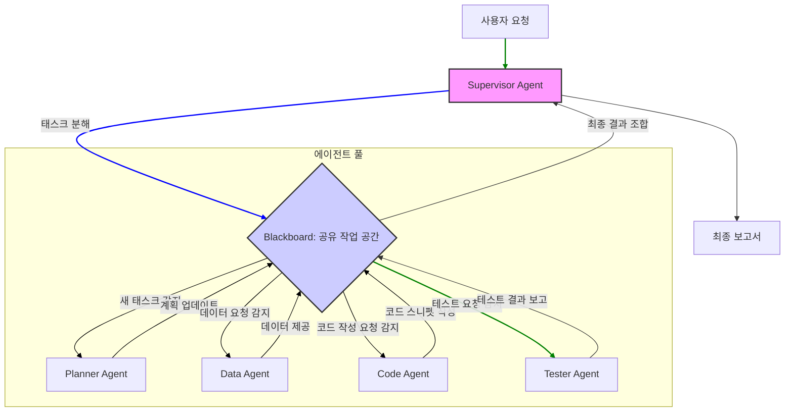

### 복잡한 문제 해결을 위한 멀티 에이전트 시스템 디자인 패턴

현대 소프트웨어 시스템은 점점 더 복잡해지고 있으며, 단일 에이전트나 모놀리식 접근 방식으로는 효율적으로 해결하기 어려운 문제들이 증가하고 있습니다. 이러한 도전 과제를 극복하기 위해 멀티 에이전트 시스템(Multi-Agent System, MAS)은 강력한 대안으로 부상하고 있습니다. MAS는 여러 자율 에이전트들이 협력하여 공동의 목표를 달성하는 시스템으로, 복잡한 태스크를 분해하고 병렬 처리하며, 유연성과 확장성을 제공합니다. 2026년 현재, LLM 기반 에이전트의 발전과 함께 MAS는 더욱 정교하고 자율적인 문제 해결 능력을 갖추고 있습니다.

### 핵심 디자인 패턴

MAS를 설계할 때 고려해야 할 몇 가지 핵심 디자인 패턴은 다음과 같습니다.

#### 1. 계층적(Hierarchical) 패턴

가장 보편적인 패턴 중 하나로, 상위 에이전트(Supervisor)가 하위 에이전트(Worker)에게 태스크를 위임하고 진행 상황을 모니터링합니다. Supervisor는 전체 목표를 관리하고, Worker는 특정 분야의 전문 지식을 활용하여 세부 태스크를 수행합니다.

*   **구조**: Supervisor, Worker Agents
*   **장점**: 역할 분담 명확, 관리 용이, 태스크 분해 용이
*   **단점**: 중앙 집중형 제어, Supervisor 병목 현상 발생 가능

#### 2. 블랙보드(Blackboard) 패턴

에이전트들이 공유하는 중앙 저장소(블랙보드)를 통해 정보를 교환하고 협력하는 패턴입니다. 각 에이전트는 블랙보드의 특정 영역을 모니터링하거나 업데이트하며, 독립적으로 문제 해결에 기여합니다.

*   **구조**: Blackboard, Knowledge Sources (Agents), Control Mechanism
*   **장점**: 높은 모듈성, 유연한 협업, 새로운 에이전트 추가 용이
*   **단점**: 블랙보드 병목 현상, 데이터 일관성 관리 복잡성

#### 3. 전문가 그룹(Expert Group) 또는 역할 기반(Role-Based) 패턴

각 에이전트가 특정 도메인 지식이나 기능을 전담하는 전문가 역할을 수행합니다. 예를 들어, `Plan Agent`, `Code Agent`, `Test Agent`, `Review Agent` 등이 하나의 태스크를 순차적 또는 병렬적으로 처리하며 협업합니다.

*   **구조**: Role-specific Agents, Coordinator (선택 사항)
*   **장점**: 전문성 극대화, 책임 분할 명확, 병렬 처리 용이
*   **단점**: 역할 간의 명확한 정의 필요, 협업 메커니즘 설계 복잡성

#### 4. 동적 오케스트레이션(Dynamic Orchestration) 패턴

미리 정의된 워크플로우를 따르기보다, 현재 상황과 태스크의 요구 사항에 따라 에이전트의 역할과 상호작용 방식이 동적으로 결정되고 조정됩니다. 이는 LLM의 추론 능력과 결합될 때 더욱 강력해집니다.

*   **구조**: Orchestrator (LLM 기반), Adaptive Agents, Dynamic Task Graph
*   **장점**: 높은 유연성, 예상치 못한 상황에 대한 적응력, 자율성 증대
*   **단점**: 설계 및 구현 복잡성, 제어 및 디버깅 어려움

### 코드 예제: 계층적 태스크 위임 (Python)

다음 Python 예제는 간단한 계층적 에이전트 시스템을 보여줍니다. `SupervisorAgent`는 사용자 요청을 받아 `WorkerAgent`에게 서브 태스크를 위임하고 결과를 종합합니다.

```python
import time
from typing import List, Dict, Any

class Agent:
    def __init__(self, name: str):
        self.name = name

    def process_task(self, task: Dict[str, Any]) -> Dict[str, Any]:
        raise NotImplementedError

class WorkerAgent(Agent):
    def process_task(self, task: Dict[str, Any]) -> Dict[str, Any]:
        task_type = task.get("type")
        payload = task.get("payload")
        print(f"[{self.name}] Processing task: {task_type} with payload: {payload}")
        time.sleep(1) # Simulate work
        if task_type == "data_fetch":
            result = f"Fetched data for {payload}"
        elif task_type == "analyze":
            result = f"Analyzed {payload}. Result: High confidence."
        else:
            result = f"Unknown task type: {task_type}"
        return {"agent": self.name, "task": task_type, "result": result}

class SupervisorAgent(Agent):
    def __init__(self, name: str, worker_agents: List[WorkerAgent]):
        super().__init__(name)
        self.worker_agents = {agent.name: agent for agent in worker_agents}

    def orchestrate_task(self, main_task: str) -> Dict[str, Any]:
        print(f"[{self.name}] Orchestrating main task: '{main_task}'")
        
        # Simulate task decomposition
        sub_tasks = self._decompose_task(main_task)
        
        results = []
        for sub_task in sub_tasks:
            assigned_worker = sub_task.get("assignee")
            if assigned_worker and assigned_worker in self.worker_agents:
                worker_response = self.worker_agents[assigned_worker].process_task(sub_task)
                results.append(worker_response)
            else:
                results.append({"error": f"No worker for {sub_task.get('type')} or unknown assignee"})
        
        final_summary = self._synthesize_results(results)
        return {"main_task": main_task, "final_summary": final_summary, "sub_task_results": results}

    def _decompose_task(self, main_task: str) -> List[Dict[str, Any]]:
        # This part would typically involve an LLM for complex decomposition
        print(f"[{self.name}] Decomposing task '{main_task}'...")
        if "market research" in main_task.lower():
            return [
                {"type": "data_fetch", "payload": "market trends report", "assignee": "DataFetcher"},
                {"type": "analyze", "payload": "fetched market data", "assignee": "Analyzer"},
            ]
        return [{"type": "generic_process", "payload": main_task, "assignee": "GenericWorker"}]

    def _synthesize_results(self, results: List[Dict[str, Any]]) -> str:
        # This part would typically involve an LLM for sophisticated synthesis
        summary_parts = [res["result"] for res in results if "result" in res]
        return " ".join(summary_parts) if summary_parts else "No meaningful results to summarize."

# System Initialization
data_fetcher = WorkerAgent("DataFetcher")
analyzer = WorkerAgent("Analyzer")
generic_worker = WorkerAgent("GenericWorker")

supervisor = SupervisorAgent("MainSupervisor", [data_fetcher, analyzer, generic_worker])

# Execute a main task
report = supervisor.orchestrate_task("Perform market research for new product launch.")
print("\n--- Final Report ---")
print(report)

report_simple = supervisor.orchestrate_task("Generate a simple report.")
print("\n--- Simple Report ---")
print(report_simple)
```

### 멀티 에이전트 시스템 협업 흐름 (Mermaid)

다음 Mermaid 다이어그램은 계층적 패턴과 블랙보드 패턴이 결합된 형태의 협업 흐름을 시각화합니다. Supervisor 에이전트가 블랙보드에 태스크를 게시하고, 전문 에이전트들이 이를 처리하는 방식입니다.



### 2026년 트렌드: 자율성 및 적응형 워크플로우

2026년의 MAS는 LLM의 발전과 함께 더욱 높은 수준의 자율성을 추구합니다. 에이전트들은 정적 워크플로우에 얽매이지 않고, 동적으로 태스크를 재할당하고, 실패 시 스스로 복구하며, 인간의 개입 없이 복잡한 목표를 달성하려는 방향으로 진화하고 있습니다. 이는 `agentic long-running carryover human checkpoint boundary` 및 `agentic self-correction retrospection loop implementation`과 같은 패턴을 통해 구현됩니다. 또한, 에이전트 간의 `shared brain system context persistence collaboration`은 장기적인 학습과 지식 공유를 가능하게 하여 시스템 전체의 지능을 향상시킵니다.

### ## 트레이드오프

멀티 에이전트 시스템 설계에는 항상 여러 트레이드오프가 존재하며, 프로젝트의 특정 요구 사항에 맞춰 신중하게 선택해야 합니다.

*   **시스템 복잡성 vs. 문제 해결 능력**:
    *   **언제 좋은가**: 단일 에이전트로는 해결하기 어려운, 여러 도메인의 전문 지식과 복잡한 상호작용이 필요한 문제일 때 MAS는 탁월한 문제 해결 능력을 제공합니다.
    *   **언제 나쁜가**: 문제가 비교적 단순하거나, 해결에 필요한 리소스와 관리 오버헤드가 문제의 복잡성보다 클 경우, MAS는 불필요한 복잡성을 야기할 수 있습니다. 시스템의 설계, 배포, 모니터링 비용이 증가합니다.

*   **에이전트 자율성 vs. 중앙 집중형 제어**:
    *   **언제 좋은가**: 에이전트들이 독립적으로 의사 결정을 내리고 태스크를 수행할 수 있을 때, 시스템은 더 높은 유연성과 확장성을 가지며, 특정 실패 지점(single point of failure)에 대한 의존도를 줄입니다.
    *   **언제 나쁜가**: 시스템 전체의 일관성, 보안, 안정성이 매우 중요하거나, 에이전트 간의 충돌 가능성이 높은 경우에는 중앙 집중식 오케스트레이션이 더 안전하고 예측 가능한 결과를 제공합니다. 과도한 자율성은 예측 불가능한 행동으로 이어질 수 있습니다.

*   **통신 오버헤드 vs. 협업 효율성**:
    *   **언제 좋은가**: 에이전트 간의 효율적인 정보 교환 및 협업 메커니즘이 잘 구축되어 있다면, 분산된 전문성을 효과적으로 결합하여 전체 시스템의 효율성을 극대화할 수 있습니다.
    *   **언제 나쁜가**: 불필요한 통신, 비효율적인 프로토콜, 또는 데이터 양이 많아질 경우, 통신 오버헤드가 시스템 성능의 병목이 될 수 있습니다. 이는 특히 대규모 MAS에서 심각한 문제가 됩니다.

*   **초기 설계 복잡성 vs. 장기적 유지보수성**:
    *   **언제 좋은가**: 초기 설계 단계에서 모듈화, 역할 분리, 명확한 인터페이스 등을 충분히 고려하면, 시스템은 장기적으로 새로운 기능 추가나 기존 기능 변경에 유연하게 대응할 수 있어 유지보수 비용을 절감합니다.
    *   **언제 나쁜가**: 초기 설계에 대한 투자가 부족하거나, 시스템의 요구 사항이 자주 변동하는 경우, 복잡한 MAS는 '스파게티 코드'가 될 수 있으며, 버그 수정 및 확장이 매우 어려워질 수 있습니다.

### ## 실전 체크리스트

멀티 에이전트 시스템을 프로젝트에 적용할 때 다음 체크리스트를 활용하여 성공적인 구현을 검증할 수 있습니다.

*   [ ] **에이전트 역할 및 책임 명확화**: 각 에이전트의 목표, 입력, 출력, 담당 도메인 지식이 명확하게 정의되어 있는지 확인합니다.
*   [ ] **통신 프로토콜 표준화**: 에이전트 간의 상호작용을 위한 메시지 형식, 교환 방식, 오류 처리 등 통신 프로토콜이 일관되고 표준화되어 있는지 점검합니다.
*   [ ] **태스크 분해 및 위임 전략**: 복잡한 메인 태스크가 서브 태스크로 효과적으로 분해되고, 각 서브 태스크가 적절한 에이전트에게 효율적으로 위임되는 메커니즘이 설계되었는지 확인합니다.
*   [ ] **충돌 감지 및 해결 메커니즘**: 에이전트 간의 목표 충돌, 리소스 경합, 의견 불일치 등을 감지하고 해결할 수 있는 자동화된 또는 인간 개입이 가능한 메커니즘이 구현되었는지 확인합니다.
*   [ ] **상태 관리 및 장기 메모리**: 에이전트들이 장기 실행 태스크나 학습을 위해 필요한 상태 정보와 기억을 효율적으로 관리하고 지속할 수 있는 시스템이 마련되어 있는지 검토합니다.
*   [ ] **모니터링 및 로깅 시스템**: 각 에이전트의 행동, 결정, 통신 내용을 실시간으로 모니터링하고 기록하여 시스템의 투명성을 확보하고 디버깅 및 분석에 활용할 수 있는지 확인합니다.
*   [ ] **보안 및 격리**: 에이전트 간, 또는 에이전트와 외부 시스템 간의 데이터 흐름에 대한 보안 경계가 명확하며, 잠재적인 악의적 행위나 데이터 유출로부터 시스템이 보호되는지 검증합니다.