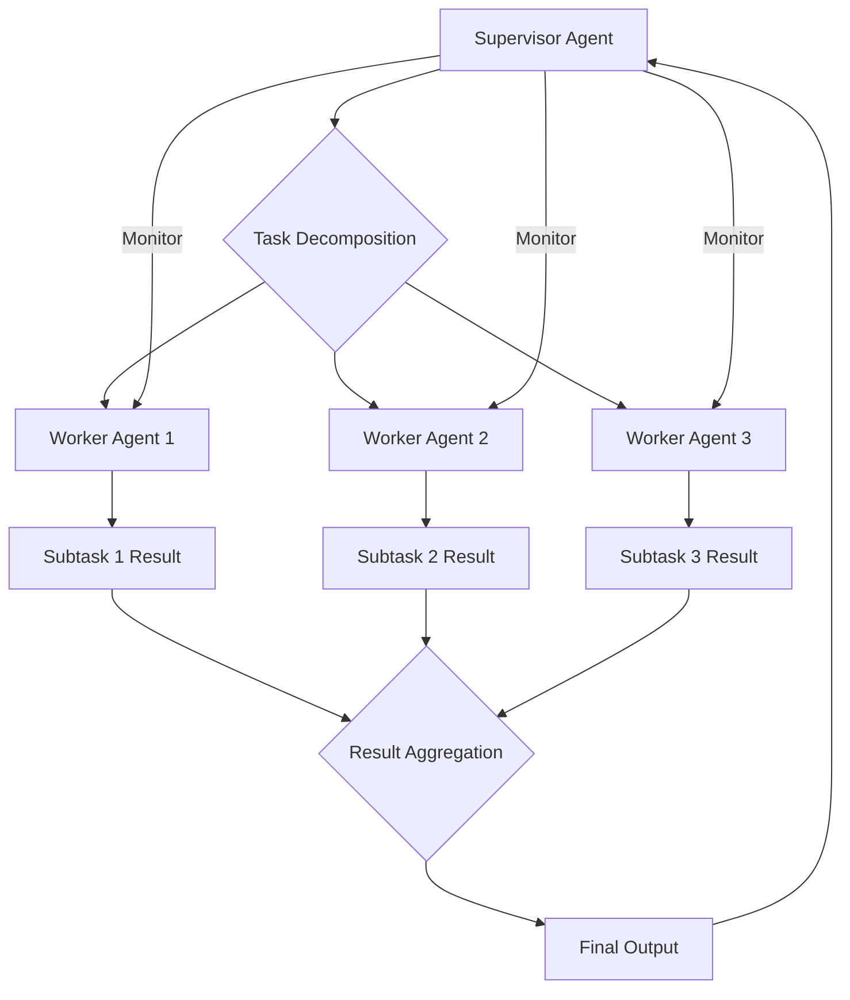

복잡한 문제 해결을 위해 인공지능 에이전트가 협력하는 멀티 에이전트 시스템 (Multi-Agent Systems, MAS)은 2026년 현재 AI 개발의 핵심 축으로 부상하고 있습니다. 단일 에이전트로는 처리하기 어려운 다단계, 다차원적인 과제를 효과적으로 분할하고 조율함으로써 시스템의 견고성, 확장성, 그리고 효율성을 크게 향상시킬 수 있습니다. 이러한 MAS를 성공적으로 설계하고 구축하기 위해서는 검증된 디자인 패턴을 이해하고 적용하는 것이 필수적입니다. 이 글에서는 대표적인 멀티 에이전트 시스템 디자인 패턴과 그 활용 방안을 소개합니다.

## 멀티 에이전트 시스템의 필요성 (Need for Multi-Agent Systems)

단일 LLM 에이전트가 모든 복잡한 작업을 처리하려 할 때 발생하는 한계는 명확합니다. 긴 컨텍스트 윈도우의 제약, 단일 지점 실패의 위험, 전문성 부족으로 인한 환각 (hallucination) 발생 가능성 등이 있습니다. 멀티 에이전트 시스템은 이러한 문제들을 해결하기 위해 여러 에이전트가 각자의 전문성을 가지고 협력하도록 설계됩니다.

*   **복잡성 관리 (Complexity Management)**: 거대하고 복잡한 문제를 작은 단위의 하위 문제로 분해하여 각 전문 에이전트가 처리하도록 합니다.
*   **모듈성 및 재사용성 (Modularity and Reusability)**: 각 에이전트는 독립적인 모듈로 개발되어 다른 시스템에서도 재사용될 수 있으며, 시스템의 유지보수 및 확장을 용이하게 합니다.
*   **견고성 및 탄력성 (Robustness and Resilience)**: 한 에이전트의 실패가 전체 시스템에 치명적인 영향을 미 미치도록 설계하여, 시스템의 안정성을 높입니다.
*   **전문성 및 병렬 처리 (Specialization and Parallel Processing)**: 특정 도메인에 특화된 에이전트들이 각자의 작업을 병렬로 수행하여 전체 처리 속도를 향상시킵니다.

## 핵심 디자인 패턴 (Core Design Patterns)

### 오케스트레이터/감독관 패턴 (Orchestrator/Supervisor Pattern)

이 패턴은 중앙 집중식 컨트롤러 또는 슈퍼바이저 에이전트가 존재하여 전체 작업 흐름을 조정하고, 하위 에이전트들에게 작업을 할당하며, 그들의 실행을 모니터링하는 방식입니다. 슈퍼바이저는 작업 분해, 결과 취합, 충돌 해결 등의 역할을 수행합니다. LLM 기반 에이전트에서는 이 슈퍼바이저가 메타 프롬프팅 (meta-prompting)을 통해 하위 에이전트의 목표와 제약을 정의하는 역할을 자주 맡습니다.



**예제 코드: 간단한 오케스트레이터 패턴 (Python)**

이 예제는 `SupervisorAgent`가 `WorkerAgent`들에게 간단한 계산 작업을 할당하고 결과를 취합하는 과정을 보여줍니다.

```python
class WorkerAgent:
    def __init__(self, name):
        self.name = name

    def perform_task(self, task_description, data):
        print(f"[{self.name}] Performing task: {task_description} with data: {data}")
        # Simulate complex AI task
        if task_description == "add":
            return data[0] + data[1]
        elif task_description == "multiply":
            return data[0] * data[1]
        else:
            return f"Unsupported task {task_description}"

class SupervisorAgent:
    def __init__(self):
        self.workers = [
            WorkerAgent("Adder"),
            WorkerAgent("Multiplier")
        ]

    def orchestrate_task(self, main_task_data):
        results = []
        print("\n[Supervisor] Decomposing main task.")

        # Example: Decompose into addition and multiplication
        add_data = (main_task_data["val1"], main_task_data["val2"])
        mul_data = (main_task_data["val3"], main_task_data["val4"])

        # Delegate tasks to specific workers based on their capabilities
        # In a real system, this would involve more intelligent routing/selection
        for worker in self.workers:
            if worker.name == "Adder":
                results.append(worker.perform_task("add", add_data))
            elif worker.name == "Multiplier":
                results.append(worker.perform_task("multiply", mul_data))

        print(f"\n[Supervisor] Aggregating results: {results}")
        final_result = sum(results) # Simple aggregation
        return final_result

# Usage
supervisor = SupervisorAgent()
main_data = {"val1": 5, "val2": 3, "val3": 4, "val4": 2}
overall_result = supervisor.orchestrate_task(main_data)
print(f"\n[Supervisor] Final overall result: {overall_result}")
```

### 블랙보드 패턴 (Blackboard Pattern)

블랙보드 패턴은 에이전트들이 공유하는 중앙 저장소 (블랙보드)를 통해 간접적으로 통신하고 협력하는 방식입니다. 각 에이전트는 특정 문제 해결 지식 (knowledge source)을 가지고 있으며, 블랙보드에 있는 데이터의 변화를 감지하고, 자신의 지식을 활용하여 블랙보드에 새로운 정보나 부분적인 해결책을 추가합니다. 이는 에이전트 간의 강한 결합도를 피하고 유연한 협업을 가능하게 합니다.

### 중재자 패턴 (Mediator Pattern)

중재자 패턴은 에이전트 간의 직접적인 통신을 방지하고, 모든 통신이 중앙의 중재자 (mediator)를 통해 이루어지도록 합니다. 이는 에이전트 간의 의존성을 줄이고, 시스템의 유지보수성을 높입니다. 각 에이전트는 중재자와만 통신하며, 중재자가 어떤 에이전트가 어떤 정보를 필요로 하는지 결정하고 메시지를 라우팅합니다. 이는 오케스트레이터 패턴과 유사해 보이지만, 중재자는 주로 통신 라우팅에 초점을 맞추고 오케스트레이터는 전체 작업 흐름 제어에 더 중점을 둡니다.

### 계층적 에이전트 패턴 (Hierarchical Agent Pattern)

이 패턴은 에이전트들을 계층적인 구조로 조직합니다. 상위 에이전트는 고수준의 목표를 설정하고 이를 하위 에이전트들에게 위임하며, 하위 에이전트는 더 구체적인 작업을 수행합니다. 이는 복잡한 시스템의 설계 및 관리를 용이하게 하고, 상위 에이전트가 하위 에이전트의 행동을 추상화하여 전체 시스템의 가시성을 확보하는 데 도움을 줍니다. 이는 `agents/multi-stage-autonomous-agent-system-architecture-implementat`와 같은 패턴과도 연결됩니다.

## 2026년 멀티 에이전트 시스템 트렌드 (2026 Multi-Agent System Trends)

*   **적응형 오케스트레이션 (Adaptive Orchestration)**: 정적인 작업 분할이 아닌, 실시간으로 변화하는 환경과 에이전트의 성능에 따라 동적으로 작업 할당 및 조정이 이루어지는 시스템이 중요해집니다. 이는 `agents/autonomous-agent-dynamic-planning-goal-strategies`와 연관됩니다.
*   **신뢰 및 투명성 (Trust and Transparency)**: 에이전트 간의 상호 작용 및 의사 결정 과정을 기록하고, 문제가 발생했을 때 원인을 추적할 수 있는 메커니즘이 필수적입니다. `agents/ai-agent-control-accountability-guardrails`와 같은 접근 방식이 중요합니다.
*   **LLM 기반 에이전트의 심화 (Deepening LLM-native Agents)**: 각 에이전트가 LLM의 추론 능력을 최대한 활용하여, 도구 사용 (tool use), 장기 기억 (long-term memory), 자율적 학습 (self-learning)을 강화하는 방향으로 발전합니다.

## 트레이드오프 (Trade-offs)

*   **중앙 집중식 vs. 분산식 제어 (Centralized vs. Decentralized Control)**
    *   **언제 좋고**: 오케스트레이터/감독관 패턴처럼 중앙 집중식은 초기 구현이 단순하고 전체 시스템의 상태를 파악하기 용이합니다. 특히 복잡한 종속성을 가진 작업에 적합합니다.
    *   **언제 나쁜지**: 단일 지점 실패 (single point of failure) 위험이 크고, 에이전트 수가 증가할수록 병목 현상 (bottleneck)이 발생하여 확장성 (scalability)이 저하될 수 있습니다. 분산식은 그 반대입니다.
*   **통신 오버헤드 (Communication Overhead)**
    *   **언제 좋고**: 중재자나 블랙보드 패턴처럼 구조화된 통신은 에이전트 간의 결합도를 낮춰 모듈성을 높이고, 에러 전파를 줄일 수 있습니다.
    *   **언제 나쁜지**: 통신 계층의 복잡성으로 인해 지연 시간 (latency)이 발생하고, 추가적인 개발 및 디버깅 노력이 필요합니다. 특히 실시간 응답성이 중요한 시스템에서는 불리할 수 있습니다.
*   **설계 복잡성 (Design Complexity)**
    *   **언제 좋고**: 복잡한 패턴 (예: 계층적 에이전트)은 거대한 시스템의 논리적 구조를 명확히 하고, 장기적인 유지보수 및 확장을 용이하게 합니다.
    *   **언제 나쁜지**: 초기 설계 및 구현 비용이 높고, 작은 규모의 문제나 단순한 협업이 필요한 경우에는 과도하게 복잡할 수 있습니다.

## 실전 체크리스트 (Practical Checklist)

멀티 에이전트 시스템을 프로젝트에 적용할 때 다음 사항들을 검증하세요.

- [ ] 각 에이전트의 역할과 책임이 명확하게 정의되었는가? (Role-Based Agent Design)
- [ ] 에이전트 간의 통신 프로토콜 (Communication Protocol)이 표준화되고 효율적으로 설계되었는가?
- [ ] 시스템 전체의 작업 흐름을 모니터링하고 에이전트의 상태를 추적할 수 있는 메커니즘이 마련되었는가?
- [ ] 한 에이전트의 실패가 전체 시스템에 미치는 영향을 최소화하기 위한 오류 처리 및 복구 전략이 구현되었는가?
- [ ] 시스템 부하 증가 시, 에이전트 추가 또는 자원 할당을 통해 확장될 수 있도록 설계되었는가?
- [ ] 새로운 유형의 작업이나 에이전트가 쉽게 추가될 수 있도록 모듈성과 유연성을 확보했는가?
- [ ] LLM 기반 에이전트의 경우, 각 에이전트가 적절한 컨텍스트와 도구 (tools)를 활용하도록 프롬프트 엔지니어링이 최적화되었는가?