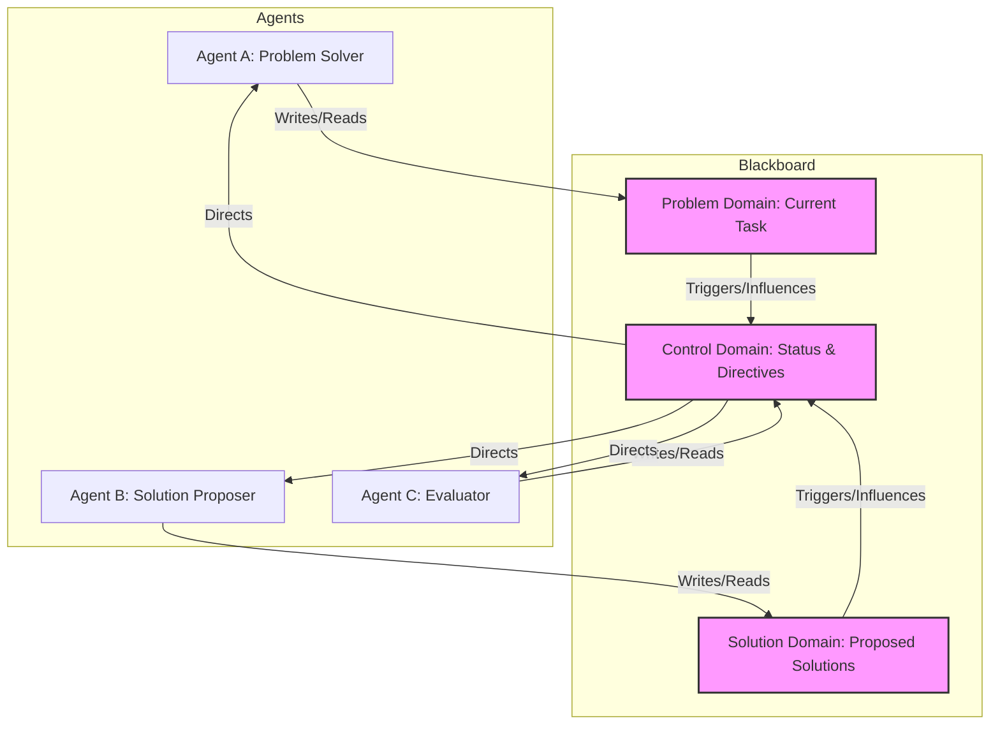

멀티 에이전트 시스템 (Multi-Agent Systems, MAS)은 복잡한 문제를 해결하기 위해 여러 자율적인 에이전트들이 상호작용하고 협력하는 분산형 컴퓨팅 패러다임입니다. 각 에이전트는 특정 목표를 가지며, 정보를 교환하고 공동 작업을 수행함으로써 개별 에이전트의 능력으로는 달성하기 어려운 전역 목표를 달성합니다. MAS의 성공은 에이전트 간의 효과적인 상호작용 (Interaction) 및 협업 (Collaboration) 설계에 달려 있습니다. 이 엔트리에서는 에이전트 간 효율적인 통신, 코디네이션, 협업을 위한 핵심 설계 패턴들을 다룹니다.

## 핵심 개념: 상호작용과 협업

멀티 에이전트 시스템에서 효과적인 상호작용과 협업을 위한 세 가지 핵심 요소는 다음과 같습니다:

### 1. 커뮤니케이션 (Communication)
에이전트들이 정보를 교환하는 수단과 프로토콜을 정의합니다. 이는 동기식 (synchronous) 또는 비동기식 (asynchronous) 메시지 전달, Peer-to-Peer (P2P) 방식 또는 브로드캐스트 (broadcast) 방식으로 이루어질 수 있습니다. 효과적인 커뮤니케이션은 에이전트들이 서로의 상태, 목표, 그리고 행동 계획을 이해하는 데 필수적입니다.

### 2. 코디네이션 (Coordination)
에이전트들의 행동을 정렬하고 잠재적인 충돌을 방지하며, 자원의 효율적인 사용을 보장하는 메커니즘입니다. 이는 공유된 목표, 규칙 기반 시스템, 혹은 중앙 집중식 스케줄러를 통해 달성될 수 있습니다. 코디네이션은 에이전트들이 독립적으로 행동하면서도 시스템 전체의 일관성을 유지하게 합니다.

### 3. 협업 (Collaboration)
에이전트들이 공동의 목표를 달성하기 위해 함께 작업하는 과정입니다. 이는 태스크 분할 (task decomposition), 역할 할당 (role assignment), 그리고 결과 통합 (result aggregation)을 포함합니다. 진정한 협업은 에이전트들이 서로의 강점을 활용하고 약점을 보완하여 시너지를 창출할 때 발생합니다.

## 주요 설계 패턴

### 1. 블랙보드 패턴 (Blackboard Pattern)
블랙보드 패턴은 에이전트들이 중앙의 공유 데이터 구조(블랙보드)를 통해 간접적으로 통신하고 협업하는 방식입니다. 각 에이전트는 블랙보드에 정보를 쓰고, 관심 있는 정보를 읽으며, 블랙보드에 변경이 있을 때 알림을 받을 수 있습니다. 이는 복잡하고 예측 불가능한 문제 해결에 특히 유용합니다.



### 2. 컨트랙트 넷 프로토콜 (Contract Net Protocol)
컨트랙트 넷 프로토콜은 분산된 태스크 할당을 위한 협상 기반 패턴입니다. 특정 태스크를 가진 에이전트(관리자)는 해당 태스크를 브로드캐스트하고, 관심 있는 에이전트(입찰자)들은 제안서를 제출합니다. 관리자는 가장 적합한 제안서를 선택하여 태스크를 할당하고 계약을 맺습니다. 이는 동적인 환경에서 자율적인 태스크 분배에 효과적입니다.

### 3. 브로커 패턴 (Broker Pattern)
브로커 패턴은 에이전트 간의 직접적인 상호작용을 중개하는 중앙 브로커를 활용합니다. 에이전트는 브로커에 서비스를 등록하고, 다른 에이전트는 브로커를 통해 필요한 서비스를 요청합니다. 브로커는 요청된 서비스를 제공하는 에이전트를 찾아 연결해 줍니다. 이는 에이전트 간의 결합도를 낮추고 시스템의 유연성을 높입니다.

### 4. 계층적 조직 (Hierarchical Organization)
이 패턴은 Supervisor-Worker (또는 Manager-Worker) 구조를 통해 에이전트들을 계층적으로 조직합니다. 상위 에이전트는 하위 에이전트에게 태스크를 위임하고, 하위 에이전트들은 태스크를 실행한 후 결과를 상위 에이전트에게 보고합니다. 이는 복잡한 태스크를 관리하고 시스템의 확장성을 높이는 데 유용합니다.

## 2026년 최신 트렌드와 LLM 에이전트 적용

최근 대규모 언어 모델 (Large Language Models, LLMs) 기반의 에이전트 시스템은 멀티 에이전트 상호작용 및 협업 설계에 새로운 가능성을 제시합니다. LLM 에이전트들은 자연어 기반으로 복잡한 지시를 이해하고, 동적으로 협업 전략을 조정하며, Self-Correction 및 Retrospection Loop (agents/agent-self-correction-retrospection-loop-implementation)를 통해 학습하고 개선할 수 있습니다.

*   **동적 협업 및 역할 조정**: LLM 에이전트는 주어진 상황과 목표에 따라 자신의 역할을 동적으로 조정하고, 다른 에이전트와 자연어 기반으로 협업하여 문제 해결 전략을 수립합니다.
*   **공유 지식 및 장기 기억**: Agentic Long-term Memory (agents/autonomous-agent-long-term-memory-implementation)와 Global Context (GC) Tree (agents/ai-agent-global-context-gc-tree-integration)와 같은 메커니즘을 통해 에이전트 간 공유되는 지식 기반을 구축하고, 장기적인 학습 및 의사결정에 활용할 수 있습니다. 이는 에이전트들이 과거의 상호작용 경험을 바탕으로 미래의 협업 방식을 최적화하도록 돕습니다.
*   **가드레일과 통제**: AI Agent Control Accountability Guardrails (agents/ai-agent-control-accountability-guardrails)는 멀티 에이전트 시스템의 예측 불가능성을 관리하고, 의도하지 않은 상호작용이나 비용 초과 (agents/ai-agent-runaway-cost-prevention-control-systems)를 방지하는 데 필수적입니다.

## 코드 예제: 파이썬 블랙보드 패턴 구현

다음은 Python을 이용한 간단한 블랙보드 패턴 구현 예제입니다. `Blackboard` 클래스는 공유 데이터를 관리하고, `Agent` 클래스는 이 블랙보드를 통해 상호작용합니다.

```python
import threading
import time

class Blackboard:
    def __init__(self):
        self._data = {}
        self._lock = threading.Lock()
        self._condition = threading.Condition(self._lock)

    def write(self, key, value):
        with self._lock:
            self._data[key] = value
            print(f"Blackboard: '{key}' updated to '{value}'")
            self._condition.notify_all() # 대기 중인 모든 에이전트에게 알림

    def read(self, key):
        with self._lock:
            return self._data.get(key)

    def wait_for_change(self, key, current_value, timeout=5):
        with self._lock:
            start_time = time.time()
            while self._data.get(key) == current_value:
                if time.time() - start_time > timeout:
                    return False # 타임아웃 발생
                self._condition.wait(1) # 1초 단위로 대기
            return True

class Agent(threading.Thread):
    def __init__(self, name, blackboard, task_key):
        super().__init__()
        self.name = name
        self.blackboard = blackboard
        self.task_key = task_key

    def run(self):
        print(f"{self.name}: Starting for task '{self.task_key}'")
        
        if self.name == "ProblemSolver":
            self.blackboard.write(self.task_key, "problem_defined")
            current_bb_state = "problem_defined"
            print(f"{self.name}: Waiting for solution_proposed...")
            if self.blackboard.wait_for_change(self.task_key, current_bb_state):
                solution = self.blackboard.read(self.task_key)
                print(f"{self.name}: Received solution: {solution}")
            else:
                print(f"{self.name}: Timeout waiting for solution.")

        elif self.name == "SolutionProposer":
            current_bb_state = None # 초기에는 아무 값도 없음
            print(f"{self.name}: Waiting for problem_defined...")
            if self.blackboard.wait_for_change(self.task_key, current_bb_state):
                problem_state = self.blackboard.read(self.task_key)
                if problem_state == "problem_defined":
                    print(f"{self.name}: Problem defined. Proposing solution...")
                    self.blackboard.write(self.task_key, "solution_proposed_v1")
                else:
                    print(f"{self.name}: Unexpected problem state: {problem_state}")
            else:
                print(f"{self.name}: Timeout waiting for problem definition.")
        
        print(f"{self.name}: Task finished.")

# 예제 실행
blackboard_instance = Blackboard()

agent1 = Agent("ProblemSolver", blackboard_instance, "project_x_status")
agent2 = Agent("SolutionProposer", blackboard_instance, "project_x_status")

agent1.start()
agent2.start()

agent1.join()
agent2.join()

print("All agents finished their tasks.")
```

## 트레이드오프

멀티 에이전트 시스템 설계 시 효과적인 상호작용 및 협업 패턴을 선택하는 데에는 여러 트레이드오프가 존재합니다.

*   **중앙 집중식 vs. 분산식 통신 (Centralized vs. Decentralized Communication)**:
    *   **언제 좋은가 (When good)**: 중앙 집중식 (예: 블랙보드, 브로커)은 시스템의 전역 상태를 쉽게 관리하고 디버깅하기 용이하며, 소규모 시스템이나 복잡한 전역 제어가 필요한 경우에 효과적입니다.
    *   **언제 나쁜가 (When bad)**: 단일 실패 지점 (Single Point of Failure)이 될 수 있고, 대규모 시스템에서는 병목 현상 및 확장성 (Scalability) 문제가 발생할 수 있습니다. 분산식 (예: 컨트랙트 넷)은 높은 확장성과 견고성 (Robustness)을 제공하지만, 전역 상태 파악이 어렵고 일관성 유지에 복잡성이 따릅니다.

*   **명시적 vs. 암묵적 코디네이션 (Explicit vs. Implicit Coordination)**:
    *   **언제 좋은가**: 명시적 코디네이션 (예: 엄격한 프로토콜, 중앙 스케줄러)은 에이전트 행동의 예측 가능성을 높이고 충돌을 최소화하는 데 효과적입니다. 안전이 critical한 시스템에 적합합니다.
    *   **언제 나쁜가**: 시스템의 유연성을 저해하고 동적인 환경 변화에 대한 적응력이 떨어질 수 있습니다. 암묵적 코디네이션 (예: 환경 변화에 따른 반응)은 유연하지만, 예상치 못한 행동이나 비효율을 초래할 수 있습니다.

*   **동질적 vs. 이질적 에이전트 (Homogeneous vs. Heterogeneous Agents)**:
    *   **언제 좋은가**: 동질적 에이전트 시스템은 설계 및 구현이 단순하며, 모든 에이전트가 동일한 로직을 따르므로 관리하기 용이합니다. 이질적 에이전트 시스템은 각 에이전트가 특정 전문성을 가지므로, 다양한 종류의 태스크를 처리하고 복합적인 문제 해결에 유리합니다.
    *   **언제 나쁜가**: 동질적 에이전트는 특정 유형의 문제에만 효율적일 수 있으며, 복잡하거나 다양한 태스크를 처리하는 데 한계가 있습니다. 이질적 에이전트 시스템은 에이전트 간의 상호작용 프로토콜 및 통합이 복잡해지고, 전체 시스템의 복잡성을 증가시킵니다.

## 실전 체크리스트

멀티 에이전트 시스템에 효과적인 상호작용 및 협업 패턴을 적용할 때 다음 체크리스트를 활용하여 시스템의 견고성과 효율성을 검증할 수 있습니다.

*   [ ] **커뮤니케이션 프로토콜 명확성**: 에이전트 간의 메시지 형식, 전달 방식, 그리고 기대되는 응답 시간이 명확히 정의되어 있는지 확인합니다.
*   [ ] **충돌 해소 전략 정의**: 에이전트 간의 목표나 자원 충돌이 발생할 경우, 이를 감지하고 해결하기 위한 자동화된 전략 (예: 협상, 경매, 우선순위 부여)이 구현되어 있는지 검증합니다.
*   [ ] **확장성 테스트**: 에이전트 수가 증가할 때, 시스템의 통신 오버헤드와 코디네이션 복잡성이 선형적으로 증가하는지, 아니면 급격히 증가하는지 벤치마킹하여 확장성 병목 지점을 식별합니다.
*   [ ] **실패 복구 메커니즘**: 개별 에이전트의 실패가 전체 시스템의 기능에 미치는 영향을 최소화하고, 실패한 에이전트나 통신 채널을 복구하는 메커니즘이 설계되어 있는지 확인합니다.
*   [ ] **상호작용 옵저버빌리티 (Observability)**: 에이전트 간의 모든 주요 상호작용 및 의사결정 과정을 로깅하고 시각화할 수 있는 도구를 갖추어, 시스템의 동작을 투명하게 모니터링하고 디버깅할 수 있는지 확인합니다.
*   [ ] **보안 및 접근 제어**: 에이전트들이 공유 리소스나 민감한 정보에 접근할 때, 적절한 인증 및 권한 부여 (Authentication and Authorization) 메커니즘이 적용되어 있는지, 그리고 악의적인 에이전트의 개입을 방지할 수 있는지 검토합니다.
*   [ ] **태스크 분할 및 위임 효율성**: 태스크가 에이전트들에게 적절하게 분할되고 위임되는지, 그리고 각 에이전트가 자신의 전문성에 따라 최적의 성능을 발휘하는지 평가하여 비효율적인 위임 패턴을 개선합니다.