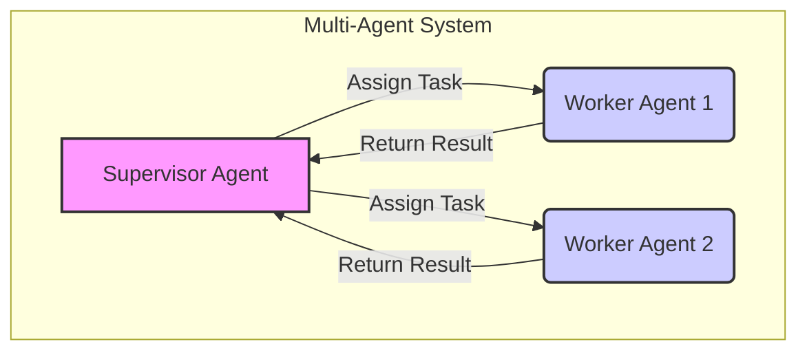

복잡한 작업을 효과적으로 처리하기 위한 다중 에이전트 시스템(Multi-Agent System, MAS)은 개별 에이전트의 전문성과 협업 능력을 결합하여 단일 에이전트로는 달성하기 어려운 목표를 수행합니다. MAS는 분산된 지능과 자율성을 통해 확장성, 견고성, 유연성을 제공하며, 특히 비선형적이고 예측 불가능한 환경에서 그 가치가 증대됩니다.

## 다중 에이전트 시스템의 핵심 디자인 패턴
MAS 설계 시 시스템의 복잡성과 에이전트 간 상호작용의 성격에 따라 다양한 디자인 패턴이 적용될 수 있습니다. 2026년 현재, LLM 기반 에이전트의 등장은 이러한 패턴의 구현 방식과 효율성을 크게 변화시키고 있습니다.

### 1. Supervisor-Worker (감독자-작업자) 패턴
중앙의 Supervisor 에이전트가 전체 작업을 분해하고 Worker 에이전트들에게 할당하며, 진행 상황을 모니터링하고 결과를 통합합니다. Worker 에이전트들은 특정 도메인 지식이나 도구를 활용하여 할당된 서브태스크를 수행합니다. 이 패턴은 작업 흐름을 명확하게 제어할 수 있어 초기 개발 단계나 예측 가능한 작업에 적합합니다.

### 2. Blackboard (블랙보드) 패턴
모든 에이전트가 공유된 중앙 저장소(블랙보드)를 통해 정보를 교환하고 협업합니다. 각 에이전트는 블랙보드의 특정 변경 사항을 감지하고, 자신의 전문성에 따라 정보를 추가하거나 수정합니다. 이 패턴은 작업 분할이 어렵거나, 동적으로 변화하는 지식이 필요한 문제 해결에 효과적입니다. 에이전트 간 직접적인 통신 없이 느슨하게 결합될 수 있다는 장점이 있습니다.

### 3. Broker (브로커) 패턴
에이전트들이 직접 통신하는 대신, 중앙의 Broker 에이전트를 통해 메시지를 주고받습니다. Broker는 메시지 라우팅, 서비스 검색, 심지어 메시지 변환까지 담당하여 에이전트 간의 결합도를 낮추고 유연성을 높입니다. 이는 대규모 시스템에서 에이전트 추가 및 제거를 용이하게 합니다.

### 4. Hierarchical (계층적) 패턴
에이전트들이 계층적으로 조직되어 상위 에이전트는 전략적 결정을, 하위 에이전트는 전술적 또는 구체적인 작업을 수행합니다. 이는 복잡한 시스템의 관리 복잡성을 줄이고, 권한과 책임의 분리를 명확히 합니다. 대규모 조직의 의사결정 구조와 유사합니다.

### 5. Federated (연합) 패턴
각 에이전트 그룹 또는 서브시스템이 자체적인 목표와 자율성을 가지면서, 필요한 경우 다른 연합 그룹과 정보를 교환하거나 협력합니다. 중앙 집중식 제어 없이 분산된 방식으로 대규모 문제를 해결하는 데 적합하며, 프라이버시(Privacy)나 보안(Security) 요구사항이 높은 환경에서 활용될 수 있습니다.

## 코드 예시: Supervisor-Worker 패턴 구현 (Python)
아래 Python 예제는 `Supervisor`가 `Worker` 에이전트에게 팩토리얼(Factorial) 계산 작업을 분배하고, 결과를 취합하는 간단한 시나리오를 보여줍니다. LLM 기반 에이전트에서는 `tool_use`를 통해 실제 계산을 수행하거나, `reasoning`을 통해 작업 분배 및 통합 로직을 강화할 수 있습니다.

```python
import time
import math
from typing import List, Dict, Any

class Agent:
    def __init__(self, agent_id: str):
        self.agent_id = agent_id

    def process_task(self, task_data: Dict[str, Any]) -> Dict[str, Any]:
        raise NotImplementedError("Subclasses must implement process_task method")

class WorkerAgent(Agent):
    def process_task(self, task_data: Dict[str, Any]) -> Dict[str, Any]:
        num = task_data.get('number')
        if num is not None:
            print(f"Worker {self.agent_id} processing factorial for {num}...")
            time.sleep(0.1) # Simulate work
            result = math.factorial(num)
            print(f"Worker {self.agent_id} completed {num}! = {result}")
            return {'agent_id': self.agent_id, 'input': num, 'result': result}
        return {'agent_id': self.agent_id, 'error': 'Invalid task data'}

class SupervisorAgent(Agent):
    def __init__(self, agent_id: str, workers: List[WorkerAgent]):
        super().__init__(agent_id)
        self.workers = workers
        self.worker_index = 0

    def orchestrate_tasks(self, numbers_to_process: List[int]) -> Dict[int, Any]:
        print(f"Supervisor {self.agent_id} starting orchestration.")
        results = {}
        for num in numbers_to_process:
            worker = self.workers[self.worker_index]
            self.worker_index = (self.worker_index + 1) % len(self.workers)

            task = {'task_type': 'calculate_factorial', 'number': num}
            worker_result = worker.process_task(task)
            results[num] = worker_result
        print(f"Supervisor {self.agent_id} completed all tasks.")
        return results

# System initialization
worker1 = WorkerAgent("W1")
worker2 = WorkerAgent("W2")
supervisor = SupervisorAgent("S1", [worker1, worker2])

# Run the system
numbers = [5, 3, 7, 4, 6]
final_results = supervisor.orchestrate_tasks(numbers)
print("\nFinal Results:", final_results)
```

## Mermaid 다이어그램: Supervisor-Worker 패턴



## 2026년 다중 에이전트 시스템 트렌드
*   **Adaptive Collaboration**: 에이전트들이 동적으로 협업 전략을 조정하고, 최적의 팀 구성 및 작업 분배를 실시간으로 학습합니다. 이는 LLM의 추론 및 계획 능력이 강화되면서 더욱 정교해지고 있습니다.
*   **Dynamic Role Assignment**: 고정된 역할 대신, 에이전트의 능력과 현재 시스템 상태에 따라 유연하게 역할을 할당하는 방식이 보편화됩니다. 이는 복잡한 작업의 변화에 대한 시스템의 반응성을 높입니다.
*   **LLM-Native Orchestration**: 기존의 코드 기반 오케스트레이션 로직이 LLM의 자연어 이해 및 생성 능력을 활용하여 프롬프트(Prompt) 기반으로 대체되거나 보강됩니다. 이를 통해 시스템의 유연성과 개발 속도가 향상됩니다.
*   **Robustness via Self-Correction Loops**: 각 에이전트 또는 시스템 전반에 걸쳐 자가 수정(Self-correction) 및 회귀(Retrospection) 루프가 내장되어, 오류 발생 시 자동으로 문제를 진단하고 해결합니다.

## 트레이드오프

### 1. 복잡성 vs. 확장성 (Complexity vs. Scalability)
*   **언제 좋음**: 고도의 전문성을 요구하는 여러 서브태스크를 병렬로 처리하여 전체 처리량을 늘려야 할 때. 에이전트 수가 늘어나도 시스템의 성능이 선형적으로 증가할 가능성이 높음.
*   **언제 나쁨**: 에이전트 간의 의존성이 높거나, 공유 상태가 많아 통신 오버헤드가 크고 상태 일관성 유지가 어려울 때. 시스템 설계 및 디버깅 복잡도가 크게 증가하여 초기 개발 비용이 높을 수 있음.

### 2. 자율성 vs. 제어 (Autonomy vs. Control)
*   **언제 좋음**: 에이전트가 각자의 전문성을 바탕으로 독립적인 의사결정을 내리고 행동할 때, 예측 불가능한 상황에 대한 유연한 대응이 가능함. 변화하는 환경에 빠르게 적응해야 하는 경우 유리함.
*   **언제 나쁨**: 전체 시스템의 목표 달성에 필수적인 강력한 일관성과 조율이 필요할 때. 에이전트의 과도한 자율성이 전역 최적화를 방해하거나, 통제 불능의 행동으로 이어질 위험이 있음.

### 3. 통신 오버헤드 vs. 견고성 (Communication Overhead vs. Robustness)
*   **언제 좋음**: 개별 에이전트의 실패가 전체 시스템에 미치는 영향을 최소화하고, 특정 에이전트의 장애 시에도 다른 에이전트가 작업을 인계받아 시스템의 안정성을 유지해야 할 때.
*   **언제 나쁨**: 에이전트 간의 정보 교환이 매우 빈번하고 양이 많을 때, 네트워크 지연(Network Latency) 및 대역폭(Bandwidth) 문제로 인해 시스템의 전체 성능이 저하될 수 있음. 통신 메커니즘 설계 비용이 증가함.

### 4. 개발 속도 vs. 런타임 효율성 (Development Speed vs. Runtime Efficiency)
*   **언제 좋음**: LLM 기반 에이전트 프레임워크를 활용하여 추상화된 수준에서 빠르게 프로토타입을 개발하고, 복잡한 로직을 자연어 프롬프트로 정의하여 개발 주기를 단축할 때.
*   **언제 나쁨**: 각 에이전트의 추론 과정에 LLM 호출이 많아 토큰 비용이 높거나, 응답 시간이 중요한 실시간(Real-time) 시스템에서는 LLM의 지연 시간(Latency)이 병목 현상을 유발할 수 있음. 최적화된 저수준(Low-level) 코드 구현보다 런타임 성능이 떨어질 수 있음.

## 실전 체크리스트

다중 에이전트 시스템을 설계하고 배포할 때 다음 항목들을 검증해야 합니다.

- [ ] **작업 분해(Task Decomposition) 명확성**: 전체 복잡한 작업이 에이전트의 전문성에 따라 논리적으로 분해되었는가? 각 서브태스크가 독립적으로 수행 가능하며, 결과 통합이 용이한가?
- [ ] **통신 프로토콜 정의**: 에이전트 간 정보 교환을 위한 통신 프로토콜(예: 메시지 큐, API, 공유 메모리)이 명확히 정의되었으며, 데이터 무결성(Data Integrity) 및 일관성(Consistency)이 보장되는가?
- [ ] **에이전트 역할 및 책임 할당**: 각 에이전트의 역할(Role), 책임(Responsibility), 그리고 허용되는 행동 범위(Permissible Actions)가 명확하게 문서화되었는가?
- [ ] **오류 처리 및 복구 메커니즘**: 개별 에이전트 또는 통신 채널에 오류가 발생했을 때, 시스템 전체가 어떻게 반응하고 복구하는지에 대한 전략(예: 재시도, 폴백, 대체 에이전트 할당)이 구현되어 있는가?
- [ ] **확장성(Scalability) 테스트**: 예상되는 작업량 증가에 따라 에이전트 수를 늘릴 때, 시스템의 성능(처리량, 응답 시간)이 허용 가능한 수준으로 유지되는지 부하 테스트(Load Test)를 수행했는가?
- [ ] **관측 가능성(Observability) 확보**: 에이전트의 내부 상태, 통신 흐름, 작업 진행 상황을 모니터링하고 시각화할 수 있는 도구(예: 로깅, 트레이싱, 대시보드)가 구축되어 있는가?
- [ ] **보안(Security) 및 권한 관리**: 에이전트 간, 또는 에이전트와 외부 시스템 간의 상호작용에서 인증(Authentication), 인가(Authorization), 데이터 암호화(Data Encryption) 등 보안 원칙이 적용되었는가?