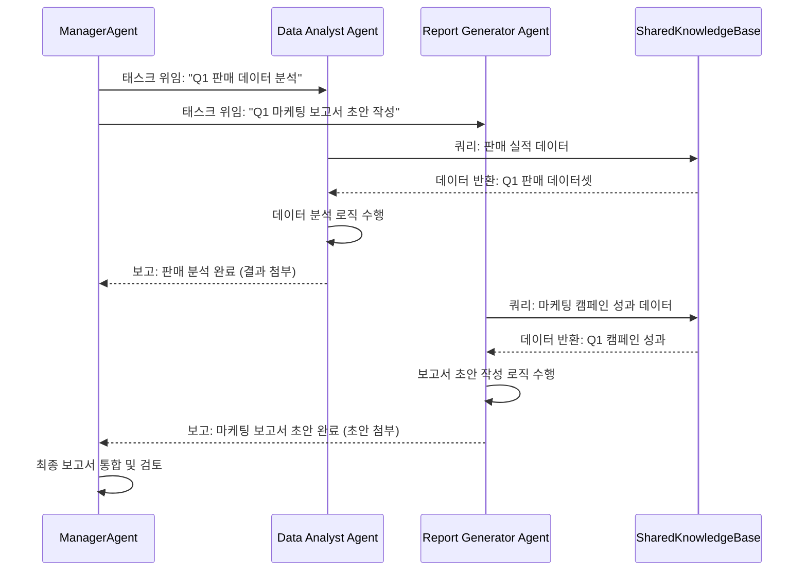

복잡한 인공지능 애플리케이션의 핵심 과제 중 하나는 여러 AI 에이전트가 협력하여 공동의 목표를 달성하도록 만드는 것입니다. 이는 단순히 각 에이전트가 개별 태스크를 수행하는 것을 넘어, 태스크를 효율적으로 분배하고, 에이전트 간의 상호작용을 조정하는 정교한 디자인 패턴을 요구합니다. 2026년 현재, 대규모 언어 모델(LLM)을 활용하는 멀티 에이전트 시스템은 이러한 협업의 복잡성을 해결하고 더 높은 수준의 자율성을 제공하며, 개발 및 운영의 효율성을 향상시키는 데 중요한 역할을 합니다.

## 태스크 위임 패턴 (Task Delegation Patterns)

멀티 에이전트 시스템에서 태스크 위임은 전체 시스템의 성능과 견고성에 직접적인 영향을 미칩니다. 주요 위임 패턴은 다음과 같습니다.

### 1. 계층형 위임 (Hierarchical Delegation)
최상위 관리자(Manager) 에이전트가 복잡한 문제를 하위 작업(sub-tasks)으로 분해하고, 이를 전문화된 작업자(Worker) 에이전트에게 할당하는 방식입니다. 작업자 에이전트는 할당된 하위 작업을 완료한 후 결과를 관리자에게 보고합니다. 이는 명확한 책임 분배와 제어 흐름을 제공하며, 시스템의 구조를 이해하기 쉽게 만듭니다.

### 2. 피어-투-피어 위임 (Peer-to-Peer Delegation)
중앙 관리자 없이 에이전트들이 직접 상호작용하며 태스크를 협상하고 위임하는 방식입니다. 각 에이전트는 자신의 능력과 현재 상태에 따라 태스크를 수락하거나 다른 에이전트에게 제안할 수 있습니다. 동적인 환경에서 유연성과 확장성이 뛰어나지만, 전역적인 최적화를 달성하기 어렵고 복잡한 협상 로직이 필요할 수 있습니다.

### 3. 관리자-작업자 특수화 (Manager-Worker with Specialization)
계층형 위임의 변형으로, 작업자 에이전트들이 특정 도메인이나 기능에 대해 고도로 전문화되어 있습니다 (예: 코드 생성 에이전트, 데이터 분석 에이전트, 테스트 에이전트). 관리자 에이전트는 태스크의 성격을 분석하여 가장 적합한 전문 작업자 에이전트에게 위임합니다. 이는 전문성을 극대화하고 중복 작업을 줄이는 데 효과적입니다.

## 조정 메커니즘 (Coordination Mechanisms)

태스크가 위임된 후, 에이전트들은 서로의 작업 진행 상황을 인지하고 협력해야 합니다. 효과적인 조정을 위한 메커니즘은 다음과 같습니다.

### 1. 공유 상태 / 블랙보드 아키텍처 (Shared State / Blackboard Architecture)
모든 에이전트가 접근할 수 있는 중앙의 공유 데이터 저장소(블랙보드)를 사용하여 정보를 교환하고 작업 상태를 업데이트합니다. 에이전트들은 블랙보드의 변경 사항을 감지하고 이에 반응하며 자신의 작업을 수행합니다. 이는 에이전트 간의 결합도를 낮추어 유연성을 높이지만, 동시성 제어 및 데이터 일관성 유지에 대한 고려가 필요합니다.

### 2. 메시지 패싱 (Message Passing)
에이전트들이 명시적인 메시지 교환을 통해 직접 통신합니다. 특정 에이전트에게 정보를 요청하거나, 작업 결과를 통보하거나, 협력을 제안하는 메시지를 보냅니다. 이는 통신 경로가 명확하고 에이전트 간의 독립성을 유지하는 데 유리하지만, 시스템이 커질수록 메시지 라우팅의 복잡성이 증가할 수 있습니다.

### 3. 경매 / 시장 기반 조정 (Auction / Market-based Coordination)
태스크를 해결하기 위한 '입찰' 과정을 통해 에이전트들이 자율적으로 태스크를 선택합니다. 각 에이전트는 자신의 능력, 리소스, 가용성에 따라 태스크에 대한 '입찰'을 제시하고, 가장 효율적인 에이전트가 태스크를 할당받습니다. 이는 자원 할당의 효율성을 높이고 동적으로 부하를 분산하는 데 효과적입니다.

### 4. LLM 기반 협상 및 조정 (LLM-facilitated Negotiation and Coordination)
최근 LLM의 발전과 함께, 에이전트들이 자연어를 사용하여 복잡한 태스크 위임, 계획 수립, 자원 배분, 심지어 갈등 해결까지 협상할 수 있습니다. LLM은 추론 엔진 역할을 하여 에이전트들이 맥락을 이해하고, 목표에 맞춰 유연하게 전략을 조정하도록 돕습니다. 이는 특히 모호하거나 동적인 문제 해결에 강력한 잠재력을 제공합니다.

## 2026년 트렌드: LLM과 동적 에이전트 팀

2026년 멀티 에이전트 시스템 디자인의 주요 트렌드는 LLM을 에이전트의 핵심 추론 및 커뮤니케이션 모듈로 활용하는 것입니다. LLM은 태스크를 이해하고, 적절한 하위 태스크로 분해하며, 다른 에이전트의 능력과 상태를 고려하여 최적의 위임 및 조정 전략을 동적으로 생성하는 데 사용될 수 있습니다. 또한, 에이전트 팀이 동적으로 재구성되고, 새로운 상황에 맞춰 스스로 역할을 조정하는 adaptive multi-agent system 설계가 중요해지고 있습니다. 이는 시스템의 복잡성과 예측 불가능성을 관리하기 위한 견고한 자가-수정(self-correction) 및 회귀 루프 (`agents/agent-self-correction-retrospection-loop-implementation`) 구현을 필수적으로 만듭니다.

## 코드 예제: 간단한 태스크 위임 및 조정 시뮬레이션

다음 Python 코드는 관리자 에이전트가 작업자 에이전트에게 태스크를 위임하고, 작업자가 결과를 반환하는 기본적인 시나리오를 보여줍니다. LLM은 여기에 추론 로직으로 통합될 수 있습니다.

```python
import abc
from typing import Dict, Any, List

class Agent(abc.ABC):
    """모든 에이전트의 기본 추상 클래스."""
    def __init__(self, name: str):
        self.name = name

    @abc.abstractmethod
    def handle_task(self, task: Dict[str, Any]) -> Dict[str, Any]:
        pass

class DataAnalysisAgent(Agent):
    """데이터 분석 전문 에이전트."""
    def handle_task(self, task: Dict[str, Any]) -> Dict[str, Any]:
        if task["type"] == "analyze_data":
            data = task.get("data", [])
            # 실제 LLM 호출 또는 복잡한 분석 로직 포함 가능
            result = sum(data)
            print(f"[{self.name}] 데이터 분석 수행: {data}, 결과: {result}")
            return {"status": "completed", "result": result, "agent": self.name}
        return {"status": "unhandled", "agent": self.name, "message": "지원하지 않는 태스크"}

class ReportGenerationAgent(Agent):
    """보고서 생성 전문 에이전트."""
    def handle_task(self, task: Dict[str, Any]) -> Dict[str, Any]:
        if task["type"] == "generate_report":
            analysis_results = task.get("analysis_results", {})
            report = f"분석 결과 기반 보고서 생성: {analysis_results}"
            print(f"[{self.name}] 보고서 생성: {report}")
            return {"status": "completed", "report": report, "agent": self.name}
        return {"status": "unhandled", "agent": self.name, "message": "지원하지 않는 태스크"}

class ManagerAgent:
    """태스크를 위임하고 조정하는 관리자 에이전트."""
    def __init__(self, agents: List[Agent]):
        self.agents = {agent.name: agent for agent in agents}
        self.tasks_in_progress = {}

    def delegate_task(self, agent_name: str, task: Dict[str, Any]) -> Dict[str, Any]:
        agent = self.agents.get(agent_name)
        if agent:
            print(f"[Manager] 태스크 '{task.get('type')}'를 {agent_name}에게 위임")
            response = agent.handle_task(task)
            if response["status"] == "completed":
                self.tasks_in_progress[task["id"]] = response
            return response
        return {"status": "failed", "reason": "에이전트를 찾을 수 없음"}

    def get_task_result(self, task_id: str) -> Dict[str, Any]:
        return self.tasks_in_progress.get(task_id, {"status": "not_found"})

# 예제 사용
if __name__ == "__main__":
    analyst = DataAnalysisAgent("AnalystAgent")
    reporter = ReportGenerationAgent("ReporterAgent")
    manager = ManagerAgent([analyst, reporter])

    # 태스크 1: 데이터 분석 위임
    task_id_1 = "T-2026-001"
    analysis_task = {"id": task_id_1, "type": "analyze_data", "data": [100, 250, 150, 300]}
    manager.delegate_task("AnalystAgent", analysis_task)
    analysis_result = manager.get_task_result(task_id_1)
    print(f"관리자가 받은 태스크 T-2026-001 결과: {analysis_result}")

    # 태스크 2: 분석 결과를 활용한 보고서 생성 위임
    task_id_2 = "T-2026-002"
    report_task = {"id": task_id_2, "type": "generate_report", "analysis_results": analysis_result["result"] if analysis_result["status"] == "completed" else "N/A"}
    manager.delegate_task("ReporterAgent", report_task)
    report_result = manager.get_task_result(task_id_2)
    print(f"관리자가 받은 태스크 T-2026-002 결과: {report_result}")
```

## Mermaid 다이어그램: 계층형 태스크 위임 흐름

다음 Mermaid 시퀀스 다이어그램은 관리자 에이전트가 두 명의 작업자 에이전트에게 태스크를 위임하고, 이들이 공유 지식 기반(Shared Knowledge Base)을 활용하여 태스크를 수행한 후 관리자에게 보고하는 과정을 시각화합니다.



## 트레이드오프 (Trade-offs)

멀티 에이전트 시스템에서 태스크 위임 및 조정 패턴을 설계할 때는 다양한 트레이드오프를 고려해야 합니다.

1.  **중앙 집중식 vs. 분산식 제어**: 시스템의 복잡성과 환경의 동적성에 따라 적절한 제어 방식을 선택해야 합니다.
    *   **언제 좋은가**: **중앙 집중식(계층형)**은 태스크 분해 및 실행 경로가 명확하고, 시스템의 전역적인 상태를 쉽게 파악하고 제어해야 할 때 유리합니다. **분산식(피어-투-피어, 시장 기반)**은 에이전트 수가 많고, 환경이 예측 불가능하며, 높은 유연성과 확장성이 필요할 때 좋습니다.
    *   **언제 나쁜가**: **중앙 집중식**은 관리자 에이전트가 병목 현상(bottleneck)이 될 수 있고, 단일 장애점(single point of failure)을 형성할 수 있습니다. **분산식**은 전역적인 최적화가 어렵고, 에이전트 간의 협상 오버헤드가 크며, 시스템의 전반적인 행동을 예측하기 어려울 수 있습니다.

2.  **명시적 통신 vs. 암묵적 통신**: 에이전트들이 정보를 교환하는 방식에 따라 시스템의 견고성과 개발 복잡성이 달라집니다.
    *   **언제 좋은가**: **명시적 통신(메시지 패싱)**은 에이전트 간의 상호작용이 명확하고 특정 정보의 흐름을 추적하기 쉬울 때 좋습니다. **암묵적 통신(공유 상태/블랙보드)**은 에이전트 간의 결합도를 낮춰 유연한 확장을 지원하고, 다양한 에이전트가 동시에 정보에 접근하여 병렬적으로 작업할 때 유리합니다.
    *   **언제 나쁜가**: **명시적 통신**은 시스템이 커질수록 메시지 라우팅 로직이 복잡해지고, 새로운 에이전트 추가 시 기존 통신 로직을 수정해야 할 가능성이 있습니다. **암묵적 통신**은 동시성 제어 및 데이터 일관성 유지가 어렵고, 정보 업데이트가 시스템 전체에 미치는 영향을 예측하기 어려울 수 있습니다.

3.  **LLM 기반 조정 vs. 규칙 기반 조정**: LLM의 도입은 새로운 가능성을 열지만, 그에 따른 비용과 신뢰성 문제가 따릅니다.
    *   **언제 좋은가**: **LLM 기반 조정**은 태스크 정의가 모호하거나, 복잡한 비정형 데이터 처리, 인간과 유사한 유연한 협상 및 추론이 필요할 때 매우 강력합니다. **규칙 기반 조정**은 태스크 흐름이 명확하고 예측 가능하며, 결정론적이고 높은 안정성이 요구될 때 적합합니다.
    *   **언제 나쁜가**: **LLM 기반 조정**은 높은 연산 비용, 응답 지연(latency), 그리고 환각(hallucination) 위험으로 인해 결정론적이고 실시간성이 중요한 시스템에는 적합하지 않을 수 있습니다. **규칙 기반 조정**은 새로운 시나리오나 예외 상황에 유연하게 대처하기 어렵고, 복잡한 규칙 집합을 유지 관리하는 데 비용이 듭니다.

## 실전 체크리스트

멀티 에이전트 시스템의 태스크 위임 및 조정 패턴을 실제 프로젝트에 적용할 때 다음 항목들을 검증해야 합니다.

- [ ] **태스크 분해 명확성**: 최상위 복합 태스크가 하위 에이전트들에게 명확하고 독립적으로 실행 가능한 단위로 분해되고 위임되는가? (예: 각 하위 태스크의 성공/실패 기준 정의)
- [ ] **에이전트 역할 및 책임 정의**: 각 에이전트의 구체적인 역할(Role), 능력(Capability), 책임(Responsibility)이 명확히 정의되어 있으며, 중복되거나 누락된 영역은 없는가?
- [ ] **통신 프로토콜 표준화**: 에이전트 간의 모든 메시지 교환(내용, 형식, 전송 방식)에 대한 표준화된 프로토콜이 존재하며, 모든 에이전트가 이를 준수하는가?
- [ ] **동시성 및 자원 접근 제어**: 여러 에이전트가 공유 데이터 또는 리소스에 동시에 접근할 때 발생할 수 있는 충돌을 방지하고 데이터 일관성을 유지하는 메커니즘이 구현되어 있는가?
- [ ] **실패 처리 및 태스크 재할당**: 특정 에이전트의 실패 또는 태스크 지연 시, 다른 에이전트에게 태스크를 동적으로 재할당하거나 대체 경로를 탐색하는 견고한 오류 처리 로직이 있는가?
- [ ] **LLM 조정 가드레일 및 검증**: LLM이 태스크 위임 및 조정 의사결정에 관여할 경우, LLM의 출력을 검증하고 잠재적 환각 또는 비정상적인 행동을 감지하고 수정하는 가드레일이 설정되어 있는가?
- [ ] **시스템 모니터링 및 가시성**: 각 에이전트의 태스크 진행 상황, 통신 로그, 자원 사용량, 그리고 전체 시스템의 협업 상태를 실시간으로 모니터링하고 시각화할 수 있는 대시보드가 구축되어 있는가?