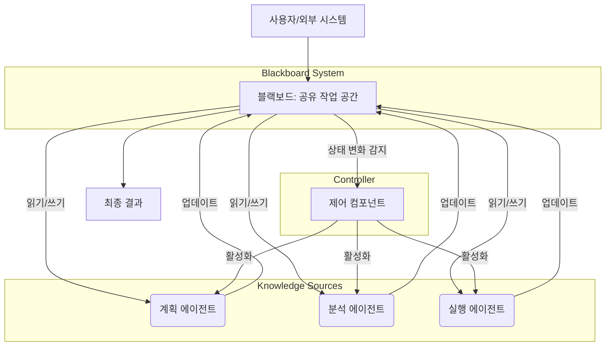

멀티 에이전트 시스템(Multi-Agent Systems, MAS)은 복잡하고 동적인 환경에서 문제를 해결하기 위해 여러 자율 에이전트들이 상호작용하는 분산 시스템입니다. 이러한 시스템의 효율성과 견고성은 에이전트 간의 태스크 분배(Task Distribution)와 협업(Collaboration) 전략에 크게 좌우됩니다. 비효율적인 분배는 리소스 낭비, 병목 현상, 혹은 문제 해결 실패로 이어질 수 있으므로, 전략적인 설계 고려사항이 필수적입니다.

## 핵심 개념: 태스크 분배 및 협업의 기본 원칙

멀티 에이전트 시스템에서 성공적인 태스크 분배 및 협업을 위해서는 다음과 같은 기본 원칙들이 중요하게 작용합니다.

### 태스크 분해 (Task Decomposition)
복잡한 상위 레벨 태스크를 에이전트들이 개별적으로 처리할 수 있는 작고 관리 가능한 서브태스크들로 나누는 과정입니다. 적절한 분해는 에이전트의 전문성을 활용하고 병렬 처리를 가능하게 합니다.

### 역할 정의 (Role Definition)
각 에이전트의 전문성, 책임, 그리고 시스템 내에서의 권한을 명확하게 정의합니다. 이는 에이전트가 어떤 종류의 태스크를 처리할 수 있고, 어떤 정보에 접근할 수 있으며, 누구와 협력해야 하는지를 결정합니다.

### 정보 공유 및 통신 (Information Sharing and Communication)
에이전트 간의 효율적인 정보 교환은 협업의 핵심입니다. 공유 메모리(Blackboard), 메시지 전달(Message Passing), 혹은 브로드캐스트(Broadcast)와 같은 다양한 통신 메커니즘이 사용될 수 있습니다.

### 조정 메커니즘 (Coordination Mechanisms)
에이전트들의 행동을 조율하고 잠재적인 갈등을 해결하여 전체 시스템의 목표 달성을 돕는 방법입니다. 이는 스케줄링, 자원 할당, 혹은 행동 동기화 등으로 나타날 수 있습니다.

## 주요 태스크 분배 전략 패턴

### 중앙 집중식 태스크 분배 (Centralized Task Distribution)

중앙 오케스트레이터(Orchestrator) 또는 관리자 에이전트가 모든 태스크를 수신하고, 사용 가능한 에이전트들의 역량과 부하를 고려하여 태스크를 할당하는 방식입니다. 단순한 시스템이나 엄격한 제어가 필요한 경우에 적합합니다.

```python
class CentralOrchestrator:
    def __init__(self, agents):
        self.agents = agents
        self.task_queue = [] # 대기 중인 태스크 큐

    def add_task(self, task_id, requirements):
        self.task_queue.append({'id': task_id, 'req': requirements})
        self.distribute_tasks()

    def distribute_tasks(self):
        for task in list(self.task_queue): # iterate over a copy
            assigned = False
            for agent in self.agents:
                if agent.can_handle(task['req']) and not agent.is_busy():
                    agent.assign_task(task)
                    self.task_queue.remove(task)
                    assigned = True
                    print(f"[Orchestrator] Task {task['id']} assigned to Agent-{agent.id}")
                    break
            if not assigned:
                print(f"[Orchestrator] Task {task['id']} waiting for available agent.")

class WorkerAgent:
    def __init__(self, id, skills):
        self.id = id
        self.skills = skills
        self.current_task = None

    def can_handle(self, requirements):
        return all(req in self.skills for req in requirements)

    def is_busy(self):
        return self.current_task is not None

    def assign_task(self, task):
        self.current_task = task
        print(f"[Agent-{self.id}] Starting task {task['id']}")
        # Simulate work
        import time
        time.sleep(1)
        self.complete_task()

    def complete_task(self):
        print(f"[Agent-{self.id}] Completed task {self.current_task['id']}")
        self.current_task = None

# Example usage
# agent1 = WorkerAgent(1, ['coding', 'testing'])
# agent2 = WorkerAgent(2, ['design', 'coding'])
# orchestrator = CentralOrchestrator([agent1, agent2])
# orchestrator.add_task('T1', ['coding'])
# orchestrator.add_task('T2', ['design'])
```

### 분산형 태스크 협상 (Decentralized Task Negotiation)

에이전트들이 태스크를 직접 협상하고 할당하는 방식입니다. 가장 대표적인 예로는 Contract Net Protocol(계약망 프로토콜)이나 Market-based 시스템이 있습니다. 태스크를 가진 에이전트(Manager)가 다른 에이전트(Bidder)에게 태스크를 공고하고, Bidder들은 자신의 역량과 가용성에 따라 입찰(Bid)하여 태스크를 수주합니다.

```python
class DecentralizedAgent:
    def __init__(self, id, skills):
        self.id = id
        self.skills = skills
        self.load = 0 # Agent's current workload

    def advertise_task(self, task):
        print(f"[Agent-{self.id} (Manager)] Advertising task {task['id']}")
        # In a real system, this would broadcast to other agents
        return task # Returning task for simulation

    def receive_advertisement(self, task):
        if all(req in self.skills for req in task['req']): # Check if skills match
            bid_value = self.load + len(task['req']) # Lower bid for less load
            print(f"[Agent-{self.id} (Bidder)] Bidding {bid_value} for task {task['id']}")
            return {'agent_id': self.id, 'bid': bid_value}
        return None # Cannot bid

    def accept_bid(self, winning_bid, task):
        if winning_bid['agent_id'] == self.id:
            self.load += len(task['req'])
            print(f"[Agent-{self.id}] Accepted task {task['id']}. Current load: {self.load}")
            # Simulate task execution
            import time
            time.sleep(0.5)
            self.load -= len(task['req'])
            print(f"[Agent-{self.id}] Completed task {task['id']}. Current load: {self.load}")

# Simplified Negotiation Flow
# agentA = DecentralizedAgent('A', ['planning'])
# agentB = DecentralizedAgent('B', ['coding'])
# agentC = DecentralizedAgent('C', ['testing'])
# all_agents = [agentA, agentB, agentC]

# task_to_advertise = {'id': 'Proj-X', 'req': ['coding'], 'originator': agentA.id}
# bids = []
# for agent in all_agents:
#     if agent.id != task_to_advertise['originator']:
#         bid = agent.receive_advertisement(task_to_advertise)
#         if bid: bids.append(bid)

# if bids:
#     winning_bid = min(bids, key=lambda x: x['bid'])
#     print(f"Winning bid for task {task_to_advertise['id']} by Agent-{winning_bid['agent_id']}")
#     for agent in all_agents:
#         agent.accept_bid(winning_bid, task_to_advertise)
```

## 협업 전략 패턴

### 블랙보드 시스템 (Blackboard Systems)

블랙보드 시스템은 에이전트들이 공유된 데이터 구조(블랙보드)를 통해 간접적으로 상호작용하는 협업 모델입니다. 각 에이전트(지식원, Knowledge Source)는 블랙보드의 특정 영역을 모니터링하고, 자신의 전문성에 따라 정보를 추가하거나 수정합니다. 중앙 제어 에이전트(컨트롤러)는 블랙보드의 상태 변화를 감지하고, 다음으로 활성화할 지식원을 결정합니다.



### 팀 기반 플레이북 (Team-Oriented Playbooks)

이 전략은 특정 태스크 또는 문제 해결을 위해 사전 정의된 역할, 책임, 통신 프로토콜 및 워크플로우를 가진 에이전트 팀을 구성합니다. 각 에이전트는 팀의 목표 달성을 위해 자신의 역할을 수행하며, 팀 내에서의 협력은 예측 가능하고 구조화되어 있습니다. 이는 반복적이고 예측 가능한 복잡한 태스크에 특히 유용합니다.

### 동적 팀 구성 및 자기 조직화 (Dynamic Team Formation and Self-Organization)

2026년 최신 트렌드를 반영하여, LLM(Large Language Model) 기반 에이전트들은 태스크의 복잡도와 동적인 환경 변화에 따라 실시간으로 팀을 구성하고 해체하는 능력을 보이고 있습니다. 이는 에이전트들이 서로의 역량을 평가하고, 필요에 따라 임시적인 협업 관계를 맺어 문제를 해결한 후 다시 분리되는 자기 조직화(Self-organizing) 원리를 포함합니다. 이러한 접근 방식은 유연성과 적응성을 극대화합니다.

## 트레이드오프 (Trade-offs)

### 중앙 집중식 vs. 분산형 태스크 분배
*   **좋은 경우**: 시스템 규모가 작고, 전역적인 최적화가 중요하며, 엄격한 제어 및 모니터링이 필요한 경우. 초기 개발 및 디버깅이 용이합니다.
*   **나쁜 경우**: 대규모 시스템, 고가용성(High Availability), 높은 확장성(Scalability)이 요구될 때, 혹은 단일 실패 지점(Single Point of Failure)이 시스템 전체를 마비시킬 수 있는 경우.

### 사전 정의된 역할 vs. 동적 역할 (플레이북 vs. 자기 조직화)
*   **좋은 경우**: 반복적이고 예측 가능한 태스크, 안정적인 환경, 명확한 책임 분리가 중요한 경우. 시스템 동작의 예측 가능성이 높습니다.
*   **나쁜 경우**: 복잡하고 변화무쌍한 환경, 창의적이고 비정형적인 문제 해결이 필요한 경우. 동적 변화에 대한 적응성이 떨어질 수 있습니다.

### 통신 오버헤드 vs. 정보 일관성
*   **좋은 경우**: 에이전트 간 정보 불일치로 인한 오류를 방지하고, 모든 에이전트가 최신 정보에 기반하여 결정을 내릴 수 있도록 할 때. 복잡한 협업으로 인한 중복 작업을 효과적으로 방지할 수 있습니다.
*   **나쁜 경우**: 에이전트 수가 많아질수록 통신 메시지 교환 비용이 시스템 성능을 저해할 수 있습니다. 특히 실시간 처리가 요구되는 시스템에서는 통신 지연이 치명적일 수 있습니다.

## 실전 체크리스트 (Practical Checklist)

멀티 에이전트 시스템에서 태스크 분배 및 협업 전략을 설계하고 구현할 때 다음 체크리스트를 활용하여 시스템의 효율성과 견고성을 검증할 수 있습니다.

- [ ] 각 에이전트의 명확한 역할과 책임, 그리고 전문성이 명확하게 정의되었는가? (Role Definition)
- [ ] 에이전트 간 통신 프로토콜(메시지 형식, 전송 방식, 통신 빈도)이 명확하고 시스템의 요구사항을 만족하는 효율적인가? (Communication Protocol Efficiency)
- [ ] 태스크 분배 로직이 에이전트의 현재 부하, 가용성, 그리고 역량을 실시간으로 고려하여 최적의 할당을 수행하는가? (Dynamic Task Allocation Logic)
- [ ] 에이전트 간 태스크 중복, 자원 경합, 혹은 목표 충돌이 발생했을 때 이를 감지하고 해결할 수 있는 명시적인 메커니즘이 존재하는가? (Conflict Resolution Mechanism)
- [ ] 시스템 전반의 태스크 진행 상황, 에이전트별 작업 처리량, 병목 현상 등을 실시간으로 모니터링할 수 있는 대시보드 및 지표가 구축되었는가? (Monitoring & Observability)
- [ ] 단일 에이전트의 장애나 오작동 시, 해당 태스크가 다른 에이전트에게 재할당되거나 시스템 전체의 태스크가 중단되지 않고 복구되는가? (Fault Tolerance and Recovery)
- [ ] 새로운 태스크 유형이나 에이전트가 추가되거나 기존 에이전트의 역량이 변경될 때, 시스템의 태스크 분배 및 협업 전략이 유연하게 확장되거나 재구성될 수 있는가? (Extensibility and Adaptability)