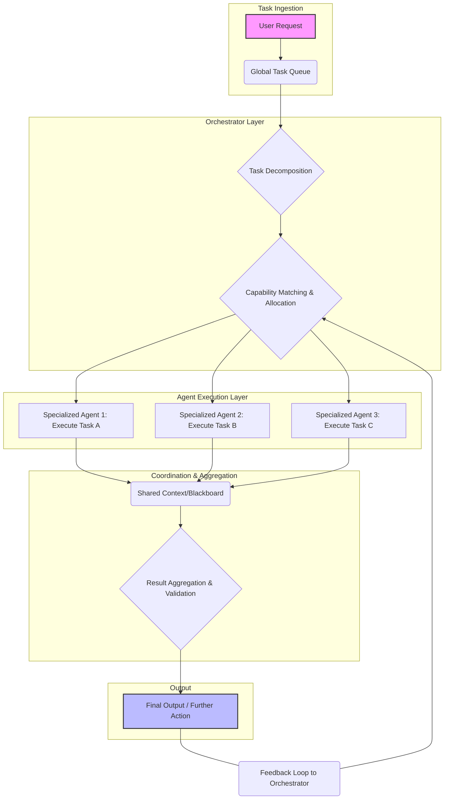

복잡한 AI 워크플로우에서 다중 에이전트(Multi-Agent)의 협업은 시스템의 효율성과 안정성에 직접적인 영향을 미칩니다. 개별 에이전트의 강점을 결합하고, 태스크(Task)를 효과적으로 분배하며, 그들의 상호작용을 조정하는 것은 전체 시스템의 성능을 최적화하는 핵심 요소입니다. 2026년 기준, 에이전트의 자율성과 동적 환경 적응 능력은 더욱 중요해지고 있으며, 이에 따라 유연하고 견고한 태스크 분배 및 조정 메커니즘이 필수적으로 요구됩니다.

## 다중 에이전트 시스템 태스크 분배의 중요성
단일 에이전트로는 처리하기 어려운 복잡한 문제를 다중 에이전트 시스템은 병렬 처리와 전문화된 역량을 통해 해결할 수 있습니다. 예를 들어, 대규모 데이터 분석, 복잡한 코드베이스 리팩토링, 실시간 재난 대응 시뮬레이션 등은 여러 AI 에이전트가 각자의 역할을 수행하며 협력해야만 효율적인 결과를 도출할 수 있습니다. 이때 태스크 분배(Task Distribution)는 각 에이전트에게 적절한 작업을 할당하여 자원 활용도를 높이고 병목 현상을 줄이는 과정이며, 태스크 조정(Task Coordination)은 에이전트 간의 상호작용을 관리하여 목표 달성을 위한 시너지를 창출하는 과정입니다.

### 핵심 원칙
1.  **태스크 분해 및 세분화 (Task Decomposition and Granularity)**: 전체 시스템 목표를 달성하기 위해 최상위 태스크를 하위 태스크로 분해합니다. 이때 하위 태스크의 세분화(Granularity) 정도는 에이전트의 역량과 통신 오버헤드(Communication Overhead)를 고려하여 결정되어야 합니다. 너무 작게 분해하면 통신 비용이 증가하고, 너무 크게 분해하면 에이전트의 병렬 처리 기회를 잃게 됩니다.
2.  **에이전트 전문화 및 역량 매핑 (Agent Specialization and Capability Mapping)**: 각 에이전트는 특정 도메인 지식이나 도구 사용 능력 등 고유한 전문성을 가집니다. 태스크를 할당하기 전에 에이전트의 역량(Capability)을 명확히 정의하고, 태스크 요구사항과 에이전트 역량을 효과적으로 매핑하는 것이 중요합니다.
3.  **동적 적응성 (Dynamic Adaptability)**: AI 워크플로우는 예측 불가능한 변수와 지속적인 변화에 직면합니다. 태스크 분배 및 조정 전략은 에이전트의 상태, 시스템 부하, 외부 환경 변화 등에 동적으로 적응하여 최적의 성능을 유지해야 합니다.

## 태스크 분배 전략

### 1. 중앙 집중식 오케스트레이션 (Centralized Orchestration)
중앙 오케스트레이터(Orchestrator)가 모든 태스크를 분해하고, 에이전트에게 할당하며, 진행 상황을 모니터링하고 결과를 통합합니다. LLM 기반의 Supervisor Agent(감독 에이전트)가 이 역할을 수행하는 경우가 많습니다.

*   **장점**: 시스템의 전역 상태를 파악하기 용이하고, 복잡한 의사 결정 및 자원 관리가 단순해집니다. 예측 가능한 워크플로우에 적합합니다.
*   **단점**: 중앙 집중점에 병목 현상이나 단일 장애점(Single Point of Failure)이 발생할 수 있습니다. 대규모 시스템이나 동적 환경에서는 확장성(Scalability)이 저하될 수 있습니다.

### 2. 분산형 (자율적) 조정 (Decentralized (Emergent) Coordination)
에이전트들이 사전에 정의된 규칙이나 프로토콜에 따라 자체적으로 태스크를 선택하고 협력합니다. 중앙 제어 없이 에이전트 간의 로컬(Local) 상호작용을 통해 전역 목표를 달성하려 합니다.

*   **장점**: 확장성이 뛰어나고, 단일 장애점에 대한 저항력이 강합니다. 동적이고 예측 불가능한 환경에 유연하게 대응할 수 있습니다.
*   **단점**: 전역 최적화가 어렵고, 에이전트 간의 충돌(Conflict)이 발생하기 쉽습니다. 시스템의 동작을 예측하고 디버깅하기가 복잡합니다.

### 3. 하이브리드 접근 방식 (Hybrid Approaches)
중앙 집중식과 분산형의 장점을 결합한 형태입니다. 예를 들어, 최상위 태스크 분배는 중앙 오케스트레이터가 담당하고, 하위 태스크 내의 미세한 조정은 에이전트들이 자율적으로 수행하게 할 수 있습니다. 2026년에는 이 하이브리드 모델이 가장 현실적인 대안으로 주목받고 있습니다.

## 조정 메커니즘

### 1. 공유 메모리/블랙보드 시스템 (Shared Memory/Blackboard Systems)
모든 에이전트가 접근할 수 있는 중앙 집중식 공유 공간(Blackboard)에 태스크, 중간 결과, 지식 등을 기록하고 참조합니다. 에이전트는 블랙보드의 특정 영역을 모니터링하며 필요한 정보를 얻고 자신의 작업을 게시합니다.

### 2. 메시지 전달 (Message Passing)
에이전트들이 명시적인 메시지를 주고받으며 정보를 교환하고 작업을 조정합니다. Pub/Sub 모델이나 Point-to-Point 통신 등 다양한 방식이 있으며, 에이전트 간의 느슨한 결합(Loose Coupling)을 가능하게 합니다.

### 3. 계약망 프로토콜 (Contract Net Protocol)
태스크를 수행할 '관리자(Manager)' 에이전트가 태스크를 제안하면, '입찰자(Bidder)' 에이전트들이 자신의 역량을 기반으로 입찰하고, 관리자가 최적의 입찰자를 선정하여 계약을 맺는 방식입니다. 동적 태스크 할당에 유용합니다.

### 4. 경매 기반 시스템 (Auction-based Systems)
태스크를 '상품'으로 간주하고, 에이전트들이 태스크 수행 비용, 시간, 성공 확률 등을 기반으로 '입찰'하여 태스크를 얻는 방식입니다. 경제적 모델을 통해 자원 효율성을 높일 수 있습니다.

## 코드 예제: 파이썬 중앙 집중식 오케스트레이션
아래 코드는 간단한 중앙 집중식 오케스트레이터가 두 가지 유형의 에이전트에게 태스크를 분배하고 결과를 통합하는 예제입니다. 각 에이전트는 특정 타입의 태스크를 처리합니다.

```python
import time
from typing import List, Dict, Any

class Agent:
    def __init__(self, agent_id: str, capabilities: List[str]):
        self.agent_id = agent_id
        self.capabilities = capabilities

    def execute_task(self, task: Dict[str, Any]) -> Dict[str, Any]:
        if task["type"] not in self.capabilities:
            return {"agent_id": self.agent_id, "task_id": task["id"], "status": "failed", "reason": "unsupported capability"}
        
        print(f"Agent {self.agent_id} is executing task {task['id']} (Type: {task['type']})...")
        time.sleep(0.1) # Simulate work
        result = f"Processed data for {task['data']}"
        return {"agent_id": self.agent_id, "task_id": task["id"], "status": "completed", "result": result}

class Orchestrator:
    def __init__(self, agents: List[Agent]):
        self.agents = {agent.agent_id: agent for agent in agents}
        self.available_agents: Dict[str, Agent] = {agent.agent_id: agent for agent in agents}
        self.task_queue: List[Dict[str, Any]] = []

    def add_task(self, task: Dict[str, Any]):
        self.task_queue.append(task)
        print(f"Task {task['id']} added to queue.")

    def distribute_and_coordinate(self):
        while self.task_queue or len(self.agents) > len(self.available_agents):
            if not self.task_queue:
                time.sleep(0.5) # Wait for new tasks or agents to finish
                continue

            task = self.task_queue.pop(0)
            allocated = False
            for agent_id, agent in list(self.available_agents.items()): # Use list for safe modification
                if task["type"] in agent.capabilities:
                    print(f"Assigning task {task['id']} to Agent {agent.agent_id}.")
                    del self.available_agents[agent_id]
                    result = agent.execute_task(task)
                    print(f"Task {task['id']} result: {result['status']}")
                    self.available_agents[agent_id] = agent # Make agent available again
                    allocated = True
                    break
            
            if not allocated:
                print(f"No suitable agent for task {task['id']}. Re-queueing.")
                self.task_queue.append(task) # Re-queue if no agent found
            time.sleep(0.05) # Prevent busy-waiting

# --- Example Usage ---
agent_data = Agent("DataProcessor", ["data_processing"])
agent_analyzer = Agent("Analyzer", ["analysis"])
agent_summarizer = Agent("Summarizer", ["summarization"])

orchestrator = Orchestrator([agent_data, agent_analyzer, agent_summarizer])

orchestrator.add_task({"id": "T1", "type": "data_processing", "data": "report_A"})
orchestrator.add_task({"id": "T2", "type": "analysis", "data": "metrics_B"})
orchestrator.add_task({"id": "T3", "type": "data_processing", "data": "log_C"})
orchestrator.add_task({"id": "T4", "type": "summarization", "data": "analysis_result_D"})

orchestrator.distribute_and_coordinate()
```

이 예제에서 `Orchestrator`는 `add_task`를 통해 태스크를 받아 큐에 넣고, `distribute_and_coordinate` 메서드에서 큐의 태스크를 순회하며 적합한 역량(Capability)을 가진 `Agent`에게 태스크를 할당합니다. 태스크가 완료되면 해당 에이전트는 다시 `available_agents` 목록으로 돌아와 다음 태스크를 기다립니다. 이는 중앙 집중식 태스크 분배의 기본적인 로직을 보여줍니다.

## 다중 에이전트 태스크 흐름 (Mermaid Diagram)



이 다이어그램은 사용자 요청이 들어오면 전역 태스크 큐에 쌓이고, 오케스트레이터가 이를 분해하여 적절한 에이전트에게 할당하는 과정을 보여줍니다. 에이전트들은 태스크를 수행한 후, 공유 컨텍스트를 통해 결과를 공유하고, 오케스트레이터는 이 결과를 통합하고 검증하여 최종 출력을 생성합니다. 오케스트레이터는 이 과정에서 에이전트의 상태를 모니터링하며, 필요 시 태스크 재할당이나 우선순위 조정을 수행하는 피드백 루프(Feedback Loop)를 가집니다.

## 트레이드오프

*   **중앙 집중식 오케스트레이션 vs. 분산형 조정**: 
    *   **중앙 집중식**: 언제 좋음: 초기 개발이 간단하고, 시스템 전체에 대한 제어 및 가시성이 중요한 경우 (예: 규제 준수, 자원 할당이 엄격한 환경). 언제 나쁨: 시스템 규모가 커지거나, 에이전트 수가 많아질 때 병목 현상과 단일 장애점 발생 위험이 커집니다.
    *   **분산형**: 언제 좋음: 높은 확장성과 내결함성(Fault Tolerance)이 요구되는 대규모 시스템, 에이전트 간의 동적이고 예측 불가능한 상호작용이 필요한 경우 (예: 로봇 군집 제어, 분산 컴퓨팅). 언제 나쁨: 에이전트 간의 조정 실패 시 전체 시스템의 일관성(Consistency)이 저해될 수 있고, 디버깅 및 전역 최적화가 어렵습니다.

*   **에이전트 전문화 vs. 일반화**: 
    *   **전문화**: 언제 좋음: 특정 태스크에 대한 높은 효율성과 성능이 필요할 때, 복잡한 도구 사용이나 도메인 지식이 요구되는 경우. 언제 나쁨: 시스템의 유연성이 떨어지고, 새로운 태스크 타입이 발생할 때 에이전트를 추가하거나 재구성해야 하는 오버헤드가 발생합니다.
    *   **일반화**: 언제 좋음: 다양한 유형의 태스크를 처리할 수 있어 시스템의 유연성이 높고, 에이전트 관리가 단순해질 수 있습니다. 언제 나쁨: 각 태스크에 대한 최적의 성능을 달성하기 어렵고, 특정 전문 지식이 필요한 태스크에서 비효율적일 수 있습니다.

*   **통신 오버헤드 vs. 태스크 병렬화**: 
    *   **낮은 통신 오버헤드**: 언제 좋음: 태스크 간 의존성이 낮고, 에이전트들이 독립적으로 작업할 수 있을 때, 처리량(Throughput)을 최대화할 수 있습니다. 언제 나쁨: 에이전트 간의 정보 공유가 필수적인 협업 태스크에서 일관성 문제나 잘못된 의사 결정으로 이어질 수 있습니다.
    *   **높은 통신 오버헤드**: 언제 좋음: 태스크 간의 긴밀한 협력과 최신 정보 공유가 필수적인 경우, 복잡한 공동 의사 결정이 요구될 때. 언제 나쁨: 시스템 전체의 지연 시간(Latency)이 증가하고, 통신 채널의 병목 현상이 발생하여 성능이 저하될 수 있습니다.

## 실전 체크리스트

- [ ] **태스크 분해 가이드라인 정의**: 최상위 목표를 하위 태스크로 분해하는 명확한 기준과 최대/최소 세분화 수준을 정의했는가?
- [ ] **에이전트 역량 명세화**: 각 에이전트가 수행할 수 있는 태스크 타입, 필요 도구, 예상 성능 지표(KPI)를 문서화했는가?
- [ ] **조정 메커니즘 선택 및 구현**: 중앙 집중식, 분산형, 또는 하이브리드 중 현재 워크플로우에 가장 적합한 조정 메커니즘을 선택하고 프로토콜을 구현했는가?
- [ ] **통신 프로토콜 표준화**: 에이전트 간 메시지 형식, 데이터 스키마, 오류 처리 방식을 표준화하여 일관성 있는 상호작용을 보장하는가?
- [ ] **동적 자원 할당 전략 구축**: 에이전트의 부하, 가용성, 성능 저하 등을 실시간으로 모니터링하여 태스크를 동적으로 재분배하는 로직을 포함했는가?
- [ ] **충돌 감지 및 해결 메커니즘**: 에이전트 간의 자원 경합, 태스크 중복, 결과 불일치 등의 충돌을 감지하고 해결할 수 있는 자동화된 시스템이 있는가?
- [ ] **종료 조건 및 결과 통합 로직 검증**: 모든 하위 태스크가 완료되었을 때 시스템이 최종 결과를 정확하게 통합하고 다음 단계로 진행할 수 있는지 검증했는가?