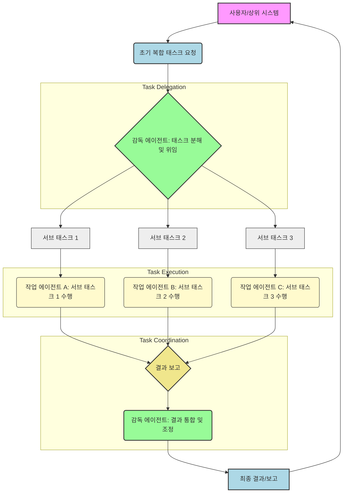

복잡한 문제 해결을 위해 설계된 멀티 에이전트 시스템(Multi-Agent Systems, MAS)에서 에이전트 간의 효율적인 태스크 위임(Task Delegation)과 조정(Coordination)은 시스템의 성공을 좌우하는 핵심 요소입니다. 특히 자율 에이전트 시스템의 규모가 커지고 태스크의 복잡도가 증가함에 따라, 에이전트들이 서로의 역량을 이해하고, 적절히 태스크를 분배하며, 충돌 없이 협력하는 메커니즘은 시스템의 효율성과 안정성을 높이는 데 필수적입니다. 이 글에서는 멀티 에이전트 시스템에서 태스크 위임 및 조정을 위한 주요 패턴들을 소개하고, 실제 적용 시 고려해야 할 사항들을 다룹니다.

## 태스크 위임 패턴
태스크 위임은 복잡한 상위 레벨의 목표를 개별 에이전트가 수행할 수 있는 하위 태스크로 분해하고, 이를 적절한 에이전트에게 할당하는 과정입니다. 효과적인 위임은 전체 시스템의 처리량을 늘리고, 특정 에이전트의 과부하를 방지하며, 문제 해결 속도를 향상시킵니다.

### 1. 계층적 위임 (Hierarchical Delegation)
가장 일반적인 패턴 중 하나로, 상위 레벨의 감독(supervisor) 에이전트가 전체 목표를 관리하고, 이를 더 작은 서브 태스크로 분해하여 하위 레벨의 작업(worker) 에이전트들에게 위임합니다. 작업 에이전트들은 할당된 태스크를 수행한 후 결과를 감독 에이전트에게 보고하며, 감독 에이전트는 이를 통합하여 최종 목표를 달성합니다.

**장점**: 명확한 역할 분담, 중앙 집중식 제어로 인한 높은 제어 가능성.
**단점**: 감독 에이전트가 단일 장애 지점(Single Point of Failure)이 될 수 있으며, 병목 현상 발생 가능성. 높은 위임 깊이는 복잡도를 증가시킵니다.

### 2. 시장 기반 위임 (Market-Based Delegation)
태스크를 경매(auction) 또는 입찰(bidding) 메커니즘을 통해 에이전트에게 할당하는 방식입니다. 태스크가 발생하면 이를 수행할 수 있는 에이전트들이 자신의 역량, 비용, 시간 등을 고려하여 입찰하고, 가장 최적의 조건을 제시한 에이전트에게 태스크가 위임됩니다. Contract Net Protocol 이 대표적인 예시입니다.

**장점**: 자원의 효율적 분배, 동적 로드 밸런싱, 에이전트 추가/제거 용이성.
**단점**: 복잡한 협상 메커니즘, 경매 오버헤드, 비합리적인 에이전트 행동으로 인한 비효율성 발생 가능성.

### 3. 기능 기반 위임 (Capability-Based Delegation)
각 에이전트가 특정 전문 기능(specialized capabilities)을 보유하고 있을 때 사용됩니다. 태스크의 종류에 따라 가장 적합한 기능을 가진 에이전트에게 직접 위임하는 방식입니다. 이는 에이전트의 스킬셋(skillset)을 기반으로 합니다.

**장점**: 전문성 활용 극대화, 빠른 태스크 매칭.
**단점**: 새로운 종류의 태스크에 대한 유연성 부족, 특정 기능 에이전트의 과부하.

## 태스크 조정 패턴
태스크 조정은 여러 에이전트가 하나의 공동 목표를 향해 효율적으로 협력하도록 보장하는 메커니즘입니다. 위임된 태스크들이 서로 의존성이 있거나, 공유 자원을 사용할 때 조정은 필수적입니다.

### 1. 중앙 집중식 조정 (Centralized Orchestration)
중앙 오케스트레이터(orchestrator) 에이전트가 모든 태스크의 진행 상황, 의존성, 자원 할당 등을 관리하고 조율합니다. 에이전트들은 오케스트레이터의 지시에 따라 행동하며, 모든 통신은 오케스트레이터를 통해 이루어집니다.

**장점**: 강력한 제어, 시스템 상태에 대한 명확한 가시성, 충돌 해결 용이성.
**단점**: 단일 장애 지점, 확장성(scalability) 문제, 오케스트레이터의 병목 현상.

### 2. 분산형/ emergent 조정 (Decentralized / Emergent Coordination)
명시적인 중앙 조정자 없이 에이전트들이 로컬 규칙(local rules)과 상호 작용을 통해 전체 시스템 수준의 조정을 달성하는 방식입니다. 공유 환경(shared environment)을 통해 암묵적으로 정보를 교환하거나, 직접적인 메시지 패싱(message passing)을 통해 협력합니다.

**장점**: 높은 확장성, 단일 장애 지점 없음, 강력한 복원력(resilience).
**단점**: 전역 최적화(global optimization) 어려움, 예측 불가능한 emergent 행동, 충돌 해결 복잡성.

### 3. 공유 메모리/블랙보드 시스템 (Shared Memory / Blackboard System)
에이전트들이 공통의 '블랙보드'나 공유 메모리 공간을 통해 정보를 읽고 쓰는 방식으로 조정을 수행합니다. 각 에이전트는 블랙보드의 특정 부분에 관심(subscribe)을 등록하고, 관련 정보가 업데이트되면 이를 기반으로 자신의 행동을 결정합니다.

**장점**: 유연한 정보 교환, 에이전트 간 낮은 직접적 결합도(loose coupling).
**단점**: 경합 조건(race condition) 발생 가능성, 블랙보드의 데이터 일관성(data consistency) 관리 어려움.

### 코드 예시: 파이썬 기반의 간단한 계층적 위임 및 조정
아래 코드는 감독 에이전트가 두 개의 작업 에이전트에게 태스크를 위임하고 결과를 조정하는 간단한 시나리오를 보여줍니다. Python의 `asyncio`를 사용하여 동시성을 흉내 냅니다.

```python
import asyncio
import random

class WorkerAgent:
    def __init__(self, agent_id):
        self.agent_id = agent_id

    async def perform_task(self, task_description):
        print(f"WorkerAgent {self.agent_id}: Task '{task_description}' received.")
        await asyncio.sleep(random.uniform(0.5, 2.0)) # Simulate work
        result = f"WorkerAgent {self.agent_id} completed '{task_description}' successfully."
        print(f"WorkerAgent {self.agent_id}: Task '{task_description}' done.")
        return result

class SupervisorAgent:
    def __init__(self):
        self.worker_agents = [
            WorkerAgent("Alpha"),
            WorkerAgent("Beta")
        ]
        self.task_queue = asyncio.Queue()
        self.results = {}

    async def delegate_task(self, task_name, worker_id=None):
        if worker_id is None:
            # Simple round-robin delegation
            worker = self.worker_agents[len(self.task_queue._queue) % len(self.worker_agents)]
        else:
            worker = next((w for w in self.worker_agents if w.agent_id == worker_id), None)
            if not worker:
                raise ValueError(f"No worker with ID {worker_id}")

        print(f"Supervisor: Delegating task '{task_name}' to {worker.agent_id}.")
        task_future = asyncio.create_task(worker.perform_task(task_name))
        self.results[task_name] = task_future

    async def coordinate_results(self):
        for task_name, future in list(self.results.items()):
            try:
                result = await future
                print(f"Supervisor: Received result for '{task_name}': {result}")
                del self.results[task_name] # Remove completed task
            except asyncio.InvalidStateError: # Task not yet done
                pass
            except Exception as e:
                print(f"Supervisor: Error for '{task_name}': {e}")
                del self.results[task_name]

    async def run(self):
        tasks_to_delegate = [
            "Analyze Data",
            "Generate Report",
            "Review Code",
            "Optimize Performance",
            "Deploy Service"
        ]

        for task in tasks_to_delegate:
            await self.delegate_task(task)
            await asyncio.sleep(0.1) # Simulate delay before next delegation

        # Continuously coordinate until all tasks are done
        while self.results:
            await self.coordinate_results()
            await asyncio.sleep(0.5) # Wait before checking results again

        print("Supervisor: All tasks processed.")

async def main():
    supervisor = SupervisorAgent()
    await supervisor.run()

if __name__ == "__main__":
    asyncio.run(main())
```

### Mermaid 다이어그램: 계층적 태스크 위임 흐름



## 2026년 트렌드와 고려사항
2026년 멀티 에이전트 시스템은 단순히 태스크를 분배하고 조정하는 것을 넘어, 동적인 환경 변화에 지능적으로 대응하며 자율성을 극대화하는 방향으로 발전하고 있습니다. 특히 LLM (Large Language Models) 기반 에이전트의 등장은 위임 및 조정 패턴에 새로운 가능성을 제시합니다.

*   **LLM 기반 지능형 위임/조정**: LLM은 태스크 설명을 분석하고, 에이전트의 역량을 이해하며, 복잡한 의존성을 추론하여 최적의 위임 및 조정 전략을 동적으로 생성할 수 있습니다. 이는 정적 규칙 기반 시스템의 한계를 뛰어넘습니다.
*   **적응형 및 자가 학습 조정**: 에이전트 시스템은 과거의 성능 데이터를 바탕으로 어떤 위임/조정 패턴이 가장 효과적이었는지 학습하고, 실시간으로 변화하는 워크로드(workload)나 에이전트 상태에 맞춰 전략을 조정합니다. 강화 학습(Reinforcement Learning) 기법이 활발히 연구되고 있습니다.
*   **트레이드오프 관리의 중요성**: 분산 시스템의 고질적인 문제인 통신 오버헤드(communication overhead), 일관성(consistency)과 가용성(availability) 간의 CAP 이론 트레이드오프는 여전히 중요한 고려 사항입니다. 특히 LLM 기반 에이전트의 경우, 토큰 비용(token cost)과 추론 지연 시간(inference latency)이 새로운 차원의 트레이드오프로 작용합니다.
*   **인간-에이전트 협력 (Human-Agent Collaboration)**: 복잡하거나 중요도가 높은 태스크는 인간의 개입이 필요한 경우가 많습니다. 에이전트 시스템은 인간 피드백(human feedback)을 효과적으로 통합하고, 특정 시점에 태스크 위임이나 조정 방식을 인간이 오버라이드(override)할 수 있는 인터페이스를 제공하는 방향으로 진화하고 있습니다.

## 트레이드오프
멀티 에이전트 시스템에서 태스크 위임 및 조정 패턴을 선택할 때는 다양한 트레이드오프를 신중하게 고려해야 합니다.

*   **중앙 집중식 vs. 분산형**: 시스템의 복잡성과 제어 수준 사이의 균형을 이룹니다.
    *   **중앙 집중식 조정**: 초기 개발 및 디버깅이 용이하며, 전체 시스템 상태에 대한 명확한 가시성을 제공합니다. **언제 좋음**: 작은 규모의 시스템, 강력한 제어 및 예측 가능한 동작이 필요한 경우, 빠르게 프로토타이핑해야 할 때. **언제 나쁨**: 높은 확장성이 요구되거나 단일 장애 지점을 허용할 수 없는 프로덕션 환경, 에이전트 수가 매우 많아 오케스트레이터의 병목이 예상될 때.
    *   **분산형 조정**: 높은 확장성과 복원력을 제공하며, 에이전트 개별 실패에 강합니다. **언제 좋음**: 대규모 분산 시스템, 예측 불가능한 환경 변화에 유연하게 대응해야 할 때, 단일 지점의 실패가 전체 시스템에 영향을 주지 않아야 할 때. **언제 나쁨**: 전역 최적화가 중요하거나 시스템의 행동을 예측하고 디버깅하기 어려울 때, 에이전트 간의 복잡한 의존성 관리가 필요할 때.
*   **태스크 위임의 세분성(Granularity)**: 태스크 분해의 정도는 위임 오버헤드와 병렬 처리 효율성에 영향을 미칩니다.
    *   **높은 세분성 (Fine-grained delegation)**: 각 에이전트가 매우 작은 태스크를 수행하여 높은 병렬성을 달성할 수 있습니다. **언제 좋음**: 태스크 병렬화가 핵심 요구사항일 때, 에이전트 자원 활용률을 극대화하고자 할 때. **언제 나쁨**: 위임 및 조정에 필요한 통신 및 관리 오버헤드가 태스크 수행 시간보다 길어져 비효율적일 수 있을 때, 태스크 간 의존성이 복잡하여 조정 비용이 과도하게 발생할 때.
    *   **낮은 세분성 (Coarse-grained delegation)**: 에이전트가 더 크고 독립적인 태스크 덩어리를 수행합니다. **언제 좋음**: 통신 오버헤드를 줄이고 싶을 때, 태스크 간 의존성이 적어 에이전트 간 상호 작용이 최소화될 때. **언제 나쁨**: 병렬 처리의 이점을 충분히 활용하기 어렵거나, 특정 에이전트에 과도한 작업이 집중될 수 있을 때.
*   **통신 메커니즘**: 에이전트 간 정보 교환 방식은 시스템의 반응성과 자원 소모에 영향을 미칩니다.
    *   **명시적 메시지 패싱 (Explicit Message Passing)**: 에이전트 간 직접적인 통신으로, 정보 전달이 명확하고 제어 가능성이 높습니다. **언제 좋음**: 에이전트 간 통신 내용이 명확하고 구조화되어 있을 때, 즉각적인 반응이 필요한 경우. **언제 나쁨**: 에이전트 수가 많아지면 통신 경로가 복잡해지고 관리 비용이 증가할 때, 느슨한 결합이 중요할 때.
    *   **암묵적 공유 환경 (Implicit Shared Environment)**: 블랙보드 시스템처럼 공유 자원을 통해 간접적으로 상호 작용합니다. **언제 좋음**: 에이전트 간 느슨한 결합이 중요하고, 시스템의 변화에 유연하게 대응해야 할 때, 동적으로 에이전트가 참여/이탈하는 시스템. **언제 나쁨**: 데이터 일관성 유지가 어렵고 경합 조건 관리에 추가적인 메커니즘이 필요할 때, 실시간으로 복잡한 의사소통이 필요한 경우.

## 실전 체크리스트
멀티 에이전트 시스템에서 태스크 위임 및 조정 패턴을 실제 프로젝트에 적용할 때 다음 체크리스트를 활용하여 시스템의 효율성과 안정성을 검증하고 최적화하세요.

- [ ] **태스크 분해 전략 명확화**: 전체 목표가 에이전트의 역량에 맞춰 논리적이고 독립적인 서브 태스크로 잘 분해되었는지 검토합니다. 각 서브 태스크가 명확한 시작점과 종료점을 가지는가?
- [ ] **위임 오버헤드 분석**: 선택한 위임 패턴(계층적, 시장 기반 등)이 태스크의 특성과 에이전트 수에 비해 과도한 오버헤드를 발생시키지 않는지 측정합니다. 특히 LLM 기반 에이전트의 경우 토큰 비용과 추론 시간을 고려했는가?
- [ ] **조정 프로토콜 설계 확인**: 에이전트 간 의존성, 공유 자원 접근, 충돌 해결을 위한 조정 프로토콜(중앙 집중식, 분산형, 블랙보드 등)이 시스템 요구사항에 부합하는지 확인합니다. 교착 상태(deadlock) 및 경합 조건 발생 가능성을 최소화했는가?
- [ ] **에이전트 통신 채널 검증**: 에이전트 간 통신 지연 시간, 대역폭(bandwidth) 사용량, 메시지 손실 허용 범위 등 통신 채널의 성능 및 신뢰성을 테스트합니다. 통신 실패 시 재시도(retry) 및 오류 처리 메커니즘이 구현되었는가?
- [ ] **모니터링 및 로깅 체계 구축**: 각 에이전트의 태스크 수행 상태, 위임/조정 과정, 자원 사용량 등을 실시간으로 모니터링하고 로깅하는 시스템이 마련되어 있는지 확인합니다. 이상 감지 시 알림(alert) 기능이 포함되어 있는가?
- [ ] **실패 복구 및 복원력 테스트**: 개별 에이전트 또는 조정 메커니즘의 실패가 전체 시스템에 미치는 영향을 시뮬레이션하고, 시스템이 자동으로 복구되거나 안정적인 상태로 전환되는지 검증합니다. 감독 에이전트의 장애 시 대비책(failover)이 있는가?
- [ ] **확장성 및 성능 벤치마킹**: 에이전트 수 또는 태스크 부하 증가에 따라 시스템의 처리량(throughput)과 응답 시간(response time)이 어떻게 변화하는지 벤치마킹하여 확장성을 평가합니다. 예상되는 최대 부하에서도 시스템이 안정적으로 작동하는가?
