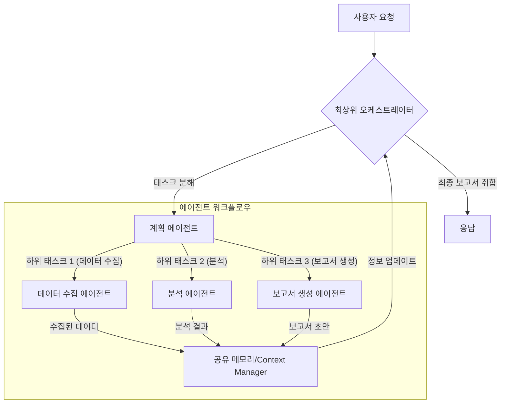

다중 AI 에이전트 시스템은 단일 에이전트로는 해결하기 어려운 복잡하고 다면적인 문제들을 처리하기 위한 필수적인 아키텍처 패턴으로 부상하고 있습니다. 이러한 시스템의 성공은 개별 에이전트의 능력뿐만 아니라, 이들 에이전트가 얼마나 효과적으로 상호작용하고 협력하는지에 달려 있습니다. 본 문서는 다중 AI 에이전트 간의 효율적인 협업 패턴을 설계하는 방법에 대해 탐구합니다.

## 다중 에이전트 협업의 중요성

복잡한 태스크는 종종 여러 하위 태스크로 분해될 수 있으며, 각 하위 태스크는 특정 전문성을 요구합니다. 단일 에이전트가 모든 전문성을 갖추기 어렵거나, 전체 태스크의 규모가 단일 에이전트의 컨텍스트 창(Context Window)을 초과할 수 있습니다. 다중 에이전트 협업은 이러한 한계를 극복하고, 다음과 같은 이점을 제공합니다.

*   **문제 해결 능력 향상**: 각 에이전트가 특정 도메인 또는 역할에 전문화되어 전체 시스템의 문제 해결 능력을 극대화합니다.
*   **유연성 및 확장성**: 새로운 태스크 요구사항에 따라 에이전트를 추가하거나 교체하기 용이하며, 시스템 전체의 확장성을 확보합니다.
*   **견고성 및 복원력**: 한 에이전트의 실패가 전체 시스템의 중단으로 이어지지 않도록 설계하여 시스템의 복원력을 높입니다.
*   **효율적인 자원 활용**: 병렬 처리를 통해 태스크를 더 빠르게 완료하고, 각 에이전트가 최적의 자원을 활용하도록 할 수 있습니다.

## 핵심 협업 패턴

다중 AI 에이전트 간의 협업은 다양한 방식으로 설계될 수 있으며, 태스크의 성격과 시스템의 복잡성에 따라 적절한 패턴을 선택해야 합니다. 주요 협업 패턴은 다음과 같습니다.

### 1. 계층적 협업 (Hierarchical Collaboration)

상위 에이전트(Coordinator 또는 Manager)가 전체 태스크를 하위 태스크로 분해하고, 이를 전문화된 하위 에이전트(Worker 또는 Executor)에게 위임하는 방식입니다. 하위 에이전트는 자신의 결과를 상위 에이전트에게 보고하며, 상위 에이전트가 전체적인 진행 상황을 모니터링하고 조정합니다.

*   **장점**: 명확한 역할 분담, 중앙 집중식 제어로 인한 예측 가능성.
*   **단점**: 중앙 에이전트에 대한 의존성, 병목 현상 발생 가능성.

### 2. 피어-투-피어 협업 (Peer-to-Peer Collaboration)

모든 에이전트가 동등한 지위를 가지고 직접적으로 상호작용하며 태스크를 해결하는 방식입니다. 특정 중앙 에이전트 없이 합의 메커니즘이나 메시지 교환을 통해 조율합니다.

*   **장점**: 높은 복원력, 단일 실패 지점(Single Point of Failure) 없음.
*   **단점**: 복잡한 조정 로직, 합의 도달의 어려움.

### 3. 블랙보드 시스템 (Blackboard System)

공유되는 중앙 저장소(Blackboard)를 통해 에이전트들이 정보를 교환하고 협업하는 방식입니다. 각 에이전트는 블랙보드에 게시된 문제를 인식하고, 자신의 전문성을 활용하여 해결책의 일부를 제공하거나 새로운 정보를 추가합니다.

*   **장점**: 유연한 구조, 다양한 에이전트의 동적 참여 가능.
*   **단점**: 블랙보드 동시성 관리의 복잡성, 정보 과부하 가능성.

### 4. 조정 및 오케스트레이션 (Coordination and Orchestration)

에이전트 간의 상호작용을 관리하고, 태스크의 흐름을 조율하는 전용 오케스트레이션 레이어를 두는 방식입니다. 이는 주로 복잡한 워크플로우를 처리할 때 유용하며, 에이전트 간의 직접적인 통신 부담을 줄여줍니다.

*   **장점**: 복잡한 워크플로우 관리 용이, 에이전트 로직의 단순화.
*   **단점**: 오케스트레이션 레이어의 성능과 가용성에 대한 의존성.

## 다중 에이전트 협업 워크플로우 예시 (Mermaid)

다음 Mermaid 다이어그램은 계층적 협업과 오케스트레이션의 결합된 형태를 보여줍니다.



## 코드 예시: 간단한 에이전트 메시지 기반 협업

다음 Python 코드 스니펫은 간단한 메시지 기반 에이전트 협업의 개념을 보여줍니다. `Agent`는 자신의 역할에 따라 메시지를 처리하고, `Communicator`를 통해 다른 에이전트에게 메시지를 보냅니다.

```python
import queue

class Communicator:
    def __init__(self):
        self.mailboxes = {} # key: agent_id, value: queue.Queue

    def register_agent(self, agent_id):
        if agent_id not in self.mailboxes:
            self.mailboxes[agent_id] = queue.Queue()

    def send_message(self, sender_id: str, recipient_id: str, message: dict):
        if recipient_id in self.mailboxes:
            print(f"[{sender_id} -> {recipient_id}]: {message['type']}")
            self.mailboxes[recipient_id].put({"sender": sender_id, "message": message})
        else:
            print(f"Error: Recipient {recipient_id} not found.")

    def get_message(self, agent_id: str):
        if agent_id in self.mailboxes and not self.mailboxes[agent_id].empty():
            return self.mailboxes[agent_id].get()
        return None

class Agent:
    def __init__(self, agent_id: str, role: str, communicator: Communicator):
        self.agent_id = agent_id
        self.role = role
        self.communicator = communicator
        self.communicator.register_agent(agent_id)
        print(f"Agent {self.agent_id} ({self.role}) initialized.")

    def process_message(self, incoming_message: dict):
        sender = incoming_message["sender"]
        message_body = incoming_message["message"]
        print(f"Agent {self.agent_id} ({self.role}) processing message from {sender}: {message_body['type']}")

        if self.role == "TaskCoordinator":
            if message_body["type"] == "initial_request":
                print(f"Coordinator received initial request: {message_body['payload']['task']}")
                # Delegate to PlanningAgent
                self.communicator.send_message(self.agent_id, "PlanningAgent",
                                                {"type": "plan_request", "payload": {"task": message_body["payload"]["task"]}})
            elif message_body["type"] == "final_result":
                print(f"Coordinator received final result: {message_body['payload']['result']}")
                # Finalize process
        elif self.role == "PlanningAgent":
            if message_body["type"] == "plan_request":
                task_description = message_body["payload"]["task"]
                print(f"PlanningAgent planning for: {task_description}")
                # Simulate task decomposition
                subtask_1 = f"Analyze '{task_description}' data"
                subtask_2 = f"Generate '{task_description}' summary"
                self.communicator.send_message(self.agent_id, "AnalysisAgent",
                                                {"type": "perform_analysis", "payload": {"subtask": subtask_1}})
                self.communicator.send_message(self.agent_id, "ReportAgent",
                                                {"type": "draft_summary", "payload": {"subtask": subtask_2}})
        elif self.role == "AnalysisAgent":
            if message_body["type"] == "perform_analysis":
                subtask = message_body["payload"]["subtask"]
                analysis_result = f"Analysis of '{subtask}' completed."
                print(f"AnalysisAgent completed: {analysis_result}")
                self.communicator.send_message(self.agent_id, "TaskCoordinator",
                                                {"type": "intermediate_result", "payload": {"result": analysis_result}})
        elif self.role == "ReportAgent":
            if message_body["type"] == "draft_summary":
                subtask = message_body["payload"]["subtask"]
                summary_draft = f"Draft summary for '{subtask}' generated."
                print(f"ReportAgent completed: {summary_draft}")
                self.communicator.send_message(self.agent_id, "TaskCoordinator",
                                                {"type": "final_result", "payload": {"result": summary_draft}})

# --- Simulation ---
comm = Communicator()

coordinator = Agent("TaskCoordinator", "TaskCoordinator", comm)
planner = Agent("PlanningAgent", "PlanningAgent", comm)
analyzer = Agent("AnalysisAgent", "AnalysisAgent", comm)
reporter = Agent("ReportAgent", "ReportAgent", comm)

# Initial request
comm.send_message("User", "TaskCoordinator", {"type": "initial_request", "payload": {"task": "Market Trend Analysis"}})

# To simulate message processing loop (in a real system, agents would run concurrently)
for _ in range(5): # Simulate a few message processing cycles
    for agent_id in comm.mailboxes.keys():
        message = comm.get_message(agent_id)
        if message:
            # Need to get the actual agent instance to call process_message
            target_agent = {
                "TaskCoordinator": coordinator,
                "PlanningAgent": planner,
                "AnalysisAgent": analyzer,
                "ReportAgent": reporter
            }.get(agent_id)
            if target_agent:
                target_agent.process_message(message)

```

## 2026년 최신 트렌드: 동적 협업과 검증 가능한 에이전트 시스템

2026년에는 다중 에이전트 시스템이 더욱 복잡하고 동적으로 진화하고 있습니다.
*   **동적 역할 할당 및 재조정**: 에이전트가 태스크의 진행 상황이나 외부 환경 변화에 따라 자신의 역할과 책임을 동적으로 조정하거나 새로운 에이전트를 온디맨드로 스폰(spawn)하는 패턴이 중요해지고 있습니다. 이는 시스템의 유연성과 적응성을 극대화합니다.
*   **시맨틱 통신 (Semantic Communication)**: 단순히 구조화된 메시지를 주고받는 것을 넘어, 에이전트들이 도메인 지식 그래프(Knowledge Graph)나 온톨로지(Ontology)를 활용하여 상호 운용성을 높이고 의미론적인 컨텍스트를 공유하는 방식으로 발전하고 있습니다.
*   **행동 검증 및 보안 강화**: 에이전트 간의 상호작용이 복잡해짐에 따라, 오작동이나 악의적인 행동을 감지하고 예방하는 강력한 가드레일(Guardrails)과 검증 메커니즘(Verification Mechanisms)이 필수적입니다. 블록체인 기반의 트랜잭션 로깅이나 영지식 증명(Zero-Knowledge Proofs)을 활용한 행동 검증 등이 연구되고 있습니다.
*   **인간-에이전트 협업 증강**: 단순히 에이전트 간의 협업을 넘어, 인간 전문가와 AI 에이전트가 실시간으로 협력하여 문제 해결 과정을 최적화하는 하이브리드 워크플로우 디자인이 주목받고 있습니다.

## 트레이드오프

다중 AI 에이전트 협업 패턴을 설계할 때는 다음과 같은 트레이드오프를 고려해야 합니다.

*   **시스템 복잡성 vs. 기능성**: 다중 에이전트 시스템은 단일 에이전트보다 훨씬 복잡합니다.
    *   **언제 좋은가?**: 단일 에이전트로는 해결하기 불가능하거나 비효율적인 매우 복잡한 문제(예: 대규모 소프트웨어 개발, 복잡한 과학 연구)를 해결해야 할 때 좋습니다. 각 에이전트가 전문화되어 전체 기능성을 확장할 수 있습니다.
    *   **언제 나쁜가?**: 단순하거나 쉽게 분해되지 않는 태스크, 또는 낮은 지연 시간(Latency)이 critical한 시스템에는 과도한 오버헤드를 유발하여 비효율적입니다. 초기 개발 및 유지보수 비용이 높습니다.
*   **중앙 집중식 제어 vs. 분산형 자율성**: 협업의 조정 방식을 어떻게 가져갈지에 대한 선택입니다.
    *   **언제 좋은가?**: 중앙 집중식(예: 계층적, 오케스트레이션)은 전체 시스템의 목표를 명확히 하고, 자원 할당 및 충돌 해결에 효과적입니다. 분산형(예: 피어-투-피어)은 단일 실패 지점을 제거하고 높은 복원력을 제공합니다.
    *   **언제 나쁜가?**: 중앙 집중식은 중앙 에이전트에 병목 현상이나 단일 실패 지점이 될 수 있으며, 분산형은 조정 메커니즘이 복잡해지고 예측 불가능한 행동으로 이어질 수 있습니다.
*   **통신 오버헤드 vs. 정보 공유 범위**: 에이전트 간 통신 빈도와 공유 정보의 양은 성능에 영향을 미칩니다.
    *   **언제 좋은가?**: 정보 공유 범위가 넓으면 에이전트들이 더 많은 컨텍스트를 가지고 최적의 결정을 내릴 수 있습니다.
    *   **언제 나쁜가?**: 과도한 통신은 네트워크 지연 시간(Network Latency)과 처리 오버헤드를 증가시켜 시스템의 전체적인 성능을 저하시킬 수 있습니다. 특히 실시간 시스템에서는 심각한 문제가 될 수 있습니다.
*   **에이전트 전문화 vs. 유연성**: 각 에이전트를 특정 역할에 고도로 전문화할 것인지, 아니면 여러 역할을 수행할 수 있는 범용성을 부여할 것인지의 문제입니다.
    *   **언제 좋은가?**: 고도로 전문화된 에이전트는 특정 태스크에 대해 높은 효율성과 정확성을 제공합니다. 범용 에이전트는 예기치 않은 상황이나 새로운 태스크에 더 유연하게 대응할 수 있습니다.
    *   **언제 나쁜가?**: 과도한 전문화는 에이전트 간의 협업 인터페이스를 복잡하게 만들고, 시스템의 적응성을 저해할 수 있습니다. 너무 범용적인 에이전트는 특정 태스크에 대한 성능이 떨어질 수 있습니다.

## 실전 체크리스트

다중 AI 에이전트 협업 패턴을 프로젝트에 적용할 때 다음 항목들을 검토해야 합니다.

*   [ ] **태스크 분해 명확성**: 전체 복합 태스크가 개별 에이전트가 처리할 수 있는 명확한 하위 태스크로 잘 분해되었는가? 각 하위 태스크의 입력과 출력이 명확히 정의되었는가?
*   [ ] **에이전트 역할 및 책임 정의**: 각 에이전트의 주된 역할(e.g., Coordinator, Planner, Executor, Aggregator)과 책임이 명확하게 할당되었으며 중복되거나 누락된 부분이 없는가?
*   [ ] **통신 프로토콜 설계**: 에이전트 간의 메시지 형식(예: JSON Schema), 통신 채널(예: 메시지 큐, REST API), 비동기/동기 통신 방식이 시스템 요구사항에 맞춰 설계되었는가?
*   [ ] **오류 처리 및 복원력 메커니즘**: 에이전트 실패, 통신 장애, 비정상적인 데이터에 대한 오류 감지 및 복구(재시도, 대체 에이전트 할당) 메커니즘이 구현되었는가?
*   [ ] **충돌 해결 전략**: 동일한 자원에 대한 접근, 다른 에이전트의 결정과의 불일치 등 협업 중 발생할 수 있는 충돌을 해결하기 위한 전략(예: 우선순위, 투표, 협상)이 마련되었는가?
*   [ ] **글로벌 상태 관리**: 에이전트들이 공유해야 하는 공통 컨텍스트나 상태 정보가 어떻게 관리되고(예: 중앙 저장소, 분산 캐시), 일관성과 동시성이 보장되는가?
*   [ ] **성능 및 확장성 테스트**: 예상되는 작업 부하 조건에서 다중 에이전트 시스템이 정의된 성능 지표(응답 시간, 처리량)를 충족하는지, 그리고 에이전트 수를 늘렸을 때 선형적으로 확장되는지 검증되었는가?