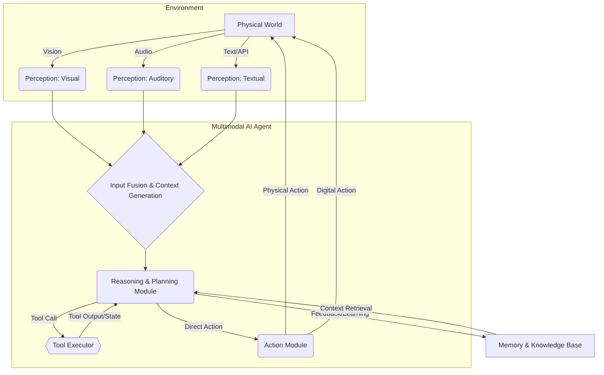

멀티모달 AI 에이전트 (Multimodal AI Agents)는 텍스트, 이미지, 오디오 등 다양한 형태의 데이터를 동시에 인지하고 이해하여, 복잡한 현실 세계의 문제들을 해결하는 데 중추적인 역할을 합니다. 2026년 현재, 이러한 에이전트들은 자율 주행, 로보틱스, 대화형 AI 시스템 등에서 그 중요성이 더욱 부각되고 있으며, 효율적인 설계 및 구현 패턴은 성공적인 애플리케이션 개발에 필수적입니다. 이 엔트리에서는 멀티모달 AI 에이전트의 핵심 구성 요소와 설계 원칙, 그리고 실제 적용 가능한 패턴들을 다룹니다.

## 멀티모달 에이전트의 핵심 구성 요소

멀티모달 AI 에이전트는 일반적으로 다음 세 가지 핵심 모듈로 구성됩니다.

### 1. 인지 모듈 (Perception Module)

이 모듈은 에이전트가 환경으로부터 다양한 모달리티의 데이터를 수집하고 처리하는 역할을 합니다. Vision-Language Model (VLM)과 같은 모델을 활용하여 이미지와 텍스트를, Automatic Speech Recognition (ASR) 및 Audio-Language Model (ALM)을 통해 오디오 데이터를 텍스트나 임베딩으로 변환합니다. 2026년 트렌드는 이러한 모달리티별 처리뿐 아니라, 각 모달리티에서 추출된 정보들을 초기 단계에서부터 통합하여 더욱 풍부한 컨텍스트를 생성하는 'Early Fusion' 또는 'Mid Fusion' 기법이 강조됩니다.

### 2. 추론 및 의사결정 모듈 (Reasoning & Decision Module)

수집된 멀티모달 데이터를 기반으로 에이전트의 목표 달성을 위한 추론과 의사결정을 수행합니다. Large Language Model (LLM)이 중심이 되어 자연어 기반의 추론을 수행하며, 외부 지식 그래프 (Knowledge Graph)나 장기 기억 (Long-Term Memory) 시스템과 연동하여 복잡한 문제 해결 능력을 향상시킵니다. 이 모듈은 현재의 상황을 이해하고, 가능한 행동을 계획하며, 적절한 도구 (Tools)를 선택하는 역할을 담당합니다.

### 3. 행동 모듈 (Action Module)

추론 모듈의 결정에 따라 실제 환경에서 행동을 실행하는 부분입니다. 이는 로봇 팔을 움직이는 물리적 행동일 수도 있고, API 호출, 데이터베이스 업데이트와 같은 디지털 행동일 수도 있습니다. 도구 사용 (Tool Use)은 멀티모달 에이전트의 행동 능력을 확장하는 중요한 패턴으로, 에이전트가 특정 작업을 외부 시스템에 위임할 수 있도록 합니다.

## 멀티모달 에이전트 설계 패턴

### 센서 융합 패턴 (Sensor Fusion Pattern)

다양한 모달리티 데이터를 통합하는 방식에 따라 `Early Fusion`, `Late Fusion`, `Hybrid Fusion` 등으로 나뉩니다. `Early Fusion`은 원시 데이터를 최대한 일찍 통합하여 더 풍부한 특징을 학습하게 하며, `Late Fusion`은 각 모달리티별로 처리한 후 최종 단계에서 의사결정을 위해 통합합니다. 2026년에는 `Hybrid Fusion`이 복잡한 시나리오에서 강점을 보이며, 상황에 따라 최적의 융합 전략을 동적으로 선택하는 방식이 주목받고 있습니다.

### 계층적 추론 패턴 (Hierarchical Reasoning Pattern)

에이전트가 복잡한 목표를 여러 하위 목표로 분해하고, 각 계층에서 추론을 수행하도록 합니다. 상위 계층은 장기적인 전략과 고수준의 목표를 관리하고, 하위 계층은 특정 모달리티 데이터에 기반한 단기적인 전술적 의사결정이나 도구 사용을 담당합니다. 이는 에이전트의 행동 계획을 더욱 견고하게 만들고, 디버깅을 용이하게 합니다.

### 동적 도구 오케스트레이션 (Dynamic Tool Orchestration) 패턴

에이전트가 주어진 멀티모달 컨텍스트에 따라 가장 적절한 도구를 동적으로 선택하고 호출하는 패턴입니다. LLM이 도구 선택과 파라미터 생성을 담당하며, Tool Executor가 실제 도구 실행을 관리합니다. 이 패턴은 에이전트의 기능 확장을 유연하게 만들고, 다양한 도메인에 적용 가능하게 합니다.

## 멀티모달 에이전트 동작 예제 (Python)

다음 Python 코드는 멀티모달 입력(시각, 청각, 텍스트)을 처리하고, 이를 기반으로 추론하여 적절한 도구를 사용하는 간단한 멀티모달 AI 에이전트의 동작을 보여줍니다.

```python
import json

class MultimodalPerception:
    def __init__(self):
        pass

    def process_vision(self, image_data: str) -> str:
        # Simulate vision processing with a VLM (Vision-Language Model)
        if "traffic light" in image_data and "red" in image_data:
            return "Vision: Red traffic light detected. Intersection ahead."
        if "person" in image_data and "waving" in image_data:
            return "Vision: Person waving detected. Potential interaction."
        return f"Vision: Analyzed image with key elements: {image_data}."

    def process_audio(self, audio_data: str) -> str:
        # Simulate audio processing with an ASR/LLM (Automatic Speech Recognition)
        if "help" in audio_data:
            return "Audio: 'Help' keyword detected. Urgent request."
        if "hello" in audio_data:
            return "Audio: 'Hello' detected. Greeting."
        return f"Audio: Processed speech with keywords: {audio_data}."

    def process_text(self, text_input: str) -> str:
        # Direct text input, potentially from user or other agents
        return f"Text: User query: '{text_input}'."

class MultimodalReasoningAgent:
    def __init__(self, tools: dict):
        self.tools = tools

    def reason(self, multimodal_context: dict) -> dict:
        vision_output = multimodal_context.get("vision", "")
        audio_output = multimodal_context.get("audio", "")
        text_output = multimodal_context.get("text", "")

        # A simplified LLM-like reasoning process
        combined_context = f"Visual: {vision_output}. Auditory: {audio_output}. Textual: {text_output}."

        decision = {"action": "observe", "parameters": {}}

        if "Red traffic light" in combined_context:
            decision = {"action": "stop_vehicle", "parameters": {"reason": "safety"}}
        elif "Help' keyword detected" in combined_context:
            decision = {"action": "call_emergency_services", "parameters": {"issue": "urgent_request"}}
        elif "Person waving detected" in combined_context:
            decision = {"action": "greet_person", "parameters": {"response": "hello"}}
        elif "search" in text_output.lower():
            query = text_output.split("search for ")[-1].strip()
            decision = {"action": "web_search", "parameters": {"query": query}}

        return decision

    def execute_action(self, action_plan: dict) -> str:
        action_name = action_plan.get("action")
        params = action_plan.get("parameters", {})

        if action_name in self.tools:
            tool_func = self.tools[action_name]
            return tool_func(**params)
        else:
            return f"Error: Unknown action '{action_name}'."

# --- Tools available to the agent ---
def stop_vehicle(reason: str) -> str:
    return f"Action: Vehicle stopped due to {reason}."

def call_emergency_services(issue: str) -> str:
    return f"Action: Called emergency services for: {issue}."

def greet_person(response: str) -> str:
    return f"Action: Responded with '{response}' to the person."

def web_search(query: str) -> str:
    return f"Action: Performing web search for '{query}'."

# --- Agent Orchestration ---
def main():
    perception_module = MultimodalPerception()
    available_tools = {
        "stop_vehicle": stop_vehicle,
        "call_emergency_services": call_emergency_services,
        "greet_person": greet_person,
        "web_search": web_search,
    }
    reasoning_agent = MultimodalReasoningAgent(available_tools)

    # Scenario 1: Red traffic light detected visually
    print("--- Scenario 1: Visual Detection ---")
    vision_input_1 = perception_module.process_vision("Image data: contains traffic light, red color, car in front")
    multimodal_ctx_1 = {"vision": vision_input_1, "audio": "", "text": ""}
    action_1 = reasoning_agent.reason(multimodal_ctx_1)
    result_1 = reasoning_agent.execute_action(action_1)
    print(f"Agent's decision: {action_1}")
    print(f"Agent's action: {result_1}\n")

    # Scenario 2: Urgent audio request
    print("--- Scenario 2: Auditory Input ---")
    audio_input_2 = perception_module.process_audio("Loud sound of a person yelling 'Help me!'")
    multimodal_ctx_2 = {"vision": "", "audio": audio_input_2, "text": ""}
    action_2 = reasoning_agent.reason(multimodal_ctx_2)
    result_2 = reasoning_agent.execute_action(action_2)
    print(f"Agent's decision: {action_2}")
    print(f"Agent's action: {result_2}\n")

    # Scenario 3: Text query with tool use
    print("--- Scenario 3: Textual Query ---")
    text_input_3 = perception_module.process_text("Please search for 'latest AI agent frameworks 2026'")
    multimodal_ctx_3 = {"vision": "", "audio": "", "text": text_input_3}
    action_3 = reasoning_agent.reason(multimodal_ctx_3)
    result_3 = reasoning_agent.execute_action(action_3)
    print(f"Agent's decision: {action_3}")
    print(f"Agent's action: {result_3}\n")

    # Scenario 4: Combined input (person waving, "hello" audio)
    print("--- Scenario 4: Combined Multimodal Input ---")
    vision_input_4 = perception_module.process_vision("Image data: shows a person, moving arm like waving")
    audio_input_4 = perception_module.process_audio("Sound data: clear voice saying 'hello'")
    multimodal_ctx_4 = {"vision": vision_input_4, "audio": audio_input_4, "text": "What should I do?"}
    action_4 = reasoning_agent.reason(multimodal_ctx_4)
    result_4 = reasoning_agent.execute_action(action_4)
    print(f"Agent's decision: {action_4}")
    print(f"Agent's action: {result_4}\n")

if __name__ == "__main__":
    main()
```

## 멀티모달 에이전트 아키텍처 다이어그램

멀티모달 에이전트의 일반적인 흐름은 다음 Mermaid 다이어그램과 같습니다.



## 트레이드오프

멀티모달 AI 에이전트 설계에는 여러 트레이드오프가 존재하며, 이를 명확히 이해하는 것이 중요합니다.

*   **복잡성 vs 성능:** 다양한 모달리티 통합은 에이전트의 인지 및 추론 능력을 극대화하지만, 동시에 시스템의 복잡성을 증가시킵니다. 언제 좋은가: 복잡한 현실 세계 문제를 해결해야 할 때, 단일 모달리티로는 충분치 않은 경우. 언제 나쁜가: 자원 제약이 심하거나, 특정 모달리티에만 의존하는 단순한 태스크에는 과도한 오버헤드를 발생시킵니다.
*   **실시간성 vs 정확성:** 여러 모달리티 데이터를 처리하고 융합하는 과정은 지연 시간 (Latency)을 유발할 수 있습니다. 실시간 반응이 중요한 애플리케이션에서는 정확성과의 균형점을 찾아야 합니다. 언제 좋은가: 자율 주행, 실시간 인터랙티브 로봇과 같이 빠른 반응이 필수적인 경우, `Early Fusion`과 경량 모델을 고려해야 합니다. 언제 나쁜가: 깊은 분석과 높은 정확도가 우선되는 비실시간 배치 처리 작업에서, `Late Fusion`이나 더 복잡한 모델 사용이 효율적일 수 있습니다.
*   **범용성 vs 전문성:** 멀티모달 에이전트는 다양한 작업에 적용될 수 있는 잠재력을 가지지만, 특정 도메인에 최적화된 에이전트보다 성능이 떨어질 수 있습니다. 언제 좋은가: 다양한 시나리오에 유연하게 대응해야 하는 범용 AI 어시스턴트나 범용 로봇 에이전트 개발 시. 언제 나쁜가: 특정 산업 분야(예: 의료 영상 분석)에서 최고 수준의 정확도를 요구하는 경우, 도메인 특화 모델이 더 적합할 수 있습니다.
*   **자율성 vs 제어 가능성:** 에이전트의 자율성이 높아질수록 예상치 못한 행동이나 오류 발생 시 인간의 개입 및 제어가 어려워질 수 있습니다. 특히 윤리적, 안전적 문제가 중요해지는 2026년 환경에서 중요한 고려사항입니다. 언제 좋은가: 명확하게 정의된 경계 내에서 자율적인 문제 해결 능력이 중요한 경우. 언제 나쁜가: 고위험 시나리오나 인간의 최종 승인이 필요한 작업에서는 세밀한 가드레일 (Guardrails)과 휴먼-인-더-루프 (Human-in-the-Loop) 메커니즘이 필수적입니다.

## 실전 체크리스트

멀티모달 AI 에이전트를 프로젝트에 적용할 때 다음 체크리스트를 활용하여 견고성과 효율성을 검증합니다.

*   [ ] **데이터 수집 및 전처리 파이프라인의 견고성:** 각 모달리티별 데이터 수집 채널 (예: 카메라, 마이크, API)이 안정적이며, 데이터 전처리 (노이즈 제거, 정규화, 동기화) 과정이 정의되어 있고, 예상치 못한 데이터 결측/오류에 대한 처리 로직이 구현되었는가?
*   [ ] **모달리티 융합 전략의 명확성:** `Early`, `Late`, `Hybrid Fusion` 중 어떤 전략을 채택했으며, 해당 전략이 에이전트의 목표와 성능 요구사항에 가장 적합한지 충분히 검토하고 벤치마킹했는가?
*   [ ] **도구 통합 및 오류 처리 로직:** 에이전트가 사용하는 외부 도구 (Tools)들이 명확하게 정의되고, 각 도구의 인터페이스가 표준화되었으며, 도구 실행 중 발생할 수 있는 오류 (API 타임아웃, 예외 발생)에 대한 견고한 복구 및 재시도 (Retry) 로직이 구현되었는가?
*   [ ] **추론 루프의 지연 시간 (Latency) 측정 및 최적화:** 에이전트가 멀티모달 입력을 받아 행동을 결정하기까지의 총 지연 시간을 측정하고 있으며, 실시간 반응 요구사항을 충족하기 위한 모델 경량화, 병렬 처리, 하드웨어 가속화 등의 최적화 방안을 적용했는가?
*   [ ] **장기 기억 (Long-Term Memory) 및 컨텍스트 관리 전략:** 에이전트가 과거 상호작용, 학습 경험, 외부 지식 등을 저장하고 검색하는 장기 기억 시스템 (예: Vector Database, Knowledge Graph)이 효과적으로 구현되었으며, 컨텍스트 윈도우 (Context Window) 관리 및 압축 전략이 정의되었는가?
*   [ ] **행동의 안전성 및 가드레일 (Guardrails) 구현:** 에이전트의 행동이 사용자나 환경에 해를 끼치지 않도록 안전 가드레일 (Safety Guardrails)이 설계되었고, 악의적인 프롬프트 주입 (Prompt Injection)이나 오작동을 방지하기 위한 제어 메커니즘이 포함되었는가?
*   [ ] **모니터링 및 로깅 체계:** 에이전트의 인지, 추론, 행동 각 단계별 입력/출력 데이터, 도구 사용 내역, 의사결정 과정 등을 상세히 로깅하고 있으며, 이상 감지 (Anomaly Detection) 및 성능 저하를 위한 모니터링 시스템이 구축되었는가?