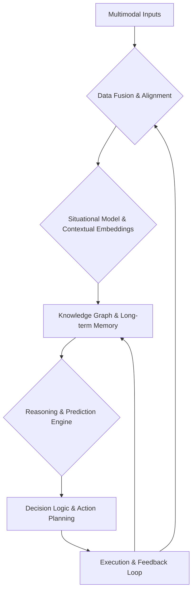

멀티모달 AI 에이전트가 2026년 실제 서비스에서 핵심 가치를 제공하기 위해서는 탁월한 상황 인지(Situational Awareness) 능력과 정교한 의사결정 로직이 필수적입니다. 단순히 여러 데이터를 수집하는 것을 넘어, 이를 통합하여 의미 있는 맥락을 구축하고 복잡한 환경에서 최적의 행동을 선택하는 디자인 패턴은 에이전트의 자율성과 효율성을 극대화합니다. 본 문서는 멀티모달 에이전트의 상황 인지 및 의사결정 로직을 설계하는 데 필요한 핵심 개념과 실용적인 접근 방식을 제시합니다.

## Multimodal Input Processing & Contextual Understanding
멀티모달 에이전트의 상황 인지는 텍스트, 음성, 이미지, 비디오, 센서 데이터 등 다양한 소스에서 입력되는 데이터를 효과적으로 처리하고 통합하는 것에서 시작됩니다. 이질적인 데이터 스트림을 단일의 일관된 '상황 모델 (Situational Model)'로 변환하는 과정은 정보 과부하를 줄이고 에이전트가 환경에 대한 포괄적인 이해를 갖도록 돕습니다.

### 데이터 융합 및 정규화 (Data Fusion & Normalization)
각기 다른 모달리티의 데이터는 고유한 특징과 형식을 가집니다. 이를 효과적으로 활용하기 위해선 데이터 융합(Data Fusion) 기법이 중요합니다. 초기 단계에서 원시 데이터를 표준화된 형식으로 변환하고, 시간적/공간적 정렬을 통해 동기화합니다. 예를 들어, 자율주행 에이전트의 경우 카메라 영상, LiDAR 포인트 클라우드, 레이더 신호가 각기 다른 주기로 수집되지만, 이를 특정 시점의 단일 '장면 (Scene)'으로 구성해야 합니다.

### 지식 그래프 통합 (Knowledge Graph Integration)
상황 모델은 단순히 현재의 감각 데이터만을 포함하지 않고, 과거의 경험, 도메인 지식, 상식 등을 통합해야 합니다. 지식 그래프(Knowledge Graph)는 이러한 구조화된 정보를 에이전트의 상황 인지에 통합하는 강력한 메커니즘을 제공합니다. 이는 에이전트가 관찰된 사실로부터 추론하고, 숨겨진 관계를 발견하며, 복잡한 시나리오를 이해하는 데 필수적입니다. 예를 들어, '사람이 손을 들고 있다'는 시각 정보와 '횡단보도 근처'라는 지도 정보를 지식 그래프로 연결하여 '길을 건너려고 한다'는 의도를 추론할 수 있습니다.



## 의사결정 로직 디자인 (Decision Logic Design)
상황 인지를 바탕으로 에이전트는 목표 달성을 위한 최적의 행동을 결정해야 합니다. 이는 단순히 규칙 기반의 시스템을 넘어, 불확실성 하에서 유연하게 적응하고 복잡한 목표를 계층적으로 해결하는 능력을 요구합니다.

### 계층적 계획 (Hierarchical Planning)
복잡한 미션은 여러 하위 목표로 분해될 수 있습니다. 계층적 계획(Hierarchical Planning)은 상위 레벨의 추상적인 목표를 하위 레벨의 구체적인 행동 시퀀스로 변환하는 방식입니다. 예를 들어, '물건 가져오기'라는 상위 목표는 '문 열기' -> '복도 이동' -> '물건 식별' -> '물건 집기'와 같은 일련의 하위 목표로 구성됩니다. 각 계층의 의사결정은 해당 레벨의 상황 인지에 기반하며, 상위 목표의 제약을 받습니다.

### 확률적 추론 및 불확실성 관리 (Probabilistic Reasoning & Uncertainty Management)
현실 세계의 정보는 항상 불완실하고 노이즈가 많습니다. 에이전트의 의사결정 로직은 이러한 불확실성을 명시적으로 모델링하고 관리해야 합니다. 베이즈 네트워크(Bayesian Networks), 칼만 필터(Kalman Filters), 파티클 필터(Particle Filters)와 같은 확률적 추론 기법은 센서 노이즈, 예측 불가능한 환경 변화 등을 고려하여 더욱 견고한 의사결정을 가능하게 합니다. 에이전트는 각 행동의 예상 결과와 그 확률을 평가하여 가장 높은 기대 가치를 가진 행동을 선택합니다.

### 툴 사용 및 행동 기반화 (Tool Use & Action Grounding)
멀티모달 에이전트의 의사결정은 추상적인 계획을 넘어 실제 환경과 상호작용하는 구체적인 행동으로 귀결됩니다. 이는 로봇 팔 제어, 웹 API 호출, 사용자 인터페이스 조작 등 다양한 '툴 (Tools)'의 활용을 포함합니다. 의사결정 로직은 현재 상황과 목표에 가장 적합한 툴을 동적으로 선택하고, 툴의 사용 결과를 다시 상황 인지 시스템에 피드백하여 다음 의사결정에 반영해야 합니다. 툴 사용의 성공 여부, 발생한 오류 등을 학습하여 미래의 툴 선택을 최적화하는 메커니즘도 중요합니다.

```python
import numpy as np

class MultimodalAgentDecisionLogic:
    def __init__(self, knowledge_graph):
        self.knowledge_graph = knowledge_graph
        self.situational_model = {} # 통합된 상황 모델
        self.current_goal = None
        self.available_tools = ["pick_up", "navigate", "open_door", "identify_object"]

    def update_situational_model(self, multimodal_data):
        # 2026 트렌드: VLM (Vision-Language Model)을 활용한 정제된 상황 인지
        text_context = self._process_text(multimodal_data.get("text"))
        image_context = self._process_image(multimodal_data.get("image"))
        audio_context = self._process_audio(multimodal_data.get("audio"))
        sensor_context = self._process_sensors(multimodal_data.get("sensors"))

        # 모든 모달리티를 통합하여 상황 모델 업데이트 (예: Contextual Embeddings)
        # 실제로는 복잡한 Transformer, Fusion Network 등이 사용됨
        integrated_context = self._fuse_contexts(text_context, image_context, audio_context, sensor_context)

        # 지식 그래프와 연동하여 추론 및 상황 강화
        self.situational_model = self._infer_from_knowledge_graph(integrated_context)
        print("Updated Situational Model:", self.situational_model)

    def _process_text(self, text):
        if text: return f"Text processed: {text.lower()}"
        return ""

    def _process_image(self, image_data):
        # Image data 처리 로직 (예: 객체 인식, 장면 이해)
        if image_data: return f"Image processed: Detected {len(image_data.get('objects', []))} objects."
        return ""

    def _process_audio(self, audio_data):
        # Audio data 처리 로직 (예: 음성 인식, 환경 소리 분석)
        if audio_data: return f"Audio processed: Speech detected: {audio_data.get('speech', 'No')}"
        return ""

    def _process_sensors(self, sensor_data):
        # Sensor data 처리 로직 (예: 위치, 온도, 거리)
        if sensor_data: return f"Sensor processed: Position {sensor_data.get('position', 'unknown')}"
        return ""

    def _fuse_contexts(self, *contexts):
        # 실제로는 attention, cross-modal transformer 등으로 복잡하게 융합
        return " ".join(filter(None, contexts))

    def _infer_from_knowledge_graph(self, integrated_context):
        # 지식 그래프를 활용한 추론 (가정: 통합된 컨텍스트에서 '물건'과 '위치' 식별)
        # 이 부분은 실제 Knowledge Graph Query Language (e.g., SPARQL) 또는 Graph Neural Network로 구현됨
        if "box" in integrated_context and "table" in integrated_context:
            return {"object": "box", "location": "on table", "intent_inference": "object_retrieval_possible"}
        return {"status": "observing", "intent_inference": "none"}


    def decide_action(self):
        if not self.current_goal:
            return "No specific goal, standing by."

        # 계층적 계획의 예시: 현재 목표와 상황 모델에 따라 하위 액션 선택
        if self.current_goal == "get_box":
            if self.situational_model.get("object") == "box" and self.situational_model.get("location") == "on table":
                if "pick_up" in self.available_tools:
                    return {"action": "pick_up", "target": "box"}
                else:
                    return "Tool 'pick_up' not available."
            elif "table" in self.situational_model.get("intent_inference", ""): # 간략화된 추론 예시
                 if "navigate" in self.available_tools:
                     return {"action": "navigate", "target": "table"}
            else:
                return "Waiting for better situational context for 'get_box'."
        return "Goal not recognized or no action decided."

# Example Usage
# dummy_knowledge_graph = {"box_properties": {"weight": "light"}, "table_properties": {"surface": "flat"}}
# agent = MultimodalAgentDecisionLogic(dummy_knowledge_graph)
#
# agent.current_goal = "get_box"
#
# # 1단계: 주변을 관찰 (이미지, 텍스트 입력)
# multimodal_data_step1 = {
#     "image": {"objects": ["chair", "table"], "scene": "room"},
#     "text": "There is a table in the room.",
#     "sensors": {"position": "near door"}
# }
# agent.update_situational_model(multimodal_data_step1)
# print("Action:", agent.decide_action())
#
# # 2단계: 테이블 근처로 이동 후 박스 발견 (이미지, 텍스트, 센서 입력)
# multimodal_data_step2 = {
#     "image": {"objects": ["chair", "table", "box"], "scene": "on_table_view"},
#     "text": "A small box is on the table.",
#     "sensors": {"position": "at table"}
# }
# agent.update_situational_model(multimodal_data_step2)
# print("Action:", agent.decide_action())
```

## 트레이드오프 (Trade-offs)

멀티모달 AI 에이전트의 상황 인지 및 의사결정 로직을 설계할 때는 여러 트레이드오프를 고려해야 합니다.

*   **정교한 상황 모델 vs. 실시간 성능 (Sophisticated Situational Model vs. Real-time Performance)**
    *   **언제 좋은가 (When Good)**: 고도로 복잡한 환경에서 미묘한 뉘앙스를 이해하고 정확한 의사결정을 내려야 할 때 (예: 의료 진단, 고위험 자율 시스템). 풍부한 컨텍스트와 심층적인 추론은 정확도를 높입니다.
    *   **언제 나쁜가 (When Bad)**: 빠른 반응 속도가 필수적인 애플리케이션 (예: 게임 AI, 실시간 로봇 제어). 복잡한 모델은 처리 지연(latency)을 유발하여 시스템의 민첩성을 저해할 수 있습니다.

*   **데이터 통합 범위 vs. 시스템 복잡성 (Data Integration Scope vs. System Complexity)**
    *   **언제 좋은가 (When Good)**: 다양한 모달리티의 데이터를 최대한 활용하여 포괄적인 이해를 얻고자 할 때 (예: 감성 AI, 인간-로봇 상호작용). 더 많은 정보는 더 강력한 추론 기반을 제공합니다.
    *   **언제 나쁜가 (When Bad)**: 개발 및 유지보수 비용, 통합 난이도가 중요한 제약 조건이 될 때. 데이터 소스가 많아질수록 데이터 정규화, 동기화, 오류 처리 등이 복잡해지고 시스템의 취약점이 증가할 수 있습니다.

*   **규칙 기반 결정 vs. 학습 기반 결정 (Rule-based Decisions vs. Learning-based Decisions)**
    *   **언제 좋은가 (When Good)**:
        *   **규칙 기반**: 안전이 중요하거나 예측 가능한 시나리오에서 명확하고 감사 가능한(auditable) 행동이 필요할 때. 초기 시스템 개발 및 디버깅에 용이합니다.
        *   **학습 기반**: 환경이 동적이고 예측 불가능하며, 에이전트가 새로운 상황에 적응하고 스스로 성능을 개선해야 할 때 (예: 강화 학습).
    *   **언제 나쁜가 (When Bad)**:
        *   **규칙 기반**: 복잡하거나 새로운 시나리오에 대한 유연성이 부족하여 '에지 케이스 (edge cases)'에 취약할 수 있습니다.
        *   **학습 기반**: 데이터 수집 비용이 높거나, 학습 과정이 불투명하여 의사결정의 '설명 가능성 (explainability)'이 낮을 수 있습니다. 안전이 중요한 영역에서는 블랙박스 모델이 위험합니다.

## 실전 체크리스트 (Practical Checklist)

멀티모달 AI 에이전트의 상황 인지 및 의사결정 로직을 프로젝트에 적용하기 위한 실전 체크리스트입니다.

- [x] **멀티모달 데이터 수집 및 정규화 파이프라인 설계**: 텍스트, 이미지, 음성, 센서 데이터 등 각 모달리티의 데이터 스트림이 일관된 형식으로 수집되고 시간적으로 동기화되는지 검증했습니다.
- [x] **상황 모델의 컨텍스트 충실도 평가**: 에이전트가 이해하는 '상황 모델'이 실제 환경의 중요한 정보를 얼마나 정확하고 풍부하게 반영하는지 정량적 지표(예: 정보 엔트로피, 핵심 개체 인식률)로 평가했습니다.
- [x] **지식 그래프 통합 및 추론 메커니즘 검증**: 도메인 지식, 상식, 과거 경험이 지식 그래프 형태로 통합되어 에이전트의 추론 능력을 향상시키는지, 추론의 정확성과 효율성을 검증했습니다.
- [x] **의사결정 로직의 목표 일치성 및 제약 조건 준수 확인**: 에이전트가 선택하는 행동이 상위 목표와 일치하며, 안전, 윤리 등 모든 정의된 제약 조건을 준수하는지 시뮬레이션 및 실제 환경에서 테스트했습니다.
- [x] **불확실성 관리 및 강건성 테스트**: 노이즈가 많거나 불완전한 입력 데이터에 대해 에이전트의 의사결정 로직이 얼마나 강건하게 작동하는지, 오작동 발생 시 적절히 완화하는지 테스트했습니다.
- [x] **툴 사용의 성공률 및 오류 처리 메커니즘 최적화**: 에이전트가 동적으로 툴을 선택하고 사용하는 성공률을 모니터링하고, 툴 사용 중 발생하는 오류를 감지하고 복구하는 메커니즘을 구축 및 최적화했습니다.
- [x] **피드백 루프를 통한 자율 학습 및 개선 구현**: 에이전트의 행동 결과(성공/실패)가 상황 모델 및 의사결정 로직의 개선을 위한 피드백으로 활용되는 자율 학습 루프가 효과적으로 동작하는지 확인했습니다.