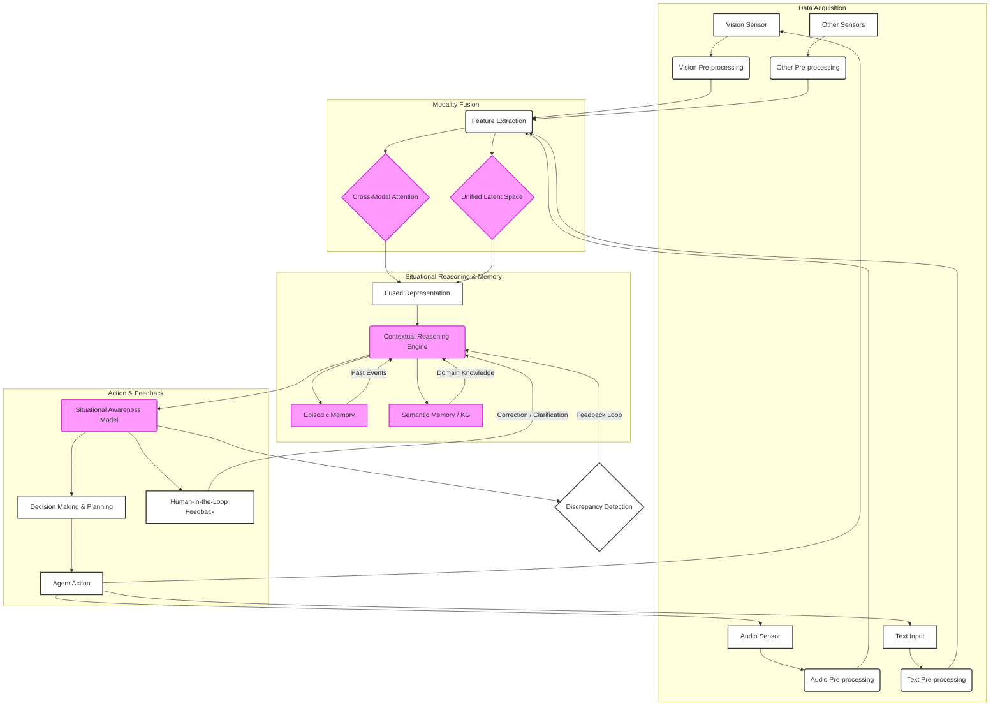

멀티모달 AI 에이전트가 복잡한 실제 환경에서 신뢰성과 유용성을 갖추려면 탁월한 상황 인식 (Situational Awareness) 능력이 필수적입니다. 단순히 여러 감각 모달리티 (Modality)로부터 데이터를 수집하는 것을 넘어, 이 정보를 통합하고 해석하여 주변 환경의 의미를 정확하게 이해하고 미래 상태를 예측하는 것이 핵심입니다. 현재 많은 AI 에이전트는 제한적인 컨텍스트 내에서 작동하며, 동적인 실제 환경의 미묘한 변화나 예상치 못한 상황에 취약합니다. 이러한 갭을 해소하기 위해 멀티모달 AI 에이전트의 상황 인식 능력을 체계적으로 향상시키는 방법론을 모색해야 합니다.

## Foundational Concepts
상황 인식은 크게 세 가지 수준으로 나눌 수 있습니다:
1.  **지각 (Perception)**: 개별적인 정보 요소 (Perceptual Cues)를 감지하고 인식하는 단계입니다. 멀티모달 에이전트의 경우, 이는 이미지, 비디오, 오디오, 텍스트, 센서 데이터 등 다양한 모달리티로부터 데이터를 수집하고 초기 특징을 추출하는 것을 의미합니다.
2.  **이해 (Comprehension)**: 지각된 정보 요소들을 통합하고, 이들 간의 관계를 파악하여 전체적인 상황의 의미를 이해하는 단계입니다. 예를 들어, 특정 객체가 어디에 있고, 어떤 행동을 하고 있으며, 주변 환경과 어떻게 상호작용하는지 파악합니다.
3.  **예측 (Projection)**: 현재 이해한 상황을 기반으로 미래에 어떤 일이 일어날지 예측하는 단계입니다. 이는 에이전트의 다음 행동을 계획하고 잠재적인 위험이나 기회를 식별하는 데 결정적인 역할을 합니다.

멀티모달 에이전트에게 있어 이러한 수준의 상황 인식을 달성하는 것은 각 모달리티의 강점을 최대한 활용하고 약점을 보완하는 '모달리티 융합 (Modality Fusion)' 전략에 크게 의존합니다.

## Enhancement Strategies

### 1. 고급 센서 융합 및 표현 (Advanced Sensor Fusion and Representation)
단순한 데이터 결합을 넘어, 의미론적 수준의 융합이 중요합니다. Vision-Language Models (VLM)과 같은 파운데이션 모델은 이미지와 텍스트 간의 복잡한 관계를 이해하여 객체 인식, 장면 해석, 행위 예측을 더 정확하게 수행합니다.
*   **Cross-Modal Attention Mechanisms**: 서로 다른 모달리티에서 추출된 특징 벡터 (Feature Vectors) 간의 주의 메커니즘을 적용하여 특정 모달리티가 다른 모달리티의 해석에 미치는 영향을 조절합니다.
*   **Unified Latent Space Representation**: 다양한 모달리티 데이터를 하나의 의미론적 잠재 공간 (Latent Space)에 매핑하여 일관된 표현을 생성하고, 이를 통해 효율적인 추론을 가능하게 합니다.

### 2. 컨텍스트 추론 및 지식 그래프 통합 (Contextual Reasoning and Knowledge Graph Integration)
에이전트가 단기적인 인식을 넘어 장기적이고 추상적인 컨텍스트를 이해하도록 돕습니다.
*   **External Knowledge Base / Knowledge Graphs (KG)**: 도메인 특정 지식, 상식, 과거 사건 등을 지식 그래프 형태로 에이전트에 주입하여 추론 능력을 강화합니다. 예를 들어, '비'가 온다는 오디오 정보와 '창밖 풍경' 비디오 정보를 통해 '우산'이 필요하다는 지식을 추론할 수 있습니다.
*   **Temporal Context Management**: 과거의 행동, 관찰, 결정 이력을 관리하는 타임스탬프 기반 메모리 시스템을 구축하여 시간의 흐름에 따른 상황 변화를 추적하고 예측합니다. `agents/ai-agent-global-context-gc-tree-integration` 참조.

### 3. 동적 메모리 시스템 (Dynamic Memory Systems)
에이전트가 복잡한 환경에서 지속적으로 학습하고 적응하도록 돕습니다.
*   **Episodic Memory**: 특정 시공간에서 발생한 사건에 대한 상세한 기록 (예: "2026년 5월 1일 10시, 사무실에서 커피 컵을 떨어뜨렸다"). 단기적인 계획과 상황 인식을 위한 'Working Memory' 역할을 합니다.
*   **Semantic Memory**: 일반화된 사실, 개념, 규칙에 대한 지식 (예: "커피 컵은 깨지기 쉽다", "액체는 엎질러진다"). 장기적인 의사결정과 문제 해결에 활용됩니다.
*   **Retrieval-Augmented Generation (RAG)**: 에이전트의 현재 컨텍스트와 가장 관련성 높은 정보를 동적으로 검색하여 추론에 활용하는 방식입니다. `agents/ai-agent-rag-integration-hallucination-reduction` 패턴을 멀티모달 컨텍스트에 적용합니다.

### 4. 자기 수정 및 반성 루프 (Self-Correction and Reflection Loops)
에이전트가 자신의 인식을 검증하고 오류를 수정하며, 새로운 경험을 통해 학습하는 메커니즘을 포함합니다.
*   **Discrepancy Detection**: 에이전트의 예측과 실제 관찰 사이의 불일치를 식별합니다. 예를 들어, '차가 우회전할 것'이라고 예측했으나 실제로는 '직진'했을 경우, 이 불일치를 감지합니다.
*   **Retrospection & Re-planning**: 불일치 발생 시, 과거의 판단 과정을 반성 (Retrospection)하고, 상황 인식을 업데이트하여 행동 계획을 재조정합니다. `agents/agent-self-correction-retrospection-loop-implementation`의 멀티모달 확장.

### 5. Human-in-the-Loop 피드백 (Human-in-the-Loop Feedback)
초기 배치 후 에이전트의 상황 인식을 지속적으로 개선하기 위한 인간의 개입을 설계합니다.
*   **Clarification Queries**: 에이전트가 불확실한 상황에 직면했을 때, 사람에게 추가 정보를 요청하는 능력을 포함합니다.
*   **Expert Oversight & Correction**: 사람 전문가가 에이전트의 상황 인식 오류를 식별하고 직접 수정하여 모델의 지속적인 Fine-tuning 또는 Reinforcement Learning from Human Feedback (RLHF)에 활용합니다.

## 코드 예제: 멀티모달 컨텍스트 업데이트 시뮬레이션 (Python)

아래 Python 코드는 가상의 멀티모달 에이전트가 텍스트, 비전, 오디오 정보를 받아 상황 인식을 업데이트하는 과정을 시뮬레이션합니다. 각 모달리티에서 추출된 정보가 컨텍스트 맵에 통합되고, 모순이 발생하면 플래그를 설정합니다.

```python
import time

class MultimodalAgentContext:
    def __init__(self):
        self.context_map = {
            "environment": {},
            "objects": {},
            "agents": {},
            "intent": {},
            "temporal_events": []
        }
        self.situational_awareness_score = 0.5
        self.contradiction_detected = False

    def update_text_context(self, text_data: str):
        print(f"[{time.time():.2f}] Processing text: '{text_data}'")
        if "traffic jam" in text_data:
            self.context_map["environment"]["traffic_status"] = "heavy"
            self.context_map["intent"]["action_suggested"] = "re-route"
            self.situational_awareness_score += 0.1
        if "delivery van" in text_data:
            self.context_map["objects"]["delivery_van_present"] = True
            self.situational_awareness_score += 0.05
        
        self._add_temporal_event(f"Text update: {text_data}")
        self._check_consistency()

    def update_vision_context(self, vision_data: dict):
        print(f"[{time.time():.2f}] Processing vision: {vision_data}")
        if vision_data.get("object_count", 0) > 10 and vision_data.get("area_density", 0) > 0.7:
            self.context_map["environment"]["crowded_area"] = True
            self.situational_awareness_score += 0.15
        if "delivery_van" in vision_data.get("identified_objects", []):
            self.context_map["objects"]["delivery_van_present"] = True
        
        self._add_temporal_event(f"Vision update: {vision_data}")
        self._check_consistency()

    def update_audio_context(self, audio_data: str):
        print(f"[{time.time():.2f}] Processing audio: '{audio_data}'")
        if "siren" in audio_data:
            self.context_map["environment"]["emergency_vehicle_nearby"] = True
            self.context_map["intent"]["action_suggested"] = "yield"
            self.situational_awareness_score += 0.2
        if "heavy traffic noise" in audio_data and self.context_map["environment"].get("traffic_status") != "heavy":
            print("Warning: Audio suggests heavy traffic, but text context did not. Potential inconsistency.")
            self.contradiction_detected = True
            self.situational_awareness_score -= 0.1 # Penalty for inconsistency
        
        self._add_temporal_event(f"Audio update: {audio_data}")
        self._check_consistency()

    def _add_temporal_event(self, event_description: str):
        self.context_map["temporal_events"].append({
            "timestamp": time.time(),
            "event": event_description
        })
        # Keep recent events only to manage memory
        self.context_map["temporal_events"] = self.context_map["temporal_events"][-10:]

    def _check_consistency(self):
        # Example consistency check: if traffic_status is heavy AND crowded_area is True, but no delivery van.
        # This is a placeholder for more complex logic.
        if (self.context_map["environment"].get("traffic_status") == "heavy" and
            self.context_map["environment"].get("crowded_area") == True and
            self.context_map["objects"].get("delivery_van_present") == False):
            # This is a simplified check for demonstration
            pass
            # print("Potential high-traffic, crowded area, but no delivery van detected. Re-evaluating.")

    def get_current_situational_awareness(self):
        return {
            "context": self.context_map,
            "awareness_score": self.situational_awareness_score,
            "contradiction_detected": self.contradiction_detected
        }

# 시뮬레이션 실행
agent = MultimodalAgentContext()
print("Initial awareness:", agent.get_current_situational_awareness()["awareness_score"])

agent.update_text_context("There is a heavy traffic jam on the main road.")
agent.update_vision_context({"object_count": 15, "area_density": 0.8, "identified_objects": ["car", "bus"]})
agent.update_audio_context("I hear distant sirens and heavy traffic noise.")
agent.update_text_context("A delivery van just passed by slowly.")
agent.update_vision_context({"object_count": 18, "area_density": 0.85, "identified_objects": ["car", "bus", "delivery_van"]})
agent.update_audio_context("Siren sounds are getting closer.")

final_awareness = agent.get_current_situational_awareness()
print("\nFinal Situational Awareness:")
print(f"  Context: {final_awareness['context']}")
print(f"  Score: {final_awareness['awareness_score']:.2f}")
print(f"  Contradiction: {final_awareness['contradiction_detected']}")

```

**Mermaid Diagram: 멀티모달 에이전트 상황 인식 아키텍처**



## 2026년 최신 트렌드 반영
2026년에는 멀티모달 AI 에이전트의 상황 인식 능력 향상에 있어 다음과 같은 트렌드가 두드러질 것입니다:
*   **Foundation Models의 Edge Deployment**: 클라우드 기반의 대규모 멀티모달 모델들이 경량화되어 온디바이스 (On-Device) 환경에서 실시간 상황 인식을 제공하는 사례가 늘어날 것입니다. 이는 자율주행, 로봇 공학, 웨어러블 AI 등 낮은 지연 시간 (Low-Latency)이 필수적인 영역에서 중요한 진전을 가져올 것입니다. `android-ai/on-device-llm-optimization-android-strategies`와 같은 최적화 기술이 멀티모달 에이전트에도 확장 적용됩니다.
*   **Explainable AI (XAI) for Situational Awareness**: 에이전트가 어떤 모달리티의 어떤 정보를 기반으로 현재 상황을 인식하고 예측했는지 인간이 이해할 수 있도록 설명하는 XAI 기술의 중요성이 더욱 커질 것입니다. 이는 에이전트의 신뢰성을 높이고 디버깅을 용이하게 합니다.
*   **Embodied AI and Continuous Learning**: 물리적 환경과 상호작용하는 Embodied AI 에이전트가 늘어나면서, 실제 경험을 통해 상황 인식을 끊임없이 업데이트하고 개선하는 Continuous Learning 패러다임이 보편화될 것입니다.

## 트레이드오프

멀티모달 AI 에이전트의 상황 인식 능력 향상은 중요한 이점을 제공하지만, 동시에 여러 트레이드오프를 수반합니다.

*   **데이터 볼륨 및 처리 지연 시간 (Data Volume vs. Latency)**
    *   **언제 좋은가**: 더 많은 모달리티 (Multi-Modality)와 풍부한 컨텍스트 (Rich Context)를 통합할수록 상황 인식의 정확성과 깊이가 향상됩니다. 이는 복잡하고 미묘한 환경 변화를 포착하는 데 필수적입니다.
    *   **언제 나쁜가**: 데이터 볼륨이 증가하고 복잡한 융합 및 추론 과정이 추가될수록, 실시간 반응이 필요한 환경 (예: 자율주행)에서는 처리 지연 시간 (Latency)이 크게 늘어나 에이전트의 즉각적인 대응 능력을 저해할 수 있습니다. `harness-engineering/realtime-llm-latency-optimization-patterns`과 같은 최적화가 필요합니다.

*   **연산 비용 및 에너지 효율성 (Computational Cost vs. Accuracy)**
    *   **언제 좋은가**: 정교한 신경망 모델과 복잡한 추론 알고리즘을 사용하여 상황 인식을 수행하면, 미세한 패턴까지 학습하여 정확도를 극대화할 수 있습니다.
    *   **언제 나쁜가**: 고도의 연산은 GPU와 같은 고성능 하드웨어를 요구하며, 이는 높은 연산 비용과 에너지 소비로 이어집니다. 제한된 자원 (Resource-Constrained) 환경이나 대규모 배포 시에는 효율성 문제에 직면할 수 있습니다.

*   **통합 복잡성 및 개발 노력 (Integration Complexity vs. Robustness)**
    *   **언제 좋은가**: 다양한 모달리티 센서와 외부 지식 시스템 (External Knowledge Systems)을 통합하면 에이전트의 상황 인식이 더 견고 (Robust)하고 포괄적이게 됩니다. 단일 모달리티의 실패나 노이즈에 강해집니다.
    *   **언제 나쁜가**: 여러 이질적인 데이터 소스와 모델을 통합하는 과정은 상당한 개발 복잡성과 엔지니어링 노력을 요구합니다. 시스템의 유지보수 (Maintenance) 및 디버깅 (Debugging) 비용이 증가할 수 있습니다.

*   **외부 지식 의존성 및 적응성 (External Knowledge Dependency vs. Adaptability)**
    *   **언제 좋은가**: 지식 그래프나 외부 데이터베이스와 같은 구조화된 지식을 활용하면 에이전트가 사전 정의된 도메인 내에서 깊이 있는 추론을 수행할 수 있습니다.
    *   **언제 나쁜가**: 너무 많은 외부 지식에 의존하면, 에이전트가 새로운 환경이나 예상치 못한 시나리오에 직면했을 때 빠르게 적응 (Adapt)하거나 창발적인 (Emergent) 행동을 보이는 능력이 저해될 수 있습니다. 지식의 최신성 (Freshness) 관리도 중요합니다.

## 실전 체크리스트

멀티모달 AI 에이전트의 상황 인식 능력을 실제 프로젝트에 적용하기 위한 검증 및 구현 체크리스트입니다.

*   - [ ] **모달리티 정의 및 융합 전략 수립**: 프로젝트의 목표와 환경에 적합한 핵심 모달리티 (예: Vision, Audio, Text, Lidar)를 정의하고, 각 모달리티 데이터의 획득, 전처리 및 융합 (Early, Late, Hybrid Fusion) 방식을 명확히 설계했는가?
*   - [ ] **컨텍스트 표현 및 관리 시스템 구축**: 에이전트가 이해해야 할 컨텍스트의 범위 (Spatial, Temporal, Semantic)를 정의하고, 이를 효율적으로 저장하고 업데이트하며 검색할 수 있는 데이터 구조 (예: Knowledge Graph, Contextual Map)를 구현했는가? `context-engineering/ai-agent-context-management-project-memory` 참조.
*   - [ ] **동적 메모리 시스템 설계**: 에이전트의 단기 (Episodic) 및 장기 (Semantic) 메모리 메커니즘을 설계하고, 관련성 높은 정보를 자동으로 검색하여 현재 추론에 활용하는 `RAG` (Retrieval-Augmented Generation) 패턴을 적용했는가?
*   - [ ] **일관성 검증 및 불일치 감지 메커니즘 구현**: 다양한 모달리티로부터 들어오는 정보들 간의 잠재적 모순이나 불일치 (Inconsistency)를 감지하고, 이를 에이전트의 상황 인식 업데이트 및 자기 수정 루프에 반영하는 로직을 구현했는가?
*   - [ ] **반성 및 자기 수정 루프 통합**: 에이전트의 예측과 실제 결과 간의 차이 (Discrepancy)를 분석하고, 이를 통해 상황 인식을 개선하거나 행동 계획을 재조정하는 `Self-Correction` 및 `Retrospection` 루프를 시스템 아키텍처에 통합했는가? `agents/agent-self-correction-retrospection-loop-implementation` 참조.
*   - [ ] **Human-in-the-Loop 피드백 채널 확보**: 에이전트가 불확실한 상황에서 사람에게 질의하거나, 사람 전문가가 에이전트의 상황 인식 오류를 교정할 수 있는 인터페이스 및 피드백 루프 (Feedback Loop)를 설계하고 구현했는가?
*   - [ ] **실시간 성능 및 자원 효율성 최적화**: 멀티모달 데이터 처리 및 추론 과정의 Latency를 측정하고, `On-Device` 추론, 모델 경량화 (`Quantization`), 비동기 처리 (Asynchronous Processing) 등의 기법을 통해 실시간 요구사항과 자원 제약을 충족하는지 검증했는가?