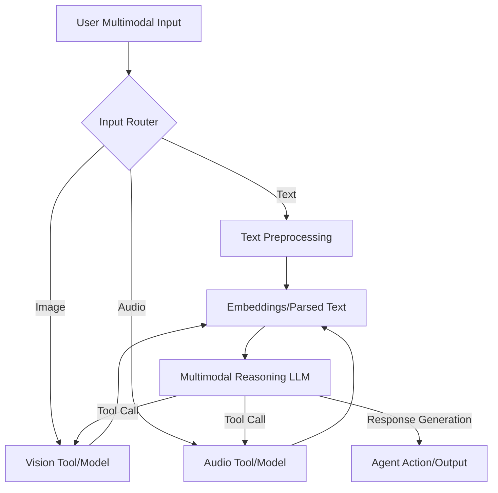

The integration of multimodal capabilities into LLM-based agents is rapidly becoming a cornerstone for tackling the increasingly complex and nuanced problems encountered in real-world scenarios. While large language models excel at processing textual information, the real world is inherently multimodal, requiring perception and reasoning across various data types such as images, audio, video, and structured data. This document outlines key methods and architectural considerations for empowering agents with such diverse information processing abilities.

## Core Concepts of Multimodal Agent Integration

An effective multimodal agent typically operates through an extended perception-reasoning-action loop, where the perception layer is significantly enriched.

### Enriched Perception Layer
The agent must be equipped to receive and interpret inputs from multiple modalities. This involves:
*   **Vision**: Image recognition, object detection, OCR (Optical Character Recognition), video analysis.
*   **Audio**: Speech-to-text, sound event detection, speaker identification, emotion analysis.
*   **Structured Data**: Database queries, API responses, sensor readings.
*   **Text**: Traditional natural language understanding, document parsing.

Each modality often requires specialized pre-processing or dedicated foundation models to extract meaningful features or convert them into a format digestible by the core LLM.

### Reasoning and Integration Layer
This is where the LLM integrates the insights from various modalities to form a coherent understanding of the situation and generate a plan.
*   **Feature Fusion**: Combine embeddings or parsed information from different modalities. This can happen at the input level (e.g., concatenating image captions with text queries) or at a deeper semantic level.
*   **Cross-Modal Reasoning**: The LLM uses its learned world knowledge to infer relationships and make decisions based on disparate multimodal clues. For instance, correlating a visual cue with an audio event.
*   **Contextualization**: Maintain a comprehensive understanding of the task by continuously updating the agent's memory with multimodal observations and generated insights.

### Action Layer
Based on its reasoning, the agent performs actions, which might also be multimodal (e.g., generating an image, synthesizing speech, or executing a code command).

## Multimodal Integration Patterns

Several patterns exist for incorporating multimodal intelligence into LLM agents.

### 1. Pre-trained Multimodal LLMs (Native Multimodality)
The most direct approach is to utilize LLMs that are inherently trained on multimodal datasets (e.g., Gemini, GPT-4o, Claude 3 family). These models can natively accept image, text, and sometimes audio inputs, performing cross-modal reasoning within a single architecture.

**Pros**: Seamless integration, often superior cross-modal reasoning, simpler architecture.
**Cons**: Less control over specific modality processing, dependency on large commercial models, potentially higher inference costs.

### 2. Tool-Use with Specialized Models (External Multimodality)
Agents can leverage external tools, each specialized in processing a particular modality. The LLM acts as an orchestrator, deciding which tool to use, feeding it input, and interpreting its output.

**Example Tools**:
*   **Vision APIs**: Google Cloud Vision API, Azure Cognitive Services, custom YOLO/CLIP models.
*   **Audio Processing Libraries**: Speech-to-text (Whisper, Google Speech-to-Text), sound analysis frameworks.
*   **Document Parsers**: OCR engines, PDF parsers.

**Workflow**: The agent receives a multimodal prompt (e.g., "Analyze this image and describe the objects, then summarize the accompanying text"). The LLM determines it needs a vision tool for the image and processes the text itself, then combines the results.

```python
# Python-like pseudocode for a multimodal agent using tools

class MultimodalAgent:
    def __init__(self, llm_client, vision_tool, audio_tool):
        self.llm = llm_client
        self.vision_tool = vision_tool
        self.audio_tool = audio_tool
        self.memory = []

    def process_request(self, text_input, image_bytes=None, audio_bytes=None):
        context = {"text": text_input}

        if image_bytes:
            print("Calling Vision Tool...")
            vision_output = self.vision_tool.analyze_image(image_bytes)
            context["image_description"] = vision_output
            print(f"Vision Tool Output: {vision_output[:50]}...")

        if audio_bytes:
            print("Calling Audio Tool (Speech-to-Text)...")
            audio_text = self.audio_tool.transcribe(audio_bytes)
            context["audio_transcript"] = audio_text
            print(f"Audio Tool Output: {audio_text[:50]}...")

        # Formulate prompt for the LLM
        prompt = (
            "You are an intelligent assistant capable of understanding multimodal information."
            "Here is the current context:\n"
            f"Text input: {context['text']}\n"
        )
        if "image_description" in context:
            prompt += f"Image analysis: {context['image_description']}\n"
        if "audio_transcript" in context:
            prompt += f"Audio transcript: {context['audio_transcript']}\n"
        
        prompt += "Based on this information, provide a comprehensive response."

        print("Calling LLM for reasoning...")
        llm_response = self.llm.generate_response(prompt, self.memory)
        self.memory.append({"role": "user", "content": prompt})
        self.memory.append({"role": "agent", "content": llm_response})
        
        return llm_response

# Dummy Tool Implementations
class DummyVisionTool:
    def analyze_image(self, image_data):
        return f"Detected objects: laptop, coffee cup, desk (from {len(image_data)} bytes)"

class DummyAudioTool:
    def transcribe(self, audio_data):
        return f"Transcription: 'Hello, how are you today?' (from {len(audio_data)} bytes)"

class DummyLLMClient:
    def generate_response(self, prompt, memory):
        print(f"LLM Prompt (truncated): {prompt[:200]}...")
        # Simple mock response
        if "laptop" in prompt and "Hello" in prompt:
            return "The image shows a laptop and a coffee cup on a desk. The audio transcript says 'Hello, how are you today?'. Combining these, it seems someone is working and greeting you."
        return "Understood the multimodal inputs and processing."

# Example Usage
llm_client = DummyLLMClient()
vision_tool = DummyVisionTool()
audio_tool = DummyAudioTool()

agent = MultimodalAgent(llm_client, vision_tool, audio_tool)

# Simulate inputs
text_input_query = "What's happening in this scene?"
dummy_image_data = b"fake_image_bytes_here"
dummy_audio_data = b"fake_audio_bytes_here"

response = agent.process_request(
    text_input_query, 
    image_bytes=dummy_image_data, 
    audio_bytes=dummy_audio_data
)
print(f"Agent's Final Response: {response}")

```

### 3. Embedding Fusion and Projection
For custom multimodal understanding, embeddings from different modalities (e.g., image embeddings from CLIP, audio embeddings from Wav2Vec, text embeddings from a specialized text encoder) can be fused. These fused embeddings are then projected into a shared semantic space or directly fed into the LLM if it supports custom embedding inputs, or used for retrieval augmented generation (RAG).

**Pros**: Fine-grained control, potential for niche domain expertise, reduced dependency on a single model.
**Cons**: High complexity in design and training, requires robust infrastructure for embedding generation and fusion.

## Multimodal Agent Architecture Flow

A simplified flow diagram illustrates the interaction.


This diagram shows how inputs are routed, processed by specialized components, integrated by the LLM, and then lead to an action or response. The LLM can also dynamically call specialized tools based on its reasoning.

## 트레이드오프

*   **성능 vs. 복잡성 (Performance vs. Complexity)**
    *   **언제 좋음**: 복잡한 실세계 문제를 해결하고 싶을 때, 단일 모달리티로는 한계가 있는 경우 (e.g., 의료 영상 진단, 자율 주행). 멀티모달 능력은 더 정확하고 풍부한 정보 처리로 이어집니다.
    *   **언제 나쁨**: 단순한 텍스트 기반 작업이나 비용 및 지연 시간(latency)이 최우선인 경우. 멀티모달 파이프라인은 추가적인 처리 단계와 모델 호출로 인해 시스템의 복잡성과 오버헤드를 증가시킵니다.

*   **정확성 vs. 비용 (Accuracy vs. Cost)**
    *   **언제 좋음**: 고도의 정확성이 요구되는 미션 크리티컬 애플리케이션 (e.g., 보안 감시, 법률 문서 검토). 다양한 정보원을 결합하여 오류를 줄이고 신뢰도를 높일 수 있습니다.
    *   **언제 나쁨**: 비용 효율성이 중요한 대규모 배치 처리 또는 초기 프로토타입 단계. 여러 모델을 호출하고 데이터를 전송하는 과정에서 컴퓨팅 리소스 및 API 비용이 크게 증가할 수 있습니다.

*   **범용성 vs. 특수성 (Generality vs. Specialization)**
    *   **언제 좋음**: 광범위한 도메인에서 다양한 유형의 작업을 처리해야 할 때. 다양한 모달리티를 이해하는 에이전트는 더 유연하고 적응력이 높습니다.
    *   **언제 나쁨**: 특정 모달리티의 매우 전문적인 작업을 최고 성능으로 수행해야 할 때. 범용 멀티모달 LLM은 특정 분야의 미세 조정된 단일 모달 모델보다 성능이 떨어질 수 있습니다.

*   **지연 시간(Latency) vs. 풍부한 정보 (Latency vs. Information Richness)**
    *   **언제 좋음**: 의사 결정에 필요한 정보의 깊이와 폭이 중요한 경우. 멀티모달 정보는 더 포괄적인 상황 인식을 제공합니다.
    *   **언제 나쁨**: 실시간 상호작용이 필수적인 애플리케이션 (e.g., 음성 비서, 게임). 여러 모달리티 처리로 인한 파이프라인 지연은 사용자 경험을 저해할 수 있습니다.

## 실전 체크리스트

*   **- [ ] 핵심 멀티모달리티 정의 및 필요성 검증**: 프로젝트의 목표 달성을 위해 어떤 모달리티(이미지, 오디오, 비디오 등)가 필수적인지 명확히 정의하고, 각 모달리티가 제공하는 가치를 정량적으로 평가했는가?
*   **- [ ] 기존 멀티모달 모델 및 툴 활용 전략 수립**: 외부 API (Google Vision API, Whisper 등) 또는 온프레미스(on-premise) 모델 중 비용, 성능, 보안 요구사항에 부합하는 최적의 솔루션을 선정하고 통합 계획을 수립했는가?
*   **- [ ] 견고한 데이터 전처리 및 통합 파이프라인 구축**: 각 모달리티별 원시 데이터를 LLM이 이해할 수 있는 형식(텍스트 설명, 임베딩)으로 변환하고 통합하는 안정적인 파이프라인을 설계하고 구현했는가?
*   **- [ ] 오류 처리 및 복구 메커니즘 설계**: 멀티모달 처리 과정에서 발생할 수 있는 데이터 손실, API 호출 실패, 모델 오류 등에 대한 예외 처리 및 복구 로직을 정의하고 테스트했는가? (e.g., `ai-agent-robust-tool-error-recovery`)
*   **- [ ] 성능 및 비용 모니터링 시스템 구축**: 멀티모달 에이전트의 엔드 투 엔드(end-to-end) 지연 시간(latency), 처리량(throughput), 그리고 각 모달리티 처리 및 LLM 추론 비용을 실시간으로 모니터링하고 최적화할 수 있는 대시보드를 구축했는가? (e.g., `llm-cost-optimization-design-patterns`)
*   **- [ ] 점진적 개선을 위한 피드백 루프 구현**: 사용자 피드백, 에이전트 성능 로그, 그리고 멀티모달 추론 결과를 분석하여 모델 선택, 프롬프트 엔지니어링, 툴 사용 전략을 지속적으로 개선할 수 있는 시스템을 마련했는가? (e.g., `autonomous-agent-feedback-loop-design-patterns`)
*   **- [ ] 보안 및 개인정보 보호 강화**: 멀티모달 데이터(특히 민감 정보) 처리 과정에서 데이터 익명화, 접근 제어, 암호화 등 개인정보 보호 및 보안 규정을 준수했는가? (e.g., `ai-agent-security-privacy-hardening`)