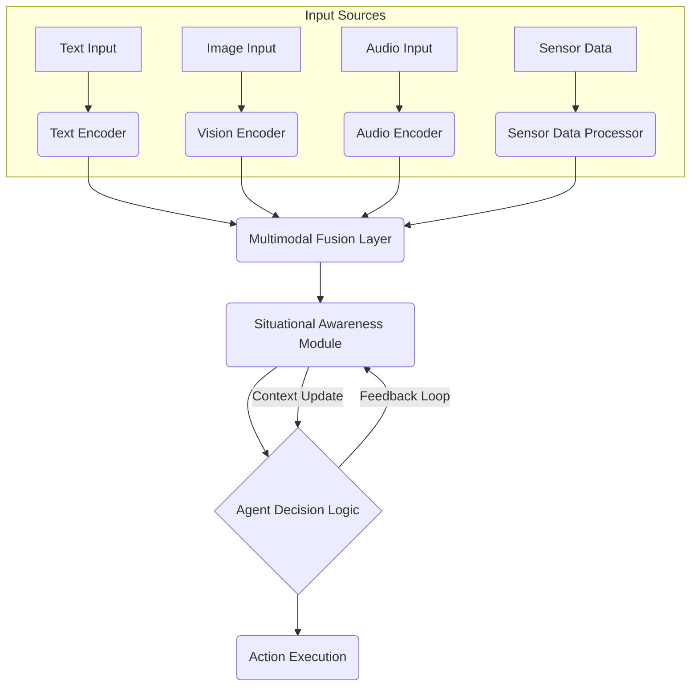

AI 에이전트의 복합적인 환경 이해는 2026년 AI 에이전트의 핵심 역량으로 부상하고 있습니다. 멀티모달리티(Multimodality)는 이러한 복잡한 환경을 에이전트가 인식하고 이해하는 데 필수적인 접근 방식입니다. 텍스트 정보에만 의존하던 기존 방식의 한계를 넘어, 시각(Vision), 청각(Audio), 촉각(Haptic) 등 다양한 센서 데이터를 통합하여 에이전트의 상황 인지(Situational Awareness)를 혁신적으로 강화할 수 있습니다. 이는 단순히 데이터의 양을 늘리는 것을 넘어, 세상에 대한 보다 깊고 미묘한 이해를 가능하게 하며, 에이전트가 현실 세계에서 더욱 효과적으로 작동하도록 만듭니다.

## 핵심 개념: 멀티모달 상황 인지

멀티모달리티를 활용한 AI 에이전트의 상황 인지 강화는 다음 세 가지 핵심 개념을 기반으로 합니다.

### 센서 융합 (Sensor Fusion)
각기 다른 모달리티(modality)에서 얻은 데이터를 하나의 응집력 있는 표현(coherent representation)으로 통합하는 과정입니다. 예를 들어, 자율주행 에이전트가 카메라(시각)와 LiDAR(거리) 데이터를 결합하여 주변 환경을 3D로 재구성하는 것이 대표적입니다. 이 과정에서 각 센서의 장점을 최대한 활용하고 단점을 상호 보완하여, 개별 센서로는 얻기 어려운 풍부하고 정확한 환경 모델을 구축합니다.

### 교차 모달 추론 (Cross-Modal Reasoning)
하나의 모달리티에서 얻은 정보를 다른 모달리티와 연결하여 더 풍부한 결론을 도출하는 능력입니다. 예를 들어, 사용자 음성(청각)에서 명령을 이해하는 동시에 사용자의 표정(시각)을 통해 감정 상태를 파악하여, 명령의 맥락을 깊이 이해하고 더욱 적절하고 공감적인 응답을 생성할 수 있습니다. 이는 에이전트의 의사결정 품질을 향상시킵니다.

### 동적 컨텍스트 구축 (Dynamic Context Construction)
실시간으로 유입되는 멀티모달 데이터를 바탕으로 에이전트의 내부 컨텍스트(context)를 지속적으로 업데이트하는 과정입니다. 이는 변화하는 환경에 민첩하게 반응하고, 장기적인 행동 계획을 수립하는 데 필수적입니다. 에이전트는 동적으로 변화하는 상황에 맞춰 자신의 내부 상태와 외부 환경 모델을 조정하며, 이를 통해 적응적이고 유연한 행동을 보일 수 있습니다.

## 멀티모달리티 활용 전략

### 데이터 수집 및 전처리 (Data Acquisition & Preprocessing)
고품질의 멀티모달 데이터셋 구축이 가장 중요합니다. 서로 다른 센서에서 수집된 데이터를 시간 동기화(time synchronization)하고, 노이즈 제거, 정규화(normalization) 등 전처리 과정을 거쳐야 합니다. 특히, 비전 데이터의 객체 탐지(Object Detection), 오디오 데이터의 음성 인식(Speech Recognition), 텍스트 데이터의 엔티티 추출(Entity Extraction) 등 각 모달리티별로 최적화된 특징 추출(Feature Extraction)이 선행되어야 합니다.

### 통합 모델 아키텍처 (Integrated Model Architectures)
각 모달리티별로 추출된 특징을 인코딩한 후, 이들을 병렬적으로 처리하거나 순차적으로 결합하는 통합 모델 아키텍처를 설계합니다. 트랜스포머(Transformer) 기반의 멀티모달 인코더(multimodal encoder)가 대표적이며, 어텐션 메커니즘(attention mechanism)을 통해 모달리티 간의 복잡한 관계를 학습하고 가중치를 부여합니다. 이는 각 모달리티의 정보를 효과적으로 융합하는 데 도움을 줍니다.

다음은 멀티모달 입력을 처리하는 에이전트의 간소화된 Python-like 코드 예시입니다:

```python
class MultimodalAgent:
    def __init__(self, text_encoder, vision_encoder, audio_encoder, fusion_model, decision_maker):
        self.text_encoder = text_encoder
        self.vision_encoder = vision_encoder
        self.audio_encoder = audio_encoder
        self.fusion_model = fusion_model
        self.decision_maker = decision_maker

    def process_multimodal_input(self, text_input, image_input, audio_input):
        # 1. Feature Extraction: 각 모달리티에서 특징을 추출합니다.
        text_features = self.text_encoder.encode(text_input)
        vision_features = self.vision_encoder.encode(image_input)
        audio_features = self.audio_encoder.encode(audio_input)

        # 2. Modality Fusion: 추출된 특징들을 융합합니다.
        fused_features = self.fusion_model.fuse(text_features, vision_features, audio_features)

        # 3. Situational Awareness & Decision Making: 융합된 특징으로 상황 컨텍스트를 구축하고 의사결정을 합니다.
        situational_context = self.decision_maker.build_context(fused_features)
        action = self.decision_maker.decide_action(situational_context)
        return action, situational_context

# Example Usage (simplified)
# agent = MultimodalAgent(TextEncoder(), VisionEncoder(), AudioEncoder(), FusionModel(), DecisionMaker())
# current_action, current_context = agent.process_multimodal_input("방에서 불을 켜줘", camera_feed, microphone_input)
# print(f"Agent Action: {current_action}, Current Context: {current_context}")
```

### 에이전트 의사결정 통합 (Agent Decision Integration)
융합된 멀티모달 특징은 에이전트의 의사결정 모듈(decision module)로 전달되어, 태스크 계획(Task Planning), 목표 추론(Goal Inference), 행동 선택(Action Selection) 등의 과정에 활용됩니다. 이는 RAG(Retrieval-Augmented Generation) 시스템과 결합하여, 외부 지식 베이스(Knowledge Base)에서 관련 정보를 검색하고 멀티모달 컨텍스트와 함께 추론하는 방식으로 강화될 수 있습니다. 이를 통해 에이전트는 더욱 정교하고 맥락에 맞는 행동을 수행할 수 있습니다.

멀티모달 에이전트의 정보 흐름은 다음과 같이 시각화할 수 있습니다:



## 트레이드오프

멀티모달리티를 활용한 AI 에이전트 설계에는 다음과 같은 트레이드오프가 존재합니다.

*   **강점**: 복합적인 상황 이해력 증대 및 견고성 향상
    *   **언제 좋음**: 자율 주행, 로봇 공학, 복잡한 사용자 인터페이스 없는 환경(음성/제스처), 원격 의료 진단과 같이 다양한 정보원이 필요한 고위험 및 고복잡성 태스크에서 에이전트의 성능과 신뢰도를 극대화할 수 있습니다. 특정 모달리티에 노이즈나 결함이 발생하더라도 다른 모달리티로 보완하여 추론을 이어갈 수 있습니다.
    *   **언제 나쁨**: 단순 텍스트 처리나 명확히 정의된 데이터만으로 충분한 태스크 (예: 챗봇의 FAQ 응답, 정형 데이터 분석)에서는 추가 모달리티가 불필요한 복잡성과 비용을 유발합니다. 각 모달리티의 독립적인 실패가 전체 시스템에 치명적인 영향을 미치는 경우(결함에 대한 견고성이 제대로 설계되지 않은 경우), 오히려 취약점이 될 수 있습니다.

*   **약점**: 데이터 복잡성, 처리 비용 및 개발 난이도 증가
    *   **언제 좋음**: 데이터 품질과 스케일이 충분히 확보되고, 강력한 컴퓨팅 자원을 활용할 수 있는 경우. 고가치 애플리케이션에서 높은 상황 인지도가 비즈니스 이점으로 직결될 때 초기 및 운영 비용을 감수할 수 있습니다. 모듈화(modularity) 및 확장성(scalability)이 잘 설계된 아키텍처를 바탕으로 전문화된 개발팀이 투입될 때 효과적입니다.
    *   **언제 나쁨**: 고품질 멀티모달 데이터 수집, 정제, 동기화에 어려움이 있거나, 컴퓨팅 자원이 제한적일 때. 초기 개발 및 운영 비용이 과도하게 증가하여 ROI(투자수익률)를 달성하기 어렵습니다. 통합 모델 설계 및 학습, 배포 과정의 복잡성으로 인해 개발 기간이 길어지고, 버그 발생 가능성이 높아질 수 있습니다. 특히, 모달리티 간의 데이터 불균형(imbalance) 문제가 발생하기 쉽습니다.

## 실전 체크리스트

멀티모달 AI 에이전트 시스템을 프로젝트에 적용할 때 다음 항목들을 검증해야 합니다.

*   - [ ] 에이전트가 처리해야 할 핵심 태스크에 멀티모달 정보가 필수적인지 **정량적**으로 분석하고, 기존 텍스트 기반 시스템 대비 성능 향상 목표를 설정했는가? (예: 기존 텍스트 기반 시스템의 실패율 20% 감소 목표)
*   - [ ] 각 모달리티별 데이터 수집 파이프라인(pipeline)이 구축되었고, 데이터 형식(format) 및 시간 동기화(time synchronization) 문제가 해결되었는가?
*   - [ ] 멀티모달 데이터의 전처리 및 특징 추출(feature extraction) 과정이 태스크 목표에 맞춰 최적화되었는가? (예: 비전 데이터에 대한 특정 객체 탐지 모델 사용, 오디오 데이터의 노이즈 제거)
*   - [ ] 선택된 멀티모달 융합(fusion) 모델 아키텍처가 각 모달리티의 중요도를 적절히 반영하고, 교차 모달 상호작용(cross-modal interaction)을 효과적으로 학습하는가? (예: 어텐션 가중치 분석을 통한 모달리티 간 기여도 확인)
*   - [ ] 에이전트의 의사결정 로직이 융합된 멀티모달 컨텍스트를 충분히 활용하며, 다양한 상황 변화(예: 특정 모달리티 손실)에 대해 일관된 성능을 보이는가?
*   - [ ] 멀티모달 시스템의 성능 평가 지표(metrics)가 정의되었고, 각 모달리티의 기여도를 측정할 수 있는 테스트 환경(예: ablation study)이 마련되었는가?
*   - [ ] 예상되는 데이터 불균형(data imbalance) 또는 특정 모달리티의 노이즈/손실 시 에이전트의 견고성(robustness)을 보장하는 전략(예: 강건한 특징 학습, 폴백 메커니즘)이 수립되었는가?
