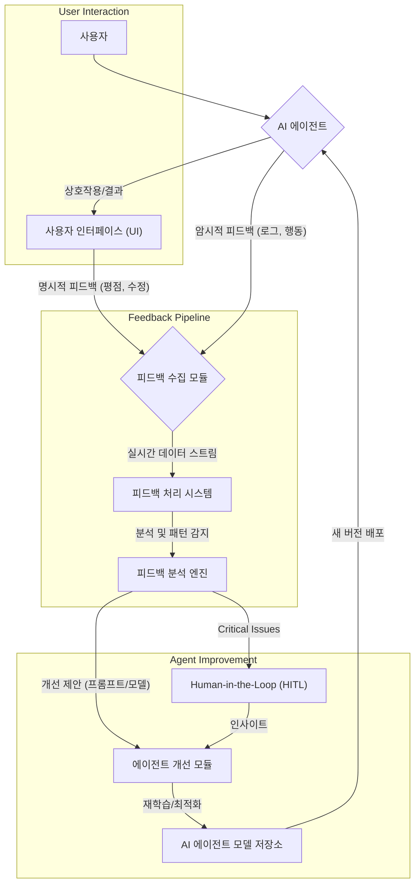

AI 에이전트의 실용적 활용도를 극대화하기 위해, 사용자 상호작용 데이터를 통한 지속적인 성능 개선은 필수적입니다. 정적(static)인 모델 배포만으로는 동적으로 변화하는 사용자 요구사항과 환경에 능동적으로 대처하기 어렵습니다. 실시간 사용자 피드백(Real-time User Feedback)은 이러한 격차를 해소하고 에이전트의 적응성과 효율성을 높이는 핵심 전략입니다.

## 실시간 피드백의 중요성 및 종류

사용자 피드백은 AI 에이전트가 현실 세계에서 마주하는 복잡성과 불확실성을 학습하고 해결하는 데 중요한 역할을 합니다. 특히 에이전트가 예상치 못한 상황에 직면하거나, 잘못된 의사결정을 내렸을 때, 사용자로부터의 즉각적인 신호는 오류를 신속하게 감지하고 수정하는 기반이 됩니다.

피드백은 크게 두 가지 유형으로 나눌 수 있습니다:

### 1. 명시적 피드백 (Explicit Feedback)
사용자가 직접 에이전트의 성능이나 출력에 대해 평가를 제공하는 방식입니다.
*   **평점 및 리뷰**: 챗봇 대화의 만족도 별점, AI 생성 콘텐츠에 대한 좋아요/싫어요.
*   **수정 및 교정**: 에이전트가 생성한 코드를 사용자가 직접 수정하거나, 답변을 변경하는 행위.
*   **설문조사**: 특정 태스크 완료 후 만족도나 정확도에 대한 질문.

### 2. 암시적 피드백 (Implicit Feedback)
사용자의 행동 패턴이나 시스템 로그를 통해 간접적으로 얻는 피드백입니다.
*   **행동 분석**: 에이전트의 답변을 사용자가 얼마나 오래 보는지, 다음 질문으로 빠르게 넘어가는지, 에이전트가 제안한 작업을 수락하는지 거부하는지.
*   **에러 로그**: 에이전트 실행 중 발생하는 예외(exception)나 오류.
*   **세션 길이 및 이탈률**: 사용자가 에이전트와 상호작용하는 시간, 특정 지점에서 대화를 중단하는 비율.

## 피드백 루프 설계 및 구현

효과적인 실시간 피드백 루프(Feedback Loop)를 설계하기 위해서는 피드백의 수집, 분석, 그리고 에이전트 개선 과정으로의 통합이 원활하게 이루어져야 합니다.

### 피드백 수집 (Feedback Collection)
에이전트와 사용자 인터페이스(UI) 간의 접점에서 다양한 방식으로 피드백을 수집합니다.
명시적 피드백은 UI에 직접적인 평가 메커니즘을 통합하여 수집하고, 암시적 피드백은 에이전트의 모든 상호작용 로그를 체계적으로 기록함으로써 얻을 수 있습니다.

```python
import json
import time

def collect_explicit_feedback(user_id: str, agent_output: str, rating: int, comment: str):
    """명시적 피드백을 수집하고 저장합니다."""
    feedback_data = {
        "timestamp": int(time.time()),
        "user_id": user_id,
        "agent_output": agent_output,
        "feedback_type": "explicit",
        "rating": rating,
        "comment": comment
    }
    # 실제 시스템에서는 데이터베이스나 메시지 큐에 저장
    print(f"Collected Explicit Feedback: {json.dumps(feedback_data)}")
    return feedback_data

def collect_implicit_feedback(user_id: str, agent_action: str, duration_ms: int, success: bool):
    """암시적 피드백을 수집하고 저장합니다."""
    feedback_data = {
        "timestamp": int(time.time()),
        "user_id": user_id,
        "agent_action": agent_action,
        "feedback_type": "implicit",
        "duration_ms": duration_ms,
        "success": success
    }
    # 실제 시스템에서는 데이터베이스나 메시지 큐에 저장
    print(f"Collected Implicit Feedback: {json.dumps(feedback_data)}")
    return feedback_data

# 예시 사용
collect_explicit_feedback("user123", "AI generated code snippet", 5, "Perfect code, very helpful!")
collect_implicit_feedback("user123", "tool_execution_search", 1500, True)
```

### 피드백 분석 및 개선 (Feedback Analysis & Improvement)
수집된 피드백은 에이전트의 약점을 식별하고 개선 방안을 도출하는 데 사용됩니다.
*   **데이터 정제 및 전처리**: 노이즈 제거, 중복 데이터 처리.
*   **패턴 분석**: 특정 유형의 질문이나 작업에서 에이전트의 실패율이 높은지, 어떤 유형의 피드백이 자주 발생하는지 분석.
*   **Human-in-the-Loop (HITL)**: 복잡하거나 중요도가 높은 피드백은 전문가가 직접 검토하고 에이전트의 의사결정 과정을 디버깅합니다. 이를 통해 에이전트의 Reasoning Trace를 강화할 수 있습니다.
*   **모델 재학습 및 프롬프트 최적화**: 분석 결과를 바탕으로 에이전트의 프롬프트(prompt)를 개선하거나, 파인튜닝(fine-tuning)을 위한 데이터셋으로 활용하여 모델을 재학습시킵니다. 2026년에는 적응형 프롬프트(Adaptive Prompting) 기술이 더욱 발전하여 실시간 피드백에 기반한 동적인 프롬프트 조정을 가능하게 할 것입니다.

다음 Mermaid 다이어그램은 실시간 사용자 피드백을 활용한 AI 에이전트 개선 워크플로우를 보여줍니다.



## 트레이드오프

### 1. 피드백 수집 복잡성 vs. 데이터 품질
*   **언제 좋은가**: 사용자 행동을 면밀히 추적하고 명시적 피드백 메커니즘을 세밀하게 설계할수록, 에이전트 개선에 필요한 고품질 데이터를 확보할 수 있습니다. 이는 에이전트의 특정 실패 모드를 정확하게 진단하고 해결하는 데 필수적입니다.
*   **언제 나쁜가**: 과도한 피드백 수집은 사용자 경험을 저해하고, 개인 정보 보호(privacy) 문제를 야기할 수 있습니다. 또한, 수집된 데이터를 관리하고 처리하는 시스템의 복잡성과 비용이 증가합니다. 모든 상호작용을 상세히 로깅하는 것은 스토리지 및 처리량 측면에서 부담이 될 수 있습니다.

### 2. 자동화된 개선 vs. Human-in-the-Loop (HITL)
*   **언제 좋은가**: 간단하고 반복적인 에러 패턴은 자동화된 재학습 루프를 통해 효율적으로 개선될 수 있습니다. 이는 에이전트의 전반적인 성능을 빠르게 향상시키고 운영 비용을 절감합니다. 2026년에는 자율 에이전트(Autonomous Agent)의 자가 학습 능력이 더욱 중요해질 것입니다.
*   **언제 나쁜가**: 복잡하거나 민감한 문제, 또는 에이전트의 핵심 기능과 관련된 오류는 자동화된 시스템만으로 해결하기 어렵습니다. 잘못된 자동 개선은 오히려 더 큰 문제를 야기할 수 있으므로, 초기 단계나 중요 영역에서는 숙련된 인력이 개입하여 에이전트의 추론 과정을 검토하고 직접적인 수정을 가하는 HITL이 필수적입니다. HITL은 비용이 많이 들고 속도가 느리다는 단점이 있습니다.

### 3. 즉각적인 배포 vs. 안정성 검증
*   **언제 좋은가**: 경쟁이 치열한 시장에서는 사용자 피드백에 기반한 개선 사항을 신속하게 반영하여 에이전트 성능을 최신 상태로 유지하는 것이 중요합니다. 작은 개선 사항이나 긴급한 버그 수정의 경우, 빠르고 지속적인 배포(Continuous Deployment)가 효과적입니다.
*   **언제 나쁜가**: 모든 피드백을 즉각적으로 에이전트 모델에 반영하고 배포하는 것은 예측 불가능한 부작용(regression)을 초래할 수 있습니다. 중요한 비즈니스 로직을 담당하는 에이전트의 경우, 엄격한 테스트 및 검증 절차(A/B Testing, Canary Deployment 등) 없이는 안정성을 보장하기 어렵습니다.

## 실전 체크리스트

AI 에이전트의 실시간 사용자 피드백 시스템을 구축하고 최적화하기 위한 실전 체크리스트입니다.

*   [ ] **피드백 수집 전략 정의**: 명시적/암시적 피드백 수집 지점과 방법을 명확히 정의했는가? (예: 만족도 별점, 좋아요/싫어요 버튼, 에러 로그, 세션 이탈률)
*   [ ] **피드백 데이터 파이프라인 구축**: 수집된 피드백 데이터가 실시간으로 저장되고 처리될 수 있는 견고한 데이터 파이프라인(예: Kafka, Kinesis)을 마련했는가?
*   [ ] **피드백 분석 대시보드 구현**: 에이전트 성능 저하 지점, 사용자 만족도 변화 등 주요 지표를 시각적으로 모니터링할 수 있는 대시보드를 구축했는가?
*   [ ] **Human-in-the-Loop (HITL) 워크플로우 설계**: 자동 개선이 어려운 복잡한 문제에 대해 전문가가 개입하여 피드백을 검토하고 에이전트의 의사결정 과정을 개선할 수 있는 워크플로우가 있는가?
*   [ ] **자동화된 모델 재학습/프롬프트 최적화**: 특정 피드백 임계값(threshold) 또는 주기(period)에 따라 에이전트 모델을 재학습하거나 프롬프트를 자동으로 업데이트하는 시스템을 구현했는가?
*   [ ] **새로운 에이전트 버전 검증 절차**: 피드백으로 개선된 에이전트 버전을 실제 환경에 배포하기 전, A/B 테스트 또는 카나리 배포(Canary Deployment)를 통해 안정성과 성능을 검증하는 프로세스를 확립했는가?
*   [ ] **개인 정보 보호 및 규제 준수**: 피드백 수집 및 활용 과정에서 사용자의 개인 정보 보호(Privacy) 원칙과 관련 규제(예: GDPR, CCPA)를 준수하고 있는가?