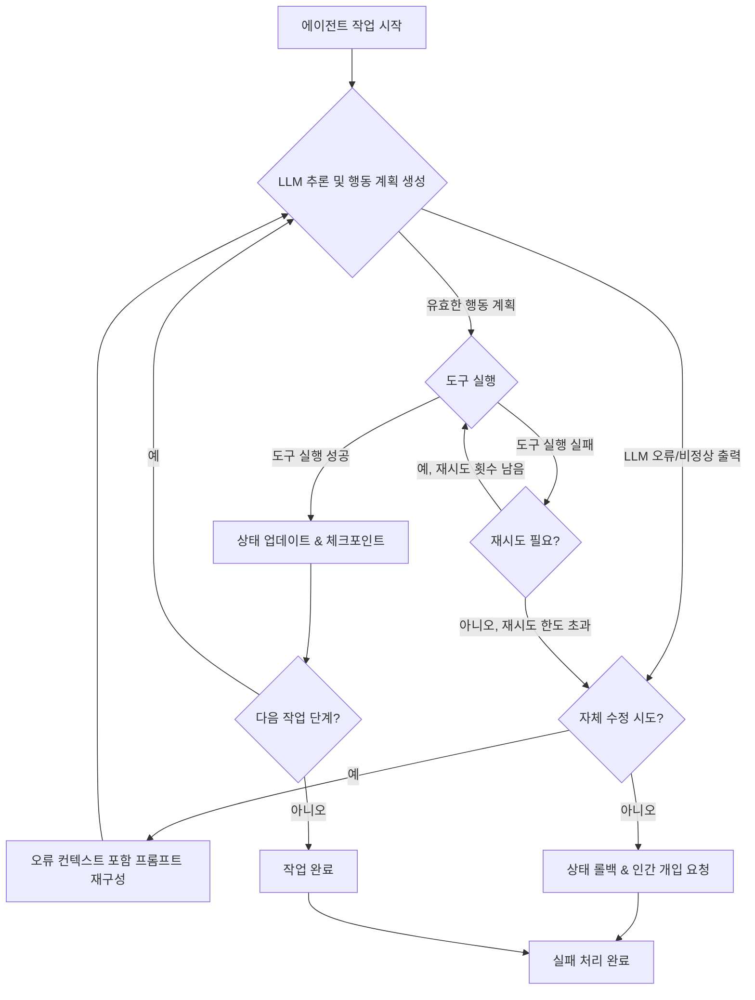

LLM 기반 자율 에이전트의 광범위한 실용적 활용을 위해서는 안정성이 필수적입니다. 에이전트는 복잡한 환경에서 예측 불가능한 상황에 직면하며, LLM의 비결정적 특성과 외부 도구(Tool)의 실패 가능성으로 인해 오류는 피할 수 없는 현실입니다. 본 문서는 자율 에이전트의 안정성을 극대화하기 위한 핵심 오류 처리 및 복구 패턴을 다룹니다.

## 에이전트 실패 유형

자율 에이전트의 오류는 다양한 원인으로 발생할 수 있습니다.

*   **LLM 결함**: 환각(Hallucination), 잘못된 추론, 비정상적인 출력 형식, 반복(Looping) 등 LLM 자체의 비결정적 특성으로 인한 오류입니다.
*   **도구 실행 실패 (Tool Execution Failures)**: 외부 API 호출 실패, 네트워크 오류, 잘못된 입력 인자 전달, 타임아웃 등 도구 사용 과정에서 발생하는 오류입니다.
*   **상태 관리 불일치 (State Management Inconsistencies)**: 에이전트의 내부 상태, 장기 기억(Long-term Memory), 또는 컨텍스트 윈도우(Context Window) 관리에 오류가 발생하여 일관성이 깨지는 경우입니다.
*   **목표 불일치 및 무한 루프 (Goal Misalignment & Infinite Loops)**: 에이전트가 원래의 목표에서 벗어나거나, 특정 작업을 반복적으로 시도하며 진행하지 못하는 상황입니다.

## 핵심 오류 처리 및 복구 패턴

### 재시도 메커니즘 (Retry Mechanisms)

일시적인 오류(Transient Errors)는 재시도를 통해 해결될 수 있습니다. 특히 외부 도구 호출 시 네트워크 불안정성이나 서비스 부하로 인한 일시적 실패에 유용합니다.

*   **지수 백오프 (Exponential Backoff)**: 재시도 간격을 지수적으로 증가시켜 백엔드 서비스의 부하를 줄이고, 서비스 복구 시간을 확보하는 전략입니다. `2^n` 초와 같이 백오프 시간을 늘립니다.
*   **데드레터 큐 (Dead-Letter Queue, DLQ)**: 특정 횟수 이상 재시도에도 실패한 작업을 DLQ로 보내어 나중에 수동으로 검토하거나 별도의 복구 로직으로 처리할 수 있게 합니다. 이는 에이전트의 주요 실행 흐름을 막지 않고 실패한 작업을 격리하는 데 도움을 줍니다.

```python
import time
import logging

logging.basicConfig(level=logging.INFO)

def execute_tool_with_retry(tool_func, max_retries=3, initial_delay=1):
    for attempt in range(max_retries):
        try:
            logging.info(f"Attempt {attempt + 1}: Calling {tool_func.__name__}")
            result = tool_func()
            logging.info(f"Successfully executed {tool_func.__name__}")
            return result
        except Exception as e:
            logging.warning(f"Error in {tool_func.__name__}: {e}")
            if attempt < max_retries - 1:
                delay = initial_delay * (2 ** attempt)
                logging.info(f"Retrying in {delay} seconds...")
                time.sleep(delay)
            else:
                logging.error(f"Max retries reached for {tool_func.__name__}. Sending to DLQ...")
                raise # Re-raise or send to DLQ

# Example usage:
# def flaky_api_call():
#     if random.random() < 0.7: # 70% chance of failure
#         raise ConnectionError("Network is unstable")
#     return "Data fetched successfully"
#
# try:
#     execute_tool_with_retry(flaky_api_call)
# except Exception as e:
#     logging.critical(f"Task ultimately failed: {e}")
```

### 자기 수정 및 회고 (Self-Correction and Retrospection)

LLM 에이전트의 가장 강력한 오류 복구 메커니즘 중 하나는 실패로부터 학습하고 스스로 수정하는 능력입니다. 에이전트가 이전에 시도했던 작업의 결과와 발생한 오류 메시지를 분석하여 다음 행동을 개선하는 방식입니다.

*   **프롬프트 기반 자기 수정 (Prompt-based Self-Correction)**: 에이전트가 특정 단계에서 실패하면, LLM에게 실패한 프롬프트, 오류 메시지, 현재 컨텍스트를 제공하여 새로운 프롬프트 또는 수정된 행동 계획을 생성하도록 요청합니다.
*   **회고 루프 (Retrospection Loop)**: 에이전트가 장기적으로 복잡한 작업을 수행할 때, 주기적으로 과거의 행동과 결과를 되돌아보고(reflect) 실패의 근본 원인을 파악하여 미래의 의사결정 전략을 개선합니다. 이는 `agents/autonomous-agent-long-term-memory-reflection-design`과 연관됩니다.

```python
def self_correct_llm_action(llm_client, original_prompt, error_details, current_context):
    correction_prompt = (
        f"이전 작업이 실패했습니다. 원본 프롬프트: `{original_prompt}`. "
        f"오류 상세: `{error_details}`. "
        f"현재 에이전트 상태: `{current_context}`. "
        "이 오류를 분석하고, 문제를 해결할 수 있는 수정된 다음 행동을 "
        "'Action: tool_name(param='value')' 형식으로 제공해 주세요."
    )
    try:
        corrected_response = llm_client.generate(correction_prompt)
        return corrected_response
    except Exception as e:
        logging.error(f"Self-correction failed: {e}")
        return None

# llm_client = YourLLMClient()
# failed_action_prompt = "Action: invalid_tool(param='wrong_arg')"
# error_msg = "Tool 'invalid_tool' not found."
# current_agent_context = "Current goal is to fetch user data."
# corrected_action = self_correct_llm_action(llm_client, failed_action_prompt, error_msg, current_agent_context)
# if corrected_action:
#     print(f"Corrected action: {corrected_action}")
```

### 상태 관리 및 롤백 (State Management & Rollback)

에이전트의 작업이 여러 단계로 구성될 때, 각 단계의 성공적인 완료 시점을 체크포인트로 저장하고, 오류 발생 시 이전의 안정된 상태로 돌아가는 롤백 전략은 매우 중요합니다. 이는 `agents/agentic-long-running-carryover-human-checkpoint-boundary`와 유사합니다.

*   **체크포인팅 (Checkpointing)**: 에이전트의 중요한 상태 변화나 작업 완료 시점에 현재의 상태(기억, 실행 계획, 데이터 등)를 저장합니다. 이는 복잡한 멀티스텝 작업의 경우 특히 유용합니다.
*   **버전 관리된 메모리 (Versioned Memory)**: 에이전트의 장기 기억 또는 컨텍스트를 변경 불가능한(Immutable) 스냅샷으로 저장하고 버전 관리하여, 필요 시 특정 시점의 상태로 복원할 수 있게 합니다. 이는 `agents/ai-agent-output-versioning-deltadb-concepts`에서 다루는 개념과도 연결됩니다.

```python
class AgentState:
    def __init__(self, data: dict):
        self._data = data

    def get_data(self): return self._data.copy()

    def update(self, key, value): self._data[key] = value

class StatefulAgent:
    def __init__(self):
        self.state_history = []
        self.current_state = AgentState({"task_progress": "start"})
        self._checkpoint_state()

    def _checkpoint_state(self):
        self.state_history.append(self.current_state.get_data())
        logging.info(f"State checkpointed: {self.current_state.get_data()}")

    def _rollback_state(self):
        if len(self.state_history) > 1:
            self.state_history.pop() # Remove current failed state
            self.current_state = AgentState(self.state_history[-1])
            logging.warning(f"Rolled back to state: {self.current_state.get_data()}")
        else:
            logging.error("No previous state to rollback to.")

    def perform_step(self, step_name):
        try:
            # Simulate a task step
            if "critical_failure" in step_name:
                raise ValueError(f"Error during {step_name}")
            self.current_state.update("task_progress", step_name)
            self._checkpoint_state()
            logging.info(f"Step '{step_name}' completed.")
        except Exception as e:
            logging.error(f"Failed to perform step '{step_name}': {e}")
            self._rollback_state()
            raise

# agent = StatefulAgent()
# agent.perform_step("initialization")
# agent.perform_step("data_fetch")
# try:
#    agent.perform_step("critical_failure_step")
# except:
#    pass # Handle the propagated error
```

### 인간 개입 (Human-in-the-Loop, HITL)

완전 자동화가 불가능하거나 위험도가 높은 시나리오에서는 인간의 개입이 필수적입니다. 에이전트는 특정 오류 조건에서 자동으로 작업을 중단하고 인간 운영자에게 상황을 보고하여 결정을 요청해야 합니다.

*   **임계점 기반 트리거 (Threshold-based Triggering)**: 재시도 횟수 초과, 자체 수정 실패, 예상치 못한 비용 초과 (`agents/ai-agent-runaway-cost-prevention-control-systems`), 특정 유형의 보안 위반 (`agents/ai-agent-safety-constraint-control-design-patterns`) 등 미리 정의된 임계값을 초과할 때 인간 개입을 트리거합니다.
*   **명확한 보고 및 인터페이스**: 인간 운영자가 상황을 신속하게 파악하고 적절한 결정을 내릴 수 있도록, 오류 발생 시 충분한 컨텍스트(에이전트의 목표, 현재 상태, 실패한 행동, 오류 메시지, 시도된 복구 전략 등)를 명확하게 보고해야 합니다.



## 트레이드오프

LLM 에이전트의 오류 처리 및 복구 패턴 설계에는 여러 트레이드오프가 존재합니다.

*   **복잡성 vs. 안정성**: 오류 처리 로직을 추가할수록 에이전트 시스템의 복잡성이 증가합니다. 복잡한 시스템은 개발 및 유지보수 비용이 높지만, 에이전트의 전반적인 안정성과 신뢰성은 향상됩니다. 단순한 작업에는 과도한 복구 메커니즘이 불필요하며, 고위험/고가치 작업에서는 복잡하더라도 견고한 시스템이 필요합니다.
*   **자동화 vs. 인간 개입**: 완전 자동화된 복구는 운영 효율성을 높이지만, 예측 불가능한 '블랙 스완' 오류에 취약합니다. 인간 개입은 안전망을 제공하지만, 지연을 발생시키고 운영 비용을 증가시킵니다. 비용 민감도가 높거나 안전이 중요한 애플리케이션에서는 인간 개입이 필수적이며, 단순 반복 작업은 높은 자동화율이 유리합니다.
*   **성능 vs. 견고성**: 재시도, 자체 수정, 상태 체크포인팅 등의 복구 메커니즘은 추가적인 컴퓨팅 자원과 시간을 소모하여 에이전트의 전체적인 성능(지연 시간, 처리량)을 저하시킬 수 있습니다. 실시간 응답이 중요한 시스템에서는 최소한의 복구 전략을, 백그라운드에서 실행되는 중요 작업에는 견고성을 우선시할 수 있습니다.
*   **비용 vs. 신뢰성**: LLM 호출은 비용이 발생하며, 재시도나 자체 수정은 추가적인 LLM 호출을 유발합니다. 이는 운영 비용 증가로 이어집니다. 비용에 매우 민감한 프로덕트에서는 복구 전략을 최소화하고 실패를 빠르게 인정하는 것을 고려해야 하며, 높은 신뢰성이 요구되는 핵심 비즈니스 로직에는 비용을 감수하고서라도 다중 복구 메커니즘을 적용해야 합니다.

## 실전 체크리스트

LLM 기반 자율 에이전트의 오류 처리 및 복구 패턴을 설계하고 구현할 때 다음 사항들을 검증해야 합니다.

- [ ] **오류 유형 정의**: 에이전트가 직면할 수 있는 LLM 결함, 도구 오류, 상태 불일치 등 주요 오류 유형을 명확히 정의하고 문서화했는가?
- [ ] **재시도 정책 구현**: 외부 도구 호출 시 지수 백오프를 포함한 재시도 로직이 적용되었으며, 최대 재시도 횟수 초과 시 DLQ 또는 대체 처리 경로로 연결되는가?
- [ ] **자체 수정 기능 활성화**: LLM이 이전 실패 컨텍스트를 받아 다음 단계를 자체적으로 수정할 수 있는 프롬프트 전략이 구현되었고, 그 효과가 측정되었는가?
- [ ] **상태 체크포인팅 및 롤백**: 에이전트의 핵심 작업 단계마다 상태 체크포인팅이 이루어지고 있으며, 중대한 오류 발생 시 이전의 안정된 상태로 롤백하는 메커니즘이 작동하는가?
- [ ] **인간 개입 트리거**: 재시도 및 자체 수정으로 해결할 수 없는 복잡한 오류나 보안/비용 관련 임계값 초과 시, 인간 운영자에게 명확한 컨텍스트와 함께 알림을 발송하고 작업을 일시 중단하는가?
- [ ] **모니터링 및 로깅**: 모든 오류 발생 시점, 재시도 횟수, 자체 수정 시도 및 결과, 인간 개입 트리거 시점 등이 상세하게 로깅되고 모니터링 시스템에 통합되어 있는가?
- [ ] **테스트 시나리오 확장**: 정상 경로 외에 다양한 오류 주입(Fault Injection) 테스트를 통해 재시도, 자체 수정, 롤백, 인간 개입 메커니즘이 예상대로 작동하는지 검증했는가?