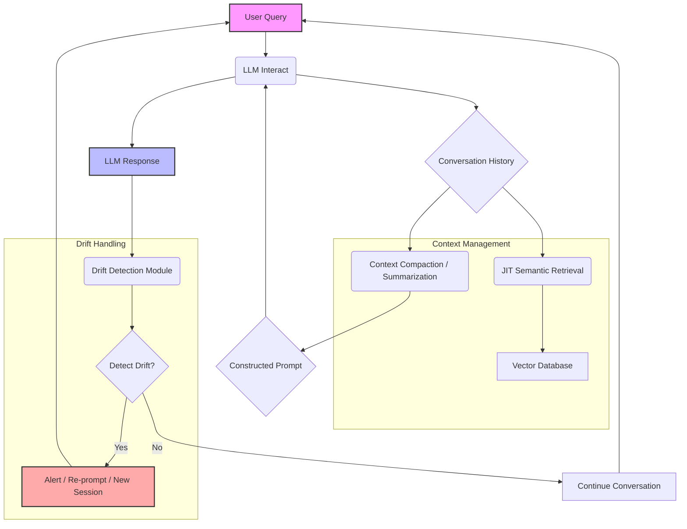

대화형 LLM(Large Language Model) 기반 애플리케이션에서 사용자들이 겪는 가장 흔한 문제 중 하나는 대화가 길어질수록 LLM의 응답 품질이 저하되고, 이전에 언급된 중요한 정보를 '잊어버리는' 현상입니다. 이러한 현상은 사용자 경험을 저해하고, 불필요한 토큰 사용으로 비용을 증가시키며, 전반적인 시스템의 신뢰도를 떨어뜨립니다. 긱뉴스에서 언급된 바와 같이, AI가 길어진 대화에서 엉뚱한 답을 하거나 핵심을 놓치는 것은 단순한 버그가 아니라 LLM 아키텍처의 내재적 특성에서 비롯된 문제입니다. 이를 해결하기 위해 LLM 컨텍스트 엔지니어링(Context Engineering)과 드리프트 감지(Drift Detection) 최적화가 필수적입니다.

## LLM 컨텍스트 관리의 도전 과제

LLM은 주어진 컨텍스트 윈도우(Context Window) 내에서만 정보를 처리하고 추론할 수 있습니다. 이 컨텍스트 윈도우의 크기는 모델마다 제한적이며, 대화가 길어질수록 과거의 대화 내용은 컨텍스트 윈도우 밖으로 밀려나거나, 중요한 정보가 긴 텍스트의 '중간'에 위치하여 LLM이 이를 간과하는 'Lost in the Middle' 현상이 발생할 수 있습니다. 또한, 사용자의 초기 의도나 핵심 주제로부터 LLM의 응답이 점진적으로 벗어나는 의미론적 드리프트(Semantic Drift)가 발생하여 대화의 일관성이 저해될 수 있습니다.

### 의미론적 드리프트(Semantic Drift)란?

의미론적 드리프트는 LLM과의 상호작용이 반복될수록, LLM이 처음 파악했던 대화의 핵심 주제나 사용자의 원래 의도에서 미묘하게 벗어나기 시작하는 현상입니다. 이는 단순히 정보를 잊는 것을 넘어, LLM의 내부 상태나 추론 방향이 초기와 달라지면서 발생하는 응답의 일관성 저하를 의미합니다. 예를 들어, 코드를 리팩토링하던 LLM이 갑자기 코드 분석 도구에 대한 일반적인 정보만 제공하거나, 원래 목표와 무관한 코드 스타일 제안을 하는 경우가 해당됩니다.

## 컨텍스트 엔지니어링 핵심 전략

LLM이 장기 대화에서 효과적으로 작동하도록 하려면, 컨텍스트를 동적으로 관리하고 관련성 높은 정보만 유지하는 지능적인 전략이 필요합니다.

### 1. 컨텍스트 압축 및 요약 (Context Compaction & Summarization)

전체 대화 기록을 LLM의 컨텍스트 윈도우에 모두 넣는 대신, 핵심 정보만을 추출하거나 요약하여 주입하는 기법입니다. 이는 토큰 비용을 절감하고, LLM이 더 중요한 정보에 집중하게 합니다.

*   **재귀적 요약 (Recursive Summarization)**: 긴 대화 세션을 작은 청크로 나누어 요약하고, 이 요약들을 다시 요약하는 방식입니다. 대화의 전반적인 맥락을 유지하면서 컨텍스트 크기를 크게 줄일 수 있습니다.
*   **추출적 요약 (Extractive Summarization)**: 원문에서 가장 중요한 문장이나 구절을 직접 추출하여 컨텍스트를 구성합니다. 이는 요약 과정에서 정보 손실을 최소화하는 데 유리합니다.

### 2. Just-In-Time (JIT) 의미 검색 (Semantic Retrieval)

RAG(Retrieval-Augmented Generation) 패턴을 활용하여, 현재 대화의 흐름과 가장 관련성이 높은 정보를 동적으로 검색하여 LLM에 제공하는 방식입니다. 이는 LLM이 마치 외부 지식 저장소에서 필요한 정보를 실시간으로 찾아보는 것과 유사합니다.

1.  **대화 임베딩 (Conversation Embedding)**: 현재 대화 턴과 이전 대화 요약을 결합하여 임베딩 벡터를 생성합니다.
2.  **벡터 데이터베이스 검색 (Vector Database Search)**: 생성된 임베딩을 사용하여 관련성 높은 지식 문서, 코드 스니펫, 과거 대화 요약 등을 벡터 데이터베이스(Vector Database)에서 검색합니다.
3.  **컨텍스트 재주입 (Context Re-injection)**: 검색된 정보를 LLM의 프롬프트에 재주입하여 LLM이 최신 정보를 기반으로 응답하게 합니다.

```python
import openai
from sklearn.metrics.pairwise import cosine_similarity
import numpy as np

# Hypothetical embedding function
def get_embedding(text: str) -> list[float]:
    # In a real scenario, this would call an embedding model (e.g., OpenAI, Sentence Transformers)
    # For demo, returning a dummy vector
    return np.random.rand(1536).tolist()

# Hypothetical vector database (simple dict for demo)
vdb = {
    "doc1": {"text": "LLM context windows are limited.", "embedding": get_embedding("LLM context windows are limited.")},
    "doc2": {"text": "Semantic drift is a common issue.", "embedding": get_embedding("Semantic drift is a common issue.")},
    "doc3": {"text": "RAG helps by injecting relevant data.", "embedding": get_embedding("RAG helps by injecting relevant data.")}
}

# Simplified LLM interaction function
def chat_with_llm_optimized(
    conversation_history: list[str],
    current_query: str,
    max_context_tokens: int = 1000
) -> str:
    # 1. Context Compaction (Recursive Summarization - simplified)
    current_context = "\n".join(conversation_history[-3:]) # Last 3 turns for simplicity
    if len(current_context.split()) > max_context_tokens * 0.5: # Simple token estimation
        # In reality, call LLM to summarize previous turns
        current_context = "Summary of previous conversation: ..." # Replace with actual summary

    # 2. JIT Semantic Retrieval
    query_embedding = get_embedding(current_query + "\n" + current_context)
    retrieved_info = []
    similarities = []

    for doc_id, data in vdb.items():
        sim = cosine_similarity(np.array(query_embedding).reshape(1, -1), np.array(data["embedding"]).reshape(1, -1))[0][0]
        similarities.append((sim, data["text"]))
    
    # Sort by similarity and take top N
    similarities.sort(key=lambda x: x[0], reverse=True)
    for sim, text in similarities[:1]: # Take top 1 relevant document
        if sim > 0.7: # Threshold for relevance
            retrieved_info.append(f"Relevant info: {text}")

    # Construct final prompt
    full_prompt = "".join(retrieved_info) + "\n" + "Conversation History: " + current_context + "\n" + "User: " + current_query

    # Simulate LLM response
    # print(f"[LLM Prompt]: {full_prompt[:200]}...") # For debugging
    return f"LLM's thoughtful response based on: '{current_query}' and context including JIT info: '{''.join(retrieved_info)}'"

# Example Usage
history = [
    "User: What are LLM context windows?",
    "LLM: They define how much text an LLM can process at once."
]
query = "How can semantic drift affect long conversations?"

response = chat_with_llm_optimized(history, query)
print(response)

# Expected output (simplified for demo):
# LLM's thoughtful response based on: 'How can semantic drift affect long conversations?' and context including JIT info: 'Relevant info: Semantic drift is a common issue.'
```

## 드리프트 감지 메커니즘

대화가 의도된 궤도에서 벗어나지 않도록 지속적으로 모니터링하고 감지하는 것이 중요합니다.

### 1. 휴리스틱 기반 감지 (Heuristic-based Detection)

*   **토큰 카운트 임계값 (Token Count Threshold)**: 대화의 총 토큰 수가 일정 임계값을 초과하면 드리프트 가능성이 높아진다고 판단하고 요약 또는 새로운 세션 시작을 제안합니다.
*   **대화 턴 수 (Conversation Turn Count)**: 특정 턴 수(예: < 3 턴)가 지나면, 컨텍스트가 희석될 수 있으므로 주의 깊게 모니터링합니다.
*   **키워드 빈도 변화 (Keyword Frequency Change)**: 초기 대화에서 등장했던 핵심 키워드의 빈도가 점진적으로 감소하거나, 새로운 무관한 키워드가 자주 등장하는지 분석합니다.

### 2. 의미론적 유사도 분석 (Semantic Similarity Analysis)

초기 대화의 핵심 주제 임베딩과 현재 LLM 응답 또는 현재 컨텍스트의 임베딩 간의 코사인 유사도(Cosine Similarity)를 지속적으로 계산하여, 유사도가 일정 임계값 이하로 떨어지면 드리프트가 발생했다고 판단합니다. 이는 LLM의 응답이 원래 의도와 얼마나 멀어졌는지 정량적으로 측정하는 데 유용합니다.

### 3. 능동적인 모니터링 및 피드백 루프 (Active Monitoring & Feedback Loops)

자동화된 평가 시스템(Automated Evaluation System)이나 제한적인 인간 피드백(Human Feedback)을 통해 LLM 응답의 품질 저하를 감지하고, 이를 드리프트 감지 신호로 활용할 수 있습니다.

다음은 LLM 컨텍스트 엔지니어링 및 드리프트 감지 파이프라인의 시각화입니다.



## 트레이드오프

### 컨텍스트 압축 및 요약
*   **장점**: 토큰 사용량을 대폭 줄여 비용을 절감하고, LLM이 핵심 정보에 집중할 수 있도록 돕습니다. 긴 대화에서 'Lost in the Middle' 현상을 완화합니다.
*   **단점**: 요약 과정에서 미묘한 정보나 세부 사항이 손실될 위험이 있습니다. 요약 자체에 LLM을 사용하면 추가적인 지연 시간(Latency)과 비용이 발생할 수 있습니다.
*   **언제 좋고/언제 나쁜지**: 대화의 길이가 매우 길거나, 토큰 예산이 제한적일 때 매우 유용합니다. 하지만 응답의 정확성과 세부 정보 유지가 최우선인 경우(예: 법률 문서 검토)에는 신중하게 접근해야 합니다.

### JIT 의미 검색 (RAG)
*   **장점**: LLM의 지식 범위를 확장하고, 최신 또는 특정 도메인의 정보를 실시간으로 활용할 수 있게 합니다. 환각(Hallucination) 현상을 줄이고, 응답의 근거를 제시할 수 있습니다.
*   **단점**: 벡터 데이터베이스(Vector Database) 구축 및 유지보수 비용, 검색 과정에서의 추가 지연 시간이 발생합니다. 검색된 정보의 품질에 따라 LLM 응답 품질이 크게 달라질 수 있으며, 부적절한 정보가 검색될 위험도 있습니다.
*   **언제 좋고/언제 나쁜지**: LLM의 지식이 부족하거나 업데이트가 필요한 도메인에서 정확하고 사실적인 정보를 제공해야 할 때 효과적입니다. 실시간 응답 속도가 매우 중요한 경우나, 검색 가능한 외부 지식 기반이 명확하지 않은 경우에는 구현 복잡성이 커집니다.

### 드리프트 감지
*   **장점**: LLM 대화의 품질 저하를 조기에 감지하여 사용자에게 더 나은 경험을 제공하거나, 개입을 통해 대화를 정상 궤도로 되돌릴 수 있습니다. 비용 초과를 방지하고 시스템 안정성을 높입니다.
*   **단점**: 드리프트 감지 로직 자체가 추가적인 컴퓨팅 자원과 지연 시간을 요구합니다. 임계값 설정에 따라 오탐(False Positive) 또는 미탐(False Negative)이 발생할 수 있으며, 드리프트 감지 후의 적절한 후속 조치(예: Re-prompt, New Session)를 설계하는 것이 복잡할 수 있습니다.
*   **언제 좋고/언제 나쁜지**: 장기 실행되는 에이전트(Agent) 시스템이나 고가치 상호작용에서 LLM의 일관성과 신뢰성이 중요한 경우 필수적입니다. 단기적이고 간단한 질의응답 시스템에서는 오버헤드가 클 수 있습니다.

## 실전 체크리스트

LLM 컨텍스트 엔지니어링 및 드리프트 감지 최적화를 프로젝트에 적용할 때 다음 항목들을 검증해야 합니다.

- [ ] 현재 LLM 상호작용의 평균 컨텍스트 윈도우 사용률과 토큰 비용을 주기적으로 모니터링하고 있습니까?
- [ ] 장기 대화 세션에 대해 재귀적 요약(Recursive Summarization) 또는 추출적 컨텍스트 압축(Extractive Context Compaction) 기법을 구현하여 컨텍스트 크기를 관리하고 있습니까?
- [ ] 현재 쿼리와 대화 기록을 기반으로 외부 지식(예: 코드 베이스, 문서)에서 관련 정보를 동적으로 검색하고 재주입하는 JIT 의미 검색(JIT Semantic Retrieval) 메커니즘(RAG)이 통합되어 있습니까?
- [ ] 대화의 초기 의도나 핵심 주제와 LLM 응답 간의 의미론적 유사도를 측정하는 드리프트 감지 지표(예: 코사인 유사도, 핵심 키워드 빈도)가 활성화되어 추적되고 있습니까?
- [ ] 감지된 드리프트에 대응하여 자동으로 프롬프트를 재구성하거나, 새로운 대화 세션을 시작하거나, 사용자에게 개입을 요청하는 등의 자동화된 알림 또는 보정 로직이 트리거되도록 설정되어 있습니까?
- [ ] 컨텍스트 엔지니어링 및 드리프트 감지 기법이 LLM 응답의 품질(관련성, 정확성) 및 시스템 지연 시간(Latency)에 미치는 영향을 정기적으로 평가하고 최적화하고 있습니까?
- [ ] 심각하거나 복구 불가능한 드리프트 상황에 대비하여 인간 검수(Human Checkpoint) 또는 안전한 새 대화 시작 프롬프트와 같은 명확한 대체(Fallback) 메커니즘이 마련되어 있습니까?