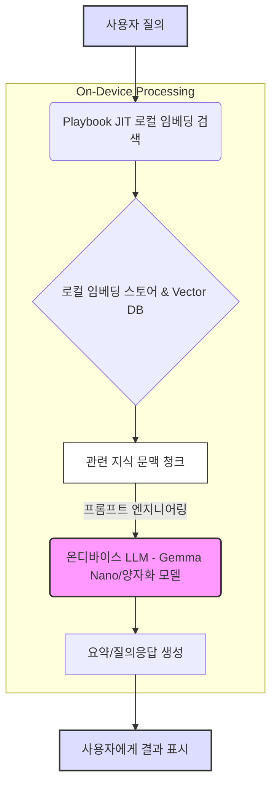

Playbook 지식 허브에 로컬 LLM (Large Language Model)을 통합하는 것은 사용자 경험을 혁신하고, 데이터 프라이버시를 강화하며, 네트워크 의존도를 줄이는 중요한 진화 방향입니다. Lastbook 프로젝트 사례에서 볼 수 있듯이, 오프라인 환경에서도 핵심 정보에 대한 즉각적인 질의응답이 가능하게 하는 on-device AI의 가치는 막대합니다. Playbook은 이러한 로컬 LLM 통합을 통해 JIT (Just-In-Time) 의미 검색 결과에 대한 즉각적인 요약 및 질의응답 기능을 제공하여 사용자에게 더욱 풍부하고 효율적인 정보 접근성을 제공할 수 있습니다.

## 온디바이스 LLM의 핵심 개념 및 이점
온디바이스 LLM은 모델 추론이 사용자 디바이스 내부에서 직접 실행되는 것을 의미합니다. 이는 클라우드 기반 LLM과 비교하여 여러 가지 중요한 이점을 제공합니다:

*   **저지연성 (Low Latency):** 네트워크 왕복 시간이 필요 없어 즉각적인 응답이 가능합니다. 이는 JIT 검색과 같은 실시간 상호작용이 중요한 시나리오에서 특히 유리합니다.
*   **데이터 프라이버시 (Enhanced Data Privacy):** 사용자 데이터가 디바이스를 벗어나지 않으므로 민감한 정보 처리 시 보안 및 프라이버시 리스크를 최소화할 수 있습니다.
*   **오프라인 기능 (Offline Capability):** 인터넷 연결 없이도 LLM 기능을 사용할 수 있어, 네트워크 환경이 불안정하거나 제한된 상황에서도 지식 허브의 가용성을 유지합니다.
*   **비용 효율성 (Cost Efficiency):** 클라우드 LLM API 호출에 따른 비용을 절감할 수 있습니다.

하지만 모델 경량화 (Quantization) 및 특정 디바이스 아키텍처 (예: MediaPipe, ML Kit, WebAssembly, WebGPU)에 최적화된 추론 엔진 통합은 필수적인 고려 사항입니다. Gemma Nano와 같은 경량화된 모델이나, Gemma 4 26B A4B 모델의 양자화 버전은 이러한 온디바이스 환경에 적합한 강력한 후보입니다.

## Playbook 지식 허브를 위한 아키텍처 설계
Playbook 지식 허브에 로컬 LLM을 통합하기 위한 아키텍처는 기존의 임베딩 기반 JIT 검색 시스템과 온디바이스 LLM을 유기적으로 연결해야 합니다. 다음은 일반적인 워크플로우입니다.

1.  **사용자 질의 (User Query):** 사용자가 지식 허브에 질문을 입력합니다.
2.  **로컬 임베딩 검색 (Local Embedding Search):** Playbook의 기존 JIT 의미 검색 엔진이 로컬에 저장된 지식 문서 임베딩에서 가장 관련성 높은 문맥 (Context Chunks)을 검색합니다. 이는 on-device Vector DB (`context-engineering/on-device-vector-db-jit-semantic-search`)를 활용할 수 있습니다.
3.  **문맥 주입 (Context Injection):** 검색된 문맥 청크는 프롬프트 엔지니어링을 통해 로컬 LLM에 주입됩니다.
4.  **온디바이스 LLM 추론 (On-Device LLM Inference):** Gemma Nano 또는 양자화된 로컬 LLM이 주입된 문맥을 바탕으로 요약, 질의응답 또는 추가적인 통찰을 생성합니다.
5.  **결과 표시 (Result Display):** LLM이 생성한 결과는 사용자 인터페이스에 즉시 표시됩니다.

이 과정은 모두 사용자 디바이스 내에서 발생하며, Next.js 클라이언트 환경에서는 WebAssembly 또는 WebGPU와 같은 기술 스택을 통해 구현될 수 있습니다.



## Next.js 환경에서의 구현 고려사항
Next.js 애플리케이션에서 온디바이스 LLM을 통합하기 위해서는 다음과 같은 기술적 고려사항이 필요합니다:

### 1. 모델 번들링 및 로딩
경량화된 LLM 모델 파일 (예: ONNX, TFLite 형식)은 Next.js 번들에 포함되거나, 애플리케이션 초기 로드 시 동적으로 다운로드될 수 있습니다. 대규모 모델의 경우, 사용자가 명시적으로 다운로드하도록 유도하는 전략이 필요할 수 있습니다.

### 2. 추론 엔진 선택
브라우저 환경에서 LLM 추론을 실행하기 위해 WebAssembly (Wasm) 또는 WebGPU 기반 라이브러리를 사용합니다. `transformers.js` (Hugging Face), MediaPipe, 또는 ML Kit (Web용 버전)와 같은 솔루션이 활용될 수 있습니다.

```typescript
// src/app/components/LocalLLMInterface.tsx
"use client";

import React, { useState, useEffect } from 'react';
// 실제 LLM 로딩 라이브러리 (예: transformers.js 또는 커스텀 Wasm 모듈) 가정
// import { pipeline } from '@huggingface/transformers'; 

interface LocalLLM {
  loadModel: () => Promise<void>;
  generate: (prompt: string, context: string[]) => Promise<string>;
}

// 가상의 로컬 LLM 서비스 구현
const createLocalLLMService = (): LocalLLM => {
  let isModelLoaded = false;

  return {
    loadModel: async () => {
      console.log("Loading local LLM model...");
      // 실제 모델 로딩 로직 (Wasm/WebGPU 기반)
      // await pipeline('summarization', 'Xenova/distilbart-cnn-6-6');
      await new Promise(resolve => setTimeout(resolve, 2000)); // Simulate loading time
      isModelLoaded = true;
      console.log("Local LLM model loaded.");
    },
    generate: async (prompt, context) => {
      if (!isModelLoaded) {
        throw new Error("Model not loaded. Please call loadModel first.");
      }
      console.log("Generating response with local LLM...");
      const fullPrompt = `Context: ${context.join("\n")}\nQuestion: ${prompt}\nAnswer:`;
      // 실제 추론 로직 (예: loadedPipeline(fullPrompt));
      await new Promise(resolve => setTimeout(resolve, 1000)); // Simulate inference time
      return `[Local LLM Response] ${prompt}에 대한 답변: ${context[0]?.substring(0, 50)}... (생략)`;
    },
  };
};

export default function LocalLLMInterface() {
  const [query, setQuery] = useState('');
  const [response, setResponse] = useState('');
  const [isLoading, setIsLoading] = useState(false);
  const [isModelReady, setIsModelReady] = useState(false);
  const [llmService, setLlmService] = useState<LocalLLM | null>(null);

  useEffect(() => {
    const service = createLocalLLMService();
    setLlmService(service);
    service.loadModel().then(() => {
      setIsModelReady(true);
    }).catch(error => console.error("Failed to load LLM", error));
  }, []);

  const handleSearch = async () => {
    if (!llmService || !isModelReady || !query.trim()) return;

    setIsLoading(true);
    setResponse('');
    try {
      // Playbook의 로컬 임베딩 검색 API 호출 (가상)
      const fetchedContext = await new Promise<string[]>(resolve => {
        setTimeout(() => {
          resolve([
            `Playbook entry about ${query}: This document provides detailed information on ${query} related to context engineering. It covers various aspects including design patterns and implementation strategies. The primary goal is to enhance user understanding and facilitate efficient knowledge retrieval.`, 
            `Another relevant document: Additional insights into ${query}'s practical application and common pitfalls. Focuses on performance optimization.`
          ]);
        }, 500);
      });

      const llmResponse = await llmService.generate(query, fetchedContext);
      setResponse(llmResponse);
    } catch (error) {
      console.error("Error during LLM generation", error);
      setResponse(`Error: ${error instanceof Error ? error.message : String(error)}`);
    } finally {
      setIsLoading(false);
    }
  };

  return (
    <div style={{ maxWidth: '800px', margin: 'auto', padding: '20px', border: '1px solid #ddd', borderRadius: '8px' }}>
      <h2 style={{ marginBottom: '20px' }}>Playbook 로컬 LLM 질의응답 (Next.js On-Device)</h2>
      <input
        type="text"
        value={query}
        onChange={(e) => setQuery(e.target.value)}
        placeholder="Playbook 지식 허브에 질문하세요..."
        disabled={!isModelReady || isLoading}
        style={{ width: '100%', padding: '10px', marginBottom: '10px', borderRadius: '4px', border: '1px solid #ccc' }}
      />
      <button
        onClick={handleSearch}
        disabled={!isModelReady || isLoading || !query.trim()}
        style={{ padding: '10px 20px', backgroundColor: '#007bff', color: 'white', border: 'none', borderRadius: '4px', cursor: 'pointer' }}
      >
        {isLoading ? '답변 생성 중...' : isModelReady ? '질문하기' : '모델 로딩 중...'}
      </button>
      {response && (
        <div style={{ marginTop: '20px', padding: '15px', backgroundColor: '#f9f9f9', border: '1px solid #eee', borderRadius: '4px' }}>
          <h3>답변:</h3>
          <p>{response}</p>
        </div>
      )}
      {!isModelReady && <p style={{ marginTop: '10px', color: '#555' }}>로컬 LLM 모델을 로딩 중입니다. 잠시 기다려 주세요.</p>}
    </div>
  );
}
```

### 3. 모델 경량화 (Quantization)
모델을 온디바이스 환경에서 효율적으로 실행하기 위해 quantization 기법을 적용합니다. 8-bit, 4-bit 양자화는 모델 크기를 줄이고 추론 속도를 향상시키면서도 합리적인 정확도를 유지하는 데 필수적입니다. Gemma 모델 계열은 이러한 경량화에 최적화된 구조를 가지고 있습니다.

### 4. JIT 검색 결과 통합
Playbook의 JIT 의미 검색 (`context-engineering/jit-embedding-retrieval-context-cost-scale-invariant`)은 사용자의 현재 문맥에 가장 적합한 정보를 효율적으로 찾아냅니다. 이 검색 결과는 로컬 LLM의 프롬프트에 `RAG (Retrieval Augmented Generation)` 방식으로 주입되어 LLM이 최신이고 정확한 정보를 기반으로 답변을 생성하도록 돕습니다. 이를 통해 LLM의 환각 (Hallucination) 현상을 크게 줄일 수 있습니다.

### 5. 캐싱 및 최적화
자주 사용되는 임베딩 검색 결과나 LLM의 중간 결과는 IndexedDB와 같은 클라이언트 측 스토리지에 캐싱하여 반복적인 연산을 줄이고 사용자 경험을 더욱 최적화할 수 있습니다.

## 트레이드오프
### 1. 추론 정확도 vs. 리소스 효율성
*   **언제 좋은가 (When Good):** 프라이버시, 저지연성, 오프라인 기능이 최우선일 때. 디바이스 리소스가 제한적이지만, 빠른 응답이 필수적인 경우. 경량화된 모델이 충분히 요구되는 정확도를 제공할 때.
*   **언제 나쁜가 (When Bad):** 클라우드 LLM 수준의 복잡한 추론 능력이나 방대한 최신 지식이 필요한 경우. 모델 경량화로 인해 정확도가 허용 범위를 벗어날 때.

### 2. 초기 로딩 시간 vs. 후속 상호작용 속도
*   **언제 좋은가 (When Good):** 초기 모델 로딩(다운로드 및 초기화) 후에는 매우 빠른 응답 속도를 기대할 수 있어, 반복적인 상호작용이 많은 Playbook 지식 허브와 같은 애플리케이션에 적합합니다.
*   **언제 나쁜가 (When Bad):** 모델 크기가 커서 초기 로딩 시간이 너무 길어지면 사용자가 불편함을 느낄 수 있습니다. 특히, 웹 환경에서는 초기 방문 시 사용자 이탈로 이어질 수 있습니다.

### 3. 개발 및 배포 복잡성 vs. 운영 비용 절감
*   **언제 좋은가 (When Good):** 클라우드 LLM API 비용을 장기적으로 크게 절감할 수 있으며, 클라우드 인프라 관리 부담을 줄입니다. 데이터 프라이버시 규제 준수에 유리합니다.
*   **언제 나쁜가 (When Bad):** 온디바이스 LLM 통합은 모델 경량화, 추론 엔진 최적화, 디바이스 호환성 등 개발 및 유지보수 과정에서 더 높은 기술적 복잡성을 요구합니다. 특히 다양한 OS 및 하드웨어 환경을 지원해야 할 때 난이도가 증가합니다.

## 실전 체크리스트
Playbook 지식 허브에 로컬 LLM 통합을 고려할 때 다음 항목들을 확인합니다.

*   [ ] **대상 디바이스 하드웨어 사양 정의 및 테스트:** 예상되는 사용자 디바이스의 최소/권장 CPU/RAM 사양을 명확히 정의하고, 해당 사양에서 로컬 LLM의 성능 테스트를 완료했는가?
*   [ ] **로컬 LLM 추론 지연 시간(Latency) 목표 설정:** 질의응답 기능에 대한 사용자 경험 목표 (예: 2초 이내 응답)를 설정하고, 실제 로컬 LLM의 추론 지연 시간이 이 목표를 만족하는지 벤치마킹했는가?
*   [ ] **모델 경량화 전략 및 적용 모델 선정:** Gemma Nano 또는 Quantized Gemma와 같이 온디바이스 환경에 적합한 모델을 선정하고, 8-bit 또는 4-bit 양자화와 같은 최적화 기법을 적용했는가?
*   [ ] **로컬 임베딩 검색 결과와 LLM 생성 답변 일관성 검증:** Playbook JIT 검색으로 얻은 문맥이 LLM에 정확히 전달되며, LLM이 이를 기반으로 일관되고 정확한 답변을 생성하는지 평가 지표를 수립하고 검증했는가?
*   [ ] **Next.js 클라이언트 추론 엔진 선정 및 POC:** Next.js 환경에서 WebAssembly/WebGPU 기반으로 LLM 추론을 실행할 `transformers.js`, MediaPipe, ML Kit 등 적절한 라이브러리를 선정하고 프로토타입 (POC)을 성공적으로 수행했는가?
*   [ ] **오프라인 동작 완전성 검증:** 인터넷 연결이 없는 상태에서도 로컬 임베딩 검색부터 LLM 답변 생성까지 전체 질의응답 워크플로우가 문제없이 동작하는지 검증했는가?
*   [ ] **사용자 프라이버시 보호 정책 구현:** 디바이스 내 데이터 처리와 관련하여 사용자 프라이버시를 보호하기 위한 명확한 정책을 수립하고, 기술적으로 이를 준수하도록 구현했는가?