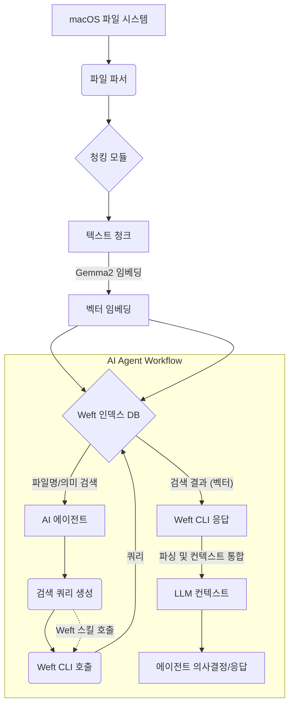

macOS 환경에서 로컬 파일 시스템의 방대한 정보를 효율적으로 탐색하는 것은 AI 에이전트의 성능을 극대화하는 핵심 과제입니다. Weft는 이 문제에 대한 해답으로 등장한 오픈소스 의미론적 검색 인덱스로, 온디바이스(on-device) 임베딩 모델인 Gemma2를 기반으로 파일의 내용과 의미를 인덱싱하여 강력한 검색 기능을 제공합니다. 이 위키 엔트리는 Weft의 핵심 기능을 평가하고, 기존의 JIT(Just-In-Time) 의미론적 검색 시스템과 비교하며, AI 에이전트의 지식 탐색 능력을 강화하기 위한 통합 방안을 모색합니다.

## Weft의 핵심 아키텍처 및 동작 원리
Weft는 macOS 사용자가 자신의 컴퓨터에 저장된 파일을 효과적으로 검색할 수 있도록 설계된 도구입니다. 기존의 파일명 기반 검색을 넘어, 파일의 실제 내용을 분석하여 의미론적인 검색 결과를 제공하는 것이 특징입니다. 이 과정은 다음과 같은 단계로 진행됩니다.

### 1. 파일 파싱(Parsing) 및 청킹(Chunking)
Weft는 다양한 형식의 파일(PDF, DOCX, TXT, MD 등)을 파싱하여 텍스트 데이터를 추출합니다. 추출된 텍스트는 특정 크기의 청크(chunk)로 분할됩니다. 이 청킹 과정은 의미적 일관성을 유지하면서도 임베딩 처리에 적합한 단위로 데이터를 나눕니다.

### 2. 임베딩(Embedding) 생성
각 청크는 Gemma2와 같은 온디바이스 대규모 언어 모델(LLM)을 기반으로 벡터 임베딩으로 변환됩니다. 임베딩은 텍스트의 의미를 다차원 벡터 공간에 수치적으로 표현한 것으로, 의미적으로 유사한 텍스트는 벡터 공간에서 가깝게 위치하게 됩니다. Weft는 이 외에도 파일, 폴더 단위로도 임베딩을 생성하여 다양한 레벨에서의 의미 검색을 지원합니다.

### 3. 인덱싱 및 검색
생성된 벡터 임베딩은 효율적인 검색을 위해 인덱스에 저장됩니다. 사용자가 쿼리를 입력하면, 해당 쿼리 또한 벡터 임베딩으로 변환되고, 인덱스에서 의미적으로 가장 유사한 청크, 파일, 또는 폴더를 찾아 반환합니다. Weft는 파일명 검색과 의미 검색 두 가지 방식을 모두 지원하여 유연한 정보 탐색을 가능하게 합니다.

## 기존 JIT 검색 시스템과의 비교
플레이북 에이전트는 현재 Xenova multilingual-e5-small 기반의 JIT 의미 검색을 활용하고 있습니다. Weft는 이와 유사한 목표를 가지지만, macOS 로컬 환경에 최적화되어 있다는 점에서 차별점을 가집니다.

*   **성능 및 지연 시간**: Weft는 온디바이스 모델을 사용하므로, 클라우드 기반 API 호출에 의존하는 JIT 검색 대비 네트워크 지연이 없습니다. 이는 로컬 환경에서의 즉각적인 응답이 중요한 에이전트 작업에 유리합니다.
*   **프라이버시 및 보안**: 모든 인덱싱 및 검색 작업이 로컬에서 이루어지므로, 민감한 파일 정보가 외부 서버로 전송될 위험이 없습니다. 이는 기업 환경이나 개인 정보 보호가 중요한 시나리오에서 큰 장점입니다.
*   **정확도 및 관련성**: Xenova multilingual-e5-small은 다국어 지원에 강점을 가지지만, Weft는 Gemma2를 활용하여 macOS 파일 시스템 특화된 의미론적 이해를 제공할 수 있습니다. 실제 파일 내용에 대한 심층적인 분석은 검색 정확도를 높일 수 있습니다.
*   **에이전트 스킬 통합**: Weft는 CLI 및 에이전트 스킬 지원을 통해 플레이북 에이전트가 직접 파일 시스템에 대한 의미론적 쿼리를 수행하고, 그 결과를 에이전트의 추론 과정에 통합할 수 있도록 합니다.

## AI 에이전트 통합 전략
Weft는 플레이북 에이전트의 지식 탐색 능력을 획기적으로 향상시킬 수 있는 잠재력을 가지고 있습니다. 특히 CLI 및 에이전트 스킬 지원은 에이전트가 Weft의 기능을 활용하는 데 중요한 역할을 합니다.

### 1. CLI 기반 지식 탐색 스킬 개발
에이전트는 Weft의 CLI 명령어를 사용하여 로컬 파일 시스템에 저장된 문서를 검색하고, 특정 정보를 추출하거나 요약할 수 있습니다. 예를 들어, 에이전트가 코드베이스 분석 중 특정 API의 사용 예시를 찾거나, 프로젝트 문서에서 특정 개념을 탐색해야 할 때 Weft CLI 스킬을 호출할 수 있습니다.

### 2. Weft 인덱스를 활용한 컨텍스트 보강
에이전트가 특정 작업을 수행할 때, Weft를 통해 관련 문서를 자동으로 검색하고, 그 내용을 LLM의 컨텍스트(context)에 추가하여 추론의 질을 높일 수 있습니다. 이는 RAG(Retrieval-Augmented Generation) 패턴의 온디바이스 구현으로 볼 수 있습니다.

### 3. 지속적인 인덱스 업데이트 및 관리
Weft 인덱스는 파일 시스템의 변경 사항을 반영하여 지속적으로 업데이트되어야 합니다. 에이전트는 스케줄링된 작업을 통해 인덱스를 갱신하거나, 특정 이벤트(파일 생성/수정)에 반응하여 인덱스 업데이트를 트리거하는 스킬을 가질 수 있습니다.

## 코드 예제: Weft CLI 활용
AI 에이전트가 Weft CLI를 사용하여 파일을 검색하는 기본적인 패턴입니다. Python의 `subprocess` 모듈을 활용하여 Weft CLI를 호출하고 결과를 파싱하는 예제입니다.

```python
import subprocess
import json

def search_weft_cli(query: str, limit: int = 5):
    """Weft CLI를 사용하여 의미론적 검색을 수행합니다."""
    command = [
        "weft",
        "search",
        "--query", query,
        "--json",
        "--limit", str(limit)
    ]
    try:
        result = subprocess.run(command, capture_output=True, text=True, check=True)
        return json.loads(result.stdout)
    except subprocess.CalledProcessError as e:
        print(f"Error during Weft search: {e.stderr}")
        return []

def get_file_content_weft_cli(file_path: str):
    """Weft CLI를 사용하여 파일의 전체 텍스트 내용을 가져옵니다."""
    command = [
        "weft",
        "cat",
        file_path
    ]
    try:
        result = subprocess.run(command, capture_output=True, text=True, check=True)
        return result.stdout
    except subprocess.CalledProcessError as e:
        print(f"Error reading file with Weft: {e.stderr}")
        return None

if __name__ == "__main__":
    search_query = "LLM 에이전트 메모리 관리 전략"
    print(f"Searching for: '{search_query}'")
    search_results = search_weft_cli(search_query)

    if search_results:
        print("--- Search Results ---")
        for item in search_results:
            print(f"Path: {item.get('path')}, Score: {item.get('score'):.4f}")
            # 첫 번째 결과의 내용 일부 가져오기
            if 'path' in item:
                content = get_file_content_weft_cli(item['path'])
                if content:
                    print(f"Content snippet: {content[:200]}...")
                    break # 첫 번째 결과만 예시로 표시
    else:
        print("No results found.")

```

## Weft 인덱싱 및 검색 워크플로우
아래 Mermaid 다이어그램은 Weft의 인덱싱 과정과 AI 에이전트가 이를 활용하는 검색 워크플로우를 시각화합니다.



## 트레이드오프

*   **로컬 실행 vs. 클라우드 확장성**: Weft는 macOS 로컬에서 실행되어 낮은 지연 시간과 높은 프라이버시를 제공합니다. 그러나 인덱싱 대상 파일의 규모가 매우 크거나(수 TB 이상) 여러 기기 간의 동기화가 필요한 경우에는 확장성 및 중앙 관리의 어려움이 있을 수 있습니다. (좋은 경우: 개인 개발 환경, 민감 데이터 처리; 나쁜 경우: 대규모 분산 시스템, 팀 협업 환경)
*   **온디바이스 임베딩 모델의 제약**: Gemma2와 같은 온디바이스 모델은 클라우드 기반의 대규모 모델에 비해 파라미터 수가 적어, 복잡하거나 미묘한 의미 관계를 포착하는 데 한계가 있을 수 있습니다. 이는 검색 정확도에 영향을 미칠 수 있습니다. (좋은 경우: 빠른 응답, 오프라인 환경; 나쁜 경우: 최고 수준의 의미론적 정확도 요구, 최신 지식 반영)
*   **인덱싱 오버헤드**: 대량의 파일을 인덱싱하는 초기 과정과 지속적인 업데이트는 상당한 CPU 및 디스크 I/O 자원을 소모할 수 있습니다. 특히 대용량 파일을 자주 수정하는 환경에서는 시스템 성능에 영향을 줄 수 있습니다. (좋은 경우: 정적인 파일 중심의 지식 베이스; 나쁜 경우: 실시간으로 파일 변경이 빈번한 코드 저장소, 리소스 제한적인 기기)
*   **플랫폼 종속성**: Weft는 macOS에 특화되어 있어, Windows나 Linux 환경에서는 직접적인 사용이 어렵습니다. 이는 멀티플랫폼 환경에서의 통합 솔루션을 구축할 때 추가적인 고려 사항이 됩니다. (좋은 경우: macOS 중심의 개인/팀 개발; 나쁜 경우: OS에 구애받지 않는 범용 솔루션 구축)

## 실전 체크리스트

*   [ ] Weft 인덱싱 대상 파일 경로 및 제외 목록을 명확히 정의하여 불필요한 인덱싱을 방지하는가?
*   [ ] Weft CLI의 `search` 및 `cat` 명령어를 에이전트 스킬로 래핑(wrapping)하고, 입력 파라미터와 출력 형식을 표준화했는가?
*   [ ] 플레이북 에이전트의 JIT 의미 검색(Xenova multilingual-e5-small)과 Weft 검색 결과의 상위 K개(top K) 유사성을 비교 평가하는 지표를 수립했는가?
*   [ ] Weft 인덱스 업데이트 주기 및 트리거 조건을 설정하여 파일 시스템 변경 사항이 검색 결과에 적시에 반영되도록 관리하는가?
*   [ ] Weft 인덱싱 과정에서 발생하는 CPU 및 메모리 사용량을 모니터링하고, 시스템 성능에 미치는 영향을 최소화하기 위한 최적화 방안을 마련했는가?
*   [ ] 에이전트가 Weft를 통해 검색된 컨텍스트를 LLM에 전달할 때, 토큰 사용량 및 컨텍스트 윈도우(context window) 한계를 고려하여 효과적인 청킹 및 요약 전략을 적용하는가?
*   [ ] Weft가 검색한 로컬 파일의 접근 권한 및 보안 정책이 AI 에이전트의 접근 통제와 일관되게 유지되는지 검증하는가?