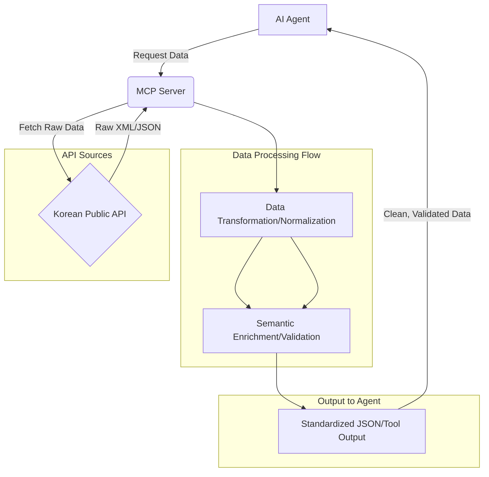

한국 공공 API 데이터는 AI 에이전트가 처리하기에 고유한 도전 과제를 제시한다. 비정형적이거나 일관성 없는 데이터 포맷, 모호한 필드명, 그리고 한국어 특유의 맥락적 요소는 LLM 기반 에이전트가 '그럴듯하지만 틀린 답'을 생성하는 주요 원인이 된다. DART(전자공시시스템), 공공데이터포털, 국가법령정보와 같은 핵심 공공 API의 응답은 복잡한 JSON/XML 구조, 불규칙한 데이터 타입, 그리고 명확하지 않은 스키마를 포함하는 경우가 많다. 에이전트가 이러한 원시 데이터를 그대로 사용하면, 표면적으로는 그럴듯해 보이지만 실제로는 핵심 정보를 오해하거나 잘못 해석할 위험이 크다.

### MCP 서버의 역할과 필요성

Multi-Cloud Proxy (MCP) 서버는 이러한 문제를 해결하기 위한 지능형 미들웨어 솔루션이다. MCP 서버는 AI 에이전트와 복잡한 외부 데이터 소스(여기서는 한국 공공 API) 사이에 위치하여, 데이터의 정규화(Normalization), 강화(Enrichment), 그리고 유효성 검사(Validation)를 수행한다. 이 과정을 통해 AI 에이전트는 복잡한 원시 데이터 대신, 정제되고 구조화된, 그리고 의미적으로 명확한 데이터를 입력받아 해석 정확도를 획기적으로 향상시킬 수 있다.

MCP 서버의 핵심 기능은 다음과 같다:

1.  **데이터 정규화 (Data Normalization)**: 다양한 형식의 API 응답(JSON, XML, CSV 등)을 AI 에이전트가 일관되게 이해할 수 있는 표준화된 구조(예: Simplified JSON Schema)로 변환한다.
2.  **의미 강화 (Semantic Enrichment)**: 모호한 필드명이나 코드 값을 인간이 이해하기 쉬운 설명이나 관련 메타데이터로 보강한다. 예를 들어, 특정 법령 코드에 해당하는 법령명이나 회사 코드에 대한 회사명을 추가한다.
3.  **데이터 유효성 검사 (Data Validation)**: 수신된 데이터가 미리 정의된 스키마나 비즈니스 규칙에 부합하는지 검증하여 잘못된 데이터를 필터링하거나 수정한다. 이는 에이전트의 잘못된 추론을 방지하는 데 필수적이다.
4.  **API 추상화 (API Abstraction)**: 여러 공공 API를 단일하고 일관된 인터페이스로 추상화하여, 에이전트가 각 API의 개별적인 특성을 신경 쓰지 않고 데이터를 요청할 수 있도록 한다.

### MCP 서버 아키텍처 및 워크플로우

일반적인 MCP 서버의 워크플로우는 다음과 같다:

1.  **데이터 수집 (Data Ingestion)**: AI 에이전트의 요청 또는 스케줄에 따라 한국 공공 API로부터 원시 데이터를 호출한다.
2.  **파싱 및 초기 정규화 (Parsing & Initial Normalization)**: 원시 응답(예: XML)을 JSON과 같은 중간 형식으로 파싱하고, 기본적인 데이터 타입 변환 및 필드명 매핑을 수행한다.
3.  **데이터 강화 (Data Enrichment)**: 외부 데이터 소스(예: 마스터 데이터베이스) 또는 내부 로직을 사용하여 데이터에 추가적인 의미론적 정보를 주입한다.
4.  **스키마 유효성 검사 (Schema Validation)**: 정규화된 데이터가 정의된 출력 스키마에 맞는지 검증한다. 유효하지 않은 데이터는 로깅하고, 에러 처리 로직에 따라 처리된다.
5.  **AI 에이전트 응답 (AI Agent Response)**: 최종적으로 정제되고 검증된 데이터를 AI 에이전트에게 전달한다.

```python
import requests
import json
import xml.etree.ElementTree as ET

class KoreaPublicApiMCP:
    def __init__(self, api_keys: dict):
        self.api_keys = api_keys
        self.api_endpoints = {
            "dart_corp_info": "https://opendart.fss.or.kr/api/corpCode.xml",
            "public_data_portal": "https://www.data.go.kr/api/example", # Placeholder
            "korea_law": "https://www.law.go.kr/api/example" # Placeholder
        }

    def _fetch_dart_corp_codes(self, page_no: int = 1) -> bytes:
        """DART에서 기업 코드 데이터를 XML로 가져옵니다."""
        url = self.api_endpoints["dart_corp_info"]
        params = {
            "crtfcKey": self.api_keys.get("DART_API_KEY"),
            "pageNo": page_no
        }
        response = requests.get(url, params=params)
        response.raise_for_status()
        return response.content

    def _normalize_dart_corp_codes(self, xml_data: bytes) -> list[dict]:
        """DART 기업 코드 XML을 정규화된 JSON 리스트로 변환합니다."""
        root = ET.fromstring(xml_data)
        corp_list = []
        for item in root.findall(".//list"): # DART API의 실제 응답 구조에 따라 경로 조정 필요
            corp_info = {
                "corp_code": item.find("corp_code").text if item.find("corp_code") is not None else "",
                "corp_name": item.find("corp_name").text if item.find("corp_name") is not None else "",
                "stock_code": item.find("stock_code").text if item.find("stock_code") is not None else "",
                "modify_date": item.find("modify_date").text if item.find("modify_date") is not None else ""
            }
            corp_list.append(corp_info)
        return corp_list

    def get_corporate_data_for_agent(self, query: str) -> list[dict]:
        """AI 에이전트가 요청하는 기업 정보를 MCP를 통해 정제하여 제공합니다."""
        print(f"[MCP] Fetching DART corporate data for query: {query}")
        try:
            raw_xml = self._fetch_dart_corp_codes(page_no=1) # 실제로는 query에 따라 검색
            normalized_data = self._normalize_dart_corp_codes(raw_xml)
            
            # 실제 구현에서는 query를 사용하여 normalized_data에서 필터링 및 추가 강화
            filtered_data = [d for d in normalized_data if query in d['corp_name']]

            if not filtered_data:
                print("[MCP] No data found for query, attempting semantic enrichment or alternative source.")
                # Placeholder for more advanced logic (e.g., call public data portal for similar names)
                return []

            # 데이터 유효성 검사 예시: 필수 필드 누락 확인
            validated_data = [
                d for d in filtered_data 
                if d.get('corp_code') and d.get('corp_name')
            ]
            print(f"[MCP] Successfully processed {len(validated_data)} corporate records.")
            return validated_data
        except requests.exceptions.RequestException as e:
            print(f"[MCP Error] API request failed: {e}")
            return []
        except ET.ParseError as e:
            print(f"[MCP Error] XML parsing failed: {e}")
            return []
        except Exception as e:
            print(f"[MCP Error] An unexpected error occurred: {e}")
            return []

# 예시 사용 (실제 API 키 필요)
# api_keys = {"DART_API_KEY": "YOUR_DART_API_KEY"}
# mcp_service = KoreaPublicApiMCP(api_keys)
# agent_query_result = mcp_service.get_corporate_data_for_agent("삼성")
# print(json.dumps(agent_query_result, indent=2, ensure_ascii=False))
```

이 예제는 DART API로부터 기업 코드 데이터를 가져와 정규화하는 `KoreaPublicApiMCP` 클래스의 개념을 보여준다. 실제 MCP 서버는 훨씬 더 복잡한 데이터 변환 규칙, 캐싱 메커니즘, 인증 및 권한 관리, 그리고 다양한 공공 API에 대한 통합된 인터페이스를 포함한다.

### MCP 서버 워크플로우 (Mermaid)



### 전략적 함의 및 2026년 트렌드

MCP 서버 도입은 2026년 AI 에이전트 개발 트렌드와 밀접하게 연관된다. **신뢰할 수 있는 AI (Reliable AI)** 구축의 핵심 요소이며, 에이전트의 **환각 (Hallucination) 감소**에 결정적인 역할을 한다. 정제된 데이터를 통해 에이전트의 **Tool Use (도구 사용)** 정확도가 높아지고, 복잡한 비즈니스 로직에 대한 **의사결정 정확도**가 향상된다. 이는 특히 한국 시장에서 기업, 부동산, 법률 데이터를 다루는 AI 에이전트의 상용화 가능성을 크게 높이는 기반 기술이다. 또한, LLM의 비용 효율성을 높이는 데 기여한다. 에이전트가 복잡한 원시 데이터를 파싱하고 해석하는 데 필요한 토큰 수가 줄어들기 때문이다.

## 트레이드오프

MCP 서버 도입은 AI 에이전트의 데이터 해석 정확도를 높이지만, 다음과 같은 트레이드오프를 고려해야 한다.

*   **복잡성 증가 vs. AI 에이전트 신뢰도 향상**: 시스템에 추가 계층이 생겨 전체 아키텍처의 복잡도가 증가한다. 이는 초기 설계 및 구현 비용을 높일 수 있다. 그러나 AI 에이전트가 '그럴듯하지만 틀린 답'을 내는 위험을 크게 줄여, 장기적인 시스템 신뢰도와 사용자 만족도를 향상시킨다. **언제 좋은가**: AI 에이전트의 데이터 해석 오류가 비즈니스에 치명적인 영향을 미 미치는 경우 (예: 금융, 법률, 의료 분야). **언제 나쁜가**: 데이터 정확도보다 개발 속도나 단순성이 더 중요한 초기 PoC 단계.
*   **추가 지연 시간 vs. 불필요한 AI 재시도 감소**: MCP 서버를 통한 데이터 처리 과정이 추가되어 API 응답에 약간의 지연이 발생할 수 있다. 하지만 AI 에이전트가 잘못된 데이터로 인해 여러 번 재시도하거나 사용자에게 잘못된 정보를 전달하는 데 드는 시간과 비용을 절감할 수 있다. **언제 좋은가**: AI 에이전트의 응답 정확성이 실시간성보다 중요한 경우. **언제 나쁜가**: 밀리초 단위의 초고속 응답이 필수적인 실시간 트레이딩 시스템 등.
*   **개발 및 유지보수 비용 vs. AI 에러 디버깅 및 사용자 불만 감소**: MCP 서버의 개발, 배포, 그리고 공공 API 변경에 따른 지속적인 유지보수에는 비용이 수반된다. 하지만 AI 에이전트의 데이터 해석 오류로 인한 디버깅 시간, 잘못된 정보로 인한 사용자 불만 및 이탈 비용을 크게 줄일 수 있다. **언제 좋은가**: 시스템이 프로덕션 환경에서 안정적으로 운영되어야 하고, AI 오류가 직접적인 손실로 이어질 수 있는 경우. **언제 나쁜가**: 리소스가 제한적이고 실험적인 기능 개발에 집중해야 하는 스타트업 초기 단계.
*   **데이터 처리 중앙화 vs. 에이전트 자율성**: MCP는 데이터 처리 로직을 중앙 집중화하여 관리의 용이성과 일관성을 제공한다. 하지만 각 에이전트가 데이터 처리 방식에 대한 자율성을 갖기 어렵게 만들 수 있다. **언제 좋은가**: 다수의 AI 에이전트가 동일한 공공 API 데이터를 사용하며, 데이터 해석의 일관성과 거버넌스가 중요한 경우. **언제 나쁜가**: 각 에이전트가 매우 특수하고 독립적인 데이터 처리 로직을 필요로 하는 분산형 에이전트 시스템.

## 실전 체크리스트

MCP 서버를 한국 공공 API 연동에 도입할 때 고려해야 할 실전 체크리스트는 다음과 같다.

- [ ] **대상 API 정의 및 스키마 분석**: 연동할 한국 공공 API(DART, 공공데이터포털, 국가법령정보 등)를 명확히 정의하고, 각 API의 원시 데이터 스키마와 응답 특성(JSON, XML, 인코딩)을 완벽하게 분석했는가?
- [ ] **정규화된 출력 스키마 설계**: AI 에이전트가 가장 효율적으로 이해하고 사용할 수 있는 표준화된 데이터 출력 스키마(예: GraphQL, Clean JSON)를 설계하고 문서화했는가?
- [ ] **데이터 유효성 검사 규칙 구현**: 각 API 응답에 대해 비즈니스 로직 및 AI 에이전트의 요구사항을 반영한 강력한 데이터 유효성 검사 규칙(필수 필드, 데이터 타입, 범위)을 구현했는가?
- [ ] **오류 처리 및 로깅 메커니즘**: API 호출 실패, 데이터 변환 오류, 유효성 검사 실패 등에 대한 강력한 오류 처리 로직과 상세 로깅 시스템을 구축하여 문제를 신속하게 진단하고 해결할 수 있는가?
- [ ] **성능 및 확장성 검토**: MCP 서버가 처리할 데이터 볼륨과 AI 에이전트 요청량을 고려하여, 충분한 성능을 제공하고 트래픽 증가에 따라 확장될 수 있는 아키텍처(예: 비동기 처리, 캐싱)를 설계했는가?
- [ ] **보안 및 접근 제어**: 공공 API 키 및 민감 데이터에 대한 접근 제어, 데이터 암호화, API 요청 시 인증/인가 등 보안 정책을 철저히 적용했는가?
- [ ] **API 변경 관리 전략**: 공공 API의 변경(필드 추가/삭제, 스키마 변경)에 대비하여 MCP 서버의 업데이트 및 배포 전략(예: 버전 관리, 자동 테스트)을 수립하고, 변경 사항을 모니터링할 수 있는가?