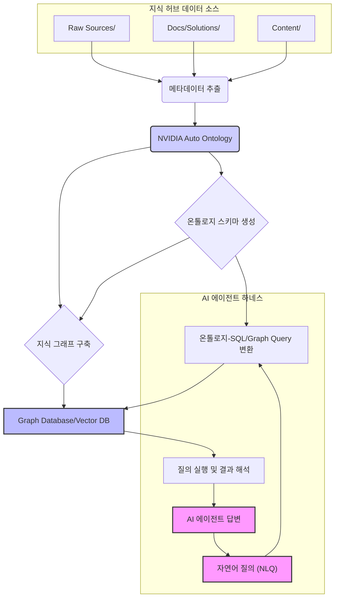

NVIDIA Auto Ontology는 기업 데이터의 내재된 의미와 관계를 자동으로 추출하여 온톨로지(Ontology) 및 지식 그래프(Knowledge Graph, KG) 형태로 구조화하는 오픈소스 도구입니다. 이는 AI 에이전트가 방대한 기업 데이터를 정확하게 이해하고, 자연어 질의를 통해 효율적으로 정보를 탐색하며, 신뢰할 수 있는 답변을 생성하는 데 필수적인 기반 지식을 제공합니다. 본 PoC(개념 증명)는 NVIDIA Auto Ontology를 활용하여 기존의 지식 허브 내 메타데이터와 구조화된 정보를 온톨로지로 변환하고, 이를 'AI 에이전트 하네스'에 연동하여 지식 탐색 효율성을 극대화하는 방안을 모색합니다.

## 지식 허브의 구조화된 이해 증진

기존의 지식 허브는 다양한 형식의 문서와 데이터셋으로 구성되어 있으며, 이들 간의 복잡한 관계는 AI 에이전트가 심층적인 비즈니스 컨텍스트를 파악하는 데 한계를 가집니다. NVIDIA Auto Ontology는 이러한 원본 데이터(예: `raw-sources/`, `docs/solutions/`, `content/` 디렉터리 내의 정보)에서 업무 용어, 지표, 데이터 계보 및 관계를 자동으로 식별하고, 이를 온톨로지 모델로 변환합니다. 이 온톨로지는 특정 도메인에 대한 명시적인 지식 모델을 제공하여 AI 에이전트가 데이터를 단순히 검색하는 것을 넘어, 의미론적으로 추론하고 질의에 대한 논리적인 답변을 구성할 수 있도록 돕습니다.

### 온톨로지 기반 지식 그래프의 역할

지식 그래프는 온톨로지에 정의된 엔티티(Entity)와 관계(Relationship)를 실제 데이터 인스턴스에 적용하여 구축됩니다. 이는 데이터 간의 연결성을 시각화하고, 복잡한 질의에 대한 다중 홉(multi-hop) 추론을 가능하게 합니다. AI 에이전트의 관점에서, 지식 그래프는 다음과 같은 핵심적인 이점을 제공합니다:

1.  **의미론적 이해 (Semantic Understanding)**: 데이터의 표면적인 키워드를 넘어, 실제 의미와 컨텍스트를 파악하게 합니다.
2.  **질의 응답 정확도 향상 (Enhanced Q&A Accuracy)**: 자연어 질문을 정형화된 쿼리(예: SQL)로 변환할 때, 온톨로지는 모호성을 줄이고 정확한 데이터 경로를 제시합니다.
3.  **데이터 계보 및 출처 제공 (Data Lineage & Provenance)**: 답변의 근거가 되는 데이터의 원천과 변환 과정을 명확히 밝혀 신뢰도를 높입니다.
4.  **환각 현상 감소 (Hallucination Reduction)**: LLM의 추론 과정을 실제 지식 그래프에 기반하게 하여 잘못된 정보 생성을 방지합니다.

## PoC 아키텍처 및 워크플로우

NVIDIA Auto Ontology PoC는 다음의 단계로 진행될 수 있습니다:

1.  **데이터 수집 및 전처리**: `playbook` 내의 markdown 파일, YAML 메타데이터 등 구조화된 정보를 수집합니다. 필요한 경우 데이터 클리닝 및 정규화를 수행합니다.
2.  **온톨로지 생성**: NVIDIA Auto Ontology를 사용하여 수집된 메타데이터에서 엔티티, 속성, 관계를 자동으로 추출하고 온톨로지 스키마를 생성합니다. 기존 온톨로지 또는 의미 모델이 있다면 이를 통합할 수도 있습니다.
3.  **지식 그래프 구축**: 생성된 온톨로지 스키마를 기반으로 실제 데이터를 인스턴스화하여 지식 그래프를 구축합니다. 이는 Graph Database(예: Neo4j, Amazon Neptune) 또는 Relational Database의 Graph Extension에 저장될 수 있습니다.
4.  **AI 에이전트 하네스 연동**: 구축된 지식 그래프를 'AI 에이전트 하네스'에 연결합니다. AI 에이전트는 자연어 질문을 받아 온톨로지-SQL 변환 레이어를 통해 지식 그래프에 쿼리하고, 결과를 해석하여 사용자에게 답변합니다.

다음은 PoC 워크플로우를 나타내는 Mermaid 다이어그램입니다:



### 코드 예시: 개념적 온톨로지 모델링

NVIDIA Auto Ontology는 내부적으로 데이터를 파싱하여 스키마를 추론하고 관계를 정의합니다. 다음은 Python을 사용하여 지식 허브 내 `Document`와 `Tag`, 그리고 그 관계를 개념적으로 모델링하는 예시입니다.

```python
# playbook/raw-sources/example_doc.md 의 메타데이터 가정
metadata = {
    "id": "example-doc-1",
    "title": "NVIDIA Auto Ontology Overview",
    "category": "Data Engineering",
    "tags": ["NVIDIA", "AutoOntology", "KnowledgeGraph"],
    "author": "AI Writer",
    "date": "2026-07-25"
}

class Entity:
    def __init__(self, id, type, properties):
        self.id = id
        self.type = type
        self.properties = properties

class Relationship:
    def __init__(self, source_id, target_id, type, properties={}):
        self.source_id = source_id
        self.target_id = target_id
        self.type = type
        self.properties = properties

# Auto Ontology가 추출할 수 있는 엔티티 및 관계 예시
document_entity = Entity(
    id=metadata["id"],
    type="Document",
    properties={
        "title": metadata["title"],
        "category": metadata["category"],
        "date": metadata["date"]
    }
)

tag_entities = []
tag_relationships = []

for tag_name in metadata["tags"]:
    tag_entity = Entity(
        id=f"tag-{tag_name.lower().replace(' ', '-')}",
        type="Tag",
        properties={
            "name": tag_name
        }
    )
    tag_entities.append(tag_entity)

    # Document HAS_TAG Tag 관계
    tag_relationships.append(
        Relationship(
            source_id=document_entity.id,
            target_id=tag_entity.id,
            type="HAS_TAG"
        )
    )

print(f"Document Entity: ({document_entity.id}) {document_entity.type} {document_entity.properties}")
for tag_e in tag_entities:
    print(f"Tag Entity: ({tag_e.id}) {tag_e.type} {tag_e.properties}")
for rel in tag_relationships:
    print(f"Relationship: ({rel.source_id}) -[{rel.type}]-> ({rel.target_id})")
```

이러한 방식으로 추출된 엔티티와 관계 정보는 지식 그래프 데이터베이스에 저장되어 AI 에이전트의 질의에 활용됩니다. 예를 들어, "`NVIDIA Auto Ontology` 태그를 가진 `Data Engineering` 카테고리 문서를 찾아줘" 와 같은 자연어 질문은 이 온톨로지 모델을 통해 정밀한 쿼리로 변환될 수 있습니다.

## 2026년 최신 트렌드와 PoC의 시사점

2026년의 AI 트렌드는 **생성형 AI(Generative AI)**의 기업 데이터 활용 증대와 **강화된 RAG (Retrieval Augmented Generation)** 시스템 구축에 초점을 맞추고 있습니다. NVIDIA Auto Ontology를 활용한 지식 허브 온톨로지 구축 PoC는 이러한 트렌드에 완벽하게 부합합니다.

*   **AI 에이전트의 자율성 증대**: 온톨로지와 지식 그래프는 AI 에이전트가 데이터의 의미를 심층적으로 이해하고, 스스로 판단하여 복잡한 작업을 수행하는 데 필요한 '뇌' 역할을 합니다.
*   **RAG 시스템의 정확도와 확장성**: 기존 RAG는 문서 검색에 의존하지만, 온톨로지 기반 지식 그래프는 의미론적 검색을 가능하게 하여, 검색 정확도를 높이고 LLM의 환각 현상을 획기적으로 줄일 수 있습니다.
*   **데이터 거버넌스 및 신뢰성 확보**: 자동화된 온톨로지 생성은 기업 내 분산된 데이터를 일관된 형태로 통합하고, 데이터의 정의와 계보를 명확히 하여 데이터 거버넌스를 강화합니다. 이는 특히 답변의 출처를 명확히 해야 하는 비즈니스 환경에서 중요한 가치를 가집니다.

## 트레이드오프

### 1. 자동화된 온톨로지 생성 vs. 수동 큐레이션
*   **언제 좋은가**: 대규모의 분산된 데이터 소스에서 초기 온톨로지를 빠르게 구축해야 할 때 유리합니다. 반복적이고 정형화된 메타데이터에서 효율적입니다. 온톨로지 유지보수 비용을 절감하고, 데이터 스키마 변경 시 유연하게 대응할 수 있습니다.
*   **언제 나쁜가**: 비즈니스 도메인의 미묘하고 복잡한 암묵적 지식이나, 추상적인 개념, 예외적인 비즈니스 규칙을 정확히 모델링해야 할 때는 수동 큐레이션의 정밀도가 더 높을 수 있습니다. 자동화된 모델은 인간의 개입 없이 이러한 뉘앙스를 포착하기 어렵습니다.

### 2. AI 에이전트 통합 복잡성 vs. 지식 활용도 증가
*   **언제 좋은가**: AI 에이전트가 자연어 질의를 통해 데이터를 이해하고 탐색하는 능력이 비약적으로 향상됩니다. 복잡한 다중 관계 질의나 비즈니스 논리 추론이 필요한 경우, 온톨로지 기반 접근 방식은 훨씬 더 정확하고 심층적인 답변을 제공합니다. 개발자가 직접 복잡한 SQL 쿼리를 작성할 필요 없이 자연어 인터페이스를 제공할 수 있습니다.
*   **언제 나쁜가**: 온톨로지-SQL 변환 레이어, 지식 그래프 데이터베이스 관리, LLM과의 통합 등 시스템 아키텍처의 복잡성이 증가합니다. 초기 구축 및 디버깅에 상당한 시간과 리소스가 소요될 수 있으며, 변환 정확도에 대한 지속적인 모니터링이 필요합니다.

### 3. 메타데이터 의존성 vs. 스키마 진화 유연성
*   **언제 좋은가**: 원본 데이터의 메타데이터가 잘 관리되고 일관성이 높다면, 온톨로지 생성의 정확도가 매우 높아집니다. 이는 강력한 데이터 거버넌스 프레임워크를 구축하고, 일관된 지식 모델을 유지하는 데 기여합니다. 메타데이터 변경 시 온톨로지 모델을 자동 또는 반자동으로 업데이트하는 파이프라인 구축이 용이합니다.
*   **언제 나쁜가**: 원본 데이터 소스의 메타데이터 품질이 낮거나, 일관성 없는 스키마를 가진 경우, Auto Ontology의 성능이 저하될 수 있습니다. 온톨로지 생성 후에도 지속적인 검증과 보정이 필요하며, 원본 스키마가 급격하게 자주 변경되는 환경에서는 온톨로지 업데이트 비용이 커질 수 있습니다.

## 실전 체크리스트

NVIDIA Auto Ontology를 활용한 지식 허브 구축 PoC를 성공적으로 진행하기 위한 실전 체크리스트입니다:

- [ ] **초기 데이터 소스 분석**: `raw-sources/`, `docs/solutions/`, `content/` 디렉터리 내 메타데이터의 정합성, 일관성, 구조화 수준을 철저히 분석하고 문서화했는가?
- [ ] **PoC 환경 설정 및 데이터 연동**: NVIDIA Auto Ontology PoC 환경(Docker 또는 클라우드 인스턴스)을 구축하고, 대상 데이터 소스와의 연결 및 초기 데이터 로딩을 성공적으로 완료했는가?
- [ ] **온톨로지/지식 그래프 검증**: Auto Ontology를 통해 생성된 온톨로지 스키마 및 지식 그래프의 핵심 엔티티와 관계 매핑이 비즈니스 요구사항에 따라 정확하게 모델링되었는지 검증하고 피드백 루프를 마련했는가?
- [ ] **NLQ -> SQL/Graph Query 변환 정확도 측정**: 'AI 에이전트 하네스'가 자연어 질의를 지식 그래프 쿼리(SQL 또는 Graph Query)로 변환하는 정확도를 측정할 벤치마크 데이터셋을 구축하고, 초기 정확도를 평가했는가?
- [ ] **답변 출처 및 데이터 계보 제공**: AI 에이전트가 생성한 답변에 대해 그 근거가 되는 지식 그래프 내 엔티티/관계 및 원본 데이터 소스를 명확하게 추적하고 사용자에게 제공하는 기능을 구현했는가?
- [ ] **온톨로지 업데이트 전략 수립**: 지식 허브 데이터의 변경 주기를 고려하여 온톨로지 및 지식 그래프를 업데이트하는 자동화된 파이프라인(예: 주기적 재구축 또는 증분 업데이트) 전략을 수립했는가?
- [ ] **LLM 환각 현상 방지 메커니즘**: 지식 그래프를 통해 LLM의 답변을 제어하여 환각 현상을 최소화하기 위한 가드레일(Guardrails) 및 모니터링 체계(예: RAG 품질 평가 지표)를 구축했는가?