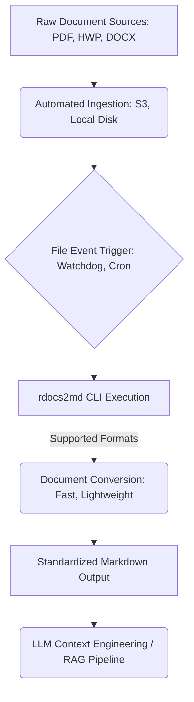

다양한 형식의 원천 문서(PDF, HWP, DOCX 등)는 정보의 보고이지만, 대규모 언어 모델(LLM) 기반 시스템, 특히 RAG(Retrieval-Augmented Generation) 파이프라인에 통합하기는 쉽지 않습니다. 문서마다 다른 구조와 포맷은 일관된 정보 추출과 컨텍스트 엔지니어링을 저해하며, 비효율적인 처리 속도와 높은 리소스 비용으로 이어질 수 있습니다.

이러한 문제를 해결하기 위해 `rdocs2md`와 같은 경량 문서 변환 도구를 활용한 Markdown 변환 파이프라인 구축은 매우 효과적인 전략입니다. `rdocs2md`는 Rust로 개발된 CLI(Command Line Interface) 도구로, PDF, HWP/HWPX, DOC/DOCX, PPT/PPTX, XLS/XLSX, ODT/ODS/ODP, RTF, EPUB 등 14가지 이상의 광범위한 문서 형식을 Markdown으로 빠르고 효율적으로 변환할 수 있습니다. 특히, 단일 실행 파일로 제공되며 별도의 런타임이나 Office 프로그램 설치가 필요 없다는 점은 배포와 운영의 복잡성을 크게 낮춥니다.

### rdocs2md 기반 파이프라인 아키텍처

`rdocs2md`를 활용한 문서 변환 파이프라인은 `raw-sources/` 디렉토리에 유입되는 원본 문서를 자동으로 감지하고, 이를 표준화된 Markdown 형식으로 변환하여 `markdown-sources/` 디렉토리에 저장하는 방식으로 구성될 수 있습니다. 이 파이프라인은 LLM 컨텍스트 엔지니어링을 위한 일관된 데이터 소스를 확보하고, 처리 속도를 개선하는 데 핵심적인 역할을 수행합니다. 2026년 최신 데이터 엔지니어링 트렌드는 LLM을 위한 데이터 전처리의 자동화와 효율성을 강조하며, `rdocs2md`는 이러한 요구사항에 부합하는 도구입니다.



위 다이어그램은 `rdocs2md`가 데이터 처리 파이프라인의 핵심 변환 계층으로 어떻게 통합되는지 보여줍니다. Raw Document Sources에서 유입된 다양한 형식의 문서는 Ingestion 단계를 거쳐, 파일 이벤트 트리거(예: 주기적인 Cron job 또는 파일 시스템 변경 감지 Watchdog)에 의해 `rdocs2md` CLI 실행을 호출합니다. `rdocs2md`는 이를 빠르고 경량으로 Markdown으로 변환하고, 그 결과는 LLM 컨텍스트 엔지니어링 및 RAG 파이프라인의 입력으로 사용됩니다.

### 파이프라인 구축 예제 (Python)

다음 Python 스크립트는 `rdocs2md` CLI를 호출하여 `raw-sources` 디렉토리의 문서를 `markdown-sources` 디렉토리로 변환하는 기본적인 파이프라인 로직을 보여줍니다. 실제 프로덕션 환경에서는 이 스크립트를 Apache Airflow, Prefect, 또는 Kubernetes Job과 같은 오케스트레이션 도구에 통합하여 실행할 수 있습니다.

```python
import os
import subprocess
from pathlib import Path

def convert_document_to_markdown(input_path: Path, output_dir: Path):
    """
    rdocs2md CLI를 활용하여 다양한 문서 형식을 Markdown으로 변환합니다.
    """
    if not input_path.is_file():
        print(f"Error: Input path is not a file {input_path}")
        return

    output_dir.mkdir(parents=True, exist_ok=True)
    
    file_name_stem = input_path.stem
    output_markdown_path = output_dir / f"{file_name_stem}.md"

    # rdocs2md CLI 경로를 환경 변수나 설정 파일에서 가져오는 것을 권장합니다.
    # 여기서는 예시를 위해 현재 디렉토리에 있다고 가정합니다.
    rdocs2md_cli_path = "./rdocs2md" 

    try:
        # rdocs2md 명령 실행
        command = [rdocs2md_cli_path, str(input_path), "-o", str(output_markdown_path)]
        print(f"Executing: {' '.join(command)}")
        
        result = subprocess.run(command, capture_output=True, text=True, check=True)
        print(f"Successfully converted {input_path.name} to {output_markdown_path.name}")

    except subprocess.CalledProcessError as e:
        print(f"Error converting {input_path.name}: {e}")
        print("STDOUT:", e.stdout)
        print("STDERR:", e.stderr)
    except FileNotFoundError:
        print(f"Error: rdocs2md CLI not found at {rdocs2md_cli_path}. Make sure it's installed and accessible.")

if __name__ == "__main__":
    raw_sources_dir = Path("raw-sources")
    markdown_output_dir = Path("markdown-sources")

    # 예시 문서 생성 (실제 환경에서는 다양한 형식의 문서가 존재)
    raw_sources_dir.mkdir(parents=True, exist_ok=True)
    (raw_sources_dir / "sample.pdf").touch() # Dummy file
    (raw_sources_dir / "document.docx").touch() # Dummy file
    (raw_sources_dir / "report.hwp").touch() # Dummy file

    print(f"Scanning {raw_sources_dir} for documents...")
    for doc_file in raw_sources_dir.iterdir():
        if doc_file.is_file():
            convert_document_to_markdown(doc_file, markdown_output_dir)

    print("\nConversion process finished.")
    print(f"Converted Markdown files can be found in: {markdown_output_dir}")
```

이 파이프라인을 통해 얻는 핵심 이점은 LLM에 입력되는 데이터의 일관성(consistency)입니다. 모든 문서가 단일 Markdown 형식으로 통일되면, 임베딩 생성(embedding generation)의 품질이 향상되고, RAG 시스템의 검색 관련성(retrieval relevance) 및 최종 응답의 정확도가 높아집니다. 또한, `rdocs2md`의 빠른 변환 속도는 대규모 문서 코퍼스 처리 시간을 단축하여 전체 LLM 워크플로우의 효율성을 증대시킵니다.

## 트레이드오프

`rdocs2md` 기반 Markdown 변환 파이프라인 구축은 여러 장점을 제공하지만, 고려해야 할 트레이드오프도 존재합니다. 이 섹션은 이 패턴/접근의 장단점을 명확히 제시하여 다른 엔트리가 이 문서를 참조할 때 적절한 판단 근거를 제공합니다.

*   **속도 및 경량성 (Speed & Lightweight)**
    *   **언제 좋음**: 대량의 문서 처리 요구사항이 있거나, 리소스 제약이 있는 환경(예: 엣지 디바이스, CI/CD 파이프라인의 빠른 전처리 단계)에서 기존 Pandoc 등 무거운 솔루션 대비 월등한 효율성을 제공합니다.
    *   **언제 나쁨**: 변환 대상 문서의 수가 매우 적고, 변환 속도가 Critical Path가 아닌 경우, 추가적인 CLI 도구 도입에 대한 운영 복잡성 증가가 미미한 이점을 상회할 수 있습니다.
*   **다양한 형식 지원 및 단일 실행 파일 (Broad Format Support & Single Binary)**
    *   **언제 좋음**: 이기종의 다양한 문서 소스(PDF, HWP, Office 등)를 단일 파이프라인으로 통합해야 할 때 복잡성을 줄여주며, 배포 및 운영을 간소화하여 인프라 관리 부담을 경감합니다.
    *   **언제 나쁨**: 모든 원천 문서가 이미 Markdown과 유사한 텍스트 기반 형식(예: `.txt`, `.json`)이거나, 특정 문서 형식이 매우 제한적인 경우, `rdocs2md`의 광범위한 형식 지원 기능이 과도할 수 있습니다.
*   **레이아웃 및 서식 손실 (Layout & Formatting Loss)**
    *   **언제 좋음**: 문서의 핵심 텍스트 콘텐츠와 구조(제목, 문단, 목록, 표) 추출이 주 목적이며, 시각적 레이아웃의 정확한 보존이 덜 중요한 경우(예: LLM RAG용 텍스트 임베딩 생성).
    *   **언제 나쁨**: 원본 문서의 시각적 정보나 복잡한 서식(예: 특정 폰트, 이미지 위치, 복잡한 그래픽, 재무 보고서의 미세한 표 레이아웃)이 비즈니스 로직이나 정보 해석에 핵심적인 역할을 하는 경우, Markdown 변환은 중요한 정보를 손실시킬 수 있습니다.

## 실전 체크리스트

`rdocs2md` 기반의 문서 변환 파이프라인을 프로젝트에 적용할 때 다음 항목들을 검증하여 성공적인 통합을 보장합니다.

*   [ ] 원천 문서 형식별 `rdocs2md` 변환 품질 평가 및 예외 처리 로직 설계: 다양한 문서 샘플에 대해 변환을 수행하고, Markdown 출력의 정확성, 누락된 정보 여부, 레이아웃 보존 수준을 평가하여 기대치와 차이점을 파악하고, 필요한 경우 후처리 스크립트를 계획합니다.
*   [ ] 대규모 문서 볼륨 처리를 위한 파이프라인의 병렬 처리 및 확장성(scalability) 검증: 수십만, 수백만 건의 문서 처리를 위한 동시성 제어, 분산 처리 전략(예: 메시지 큐 기반 워커 풀)을 설계하고, 실제 환경에서 성능 병목 현상을 테스트합니다.
*   [ ] 변환된 Markdown 문서의 구문 유효성(syntax validity) 및 LLM 컨텍스트 적합성 검토: 변환된 Markdown이 올바른 구문을 따르는지, LLM이 효과적으로 이해하고 활용할 수 있는 구조(예: 헤딩, 목록, 코드 블록)를 갖추었는지 확인합니다.
*   [ ] 문서 변환 실패 시 재시도 로직, 오류 보고, 원본 보존 정책 수립: 특정 문서가 변환에 실패할 경우, 자동 재시도, 실패 로그 기록, 원본 문서 격리, 담당자 알림 등 견고한 오류 처리 및 모니터링 시스템을 구축합니다.
*   [ ] 새로운 문서 형식이 추가되거나 `rdocs2md` 업데이트 시 파이프라인 재검증 프로세스 구축: 향후 새로운 문서 형식 지원이 필요하거나 `rdocs2md` 도구 자체가 업데이트될 경우, 기존 파이프라인의 호환성과 안정성을 보장하기 위한 회귀 테스트 및 재검증 절차를 마련합니다.
*   [ ] 변환 파이프라인의 엔드-투-엔드(end-to-end) 처리 속도 및 리소스 사용량 모니터링: 전체 문서 변환 과정의 소요 시간, CPU/메모리 사용량, 디스크 I/O 등을 지속적으로 모니터링하여 최적의 성능을 유지하고, 예상치 못한 비용 증가를 방지합니다.
*   [ ] 변환된 Markdown 문서에 포함될 수 있는 민감 정보의 마스킹/제거 전략 구현: 원본 문서에 포함된 개인 식별 정보(PII), 영업 비밀 등 민감한 데이터가 LLM 컨텍스트에 부적절하게 노출되지 않도록, 변환 후 또는 변환 중 마스킹, 필터링, 익명화 등의 보안 처리 단계를 추가합니다.