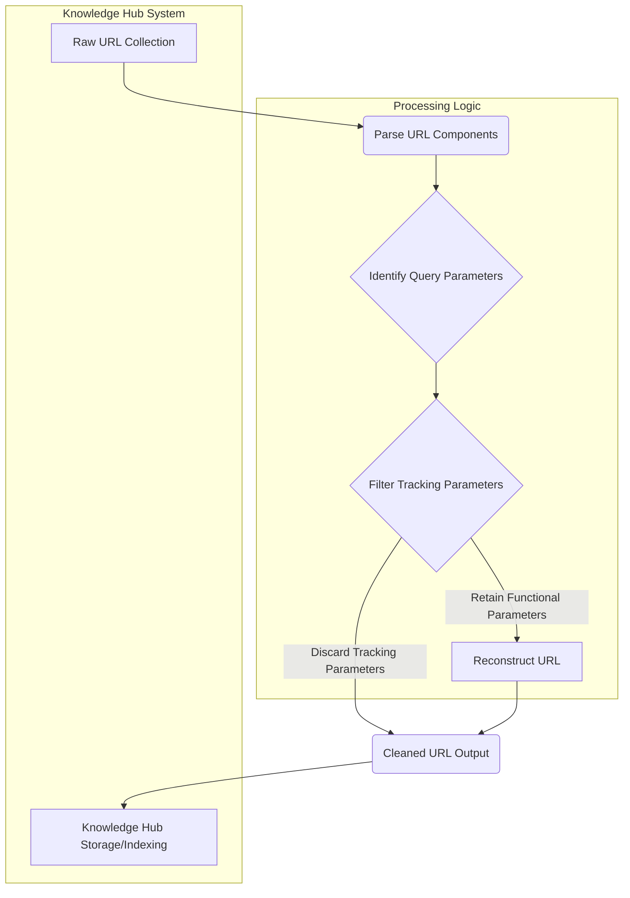

The proliferation of tracking parameters in URLs poses significant challenges for knowledge hub data management. When collecting URLs from external sources for indexing, these appended strings (e.g., `utm_source`, `gclid`, `fbclid`) lead to redundant data storage, hinder effective deduplication, and can skew analytical insights. Adopting a robust URL normalization strategy, inspired by tools like LinkLoom, becomes critical to ensure data integrity, optimize storage, and enhance the utility of the knowledge hub.

### Why URL Normalization is Essential

Tracking parameters are designed to provide analytics on user behavior, campaign effectiveness, and referral sources. While valuable for marketers, they transform logically identical URLs into distinct entries within a knowledge base. This creates several problems:
*   **Data Redundancy**: The same content is referenced by multiple URLs, wasting storage space and bandwidth.
*   **Deduplication Challenges**: Identifying unique knowledge entities becomes complex, impacting the accuracy of search and recommendation systems.
*   **Cache Inefficiency**: Different URLs for the same resource reduce the effectiveness of caching mechanisms.
*   **Skewed Metrics**: Analytical tools might misinterpret distinct URLs as unique pieces of content rather than different access paths to the same content.
*   **Privacy Concerns**: Retaining tracking parameters, especially those with personal identifiers or specific campaign details, can inadvertently raise privacy issues, aligning with 2026's heightened data governance standards.

By implementing a logic to strip these superfluous parameters, the knowledge hub can store a cleaner, canonical representation of each URL, making data management more efficient and reliable.

### Core Logic for Parameter Removal

The primary goal is to identify and remove parameters that serve purely tracking purposes, while preserving those essential for content delivery or specific functionality (e.g., `?id=123`, `?query=searchterm`). This typically involves:
1.  **Parsing the URL**: Breaking down the URL into its components (scheme, netloc, path, query, fragment).
2.  **Identifying Tracking Parameters**: Using a predefined list of common tracking parameter names or patterns.
3.  **Reconstructing the URL**: Rebuilding the URL without the identified tracking parameters, while retaining functional query parameters and fragments.

A comprehensive list of common tracking parameters, regularly updated, is crucial. Examples include:
*   `utm_source`, `utm_medium`, `utm_campaign`, `utm_term`, `utm_content`
*   `gclid` (Google Click Identifier)
*   `fbclid` (Facebook Click Identifier)
*   `_ga`, `_gl`, `_hsenc`, `_hstc` (Google Analytics, HubSpot)
*   `__hssc`, `__hsfp`
*   `mc_eid`, `mc_cid` (MailChimp)
*   `s_cid` (Adobe Analytics)
*   `pk_campaign`, `pk_kwd` (Piwik/Matomo)
*   `ref`, `referrer` (often for internal tracking)
*   `partner_id`, `affiliate_id`

### Implementation Example (Python)

A Python function can efficiently handle this normalization.

```python
import re
from urllib.parse import urlparse, urlunparse, parse_qs, urlencode

def clean_url_tracking_parameters(url: str) -> str:
    """
    Removes known tracking parameters from a URL while preserving functional ones.
    """
    if not url:
        return url

    # List of common tracking parameters to remove (case-insensitive)
    TRACKING_PARAMS = {
        'utm_source', 'utm_medium', 'utm_campaign', 'utm_term', 'utm_content',
        'gclid', 'fbclid', '_ga', '_gl', '_hsenc', '_hstc', '__hssc', '__hsfp',
        'mc_eid', 'mc_cid', 's_cid', 'pk_campaign', 'pk_kwd', 'ref', 'referrer',
        'partner_id', 'affiliate_id', 'asset_id', 'source', 'cmpid', 'cmpgn'
    }

    parsed_url = urlparse(url)
    query_params = parse_qs(parsed_url.query)

    cleaned_query_params = {}
    for key, value in query_params.items():
        if key.lower() not in TRACKING_PARAMS:
            cleaned_query_params[key] = value

    # Reconstruct the query string
    cleaned_query_string = urlencode(cleaned_query_params, doseq=True)

    # Reconstruct the URL components
    cleaned_url = urlunparse(
        parsed_url._replace(query=cleaned_query_string)
    )
    return cleaned_url

# Example Usage:
example_url_1 = "https://example.com/page?id=123&utm_source=google&gclid=ABCD123&query=test"
example_url_2 = "https://another.net/article?fbclid=xyz&ref=internal&content=main"
example_url_3 = "https://safe.org/resource?param1=value1&param2=value2#section"
example_url_4 = "https://signed.com/data?token=ABCDEF&signature=XYZ123" # Functional, should be retained

print(f"Original 1: {example_url_1}")
print(f"Cleaned 1: {clean_url_tracking_parameters(example_url_1)}")
print(f"Original 2: {example_url_2}")
print(f"Cleaned 2: {clean_url_tracking_parameters(example_url_2)}")
print(f"Original 3: {example_url_3}")
print(f"Cleaned 3: {clean_url_tracking_parameters(example_url_3)}")
print(f"Original 4: {example_url_4}")
print(f"Cleaned 4: {clean_url_tracking_parameters(example_url_4)}")
```

This code snippet demonstrates a basic, yet effective, approach. In a production system, the `TRACKING_PARAMS` list would be managed externally and kept up-to-date.

### Data Flow for URL Normalization



In the diagram, raw URLs enter the system, are parsed, and their query parameters are analyzed. Functional parameters are preserved, while tracking parameters are explicitly removed before the URL is reconstructed and stored in the knowledge hub.

### 2026 Trends and Impact on Knowledge Systems

As of 2026, the emphasis on high-quality, canonical data for AI-driven knowledge systems is paramount. Large Language Models (LLMs) used in RAG (Retrieval Augmented Generation) architectures, semantic search engines, and knowledge graph construction rely heavily on clean, unambiguous source data. Redundant URLs caused by tracking parameters can:
*   **Degrade RAG Performance**: LLMs might retrieve multiple identical documents, increasing processing costs and potentially diluting the relevance score of truly unique information.
*   **Increase Embedding Index Size**: Storing embeddings for slightly different URLs that point to the same content inflates vector databases, leading to higher inference costs and slower search.
*   **Complicate Knowledge Graph Linkages**: Building accurate knowledge graphs requires precise entity resolution. Divergent URLs for the same entity introduce noise and prevent proper linking.

Furthermore, with evolving privacy regulations and user expectations, proactively removing tracking data aligns with ethical AI principles and responsible data stewardship. It minimizes the risk of accidental data leakage or misuse, which is a growing concern for enterprises leveraging external data sources.

## 트레이드오프

URL 트래킹 파라미터 제거 로직 도입은 여러 이점과 함께 트레이드오프를 수반한다.

*   **정확성 vs. 유연성 (Accuracy vs. Flexibility)**
    *   **언제 좋음**: 미리 정의된 트래킹 파라미터 리스트를 사용하여 널리 알려진 파라미터들을 효과적으로 제거할 수 있다. 이는 데이터 정규화의 일관성을 높이고, 대부분의 웹 소스에 적용 가능하며, 높은 정확도로 중복을 줄일 수 있다.
    *   **언제 나쁨**: 웹 환경은 끊임없이 변화하며, 새로운 트래킹 파라미터나 특정 서비스의 고유한 `functional query values`가 등장할 수 있다. 정적인 리스트는 이러한 변화에 즉각적으로 대응하기 어려워, 필요한 정보를 실수로 제거하거나(false positive) 새로운 트래커를 놓칠 수 있다(false negative).

*   **성능 vs. 커버리지 (Performance vs. Coverage)**
    *   **언제 좋음**: 간단한 정규식이나 해시셋(hash set) 기반의 파라미터 검사는 매우 빠르게 수행되어 대량의 URL 수집 시 오버헤드를 최소화할 수 있다. 초기 단계에서는 대부분의 일반적인 트래커를 빠르게 처리할 수 있다.
    *   **언제 나쁨**: 모든 가능한 트래킹 패턴을 커버하기 위해 복잡한 정규식 엔진이나 외부 API 호출을 사용하면 URL 처리 시간이 증가할 수 있다. 이는 실시간 인덱싱 파이프라인이나 대규모 병렬 처리 환경에서 병목 현상을 유발할 수 있다.

*   **구현 복잡도 vs. 유지보수 용이성 (Implementation Complexity vs. Maintainability)**
    *   **언제 좋음**: 잘 정의된 모듈식 로직과 명확한 트래킹 파라미터 리스트는 초기 구현을 비교적 간단하게 만들고, 코드를 이해하고 확장하기 쉽게 만든다.
    *   **언제 나쁨**: `functional query values`와 `tracking parameters`를 정확히 구분하는 것은 쉽지 않다. 예를 들어, `id`, `q`, `token`, `session_id`, `signature` 등은 서비스에 따라 필수적이거나 트래킹용으로 사용될 수 있다. 이를 구별하기 위한 복잡한 규칙이나 학습 기반 시스템을 도입하면 구현 및 유지보수 비용이 급증한다.

*   **데이터 스토리지 효율성 vs. 정보 손실 위험 (Storage Efficiency vs. Risk of Information Loss)**
    *   **언제 좋음**: 불필요한 파라미터 제거는 스토리지 공간을 절약하고, 캐시 적중률을 높이며, deduplication 효율성을 크게 향상시킨다. 이는 지식 허브의 운영 비용을 절감하고 전반적인 성능을 개선한다.
    *   **언제 나쁨**: 너무 적극적인 파라미터 제거는 때때로 콘텐츠의 특정 버전, 지역화된 정보, 혹은 사용자의 세션 정보 등 중요한 `contextual information`을 손실시킬 위험이 있다. 이로 인해 원본 URL의 `intended meaning`이 왜곡될 수 있으며, 이는 특히 `RAG`나 `semantic search`의 정확도에 부정적인 영향을 미칠 수 있다.

## 실전 체크리스트

URL 트래킹 파라미터 제거 로직을 지식 허브에 성공적으로 도입하기 위한 실전 체크리스트입니다.

*   [ ] **트래킹 파라미터 정의 목록 구축**:
    *   `utm_`, `gclid`, `fbclid`, `_ga` 등 널리 알려진 트래킹 파라미터 외에, 수집 대상 웹사이트의 특성과 빈번하게 나타나는 파라미터를 분석하여 고유한(custom) 트래킹 파라미터 리스트를 30개 이상 정의하고 주기적인 업데이트 정책을 수립했는가?
*   [ ] **기능성 쿼리 파라미터(functional query parameters) 보호 로직 구현**:
    *   `id`, `q` (query), `token`, `session_id`, `signature` 등 URL의 핵심 기능을 담당하는 파라미터들을 화이트리스트(whitelist) 또는 정교한 패턴 매칭을 통해 보호하고, 테스트 스위트에서 필수 파라미터가 제거되지 않음을 99% 이상 검증했는가?
*   [ ] **URL 정규화 테스트 스위트 개발**:
    *   다양한 케이스(트래킹 파라미터만 있는 URL, 기능성 파라미터만 있는 URL, 둘 다 있는 URL, Fragment 포함 URL, signed/tokenized 링크)를 포함하는 100개 이상의 테스트 케이스를 구축하고, 예상되는 정규화 결과를 정확히 예측하여 테스트 통과율 100%를 달성했는가?
*   [ ] **데이터 수집 파이프라인 통합 및 모니터링**:
    *   URL 수집 또는 JIT 의미 검색 인덱싱 파이프라인의 핵심 구간에 정규화 로직을 통합하고, 정규화 전/후 URL 변화율, 스토리지 절감 효과, 중복 제거율(deduplication rate)을 추적하는 모니터링 대시보드를 구축했는가? (예: `Grafana`, `Datadog`)
*   [ ] **성능 벤치마킹 및 최적화**:
    *   수집되는 URL의 예상 볼륨(예: 초당 1000개 URL)에 대해 정규화 로직의 처리 속도와 자원(CPU, 메모리) 사용량을 벤치마킹하고, 설정된 SLA(Service Level Agreement) 내에서 작동함을 검증했는가?
*   [ ] **이상 감지 및 알림 시스템 구축**:
    *   잘못된 파라미터 제거(false positive) 또는 새로운 트래킹 파라미터 누락(false negative)과 같은 이상 징후(예: `URL diversity increase`, `Unexpected parameter retention`)를 감지하고, 담당자에게 알림을 전송하는 시스템을 구현했는가?
*   [ ] **정규화 정책 및 파라미터 리스트 버전 관리**:
    *   트래킹 파라미터 리스트와 정규화 로직의 변경 이력을 버전 관리 시스템(예: Git)으로 관리하고, 변경 사항 적용 시 롤백(rollback) 가능한 배포 전략을 수립했는가?